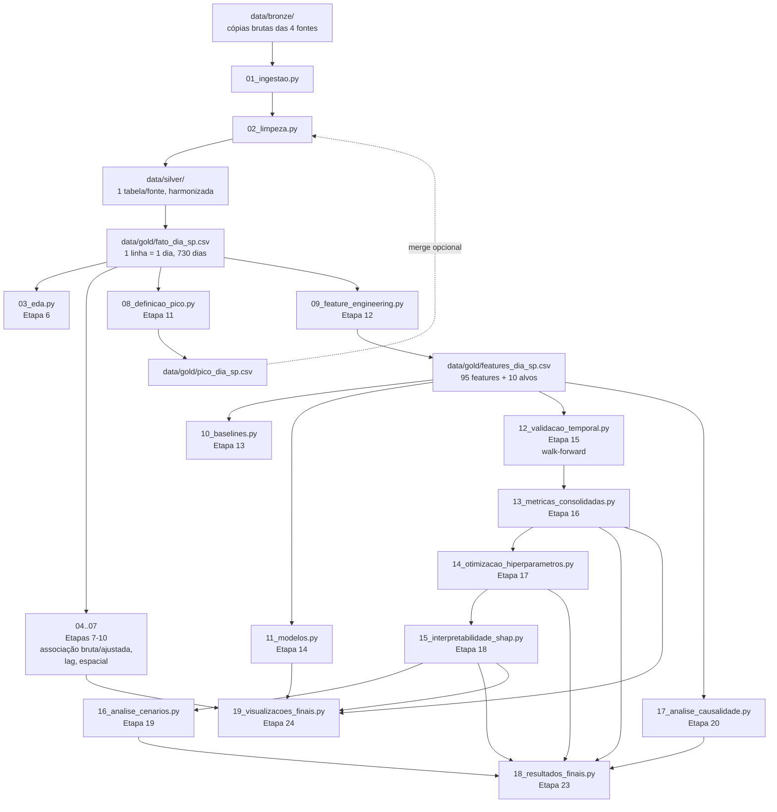

# Predição de picos de violência/acidentes em dias de jogo — São Paulo

Projeto de ciência de dados que investiga a associação entre jogos de futebol
dos clubes de São Paulo capital (Corinthians, Palmeiras, São Paulo) e picos de
crime/acidentes de trânsito na cidade, e compara XGBoost e Prophet na previsão
desses desfechos. Segue o roteiro de 27 seções em `docs/briefing_original.md`.

**Achado central**: a associação bruta entre dia de jogo e desfechos
(lesão corporal +14,9%, acidentes +6,3%, acidentes fatais +38,7%)
**desaparece após controlar dia da semana, mês e feriado**. Sete métodos
independentes — GLM Poisson ajustado, correlação parcial, modelo de
defasagens distribuídas, Difference-in-Differences espacial, auditoria de
colinearidade no SHAP, Propensity Score Matching e uma checagem de evento
extremo — convergem no mesmo resultado: **efeito de calendário, não de
futebol; associação, não causalidade.**

## Estrutura do pipeline



Cada script escreve seu relatório em `reports/etapaN/` (Markdown + figuras
PNG + tabelas CSV) e nunca sobrescreve o de outra etapa. `docs/Changelog.md`
registra, em ordem cronológica, o que foi feito e por quê em cada etapa —
leia-o (ou `CLAUDE.md`) antes de alterar qualquer decisão já tomada.

## Como rodar

```bash
cd scripts
python 01_ingestao.py                     # bronze (usa cache; ~6min do zero)
python 02_limpeza.py                      # silver + gold/fato_dia_sp.csv
python 03_eda.py                          # Etapa 6  → reports/eda/
python 04_analise_jogo_vs_naojogo.py      # Etapa 7  → reports/etapa7/
python 05_analise_estatistica.py          # Etapa 8  → reports/etapa8/
python 06_analise_defasagem.py            # Etapa 9  → reports/etapa9/
python 07_analise_espacial.py             # Etapa 10 → reports/etapa10/
python 08_definicao_pico.py               # Etapa 11 → reports/etapa11/ + gold/pico_dia_sp.csv
python 02_limpeza.py                      # de novo: mescla pico_dia_sp.csv no fato
python 09_feature_engineering.py          # Etapa 12 → reports/etapa12/ + gold/features_dia_sp.csv
python 10_baselines.py                    # Etapa 13 → reports/etapa13/
python 11_modelos.py                      # Etapa 14 → reports/etapa14/
python 12_validacao_temporal.py           # Etapa 15 → reports/etapa15/
python 13_metricas_consolidadas.py        # Etapa 16 → reports/etapa16/
python 14_otimizacao_hiperparametros.py   # Etapa 17 → reports/etapa17/
python 15_interpretabilidade_shap.py      # Etapa 18 → reports/etapa18/
python 16_analise_cenarios.py             # Etapa 19 → reports/etapa19/
python 17_analise_causalidade.py          # Etapa 20 → reports/etapa20/
python 18_resultados_finais.py            # Etapa 23 → reports/etapa23/
python 19_visualizacoes_finais.py         # Etapa 24 → reports/etapa24/
```

No Windows o interpretador é `python` (não `python3`). Dependências além do
padrão científico (`pandas numpy matplotlib scipy statsmodels scikit-learn`):
`openpyxl xgboost lightgbm prophet shap`.

```bash
pip install openpyxl xgboost lightgbm prophet shap
```

## Estrutura de diretórios

```
data/
  bronze/   cópias brutas das fontes (não versionado — >100MB, dado governamental bruto)
  silver/   1 tabela diária por fonte, harmonizada e filtrada para SP capital
  gold/     fato_dia_sp.csv, pico_dia_sp.csv, features_dia_sp.csv — datasets analíticos
docs/
  briefing_original.md   roteiro completo do projeto (27 seções)
  Changelog.md            registro cronológico: o que foi feito, decisões, por quê
scripts/    01 a 19, um por etapa, cada um roda de forma independente e idempotente
reports/    1 subpasta por etapa (etapaN/ ou nome descritivo), com:
  figures/    PNGs
  tabelas/    CSVs
  relatorio_*.md
uploads/    planilhas originais fornecidas pelo usuário (não versionado)
CLAUDE.md   contexto operacional para assistência de IA (decisões, convenções, pendências)
```

## Fontes de dados

| Fonte | Cobertura | Uso |
|---|---|---|
| SPDadosCriminais (SSP-SP) | 2022–2023, estado todo, filtrado por `CD_IBGE==3550308` | crime |
| BR-Football-Dataset | 2014–2023, Série A/B/C + Copa do Brasil | jogos (Paulistão/Libertadores **não** cobertos — limitação declarada) |
| INMET (estação A701 Mirante) | 2022–2023, horário → agregado diário | clima |
| Infosiga SP (Detran-SP) | 2022–2023, estado todo, filtrado | acidentes de trânsito |

## Status

Etapas 1–20 e 23 do roteiro concluídas (ver `CLAUDE.md` para o detalhe de
cada uma e as decisões metodológicas tomadas). Pendente: §24 completo
(galeria parcialmente montada), §25 (relatório acadêmico final em LaTeX,
template SBC).
