# EDA -- fato_dia_sp.csv (Etapa 6)

_Gerado por `scripts/03_eda.py` em 2026-09-03. Fonte: `data/gold/fato_dia_sp.csv` (730 linhas x 69 colunas)._

> Escopo desta etapa: qualidade, estatistica descritiva, distribuicoes e series temporais. Testes de hipotese formais (jogo vs nao-jogo, classico, noturno) sao a Etapa 7. Definicao de 'pico' e a Etapa 11. Nada e modelado aqui.

## 1. Qualidade dos dados

- Linhas: **730** | Colunas: **69**
- Intervalo: **2022-01-01 a 2023-12-31** (730 dias no calendario)
- Dias ausentes na grade diaria: **0** 
- Datas duplicadas: **0**
- Linhas totalmente duplicadas: **0**

### 1.1 Valores ausentes (colunas com pelo menos 1 NaN)

| coluna | n_missing | pct |
| --- | --- | --- |
| pico_acidente_p90 | 730 | 100.00 |
| pico_crime_zscore | 730 | 100.00 |
| pico_crime_p90 | 730 | 100.00 |
| nivel_risco | 730 | 100.00 |
| publico | 730 | 100.00 |
| taxa_ocupacao | 730 | 100.00 |
| nome_feriado | 704 | 96.44 |
| resultado_mandante | 604 | 82.74 |
| jogo_noturno | 604 | 82.74 |
| horario_jogo | 604 | 82.74 |
| campeonato | 604 | 82.74 |
| visitante | 604 | 82.74 |
| mandante | 604 | 82.74 |
| gols_visitante | 604 | 82.74 |
| gols_mandante | 604 | 82.74 |
| fonte_jogo | 604 | 82.74 |
| capacidade_estadio | 604 | 82.74 |
| precipitacao_total | 17 | 2.33 |
| temp_media | 1 | 0.14 |
| temp_max | 1 | 0.14 |
| vento_max | 1 | 0.14 |
| temp_min | 1 | 0.14 |
| umidade_media | 1 | 0.14 |

Leitura esperada (ver `CLAUDE.md`):
- Colunas de **futebol** (`mandante`, `visitante`, `publico`, `taxa_ocupacao`, ...):
  NaN em todo dia sem jogo -- isso e *ausencia de evento*, nao falha de dado.
  `publico`/`taxa_ocupacao` sao NaN em 100% das linhas (fonte de publico ainda nao integrada).
- Colunas de **crime/acidente**: NaN aqui indicaria falha de ingestao. Esperado 0.
- Colunas de **clima**: NaN concentrado nas lacunas conhecidas do INMET.
- `pico_*` e `nivel_risco`: placeholders vazios de proposito (definidos na Etapa 11).

### 1.2 Lacunas de clima conhecidas -- confirmacao

| janela | descricao | temp_media_NaN | precipitacao_NaN | n_dias |
| --- | --- | --- | --- | --- |
| 2023-11-27 a 2023-11-27 | INMET sem nenhuma leitura (falha de estacao) | 1 | 1 | 1 |
| 2023-08-25 a 2023-09-11 | sensor de precipitacao do INMET fora do ar (temp ok, chuva NaN) | 0 | 16 | 18 |
| 2023-12-30 a 2023-12-31 | censura no fim da serie: contagens de crime/acidente artificialmente baixas (defasagem de registro) | 0 | 0 | 2 |

### 1.3 Valores impossiveis e inconsistencias

| checagem | n_dias | exemplos |
| --- | --- | --- |
| alguma contagem de crime/acidente negativa | 0 |  |
| temp_min > temp_max | 0 |  |
| temp_media fora de [temp_min, temp_max] | 0 |  |
| umidade_media fora de [0, 100] | 0 |  |
| precipitacao_total negativa | 0 |  |
| vento_max negativo | 0 |  |
| taxa_ocupacao > 1 (publico > capacidade) | 0 |  |
| tem_jogo_sp=True mas numero_jogos_sp=0 | 0 |  |
| tem_jogo_sp=False mas mandante preenchido | 0 |  |
| classico=True mas tem_jogo_sp=False | 0 |  |

### 1.4 Outliers (metodo IQR e z-score) nas contagens principais

| coluna | min | max | lim_inf_IQR | lim_sup_IQR | n_out_IQR | n_out_z>3 |
| --- | --- | --- | --- | --- | --- | --- |
| crimes_totais | 161 | 3371 | 813.500 | 1,839.500 | 15 | 8 |
| crimes_violentos | 76 | 755 | 330.500 | 702.500 | 9 | 5 |
| roubos_total | 49 | 615 | 226.400 | 609.400 | 4 | 3 |
| furtos_total | 72 | 2633 | 413.900 | 1,112.900 | 22 | 8 |
| acidentes_total | 7 | 209 | 62.500 | 186.500 | 13 | 6 |
| acidentes_com_vitima | 7 | 125 | 41.000 | 121.000 | 12 | 3 |
| atropelamentos | 1 | 33 | 1.000 | 33.000 | 0 | 0 |
| colisoes | 2 | 87 | 20.100 | 79.100 | 8 | 4 |

_Nota: contagens diarias de crime tem forte sazonalidade semanal; um 'outlier' IQR marginal pode ser so o efeito de dia da semana, nao um ponto anomalo real. A remocao (se houver) e decidida na Etapa 12, nao aqui._

### 1.4b Dias nos extremos -- checagem de censura, lacuna e registro em lote

**crimes_totais** (6 menores):

| data | crimes_totais | nome_dia_semana | feriado | tem_jogo_sp |
| --- | --- | --- | --- | --- |
| 2023-12-31 | 161 | domingo | False | False |
| 2023-12-30 | 554 | sábado | False | False |
| 2023-12-25 | 696 | segunda | True | False |
| 2022-01-02 | 711 | domingo | False | False |
| 2022-12-25 | 802 | domingo | True | False |
| 2022-01-01 | 810 | sábado | True | False |

**acidentes_total** (6 menores):

| data | acidentes_total | nome_dia_semana | feriado | tem_jogo_sp | frac_com_vitima |
| --- | --- | --- | --- | --- | --- |
| 2022-01-17 | 7 | segunda | False | False | 1.00 |
| 2023-08-07 | 24 | segunda | False | False | 0.96 |
| 2023-01-02 | 52 | segunda | False | False | 0.63 |
| 2022-01-04 | 59 | terça | False | False | 0.56 |
| 2023-12-31 | 61 | domingo | False | False | 0.54 |
| 2022-01-02 | 62 | domingo | False | False | 0.74 |

**crimes_totais** (6 maiores):

| data | crimes_totais | furtos_total | roubos_total | crimes_violentos | nome_dia_semana | feriado | tem_jogo_sp |
| --- | --- | --- | --- | --- | --- | --- | --- |
| 2022-06-19 | 3371 | 2633 | 607 | 715 | domingo | False | True |
| 2023-06-11 | 2407 | 1658 | 539 | 704 | domingo | False | True |
| 2022-10-30 | 2092 | 1312 | 541 | 722 | domingo | False | False |
| 2023-02-18 | 2049 | 1355 | 534 | 653 | sábado | False | False |
| 2023-02-11 | 2035 | 1331 | 508 | 637 | sábado | False | False |
| 2023-09-24 | 1886 | 1282 | 365 | 553 | domingo | False | True |

Leitura:
- **crimes_totais (maiores)**: `2022-06-19` (3371) e um ponto muito acima dos demais,
  puxado por `furtos_total`=2633 (mediana ~780). Pico isolado desse tamanho num unico
  domingo sugere registro em lote / efeito de mutirao de BOs, nao um dia real 3x mais
  violento. Nao remover agora -- sinalizar e reavaliar na Etapa 12 (a definicao de
  'pico' da Etapa 11 nao pode ser dominada por 1 artefato). Os demais dias no topo
  sao fins de semana (com e sem jogo), coerente com a sazonalidade semanal.
- **crimes_totais (menores)**: `2023-12-31` (161) e `2023-12-30` (554) sao os dois
  menores e nao sao feriado -> confirmam a censura por defasagem de registro no fim
  da serie ja anotada no `CLAUDE.md`. `2023-12-25` e `2022-12-25` sao Natal (queda real).
- **acidentes_total (menores)**: `2022-01-17` (7) e `2023-08-07` (24) sao segundas
  comuns, sem feriado, cercadas de dias ~110-150. Em ambos `frac_com_vitima` ~= 1.0
  (tipico ~0.65): o fluxo so-dano-material (`tipo_registro = NOTIFICACAO`) nao entrou
  nesses dias. E lacuna de registro da fonte Infosiga, nao reducao real -- adicionada
  agora ao `CLAUDE.md`. Tratar `acidentes_total`/`colisoes` desses 2 dias como
  missing (nao zero) na Etapa 12.
- `2023-12-31` tambem aparece no fundo de acidentes (61); `2023-12-30` nao, entao a
  censura de fim de serie pesa mais no crime do que no acidente.

### 1.5 Distribuicao temporal (contagem de dias e volume por mes)

| ano_mes | n_dias | crimes_totais | acidentes_total | dias_com_jogo |
| --- | --- | --- | --- | --- |
| 2022-01 | 31 | 35804 | 2906 | 0 |
| 2022-02 | 28 | 34719 | 3410 | 0 |
| 2022-03 | 31 | 42878 | 3899 | 1 |
| 2022-04 | 30 | 39969 | 3645 | 3 |
| 2022-05 | 31 | 40933 | 3968 | 9 |
| 2022-06 | 30 | 39885 | 3781 | 11 |
| 2022-07 | 31 | 38943 | 3688 | 10 |
| 2022-08 | 31 | 40572 | 3950 | 8 |
| 2022-09 | 30 | 39640 | 3751 | 6 |
| 2022-10 | 31 | 44144 | 3766 | 8 |
| 2022-11 | 30 | 41617 | 3687 | 6 |
| 2022-12 | 31 | 43086 | 3866 | 0 |
| 2023-01 | 31 | 38817 | 3093 | 0 |
| 2023-02 | 28 | 41827 | 3125 | 0 |
| 2023-03 | 31 | 43972 | 3826 | 0 |
| 2023-04 | 30 | 39041 | 3663 | 7 |
| 2023-05 | 31 | 41419 | 4079 | 7 |
| 2023-06 | 30 | 41675 | 4215 | 6 |
| 2023-07 | 31 | 40166 | 4199 | 11 |
| 2023-08 | 31 | 41755 | 3980 | 6 |
| 2023-09 | 30 | 42362 | 3922 | 8 |
| 2023-10 | 31 | 41371 | 4152 | 7 |
| 2023-11 | 30 | 41760 | 4124 | 9 |
| 2023-12 | 31 | 38382 | 4134 | 3 |

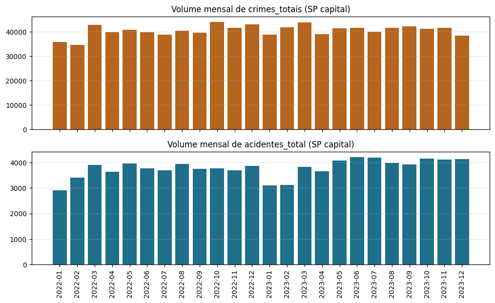

## 2. Estatistica descritiva

| index | n | media | mediana | desvio_padrao | min | q25 | q50 | q75 | max | coef_variacao | assimetria | curtose |
| --- | --- | --- | --- | --- | --- | --- | --- | --- | --- | --- | --- | --- |
| crimes_totais | 730.000 | 1,335.256 | 1,349.000 | 212.016 | 161.000 | 1,198.250 | 1,349.000 | 1,454.750 | 3,371.000 | 0.159 | 1.130 | 13.515 |
| bos_unicos | 730.000 | 1,331.111 | 1,346.500 | 211.723 | 160.000 | 1,197.250 | 1,346.500 | 1,449.750 | 3,368.000 | 0.159 | 1.138 | 13.628 |
| crimes_violentos | 730.000 | 516.989 | 514.000 | 68.263 | 76.000 | 470.000 | 514.000 | 563.000 | 755.000 | 0.132 | -0.170 | 2.289 |
| homicidios_dolosos | 730.000 | 1.414 | 1.000 | 1.252 | 0.000 | 0.000 | 1.000 | 2.000 | 7.000 | 0.886 | 0.945 | 0.940 |
| tentativas_homicidio | 730.000 | 0.845 | 0.000 | 1.278 | 0.000 | 0.000 | 0.000 | 1.000 | 6.000 | 1.513 | 1.548 | 1.758 |
| lesao_corporal_dolosa | 730.000 | 89.614 | 85.000 | 23.656 | 25.000 | 72.000 | 85.000 | 103.750 | 189.000 | 0.264 | 0.893 | 0.858 |
| roubos_total | 730.000 | 417.848 | 420.000 | 66.133 | 49.000 | 370.000 | 420.000 | 465.750 | 615.000 | 0.158 | -0.248 | 1.098 |
| roubo_veiculo | 730.000 | 42.879 | 43.000 | 11.380 | 10.000 | 35.000 | 43.000 | 49.000 | 97.000 | 0.265 | 0.544 | 1.495 |
| furtos_total | 730.000 | 769.738 | 780.500 | 159.268 | 72.000 | 676.000 | 780.500 | 850.750 | 2,633.000 | 0.207 | 2.346 | 27.114 |
| furto_veiculo | 730.000 | 111.671 | 113.000 | 38.367 | 17.000 | 79.000 | 113.000 | 144.750 | 202.000 | 0.344 | -0.053 | -1.045 |
| estupros | 730.000 | 6.714 | 6.000 | 2.989 | 0.000 | 5.000 | 6.000 | 8.000 | 21.000 | 0.445 | 0.685 | 0.762 |
| acidentes_total | 730.000 | 124.423 | 124.000 | 24.010 | 7.000 | 109.000 | 124.000 | 140.000 | 209.000 | 0.193 | -0.159 | 1.150 |
| acidentes_com_vitima | 730.000 | 80.625 | 81.000 | 15.994 | 7.000 | 71.000 | 81.000 | 91.000 | 125.000 | 0.198 | -0.314 | 0.667 |
| acidentes_fatais | 730.000 | 2.386 | 2.000 | 1.751 | 0.000 | 1.000 | 2.000 | 3.000 | 12.000 | 0.734 | 1.018 | 1.741 |
| obitos_transito | 730.000 | 2.462 | 2.000 | 1.819 | 0.000 | 1.000 | 2.000 | 3.000 | 12.000 | 0.739 | 0.995 | 1.496 |
| feridos_transito | 730.000 | 81.432 | 82.000 | 16.533 | 5.000 | 72.000 | 82.000 | 93.000 | 129.000 | 0.203 | -0.461 | 0.970 |
| atropelamentos | 730.000 | 16.647 | 16.000 | 5.574 | 1.000 | 13.000 | 16.000 | 21.000 | 33.000 | 0.335 | 0.147 | -0.245 |
| colisoes | 730.000 | 49.605 | 49.000 | 10.973 | 2.000 | 42.250 | 49.000 | 57.000 | 87.000 | 0.221 | -0.119 | 0.549 |
| temp_media | 729.000 | 20.569 | 20.850 | 3.383 | 9.533 | 18.233 | 20.850 | 23.046 | 30.429 | 0.164 | -0.225 | -0.151 |
| temp_max | 729.000 | 25.879 | 26.400 | 4.400 | 11.900 | 23.100 | 26.400 | 28.900 | 37.200 | 0.170 | -0.407 | -0.146 |
| temp_min | 729.000 | 16.898 | 17.200 | 3.074 | 7.200 | 14.700 | 17.200 | 19.400 | 25.700 | 0.182 | -0.377 | -0.363 |
| precipitacao_total | 713.000 | 4.508 | 0.000 | 10.091 | 0.000 | 0.000 | 0.000 | 3.200 | 80.400 | 2.238 | 3.266 | 12.607 |
| umidade_media | 729.000 | 69.103 | 70.083 | 10.453 | 28.857 | 63.792 | 70.083 | 76.458 | 93.333 | 0.151 | -0.544 | 0.290 |
| vento_max | 729.000 | 9.289 | 8.900 | 2.653 | 3.500 | 7.600 | 8.900 | 10.500 | 25.000 | 0.286 | 1.417 | 4.062 |

- **Coeficiente de variacao (CV = desvio/media)**: quanto maior, mais volatil a
  contagem. Contagens raras (homicidios, latrocinio, acidentes fatais) tem CV alto
  e distribuicao muito assimetrica -- favorece modelagem de contagem
  (Poisson/Neg. Binomial) e nao regressao gaussiana ingenua.
- **Assimetria > 0** em quase todas as contagens: cauda a direita, esperado para
  dados de ocorrencias. Sera relevante na escolha de teste (Etapa 7) e transformacao.

### 2.1 Leitura preliminar: dia com jogo vs dia sem jogo (apenas descritivo)

| level_0 | level_1 | False | True |
| --- | --- | --- | --- |
| crimes_totais | mean | 1,334.07 | 1,340.94 |
| crimes_totais | median | 1,351.00 | 1,342.00 |
| crimes_totais | std | 195.07 | 280.25 |
| crimes_totais | count | 604.00 | 126.00 |
| crimes_violentos | mean | 516.84 | 517.69 |
| crimes_violentos | median | 514.50 | 510.50 |
| crimes_violentos | std | 69.66 | 61.40 |
| crimes_violentos | count | 604.00 | 126.00 |
| acidentes_total | mean | 122.98 | 131.36 |
| acidentes_total | median | 123.00 | 132.50 |
| acidentes_total | std | 24.61 | 19.53 |
| acidentes_total | count | 604.00 | 126.00 |
| acidentes_com_vitima | mean | 79.93 | 83.95 |
| acidentes_com_vitima | median | 81.00 | 84.00 |
| acidentes_com_vitima | std | 16.72 | 11.38 |
| acidentes_com_vitima | count | 604.00 | 126.00 |

_A comparacao formal (intervalo de confianca, Mann-Whitney/t-test, effect size, controle de dia da semana e feriado) e a Etapa 7. Aqui e so panorama._

## 3. Distribuicoes

### 3.1 Crimes e acidentes

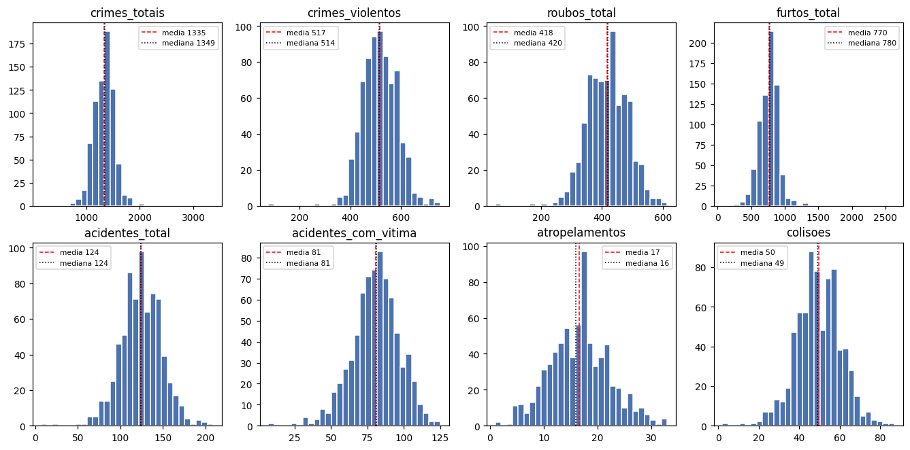

| coluna | assimetria | curtose | normaltest_p | normal_5pct |
| --- | --- | --- | --- | --- |
| crimes_totais | 1.130 | 13.515 | 0.000 | rejeita |
| crimes_violentos | -0.170 | 2.289 | 0.000 | rejeita |
| roubos_total | -0.248 | 1.098 | 0.000 | rejeita |
| furtos_total | 2.346 | 27.114 | 0.000 | rejeita |
| acidentes_total | -0.159 | 1.150 | 0.000 | rejeita |
| acidentes_com_vitima | -0.314 | 0.667 | 0.000 | rejeita |
| atropelamentos | 0.147 | -0.245 | 0.096 | nao rejeita |
| colisoes | -0.119 | 0.549 | 0.015 | rejeita |

_Praticamente todas rejeitam normalidade -> testes nao-parametricos (Mann-Whitney, Kruskal-Wallis) sao a escolha default na Etapa 7._

### 3.2 Numero de jogos por dia

| numero_jogos_sp | n_dias | pct |
| --- | --- | --- |
| 0.00 | 604.00 | 82.74 |
| 1.00 | 115.00 | 15.75 |
| 2.00 | 11.00 | 1.51 |

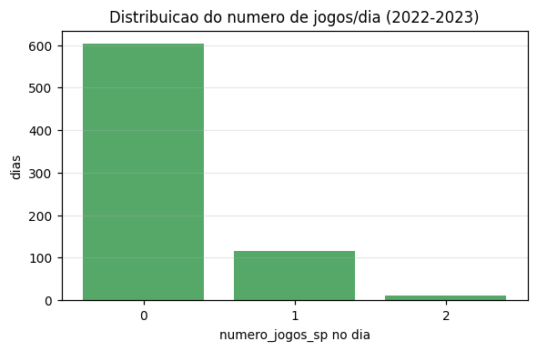

### 3.3 Publico

`publico` esta **100% ausente** -- fonte de publico pagante ainda nao integrada (hook `clean_football(kaggle_publico_path=...)`). Toda analise por publico (Etapa 7 'alto vs baixo publico' e feature `taxa_ocupacao`) fica **bloqueada** ate essa fonte entrar. Limitacao declarada, nao contornada.

## 4. Series temporais

### 4.1 Crimes ao longo do tempo

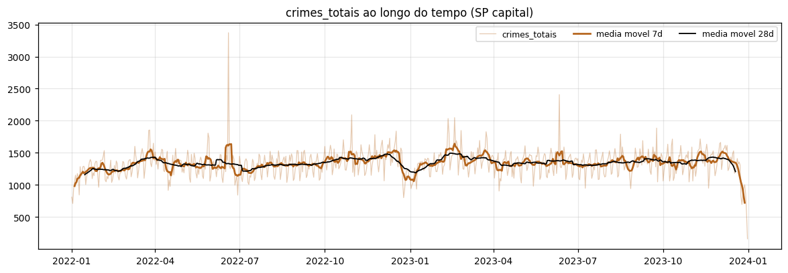

_Queda abrupta nos 2 ultimos dias = censura de registro (2023-12-30/31), nao reducao real. Candidata a exclusao no split (Etapa 15)._

### 4.2 Acidentes ao longo do tempo

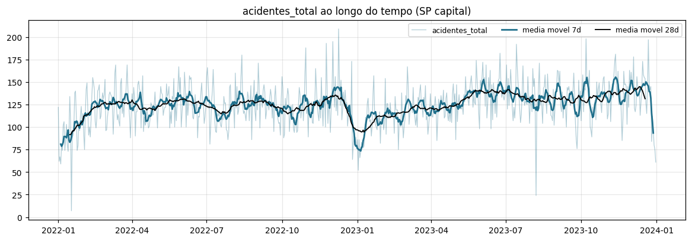

### 4.3 Jogos ao longo do tempo

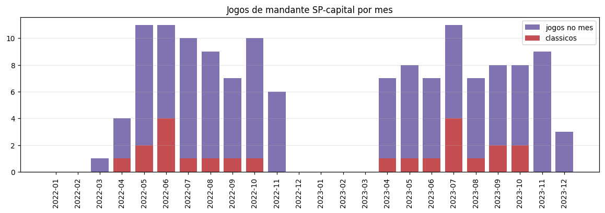

| ano_mes | dias_com_jogo | jogos | classicos |
| --- | --- | --- | --- |
| 2022-01 | 0 | 0 | 0 |
| 2022-02 | 0 | 0 | 0 |
| 2022-03 | 1 | 1 | 0 |
| 2022-04 | 3 | 4 | 1 |
| 2022-05 | 9 | 11 | 2 |
| 2022-06 | 11 | 11 | 4 |
| 2022-07 | 10 | 10 | 1 |
| 2022-08 | 8 | 9 | 1 |
| 2022-09 | 6 | 7 | 1 |
| 2022-10 | 8 | 10 | 1 |
| 2022-11 | 6 | 6 | 0 |
| 2022-12 | 0 | 0 | 0 |
| 2023-01 | 0 | 0 | 0 |
| 2023-02 | 0 | 0 | 0 |
| 2023-03 | 0 | 0 | 0 |
| 2023-04 | 7 | 7 | 1 |
| 2023-05 | 7 | 8 | 1 |
| 2023-06 | 6 | 7 | 1 |
| 2023-07 | 11 | 11 | 4 |
| 2023-08 | 6 | 7 | 1 |
| 2023-09 | 8 | 8 | 2 |
| 2023-10 | 7 | 8 | 2 |
| 2023-11 | 9 | 9 | 0 |
| 2023-12 | 3 | 3 | 0 |

### 4.4 Crimes vs jogos e acidentes vs jogos

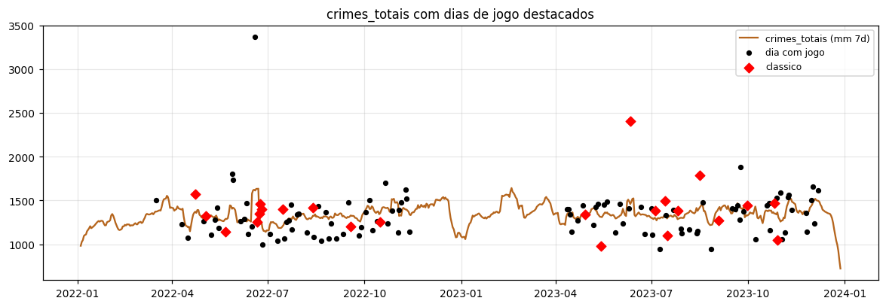

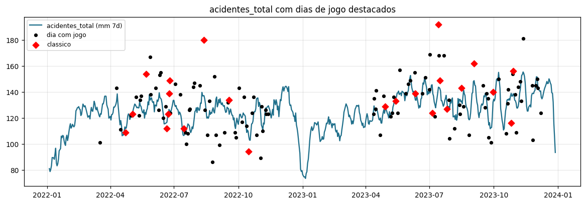

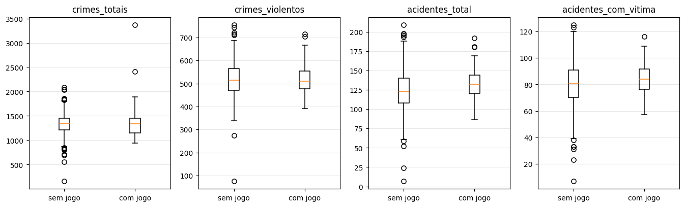

_Somente visual. Diferenca de medianas aqui **nao** e evidencia -- Etapa 7 faz o teste com controle de dia da semana (jogos concentram em fim de semana, que ja tem padrao proprio)._

### 4.5 Sazonalidade: dia da semana x mes

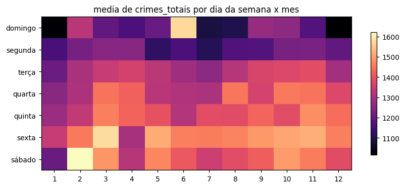

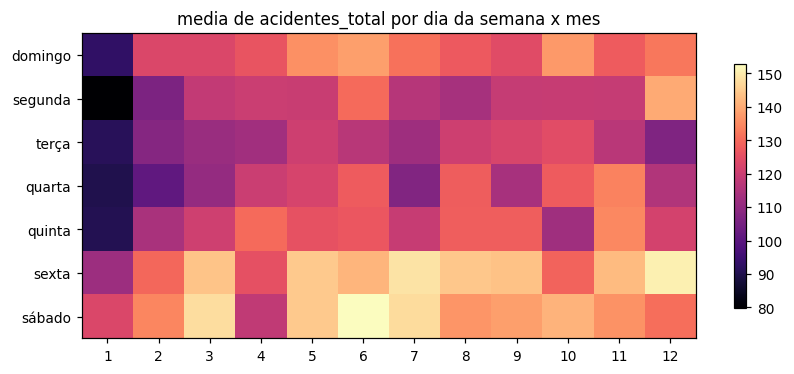

Media por dia da semana:

| nome_dia_semana | crimes_totais | crimes_violentos | acidentes_total | acidentes_com_vitima |
| --- | --- | --- | --- | --- |
| domingo | 1,194.07 | 500.10 | 126.42 | 73.68 |
| segunda | 1,188.33 | 462.68 | 116.21 | 77.73 |
| terça | 1,320.54 | 489.93 | 113.88 | 78.08 |
| quarta | 1,374.84 | 513.85 | 117.06 | 79.07 |
| quinta | 1,394.05 | 527.84 | 121.50 | 81.24 |
| sexta | 1,463.14 | 571.06 | 138.45 | 90.47 |
| sábado | 1,412.45 | 553.29 | 137.30 | 84.14 |

### 4.6 Autocorrelacao (ACF) -- estrutura temporal

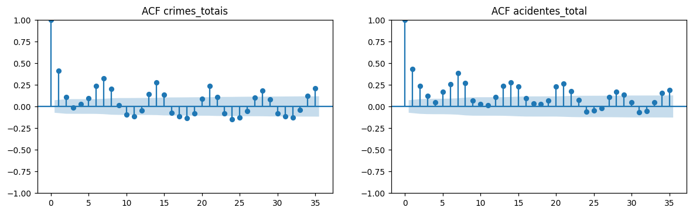

_Pico em lag 7 e multiplos = sazonalidade semanal forte. Justifica lags 7/14/28 e `rolling_mean_7` na Etapa 12, e validacao temporal (nunca split aleatorio) na Etapa 15._

### 4.7 Correlacao exploratoria (alvos x clima x calendario)

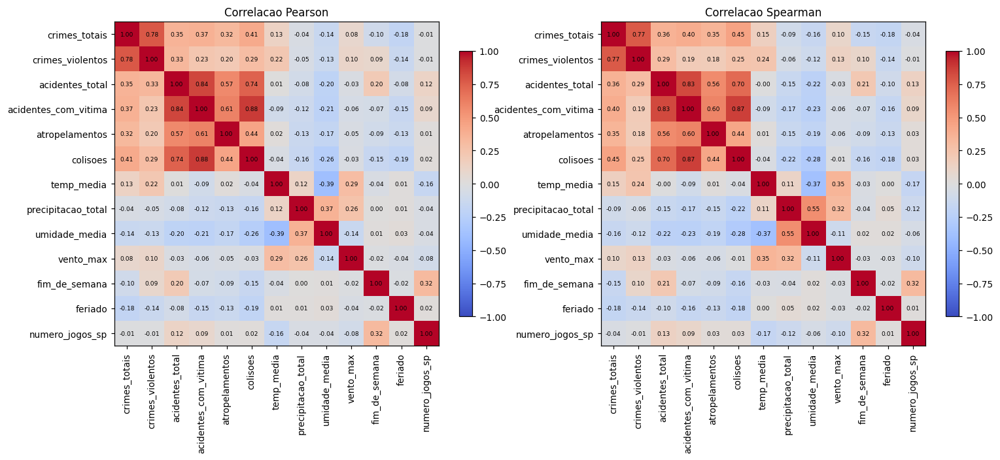

_Exploratorio. Correlacao != causalidade (Regra 5 do briefing). O teste com confundidores controlados e Etapas 7-8 e 20._

## 5. Sintese para as proximas etapas

1. **Contagens assimetricas, nao-normais, com sazonalidade semanal forte** ->
   testes nao-parametricos (Etapa 7), modelos de contagem (Etapa 14), lags 7/14/28
   e validacao temporal walk-forward (Etapa 15).
2. **`publico`/`taxa_ocupacao` 100% ausentes** -> analises por publico bloqueadas
   ate integrar a fonte Kaggle. Declarar como limitacao.
3. **Censura no fim da serie (2023-12-30/31)** -> excluir do treino/teste ou marcar.
3b. **Lacuna nova descoberta nesta EDA**: 2022-01-17 e 2023-08-07 tem quase so
   acidentes com vitima (some o fluxo `NOTIFICACAO` da Infosiga). Marcar
   `acidentes_total`/`colisoes` desses 2 dias como missing, nao zero. Adicionar ao
   `CLAUDE.md`.
4. **Lacunas de clima do INMET** (27/11/2023; precip 25/08-11/09/2023) -> imputar
   com cautela ou usar flag de missing; nao inventar valores.
5. **Janela curta (730 dias)** -> pouca folga para o split temporal; considerar
   TimeSeriesSplit com poucos folds e reportar incerteza larga.
6. **Jogos concentrados em fim de semana** -> qualquer comparacao jogo vs nao-jogo
   precisa controlar dia da semana e feriado (confundidores).
