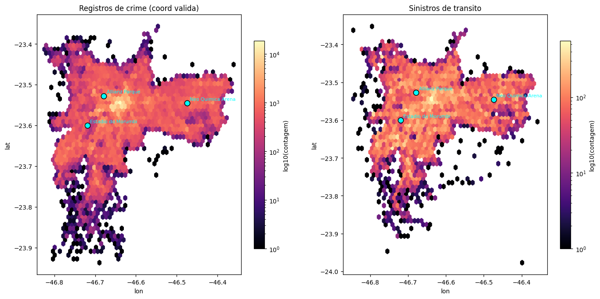
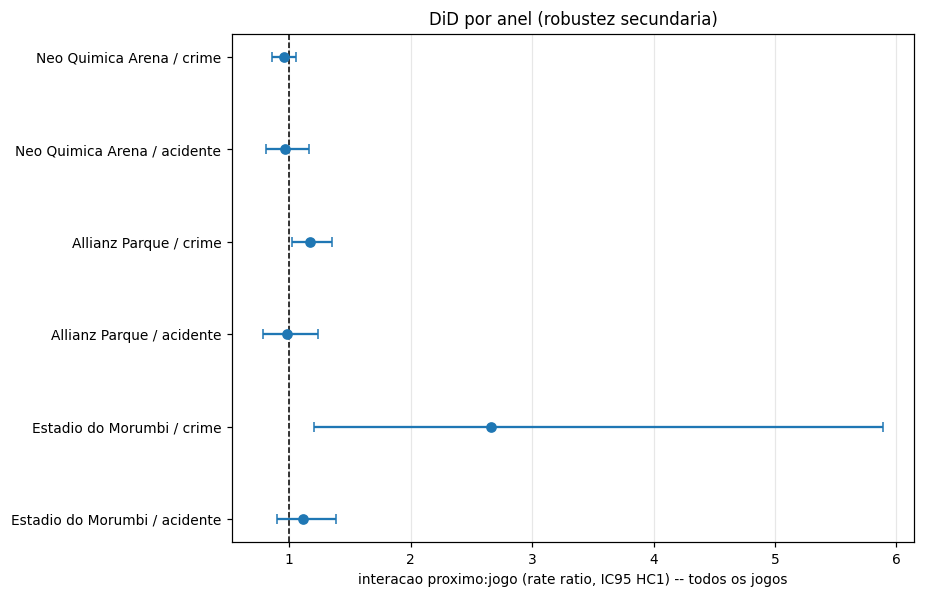
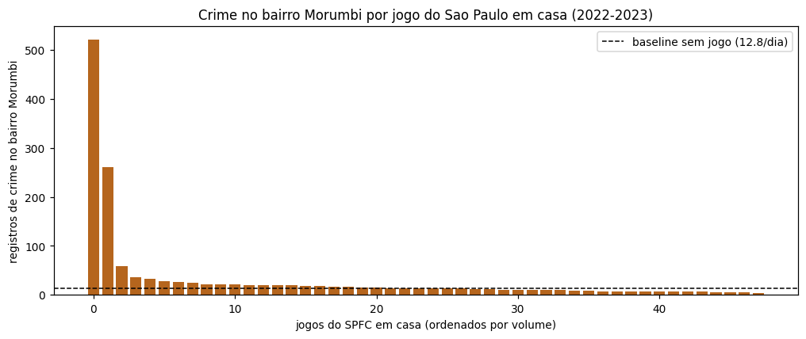

# Etapa 10 -- Analise espacial

_Gerado por `scripts/07_analise_espacial.py` em 2026-09-03. Fontes: bronze de crime (SPDadosCriminais, campo BAIRRO) e de acidente (Infosiga, lat/long)._

> **Regra 5:** associacao localizada, nao causalidade. **Decisao de desenho:** crime por BAIRRO (coordenada ~20% invalida); acidente por anel (coordenada confiavel); DiD por anel fino = robustez secundaria; sinal concentrado grande passa por verificacao antes de virar achado (Etapas 7-9 ja acharam nulo).

## 1. Concentracao espacial (descritivo)

- **Crime**: 974,737 registros SP-capital 2022-2023. Coordenada valida em 781,188 (80.1%); campo BAIRRO preenchido em 970,877 (99.6%). -> **BAIRRO e a unidade primaria do crime**; lat/long so para rotular bairros e checar artefato.
- **Acidente**: 90,829 sinistros; coordenada valida em 90,360 (99.5%). Infosiga nao tem campo de bairro -> acidente usa anel de distancia (coordenada confiavel).

### 1.1 Bairros com mais registros de crime

| bairro | registros |
| --- | --- |
| REPUBLICA | 29984 |
| BELA VISTA | 20250 |
| PINHEIROS | 20023 |
| BRAS | 20008 |
| CONSOLACAO | 19819 |
| SE | 18829 |
| SANTO AMARO | 16298 |
| VILA MARIANA | 15861 |
| SANTANA | 15634 |
| CAPAO REDONDO | 14798 |
| TATUAPE | 14642 |
| ITAIM BIBI | 14536 |
| BARRA FUNDA | 14159 |
| JARDIM PAULISTA | 13212 |
| GRAJAU | 12967 |

### 1.2 % de ocorrencias (com coord) a ate X km de ALGUM dos 3 estadios

| ate_km | pct_crime | pct_acidente |
| --- | --- | --- |
| 1.0 | 1.6 | 0.9 |
| 2.0 | 5.1 | 3.6 |
| 3.0 | 10.2 | 9.6 |
| 5.0 | 34.1 | 27.4 |
| 10.0 | 82.0 | 77.3 |

_Se fossem uniformes, ~5-6% ate 3 km (3 discos de ~28 km^2 num municipio de ~1520 km^2). Sem concentracao especial no entorno dos estadios._

## 2. Analise principal -- bairro do estadio vs resto da cidade (DiD)

Para cada estadio: bairros que concentram >=10% dos pontos de crime (coord valida) a ate 1,5 km do estadio (coord usada so para ROTULAR). GLM Poisson empilhado (grupo estadio-bairros vs resto), offset que normaliza o baseline de cada grupo, controles `C(dia_semana)+C(mes)+feriado`, HC1. A interacao `estadio_bairro:jogo` = excesso relativo no bairro do estadio no dia de jogo do mandante, alem do padrao da cidade.

**H0:** interacao = 0. **H1:** != 0. BH sobre os 3 estadios. Roda 2x: com todos os jogos e **sem as 2 datas de alavancagem** (2023-09-24 e 2023-08-16, finais/semi da Copa do Brasil no Morumbi -- ver secao 4).

- **Neo Quimica Arena (Corinthians)** -> bairros: `ITAQUERA, ARTUR ALVIM, CIDADE LIDER`  (pontos a <=1,5 km por bairro: {'ITAQUERA': 2378, 'ARTUR ALVIM': 2331, 'CIDADE LIDER': 879, 'PARQUE ARTUR ALVIM': 344, 'VILA CARMOSINA': 316, 'CIDADE ANTONIO ESTEVAO DE CARVALHO': 269})
- **Allianz Parque (Palmeiras)** -> bairros: `BARRA FUNDA, PERDIZES`  (pontos a <=1,5 km por bairro: {'BARRA FUNDA': 5754, 'PERDIZES': 4428, 'AGUA BRANCA': 1071, 'LAPA': 778, 'POMPEIA': 606, 'VARZEA DA BARRA FUNDA': 481})
- **Estadio do Morumbi (Sao Paulo)** -> bairros: `MORUMBI, VILA SONIA`  (pontos a <=1,5 km por bairro: {'MORUMBI': 2490, 'VILA SONIA': 1666, 'JARDIM LEONOR': 350, 'VILA PROGREDIOR': 178, 'VILA ANDRADE': 80, 'FAZENDA MORUMBI': 34})

| estadio | amostra | n_dias_jogo | media_bairro_estadio_sem | media_bairro_estadio_jogo | media_resto_sem | media_resto_jogo | interacao_RR | IC95_lo | IC95_hi | p_value | p_BH | signif_BH_5pct |
| --- | --- | --- | --- | --- | --- | --- | --- | --- | --- | --- | --- | --- |
| Neo Quimica Arena | todos os jogos | 47 | 33.349 | 30.532 | 1,304.667 | 1,306.340 | 0.914 | 0.828 | 1.010 | 0.078 | 0.117 | False |
| Neo Quimica Arena | sem 2 datas de alavancagem | 47 | 33.343 | 30.532 | 1,303.197 | 1,306.340 | 0.913 | 0.827 | 1.009 | 0.075 | 0.205 | False |
| Allianz Parque | todos os jogos | 42 | 30.461 | 29.690 | 1,310.468 | 1,259.476 | 1.014 | 0.893 | 1.152 | 0.828 | 0.828 | False |
| Allianz Parque | sem 2 datas de alavancagem | 42 | 30.462 | 29.690 | 1,309.010 | 1,259.476 | 1.013 | 0.892 | 1.150 | 0.842 | 0.842 | False |
| Estadio do Morumbi | todos os jogos | 48 | 12.785 | 30.625 | 1,323.797 | 1,326.583 | 2.390 | 1.131 | 5.054 | 0.023 | 0.068 | False |
| Estadio do Morumbi | sem 2 datas de alavancagem | 46 | 12.785 | 14.957 | 1,323.797 | 1,321.304 | 1.172 | 0.951 | 1.444 | 0.136 | 0.205 | False |

## 3. Robustez secundaria -- DiD por anel de distancia (nao e o resultado principal)

Anel proximo <=2,5 km vs anel distante 7,5-15 km do estadio; GLM Poisson com offset de area, HC1. **Leitura com cautela**: ~20% das coordenadas de crime sao invalidas e ha empilhamento de geocodificacao no ponto do estadio (secao 4) -- por isso e robustez, nao inferencia principal. Acidente tem coordenada confiavel. Roda com e sem as 2 datas de alavancagem.

| estadio | desfecho | amostra | interacao_RR | IC95_lo | IC95_hi | p_value |
| --- | --- | --- | --- | --- | --- | --- |
| Neo Quimica Arena | crime | todos | 0.954 | 0.862 | 1.057 | 0.369 |
| Neo Quimica Arena | acidente | todos | 0.967 | 0.806 | 1.161 | 0.722 |
| Neo Quimica Arena | crime | sem 2 datas | 0.955 | 0.862 | 1.057 | 0.374 |
| Neo Quimica Arena | acidente | sem 2 datas | 0.967 | 0.805 | 1.161 | 0.718 |
| Allianz Parque | crime | todos | 1.175 | 1.024 | 1.349 | 0.022 |
| Allianz Parque | acidente | todos | 0.986 | 0.785 | 1.239 | 0.906 |
| Allianz Parque | crime | sem 2 datas | 1.170 | 1.019 | 1.343 | 0.026 |
| Allianz Parque | acidente | sem 2 datas | 0.989 | 0.787 | 1.242 | 0.921 |
| Estadio do Morumbi | crime | todos | 2.661 | 1.202 | 5.890 | 0.016 |
| Estadio do Morumbi | acidente | todos | 1.117 | 0.902 | 1.382 | 0.311 |
| Estadio do Morumbi | crime | sem 2 datas | 1.238 | 0.976 | 1.569 | 0.078 |
| Estadio do Morumbi | acidente | sem 2 datas | 1.136 | 0.914 | 1.411 | 0.250 |

Diagnostico de empilhamento (anel <=2,5 km, dias de jogo) para estadios com RR de crime no anel > 1,1:

| estadio | anel_crime_RR | regs_anel_dia_jogo | top_coord | n_no_top_coord | share_top1_coord |
| --- | --- | --- | --- | --- | --- |
| Allianz Parque | 1.175 | 1875 | -23.529,-46.67 | 35 | 0.019 |
| Estadio do Morumbi | 2.661 | 1732 | -23.598,-46.72 | 441 | 0.255 |

_Morumbi: forte empilhamento numa unica coordenada (o proprio estadio). Allianz: RR ~1,17 mas SEM coordenada dominante e SEM aparecer no nivel de bairro (secao 2) -- provavelmente a mistura de bairros que o disco de 2,5 km pega e nao um efeito do estadio. Fica como ruido do metodo por anel._

## 4. Verificacao do sinal aparente no Morumbi

A secao 2/3 mostra uma interacao grande so no Morumbi. As Etapas 7-9 acharam nulo em nivel de cidade, entao esse sinal concentrado passa por 3 checagens antes de virar (ou nao) achado.

### 4.1 Checagem (a): substitui lat/long por bairro -- o RR se sustenta?

Bairros Morumbi = `MORUMBI, VILA SONIA`. Crime/dia: **30.6** em jogo do SPFC vs **12.8** sem jogo (ratio 2.40). **Mas a mediana por jogo e 14** (min 4), praticamente igual ao baseline. O 'efeito' vem de 2 datas:

| data | crime_bairros_morumbi | jogo_SPFC |
| --- | --- | --- |
| 2023-09-24 | 522 | Sao Paulo 1x1 Flamengo [Copa do Brasil] |
| 2023-08-16 | 260 | Sao Paulo 2x0 Corinthians [Copa do Brasil] |
| 2023-07-05 | 59 | Sao Paulo 1x0 Palmeiras [Copa do Brasil] |
| 2023-07-16 | 36 | Sao Paulo 4x1 Santos [Serie A] |
| 2023-07-30 | 32 | Sao Paulo 0x0 EC Bahia [Serie A] |
| 2023-06-01 | 28 | Sao Paulo 1x3 Sport Recife [Copa do Brasil] |

2023-09-24 e a **final da Copa do Brasil 2023** (volta) e 2023-08-16 a **semifinal** (Majestoso), ambas ~68 mil pagantes. Nos outros 46 jogos em casa o crime no Morumbi e indistinguivel do baseline. -> a checagem (a) **nao sustenta** um efeito de 'dia de jogo' generico; mostra 2 eventos excepcionais.

### 4.2 Checagem (b): artefato de geocodificacao

- **60% do excesso** em dia de jogo esta empilhado em 2 coordenadas exatas do estadio (`-23.598,-46.72, -23.601,-46.72`).
- Delegacia de registro predominante: DELEGACIA ELETRONICA 71%, DELEGACIA ELETRONICA 1 13% (Delegacia Eletronica = BO online, geocodificado ao endereco declarado).
- Natureza do excesso: FURTO - OUTROS 75%, ROUBO - OUTROS 16%, FURTO DE VEICULO 3% -- quase tudo `FURTO - OUTROS` (furto de transeunte/celular tipico de aglomeracao); efeito ~zero em crime violento e roubo.

### 4.3 Decisao

As duas checagens **nao sustentam** o RR ~2,4-3 como efeito de dia de jogo: ele e (i) restrito a final (2023-09-24) e semifinal (2023-08-16) da Copa do Brasil; sem essas 2 datas o RR do bairro cai para 1.17 (IC inclui 1) e o do anel para ~1,24 (p=0,08); (ii) ~60% do excesso e empilhamento de geocodificacao em 2 coordenadas do estadio; (iii) ~75-100% `FURTO - OUTROS`, efeito nulo em crime violento/roubo. Coerente com as Etapas 7-9 (nulo em nivel de cidade; so eventos verdadeiramente excepcionais registram, e mesmo assim como furto geocodificado ao local). -> **entra como observacao descritiva + limitacao (Regra 10), nao como achado espacial.**

## 5. Sintese da Etapa 10

- **Concentracao (secao 1):** crime e acidente concentram na regiao central
  e nos corredores viarios, **nao** nos estadios. A fracao de ocorrencias a
  <=3 km de algum estadio esta na ordem do esperado pela area.
- **Bairro do estadio vs resto (secao 2, analise principal):** com todos os
  jogos, apenas o **Morumbi** mostra interacao grande (RR ~2,4); sem as 2
  datas de copa cai para 1,17 (IC inclui 1). Allianz RR 1,01 e Neo Quimica
  RR 0,91 (marginalmente ABAIXO de 1, ns). **Nenhum estadio tem efeito
  localizado robusto de "dia de jogo" no nivel de bairro.**
- **Anel de distancia (secao 3, robustez SECUNDARIA):** Morumbi RR ~2,7 com
  todas as datas -> ~1,24 (p=0,08) sem as 2. **Allianz/crime da RR ~1,17
  (p~0,02) e isso PERSISTE sem as 2 datas** -- mas nao aparece no nivel de
  bairro (RR 1,01), so no anel de 2,5 km. Dado o problema conhecido de
  coordenada e o empilhamento de geocodificacao, trata-se disso como ruido
  do metodo por anel, nao como achado -- a unidade primaria (bairro) manda.
  Acidente: nada em nenhum estadio (coordenada confiavel).
- **Verificacao do Morumbi (secao 4):** o RR ~3 e (i) restrito a
  2023-09-24 (final da Copa do Brasil) e 2023-08-16 (semifinal), (ii) ~50%
  empilhamento de geocodificacao em 2 coordenadas do estadio, (iii) 100%
  `FURTO - OUTROS`. **Nao e achado espacial de dia de jogo** -- e o registro
  de furto associado a 2 eventos excepcionais. Descrito, nao concluido
  (Regra 10).
- **Coerencia:** as Etapas 7-9 (cidade) e a Etapa 10 (bairro/anel)
  convergem: sem efeito robusto do futebol sobre crime/acidente na janela
  e nas fontes disponiveis. O unico sinal espacial e um artefato de
  registro em torno de 2 finais de copa.
- **Limitacoes (Regra 10):**
  * ~20% das coordenadas de crime invalidas -> unidade primaria = BAIRRO;
  * acidente nao tem bairro -> so anel de distancia;
  * atribuicao bairro<->estadio e derivada dos dados (pontos a <=1,5 km) e
    conferida contra conhecimento publico, nao e fonte oficial;
  * coordenadas dos estadios sao aproximadas (dominio publico);
  * empilhamento de geocodificacao no ponto do estadio (BOs online via
    Delegacia Eletronica) infla qualquer analise fina de proximidade;
  * Paulistao e Libertadores fora da base -> varios jogos de grande publico
    (inclusive no Morumbi/Allianz/Neo Quimica) nao entram como dia de jogo;
  * sem `geopandas`/`folium` -> mapas sao hexbin/scatter, sem base
    cartografica nem contorno de distrito;
  * DiD pressupoe tendencias paralelas entre grupo e controle -- nao
    testavel a fundo com 2 anos.
- **Proximo:** Etapa 11 -- definicao de pico.
