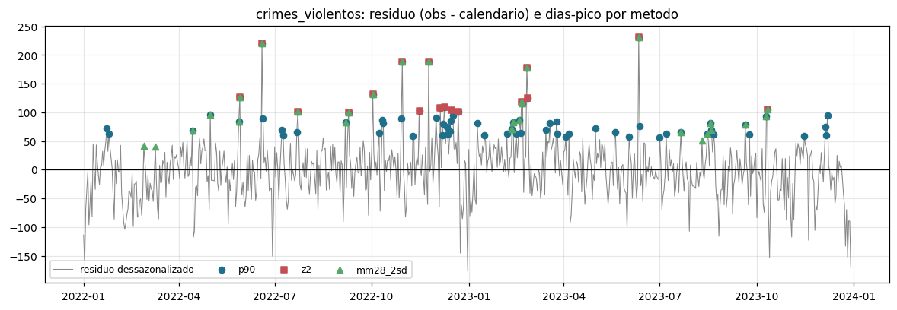
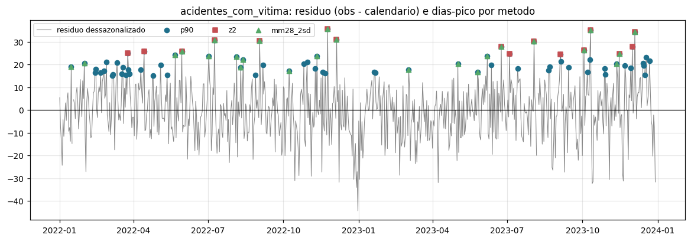

# Etapa 11 -- Definicao de "pico"

_Gerado por `scripts/08_definicao_pico.py` em 2026-09-04. Fonte: `data/gold/fato_dia_sp.csv`._

> Pico e definido sobre o **residuo dessazonalizado**, nao a contagem crua (Etapas 6-10: sazonalidade semanal/mensal domina). Tres metodos testados e comparados; escolha justificada na secao 5.

## 1. Por que NAO usar a contagem crua

Repetindo o teste provisorio da Etapa 8, agora so para mostrar o problema: `pico_cru` = dia acima do P90 da contagem crua de `crimes_totais`.

| nome_dia_semana | % dos dias que sao 'pico cru' |
| --- | --- |
| domingo | 6.7 |
| segunda | 1.0 |
| terça | 3.8 |
| quarta | 9.6 |
| quinta | 9.6 |
| sexta | 25.0 |
| sábado | 14.3 |

- 36% dos 'picos crus' caem numa **sexta** e 21% num **sabado**; **domingo e segunda quase nunca** (7% e 1% dos seus dias). Ou seja, 'pico cru' ~= 'e fim de semana'. Nao serve como alvo -- um modelo acertaria so aprendendo o dia da semana.

**Solucao:** definir pico sobre o **residuo dessazonalizado** `obs - OLS(obs ~ t + C(dia_semana) + C(mes) + feriado)`. R^2 do ajuste de calendario por desfecho:

| desfecho | R2_calendario | obs_explicada_% |
| --- | --- | --- |
| crimes_violentos | 0.427 | 42.680 |
| crimes_totais | 0.330 | 33.050 |
| lesao_corporal_dolosa | 0.600 | 59.963 |
| acidentes_com_vitima | 0.373 | 37.344 |
| acidentes_total | 0.337 | 33.694 |
| acidentes_fatais | 0.160 | 16.026 |

_Quanto maior o R^2, mais da variacao diaria e so calendario -- e mais enganoso seria um pico definido na contagem crua._

## 2. Tres definicoes de pico sobre o residuo -- comparacao

Metodos: **percentil** (residuo > P90/P95), **z-score** (residuo/desvio > 2; e versao robusta com MAD), **media movel** (residuo > media_movel_28d + 2*desvio_movel_28d, janela causal deslocada 1 dia -> sem leakage e reutilizavel como feature).

Numero de dias-pico por desfecho x metodo (de ~726-728 dias elegiveis):

| desfecho | p90 | p95 | z1_5 | z2 | z2_robusto | mm28_2sd |
| --- | --- | --- | --- | --- | --- | --- |
| acidentes_com_vitima | 73 | 37 | 45 | 16 | 20 | 25 |
| acidentes_fatais | 73 | 37 | 58 | 34 | 43 | 36 |
| acidentes_total | 73 | 37 | 41 | 18 | 21 | 31 |
| crimes_totais | 73 | 37 | 25 | 18 | 42 | 28 |
| crimes_violentos | 73 | 37 | 40 | 18 | 25 | 28 |
| lesao_corporal_dolosa | 73 | 37 | 43 | 19 | 26 | 34 |

Mesma coisa em % dos dias elegiveis:

| desfecho | p90 | p95 | z1_5 | z2 | z2_robusto | mm28_2sd |
| --- | --- | --- | --- | --- | --- | --- |
| acidentes_com_vitima | 10.1 | 5.1 | 6.2 | 2.2 | 2.8 | 3.4 |
| acidentes_fatais | 10.1 | 5.1 | 8.0 | 4.7 | 5.9 | 5.0 |
| acidentes_total | 10.1 | 5.1 | 5.6 | 2.5 | 2.9 | 4.3 |
| crimes_totais | 10.0 | 5.1 | 3.4 | 2.5 | 5.8 | 3.8 |
| crimes_violentos | 10.0 | 5.1 | 5.5 | 2.5 | 3.4 | 3.8 |
| lesao_corporal_dolosa | 10.0 | 5.1 | 5.9 | 2.6 | 3.6 | 4.7 |

- **P90** da ~10% de positivos por construcao; **P95** ~5%.
- **z>2** no residuo tende a dar MENOS que 5% (a cauda direita e mais
  pesada que a normal -> poucos pontos passam 2 desvios) e **z>1,5** fica
  entre P90 e P95. O z-score assume simetria/normalidade que a EDA ja
  rejeitou -> menos indicado como definicao principal.
- **media movel** da um numero parecido com P90/P95 mas VARIA no tempo
  (adapta-se a periodos mais ou menos volateis) e e a unica que pode
  virar feature sem leakage.

## 3. Concordancia entre metodos e inspecao dos picos de consenso

### crimes_violentos

Jaccard entre os 3 metodos (P90 / z>2 / media movel):

| metodo | p90 | z2 | mm28_2sd |
| --- | --- | --- | --- |
| p90 | 1.00 | 0.25 | 0.33 |
| z2 | 0.25 | 1.00 | 0.35 |
| mm28_2sd | 0.33 | 0.35 | 1.00 |

Dias-pico por **consenso dos 3**: 12 (uniao: 76). Concordancia baixa entre metodos (Jaccard ~0,2-0,35) -- esperado: cada um define uma cauda diferente. O consenso pega os dias inequivocamente anomalos.

| data | nome_dia_semana | feriado | tem_jogo_sp | classico | crimes_violentos | is_outlier_lote |
| --- | --- | --- | --- | --- | --- | --- |
| 2022-05-29 | domingo | 0 | True | False | 626 | False |
| 2022-06-19 | domingo | 0 | True | False | 715 | True |
| 2022-07-23 | sábado | 0 | True | False | 634 | False |
| 2022-09-09 | sexta | 0 | False | False | 680 | False |
| 2022-10-02 | domingo | 0 | True | False | 667 | False |
| 2022-10-30 | domingo | 0 | False | False | 722 | False |
| 2022-11-24 | quinta | 0 | False | False | 755 | False |
| 2023-02-20 | segunda | 0 | False | False | 591 | False |
| 2023-02-21 | terça | 1 | False | False | 563 | False |
| 2023-02-25 | sábado | 0 | False | False | 744 | False |
| 2023-06-11 | domingo | 0 | True | True | 704 | False |
| 2023-10-11 | quarta | 0 | False | False | 627 | False |

_Dos 12 picos de consenso de `crimes_violentos`, 5 sao dia de jogo (42%; taxa-base ~17%), **1 deles e o artefato de 2022-06-19**. Inspecao qualitativa dos dias mais anomalos; o teste formal dessa proporcao esta logo abaixo._

**Teste de Fisher exato -- pico de consenso de `crimes_violentos` x dia de jogo** (dias elegiveis = 728; taxa-base de dia de jogo = 17.3%):

| index | dia de jogo | sem jogo | total |
| --- | --- | --- | --- |
| pico de consenso | 5 | 7 | 12 |
| nao-pico | 121 | 595 | 716 |
| total | 126 | 602 | 728 |

- **H0:** ser dia-pico de consenso e ser dia de jogo sao independentes (P(jogo | pico) = P(jogo | nao-pico)). **H1:** nao sao.
- **Odds ratio = 3.51** | **p (bilateral) = 0.041** | p (unilateral, jogo > base) = 0.041.
- 5/12 = 42% dos picos sao dia de jogo vs 17.3% esperado.
- **Resultado registrado: significativo a 5% (p = 0.041).**
- **Robustez / porque nao vira achado:**
  * sem o artefato de 2022-06-19 (1 dos 5 da celula pico&jogo): p = 0.103 -> deixa de ser significativo;
  * pos-hoc: a definicao 'consenso dos 3 metodos' e uma de varias que poderiam ter sido testadas; corrigindo grosseiramente por 6 desfechos inspecionados, p_Bonferroni = 0.24 (ns);
  * a residualizacao remove a MEDIA de dia-da-semana e mes, nao toda a estrutura de fim de semana -- jogos concentram em fim de semana, entao 'dia de jogo' aqui ainda e em parte um proxy de fim de semana;
  * n minusculo (5 na celula critica) -> IC do OR de <1 a >10;
  * **as Etapas 7-9 testaram exatamente `crimes_violentos` x jogo com n completo (126 vs 602), controles e modelos de defasagem -> todas nulas.** Uma associacao pos-hoc em 12 dias nao reverte isso.
- **Uso no artigo:** citar como associacao exploratoria que NAO sobrevive a remocao do artefato nem a correcao de multiplas comparacoes, e e inconsistente com as analises primarias (Etapas 7-9).

### acidentes_com_vitima

Jaccard entre os 3 metodos (P90 / z>2 / media movel):

| metodo | p90 | z2 | mm28_2sd |
| --- | --- | --- | --- |
| p90 | 1.00 | 0.22 | 0.34 |
| z2 | 0.22 | 1.00 | 0.37 |
| mm28_2sd | 0.34 | 0.37 | 1.00 |

Dias-pico por **consenso dos 3**: 11 (uniao: 73). Concordancia baixa entre metodos (Jaccard ~0,2-0,35) -- esperado: cada um define uma cauda diferente. O consenso pega os dias inequivocamente anomalos.

| data | nome_dia_semana | feriado | tem_jogo_sp | classico | acidentes_com_vitima | is_outlier_lote |
| --- | --- | --- | --- | --- | --- | --- |
| 2022-05-30 | segunda | 0 | False | False | 109 | False |
| 2022-07-09 | sábado | 1 | False | False | 106 | False |
| 2022-09-02 | sexta | 0 | False | False | 123 | False |
| 2022-11-24 | quinta | 0 | False | False | 116 | False |
| 2022-12-05 | segunda | 0 | False | False | 100 | False |
| 2023-06-24 | sábado | 0 | False | False | 125 | False |
| 2023-08-03 | quinta | 0 | False | False | 119 | False |
| 2023-10-03 | terça | 0 | False | False | 110 | False |
| 2023-10-11 | quarta | 0 | False | False | 120 | False |
| 2023-11-15 | quarta | 1 | False | False | 97 | False |
| 2023-12-04 | segunda | 0 | False | False | 109 | False |

_Dos 11 picos de consenso de `acidentes_com_vitima`, 0 sao dia de jogo (0%; taxa-base ~17%). Inspecao qualitativa dos dias mais anomalos; o teste formal dessa proporcao esta logo abaixo._

**Teste de Fisher exato -- pico de consenso de `acidentes_com_vitima` x dia de jogo** (dias elegiveis = 726; taxa-base de dia de jogo = 17.4%):

| index | dia de jogo | sem jogo | total |
| --- | --- | --- | --- |
| pico de consenso | 0 | 11 | 11 |
| nao-pico | 126 | 589 | 715 |
| total | 126 | 600 | 726 |

- **H0:** ser dia-pico de consenso e ser dia de jogo sao independentes (P(jogo | pico) = P(jogo | nao-pico)). **H1:** nao sao.
- **Odds ratio = 0.00** | **p (bilateral) = 0.227** | p (unilateral, jogo > base) = 1.000.
- 0/11 = 0% dos picos sao dia de jogo vs 17.4% esperado.
- **Resultado registrado: nao significativo a 5% (p = 0.227).**
- **Robustez / porque nao vira achado:**
  * pos-hoc: a definicao 'consenso dos 3 metodos' e uma de varias que poderiam ter sido testadas; corrigindo grosseiramente por 6 desfechos inspecionados, p_Bonferroni = 1.00 (ns);
  * a residualizacao remove a MEDIA de dia-da-semana e mes, nao toda a estrutura de fim de semana -- jogos concentram em fim de semana, entao 'dia de jogo' aqui ainda e em parte um proxy de fim de semana;
  * n minusculo (0 na celula critica) -> IC do OR de <1 a >10;
  * **as Etapas 7-9 testaram exatamente `acidentes_com_vitima` x jogo com n completo (126 vs 600), controles e modelos de defasagem -> todas nulas.** Uma associacao pos-hoc em 12 dias nao reverte isso.
- **Uso no artigo:** citar como associacao exploratoria que NAO sobrevive a correcao de multiplas comparacoes, e e inconsistente com as analises primarias (Etapas 7-9).

## 4. Visualizacao -- residuo e picos ao longo do tempo

## 5. Recomendacao e materializacao

**Definicao principal para a Etapa 12 (classificacao):**
`pico = residuo dessazonalizado > P90`, por desfecho.
- Percentil nao assume normalidade (o z-score assume, e a EDA rejeitou).
- P90 da ~10% de positivos -> ~73 dias-pico em 728: suficiente para o
  split temporal da Etapa 15 (P95 daria ~36, pouco para validar).
- P95, z>2 e media movel ficam como **variantes de robustez** -- a Etapa 14
  reporta a metrica do modelo nos 3 limiares.

**Alvos recomendados** (os "picos de violencia/acidentes" do titulo):
`crimes_violentos` e `acidentes_com_vitima`. `crimes_totais`/
`acidentes_total` entram como secundarios.

**Versao 3 niveis (Baixo/Medio/Alto)** pedida no roteiro: sobre o residuo,
`< P75` = Baixo, `P75-P90` = Medio, `> P90` = Alto. Materializada em
`nivel_risco` (baseada em `crimes_violentos`).

**Ressalvas para a Etapa 15**: o limiar (P90/P95) e o ajuste de calendario
aqui usam a serie inteira. Numa validacao walk-forward estrita, ambos devem
ser reestimados so no treino de cada fold -- senao ha vazamento leve do
teste para a definicao do alvo. A versao **media movel** ja e causal e nao
tem esse problema.
2022-06-19 permanece marcado como pico (artefato de registro em lote);
a Etapa 12 decide remover/winsorizar.

**Arquivo gerado:** `data/gold/pico_dia_sp.csv` (730 linhas x 40 colunas), chave `data`. Colunas: flags `pico_<alvo>_<metodo>` (boolean, NaN nos dias excluidos), `nivel_risco`, e os residuos dos 2 alvos principais.

`02_limpeza.py` foi ajustado para fazer o merge deste arquivo nos placeholders `pico_crime_p90` / `pico_crime_zscore` / `pico_acidente_p90` / `nivel_risco` do `fato_dia_sp.csv` (se o arquivo existir). Ordem de execucao: `02` -> `08` -> (`02` de novo, opcional, para o fato carregar as colunas).

Distribuicao de `nivel_risco` (base `crimes_violentos`):

| nivel_risco | n_dias |
| --- | --- |
| Baixo | 546 |
| Medio | 109 |
| Alto | 73 |
| <NA> | 2 |
