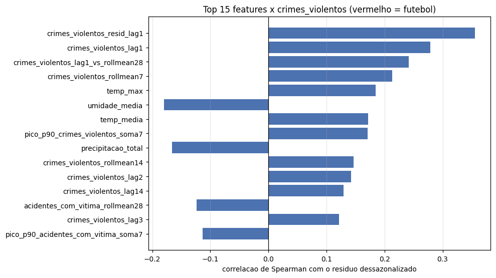
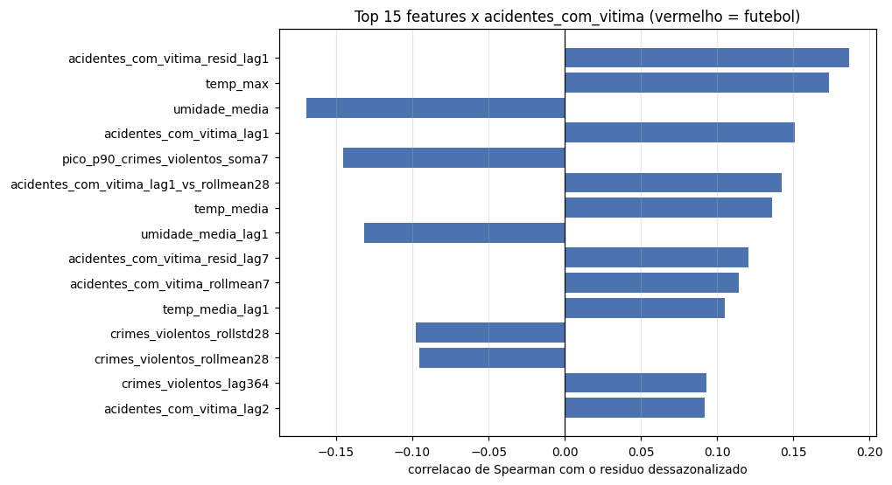

# Etapa 12 -- Feature engineering

_Gerado por `scripts/09_feature_engineering.py` em 2026-09-04. Fonte: `data/gold/fato_dia_sp.csv`._

> Matriz de modelagem 1 dia = 1 linha, **sem data leakage**: features de calendario e de jogos de D0 (conhecidas em avanco), clima de D0 (assume previsao) e historico do desfecho (shift >= 1). Alvos recalculados aqui com o tratamento de outliers desta etapa. Modelos: Etapas 13-14.

## 1. Alvos (recalculados com o tratamento de outliers desta etapa)

| base | R2_calendario | n_elegivel | n_pico_p90 | n_pico_p95 |
| --- | --- | --- | --- | --- |
| crimes_violentos | 0.436 | 727 | 73 | 37 |
| acidentes_com_vitima | 0.373 | 726 | 73 | 37 |

_Os alvos residuais e P90/P95 seguem a definicao da Etapa 11, mas aplicados a serie ja com 2022-06-19 tratado como missing -- por isso podem diferir de `pico_dia_sp.csv` exatamente nesse dia (que la era pico `Alto`, aqui e NaN)._

## 2. Features construidas

`leakage_ok`: `True` = seguro por construcao; texto = ressalva explicita (ver secao 3).

### temporal (26)

| feature | leakage_ok | descricao |
| --- | --- | --- |
| trend | True | indice do dia normalizado 0..1 (tendencia linear) |
| sin_doy | True | codificacao ciclica (dia do ano / dia da semana) |
| cos_doy | True | codificacao ciclica (dia do ano / dia da semana) |
| sin_dow | True | codificacao ciclica (dia do ano / dia da semana) |
| cos_dow | True | codificacao ciclica (dia do ano / dia da semana) |
| dow_0 | True | one-hot dia da semana (dia_semana==0, domingo) |
| dow_1 | True | one-hot dia da semana (dia_semana==1, segunda) |
| dow_2 | True | one-hot dia da semana (dia_semana==2, terça) |
| dow_3 | True | one-hot dia da semana (dia_semana==3, quarta) |
| dow_4 | True | one-hot dia da semana (dia_semana==4, quinta) |
| dow_5 | True | one-hot dia da semana (dia_semana==5, sexta) |
| dow_6 | True | one-hot dia da semana (dia_semana==6, sábado) |
| dia_do_mes | True | dia do mes 1..31 |
| mes | True | campo de calendario do fato (conhecido em avanco) |
| trimestre | True | campo de calendario do fato (conhecido em avanco) |
| semana_ano | True | campo de calendario do fato (conhecido em avanco) |
| fim_de_semana | True | campo de calendario do fato (conhecido em avanco) |
| feriado | True | campo de calendario do fato (conhecido em avanco) |
| feriado_nacional | True | campo de calendario do fato (conhecido em avanco) |
| feriado_estadual | True | campo de calendario do fato (conhecido em avanco) |
| feriado_municipal | True | campo de calendario do fato (conhecido em avanco) |
| vespera_feriado | True | campo de calendario do fato (conhecido em avanco) |
| periodo_letivo | True | campo de calendario do fato (conhecido em avanco) |
| ferias_escolares | True | campo de calendario do fato (conhecido em avanco) |
| recesso_escolar | True | campo de calendario do fato (conhecido em avanco) |
| pos_feriado | True | dia seguinte a um feriado |

### futebol (20)

| feature | leakage_ok | descricao |
| --- | --- | --- |
| tem_jogo_sp | True | fixture/flag do dia (tabela publicada com antecedencia) |
| numero_jogos_sp | True | fixture/flag do dia (tabela publicada com antecedencia) |
| classico | True | fixture/flag do dia (tabela publicada com antecedencia) |
| jogo_noturno | True | fixture/flag do dia (tabela publicada com antecedencia) |
| jogo_d_menos_1 | True | fixture/flag do dia (tabela publicada com antecedencia) |
| jogo_d_mais_1 | True | fixture/flag do dia (tabela publicada com antecedencia) |
| classico_d_menos_1 | True | fixture/flag do dia (tabela publicada com antecedencia) |
| classico_d_mais_1 | True | fixture/flag do dia (tabela publicada com antecedencia) |
| jogo_copa | True | jogo de Copa do Brasil (proxy grosseiro de importancia) |
| jogo_serie_a | True | jogo de Serie A |
| jogo_d_menos_2 | True | houve jogo ha 2 dias (convencao do gold) |
| jogo_d_mais_2 | True | ha jogo daqui a 2 dias (convencao do gold) |
| n_jogos_janela7 | True | nº de jogos nos ultimos 7 dias incl. hoje (fixture conhecido) |
| dias_desde_jogo | True | dias desde o ultimo jogo (>=0) |
| dias_ate_jogo | True | dias ate o proximo jogo (>=0) |
| jogo_x_fds | True | interacao explicita (o modelo tambem pode achar sozinho) |
| jogo_x_noturno | True | interacao explicita (o modelo tambem pode achar sozinho) |
| classico_x_fds | True | interacao explicita (o modelo tambem pode achar sozinho) |
| publico | True | BLOQUEADO: 100% NaN (fonte Kaggle nao integrada) |
| taxa_ocupacao | True | BLOQUEADO: depende de publico |

### clima (11)

| feature | leakage_ok | descricao |
| --- | --- | --- |
| temp_media | assume previsao D0 | clima observado do dia (proxy de previsao perfeita) |
| temp_max | assume previsao D0 | clima observado do dia (proxy de previsao perfeita) |
| temp_min | assume previsao D0 | clima observado do dia (proxy de previsao perfeita) |
| precipitacao_total | assume previsao D0 | clima observado do dia (proxy de previsao perfeita) |
| umidade_media | assume previsao D0 | clima observado do dia (proxy de previsao perfeita) |
| vento_max | assume previsao D0 | clima observado do dia (proxy de previsao perfeita) |
| chuva | assume previsao D0 | clima observado do dia (proxy de previsao perfeita) |
| clima_missing | True | flag: alguma variavel de clima ausente no dia (lacunas INMET) |
| temp_media_lag1 | True | clima de ontem (alternativa conservadora a previsao) |
| precipitacao_total_lag1 | True | clima de ontem (alternativa conservadora a previsao) |
| umidade_media_lag1 | True | clima de ontem (alternativa conservadora a previsao) |

### historica (38)

| feature | leakage_ok | descricao |
| --- | --- | --- |
| crimes_violentos_lag1 | True | crimes_violentos 1 dia(s) atras (interpolado nos buracos) |
| crimes_violentos_lag2 | True | crimes_violentos 2 dia(s) atras (interpolado nos buracos) |
| crimes_violentos_lag3 | True | crimes_violentos 3 dia(s) atras (interpolado nos buracos) |
| crimes_violentos_lag7 | True | crimes_violentos 7 dia(s) atras (interpolado nos buracos) |
| crimes_violentos_lag14 | True | crimes_violentos 14 dia(s) atras (interpolado nos buracos) |
| crimes_violentos_lag28 | True | crimes_violentos 28 dia(s) atras (interpolado nos buracos) |
| crimes_violentos_lag364 | True | crimes_violentos 364 dia(s) atras (interpolado nos buracos) |
| crimes_violentos_rollmean7 | True | media movel 7d de crimes_violentos, deslocada 1 dia |
| crimes_violentos_rollstd7 | True | desvio movel 7d de crimes_violentos, deslocado 1 dia |
| crimes_violentos_rollmean14 | True | media movel 14d de crimes_violentos, deslocada 1 dia |
| crimes_violentos_rollstd14 | True | desvio movel 14d de crimes_violentos, deslocado 1 dia |
| crimes_violentos_rollmean28 | True | media movel 28d de crimes_violentos, deslocada 1 dia |
| crimes_violentos_rollstd28 | True | desvio movel 28d de crimes_violentos, deslocado 1 dia |
| crimes_violentos_resid_lag1 | ver ressalva E15 | residuo dessazonalizado de ontem (ajuste de calendario usa serie inteira) |
| crimes_violentos_resid_lag7 | ver ressalva E15 | residuo dessazonalizado de 7 dias atras |
| crimes_violentos_lag1_vs_rollmean28 | True | ontem menos a media movel de 28d |
| pico_p90_crimes_violentos_lag1 | True | ontem foi pico? (0/1) |
| pico_p90_crimes_violentos_soma7 | True | nº de picos nos 7 dias anteriores |
| sazonal_esperado_crimes_violentos | ver ressalva E15 | valor esperado de {base} so pelo calendario (ajuste na serie inteira) |
| acidentes_com_vitima_lag1 | True | acidentes_com_vitima 1 dia(s) atras (interpolado nos buracos) |
| acidentes_com_vitima_lag2 | True | acidentes_com_vitima 2 dia(s) atras (interpolado nos buracos) |
| acidentes_com_vitima_lag3 | True | acidentes_com_vitima 3 dia(s) atras (interpolado nos buracos) |
| acidentes_com_vitima_lag7 | True | acidentes_com_vitima 7 dia(s) atras (interpolado nos buracos) |
| acidentes_com_vitima_lag14 | True | acidentes_com_vitima 14 dia(s) atras (interpolado nos buracos) |
| acidentes_com_vitima_lag28 | True | acidentes_com_vitima 28 dia(s) atras (interpolado nos buracos) |
| acidentes_com_vitima_lag364 | True | acidentes_com_vitima 364 dia(s) atras (interpolado nos buracos) |
| acidentes_com_vitima_rollmean7 | True | media movel 7d de acidentes_com_vitima, deslocada 1 dia |
| acidentes_com_vitima_rollstd7 | True | desvio movel 7d de acidentes_com_vitima, deslocado 1 dia |
| acidentes_com_vitima_rollmean14 | True | media movel 14d de acidentes_com_vitima, deslocada 1 dia |
| acidentes_com_vitima_rollstd14 | True | desvio movel 14d de acidentes_com_vitima, deslocado 1 dia |
| acidentes_com_vitima_rollmean28 | True | media movel 28d de acidentes_com_vitima, deslocada 1 dia |
| acidentes_com_vitima_rollstd28 | True | desvio movel 28d de acidentes_com_vitima, deslocado 1 dia |
| acidentes_com_vitima_resid_lag1 | ver ressalva E15 | residuo dessazonalizado de ontem (ajuste de calendario usa serie inteira) |
| acidentes_com_vitima_resid_lag7 | ver ressalva E15 | residuo dessazonalizado de 7 dias atras |
| acidentes_com_vitima_lag1_vs_rollmean28 | True | ontem menos a media movel de 28d |
| pico_p90_acidentes_com_vitima_lag1 | True | ontem foi pico? (0/1) |
| pico_p90_acidentes_com_vitima_soma7 | True | nº de picos nos 7 dias anteriores |
| sazonal_esperado_acidentes_com_vitima | ver ressalva E15 | valor esperado de {base} so pelo calendario (ajuste na serie inteira) |

## 3. Auditoria de data leakage

| feature | checagem | frac_igual_ao_alvo | ok |
| --- | --- | --- | --- |
| crimes_violentos_lag1 | == alvo do MESMO dia? | 0.0041 | True |
| crimes_violentos_lag2 | == alvo do MESMO dia? | 0.0027 | True |
| crimes_violentos_lag3 | == alvo do MESMO dia? | 0.0055 | True |
| crimes_violentos_lag7 | == alvo do MESMO dia? | 0.0068 | True |
| crimes_violentos_lag14 | == alvo do MESMO dia? | 0.0068 | True |
| crimes_violentos_lag28 | == alvo do MESMO dia? | 0.0068 | True |
| crimes_violentos_lag364 | == alvo do MESMO dia? | 0.0068 | True |
| acidentes_com_vitima_lag1 | == alvo do MESMO dia? | 0.0288 | True |
| acidentes_com_vitima_lag2 | == alvo do MESMO dia? | 0.0247 | True |
| acidentes_com_vitima_lag3 | == alvo do MESMO dia? | 0.0274 | True |
| acidentes_com_vitima_lag7 | == alvo do MESMO dia? | 0.0274 | True |
| acidentes_com_vitima_lag14 | == alvo do MESMO dia? | 0.0151 | True |
| acidentes_com_vitima_lag28 | == alvo do MESMO dia? | 0.0342 | True |
| acidentes_com_vitima_lag364 | == alvo do MESMO dia? | 0.0082 | True |
| crimes_violentos_rollmean7 | corr(now) < corr(prev)? |  | True |
| acidentes_com_vitima_rollmean7 | corr(now) < corr(prev)? |  | True |

**0 falha(s)** na auditoria automatica. Todas as features historicas usam shift>=1; nenhuma coincide com o alvo do dia.

Pontos que a auditoria automatica NAO cobre (tratados por design, ver cabecalho):
- `temp_*`/`precipitacao_*`/`umidade_*`/`vento_*`/`chuva` de D0 assumem previsao perfeita -- alternativa conservadora `*_lag1` incluida.
- `y_resid_*`, `*_resid_lag*`, `sazonal_esperado_*` usam um ajuste de calendario estimado na serie inteira -> vazamento leve de tendencia/sazonalidade. Na Etapa 15 reajustar por fold. Marcadas como `leakage_ok = 'ver ressalva E15'` no dicionario.

## 4. Missingness e distribuicao dos alvos

Features com valores ausentes (apos construcao):

| feature | pct_missing |
| --- | --- |
| publico | 100.00 |
| taxa_ocupacao | 100.00 |
| jogo_noturno | 82.74 |
| crimes_violentos_lag364 | 49.86 |
| acidentes_com_vitima_lag364 | 49.86 |
| acidentes_com_vitima_lag28 | 3.84 |
| crimes_violentos_lag28 | 3.84 |
| precipitacao_total_lag1 | 2.47 |
| precipitacao_total | 2.33 |
| crimes_violentos_lag14 | 1.92 |
| crimes_violentos_rollmean28 | 1.92 |
| acidentes_com_vitima_rollmean28 | 1.92 |
| acidentes_com_vitima_lag14 | 1.92 |
| crimes_violentos_rollstd28 | 1.92 |
| crimes_violentos_lag1_vs_rollmean28 | 1.92 |
| acidentes_com_vitima_lag1_vs_rollmean28 | 1.92 |
| acidentes_com_vitima_rollstd28 | 1.92 |
| acidentes_com_vitima_lag7 | 0.96 |
| acidentes_com_vitima_rollstd14 | 0.96 |
| crimes_violentos_rollstd14 | 0.96 |
| crimes_violentos_rollmean14 | 0.96 |
| crimes_violentos_resid_lag7 | 0.96 |
| acidentes_com_vitima_rollmean14 | 0.96 |
| acidentes_com_vitima_resid_lag7 | 0.96 |
| crimes_violentos_lag7 | 0.96 |
| pico_p90_acidentes_com_vitima_lag1 | 0.55 |
| crimes_violentos_rollmean7 | 0.41 |
| pico_p90_crimes_violentos_soma7 | 0.41 |
| acidentes_com_vitima_lag3 | 0.41 |
| crimes_violentos_rollstd7 | 0.41 |
| acidentes_com_vitima_rollstd7 | 0.41 |
| acidentes_com_vitima_rollmean7 | 0.41 |
| pico_p90_acidentes_com_vitima_soma7 | 0.41 |
| pico_p90_crimes_violentos_lag1 | 0.41 |
| crimes_violentos_lag3 | 0.41 |
| umidade_media_lag1 | 0.27 |
| crimes_violentos_lag2 | 0.27 |
| acidentes_com_vitima_lag2 | 0.27 |
| temp_media_lag1 | 0.27 |
| vento_max | 0.14 |
| temp_min | 0.14 |
| temp_max | 0.14 |
| crimes_violentos_resid_lag1 | 0.14 |
| acidentes_com_vitima_resid_lag1 | 0.14 |
| acidentes_com_vitima_lag1 | 0.14 |
| temp_media | 0.14 |
| umidade_media | 0.14 |
| crimes_violentos_lag1 | 0.14 |

_Esperado: `publico`/`taxa_ocupacao` 100% (bloqueadas); `jogo_noturno` ~83% (so definido em dia de jogo, igual ao resto do gold -- NaN != 0); `*_lag364` ~50% (so o 2º ano tem historico de 1 ano); `*_lag28`/`rollmean28` ~4% (aquecimento da janela); clima ~2% (lacunas INMET). O split da Etapa 15 comeca depois do aquecimento das janelas._

| alvo | n_True | n_False | n_NaN | prevalencia_% |
| --- | --- | --- | --- | --- |
| y_pico_p90_crimes_violentos | 73 | 654 | 3 | 10.04 |
| y_pico_p95_crimes_violentos | 37 | 690 | 3 | 5.09 |
| y_pico_p90_acidentes_com_vitima | 73 | 653 | 4 | 10.06 |
| y_pico_p95_acidentes_com_vitima | 37 | 689 | 4 | 5.10 |

## 5. Sanidade: correlacao das features com o alvo (Spearman)

Previa do que a Etapa 18 (SHAP) deve confirmar. Espera-se lags/rolling do proprio desfecho no topo e features de futebol perto de zero -- coerente com Etapas 7-10.

### crimes_violentos -- top 15 |rho|

| feature | spearman_rho | p |
| --- | --- | --- |
| crimes_violentos_resid_lag1 | 0.356 | 0.000 |
| crimes_violentos_lag1 | 0.279 | 0.000 |
| crimes_violentos_lag1_vs_rollmean28 | 0.241 | 0.000 |
| crimes_violentos_rollmean7 | 0.213 | 0.000 |
| temp_max | 0.184 | 0.000 |
| umidade_media | -0.179 | 0.000 |
| temp_media | 0.172 | 0.000 |
| pico_p90_crimes_violentos_soma7 | 0.171 | 0.000 |
| precipitacao_total | -0.166 | 0.000 |
| crimes_violentos_rollmean14 | 0.146 | 0.000 |
| crimes_violentos_lag2 | 0.142 | 0.000 |
| crimes_violentos_lag14 | 0.129 | 0.001 |
| acidentes_com_vitima_rollmean28 | -0.123 | 0.001 |
| crimes_violentos_lag3 | 0.122 | 0.001 |
| pico_p90_acidentes_com_vitima_soma7 | -0.113 | 0.002 |

_Features de futebol: |rho| maximo = 0.018 (dias_ate_jogo). Todas fracas, como esperado._

### acidentes_com_vitima -- top 15 |rho|

| feature | spearman_rho | p |
| --- | --- | --- |
| acidentes_com_vitima_resid_lag1 | 0.186 | 0.000 |
| temp_max | 0.173 | 0.000 |
| umidade_media | -0.170 | 0.000 |
| acidentes_com_vitima_lag1 | 0.151 | 0.000 |
| pico_p90_crimes_violentos_soma7 | -0.145 | 0.000 |
| acidentes_com_vitima_lag1_vs_rollmean28 | 0.143 | 0.000 |
| temp_media | 0.136 | 0.000 |
| umidade_media_lag1 | -0.131 | 0.000 |
| acidentes_com_vitima_resid_lag7 | 0.120 | 0.001 |
| acidentes_com_vitima_rollmean7 | 0.114 | 0.002 |
| temp_media_lag1 | 0.105 | 0.005 |
| crimes_violentos_rollstd28 | -0.098 | 0.009 |
| crimes_violentos_rollmean28 | -0.096 | 0.011 |
| crimes_violentos_lag364 | 0.093 | 0.076 |
| acidentes_com_vitima_lag2 | 0.092 | 0.013 |

_Features de futebol: |rho| maximo = 0.055 (dias_desde_jogo). Todas fracas, como esperado._

## 6. Tratamento de 2022-06-19 e materializacao

2022-06-19 antes (fato) -> depois (features), mesmas 4 colunas de contagem:

| index | antes_fato | depois_features |
| --- | --- | --- |
| crimes_totais | 3371 |  |
| crimes_violentos | 715 |  |
| furtos_total | 2633 |  |
| roubos_total | 607 |  |

Outros campos do dia: `y_count_crimes_violentos`=nan, `y_pico_p90_crimes_violentos`=<NA>, `dia_artefato_lote`=1.

A contagem de crime do dia virou NaN (como as lacunas ja tratadas); o alvo `y_*_crimes_violentos` e NaN -> a linha nao entra em treino/teste de crime. Para os lags, `crimes_*__lagsrc` interpola o buraco (linear, no maximo 1 dia isolado) para nao contaminar 2022-06-20+. `dia_artefato_lote=1` fica como flag. **Sensibilidade planejada (Etapa 14):** rodar os modelos tambem SEM esse tratamento (dia mantido) e comparar as metricas.

**Arquivo:** `data/gold/features_dia_sp.csv` -- 730 linhas x 109 colunas (95 features + 10 alvos + 4 flags/chave).

Dicionario completo em `reports/etapa12/tabelas/dicionario_features.csv`. Resumo por grupo:

| grupo | n_features |
| --- | --- |
| clima | 11 |
| futebol | 20 |
| historica | 38 |
| temporal | 26 |

## 7. Sintese e proximos passos

- Matriz pronta com 4 grupos de feature (temporal, futebol, clima, historica)
  + 6 alvos (contagem, residuo, pico P90/P95, nivel) x 2 desfechos.
- **Leakage**: features historicas usam shift >= 1; resultado do jogo de D0
  excluido (so entra defasado); clima de D0 assumido como previsao (variante
  `*_lag1` disponivel); `*_resid_*`/`sazonal_esperado_*` dependem de um ajuste
  de calendario feito na serie inteira -> reajustar por fold na Etapa 15.
- **Outlier 2022-06-19**: contagens de crime -> NaN (missing, nao zero),
  interpoladas so para lags; linha fora de treino/teste; flag mantida;
  sensibilidade na Etapa 14.
- **Publico bloqueado**: colunas presentes, 100% NaN (Regra 10).
- **Correlacao com o alvo** ja antecipa: lags/rolling do proprio desfecho
  lideram; futebol fraco -- consistente com Etapas 7-10 e com a expectativa
  de importancia baixa no SHAP (Etapa 18).
- **Etapa 13**: baselines (media historica, media movel, mesmo dia da semana
  anterior, classe majoritaria, regressao logistica) sobre `features_dia_sp.csv`,
  com split temporal (TimeSeriesSplit / walk-forward), comecando apos o
  aquecimento das janelas (>= dia 28; ideal >= 365 para ter `*_lag364`).
