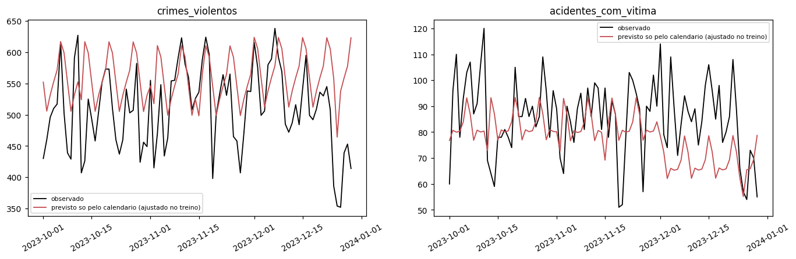
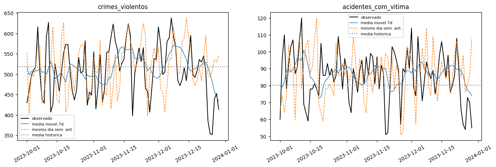
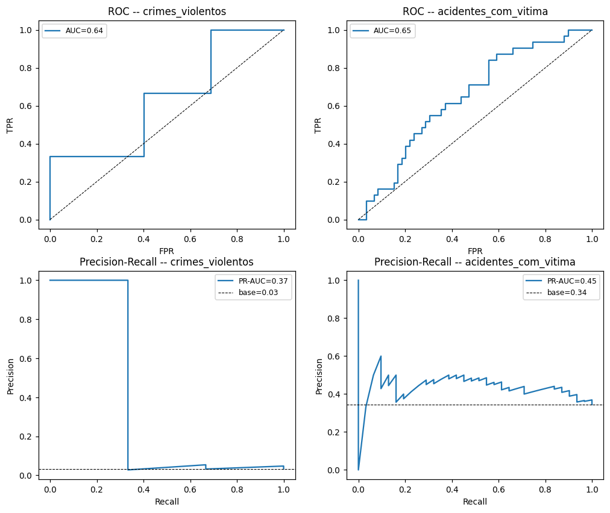

# Etapa 13 -- Baselines

_Gerado por `scripts/10_baselines.py` em 2026-09-04. Fontes: `data/gold/features_dia_sp.csv` + `fato_dia_sp.csv`._

> Regra 9 do briefing: todo modelo de ML da Etapa 14 em diante sera comparado contra os baselines desta etapa. Regra 8: nunca escolher por Accuracy isolada -- ver Recall/F1/PR-AUC, dado o desbalanceamento (~10% de pico).

## 1. Split temporal

Corte fixo: **treino** = antes de 2023-10-01, **teste** = a partir de 2023-10-01 (sem embaralhar; validacao com multiplos folds = Etapa 15).

| base | n_treino | n_teste | R2_calendario_treino | limiar_P90_treino | pico_treino_% | pico_teste_% |
| --- | --- | --- | --- | --- | --- | --- |
| crimes_violentos | 637 | 90 | 0.49 | 53.96 | 10.05 | 3.33 |
| acidentes_com_vitima | 636 | 90 | 0.43 | 14.69 | 10.06 | 34.44 |

_O limiar P90 e o ajuste de calendario vem SO do treino; a % de pico no teste nao precisa ficar em 10% porque o limiar nao foi calibrado nele (esperado, e o preco de nao vazar o teste para a definicao do alvo) -- mas o desvio aqui e grande demais pra ser so isso. Ver 1.1._

### 1.1 Por que a prevalencia de pico no teste foge tanto de 10%

| base | media_real_teste | media_prevista_calendario_teste | residuo_medio_teste | residuo_medio_treino |
| --- | --- | --- | --- | --- |
| crimes_violentos | 510.14 | 558.54 | -48.40 | 0.00 |
| acidentes_com_vitima | 85.58 | 77.90 | 7.67 | 0.00 |

O termo de **tendencia linear** (`t_idx`) do modelo de calendario, ajustado
so ate set/2023, extrapola mal para out-dez/2023:
- `crimes_violentos`: a previsao media do calendario no teste (558,5) fica
  MUITO acima do real (510,1) -> residuo medio de -48 no teste (vs 0 por
  construcao no treino) -> quase nenhum dia ultrapassa o limiar P90 do
  treino -> **prevalencia de pico cai pra 3,3%** (so 3 dias em 90).
- `acidentes_com_vitima`: o oposto -- o calendario SUBESTIMA o teste
  (77,9 previsto vs 85,6 real) -> residuo medio de +7,7 -> muitos dias
  passam do limiar -> **prevalencia sobe pra 34,4%** (31 em 90).

Isso NAO e um bug -- e uma demonstracao concreta de por que um unico corte
temporal e fragil para series de 2 anos com tendencia: o `t_idx` linear
extrapolado 3 meses a frente erra facil. **Consequencia pratica desta
etapa**: com so 3 positivos no teste de `crimes_violentos`, qualquer
metrica de classificacao para esse desfecho (secao 3) tem variancia
enorme e deve ser lida como ilustrativa, nao conclusiva -- a Etapa 15
(walk-forward, calendario reajustado em cada fold, metricas agregadas em
varias janelas) e o que da uma leitura confiavel.

## 2. Baselines de regressao (prever a contagem)

**H:** um modelo de ML (Etapa 14) so vale a pena se bater estes 3 baselines no teste. Metricas: MAE, RMSE, R^2 (vs media do PROPRIO teste), MAPE.

### crimes_violentos

| baseline | n | MAE | RMSE | R2 | MAPE_% |
| --- | --- | --- | --- | --- | --- |
| media_historica | 90 | 53.98 | 65.69 | -0.02 | 11.19 |
| media_movel_7d | 90 | 51.32 | 63.90 | 0.04 | 10.51 |
| media_movel_28d | 90 | 53.53 | 65.62 | -0.02 | 11.03 |
| mesmo_dia_semana_ant | 90 | 60.01 | 77.62 | -0.42 | 12.27 |

### acidentes_com_vitima

| baseline | n | MAE | RMSE | R2 | MAPE_% |
| --- | --- | --- | --- | --- | --- |
| media_historica | 90 | 12.78 | 15.71 | -0.13 | 15.32 |
| media_movel_7d | 90 | 11.82 | 15.33 | -0.07 | 15.17 |
| media_movel_28d | 90 | 11.89 | 15.24 | -0.06 | 15.44 |
| mesmo_dia_semana_ant | 90 | 15.48 | 20.20 | -0.87 | 19.77 |

_R^2 negativo e possivel e esperado para a media historica (constante do treino avaliada contra a variancia do teste) -- nao e bug._

## 3. Baselines de classificacao (prever pico)

**H0 implicita de cada baseline:** nao ha estrutura previsivel alem dela. Metricas: Accuracy, Precision, Recall, F1, ROC-AUC, PR-AUC (Regra 8: nao julgar so pela Accuracy -- com ~10% de prevalencia, 'nunca preve pico' ja acerta ~90%).

### crimes_violentos (prevalencia no teste: 3.3%, n_teste=90, n_pico=3)

| baseline | n_teste | n_pico_teste | accuracy | precision | recall | f1 | roc_auc | pr_auc |
| --- | --- | --- | --- | --- | --- | --- | --- | --- |
| classe_majoritaria | 90 | 3 | 0.967 | 0.000 | 0.000 | 0.000 |  |  |
| dia_semana_risco (domingo/segunda/sábado) | 90 | 3 | 0.544 | 0.000 | 0.000 | 0.000 | 0.282 | 0.033 |
| logreg | 90 | 3 | 0.944 | 0.250 | 0.333 | 0.286 | 0.636 | 0.367 |
| logreg_balanced | 90 | 3 | 0.789 | 0.056 | 0.333 | 0.095 | 0.686 | 0.217 |

### acidentes_com_vitima (prevalencia no teste: 34.4%, n_teste=90, n_pico=31)

| baseline | n_teste | n_pico_teste | accuracy | precision | recall | f1 | roc_auc | pr_auc |
| --- | --- | --- | --- | --- | --- | --- | --- | --- |
| classe_majoritaria | 90 | 31 | 0.656 | 0.000 | 0.000 | 0.000 |  |  |
| dia_semana_risco (segunda/quarta/sexta/sábado) | 90 | 31 | 0.533 | 0.392 | 0.645 | 0.488 | 0.560 | 0.375 |
| logreg | 90 | 31 | 0.622 | 0.400 | 0.194 | 0.261 | 0.646 | 0.451 |
| logreg_balanced | 90 | 31 | 0.578 | 0.434 | 0.742 | 0.548 | 0.635 | 0.436 |

_`roc_auc`/`pr_auc` em branco = classificador sem score continuo (classe majoritaria sempre prediz 0, nao ha curva a tracar)._

Matriz de confusao -- Logistic Regression, `crimes_violentos` (threshold 0.5):

| index | prev: nao-pico | prev: pico |
| --- | --- | --- |
| real: nao-pico | 84 | 3 |
| real: pico | 2 | 1 |

Matriz de confusao -- Logistic Regression, `acidentes_com_vitima` (threshold 0.5):

| index | prev: nao-pico | prev: pico |
| --- | --- | --- |
| real: nao-pico | 50 | 9 |
| real: pico | 25 | 6 |

## 4. Sintese

- **O resultado mais importante desta etapa nao e qual baseline "ganhou",
  e a secao 1.1**: um unico corte temporal com tendencia linear extrapolada
  3 meses a frente pode distorcer MUITO a prevalencia do alvo no teste
  (3,3% vs 34,4%, ambos longe do 10% nominal). Isso e um argumento de peso
  -- com numeros do proprio projeto, nao so teorico -- para a validacao
  walk-forward da Etapa 15 em vez de confiar num split unico.
- **Regressao**: comparar MAE/RMSE dos modelos da Etapa 14 aos 3 baselines
  acima, por desfecho. A media movel bateu a media historica e o
  mesmo-dia-da-semana-anterior nos dois desfechos neste corte -- piso
  realista a superar.
- **Classificacao**: leitura por desfecho, nao agregada --
  `acidentes_com_vitima` (31 positivos no teste) da uma comparacao razoavel:
  `logreg_balanced` supera a classe majoritaria e o `dia_semana_risco` em
  Recall/F1 (0,74/0,55). Ja `crimes_violentos` (so 3 positivos no teste) NAO
  deve ser usado para julgar modelo nenhum nesta rodada -- o proprio
  `dia_semana_risco` sai com ROC-AUC abaixo de 0,5 so por causa do n
  minusculo, nao porque calendario "piora" a previsao.
- **Vazamento corrigido**: o alvo de pico foi redefinido com o modelo de
  calendario ajustado SO no treino -- primeira aplicacao concreta da
  ressalva repetida desde a Etapa 8. A Etapa 15 generaliza isso para
  multiplos folds (walk-forward), o que tambem deve estabilizar a
  prevalencia do alvo no teste.
- **Proximo**: Etapa 14 -- Decision Tree, Random Forest, XGBoost,
  LightGBM/CatBoost e comparacao final contra estes baselines, incluindo a
  sensibilidade ao outlier de 2022-06-19. Considerar, na Etapa 14/15,
  suavizar ou remover o termo de tendencia linear do modelo de calendario
  (ou reajusta-lo com mais frequencia) para evitar a extrapolacao vista
  aqui.
