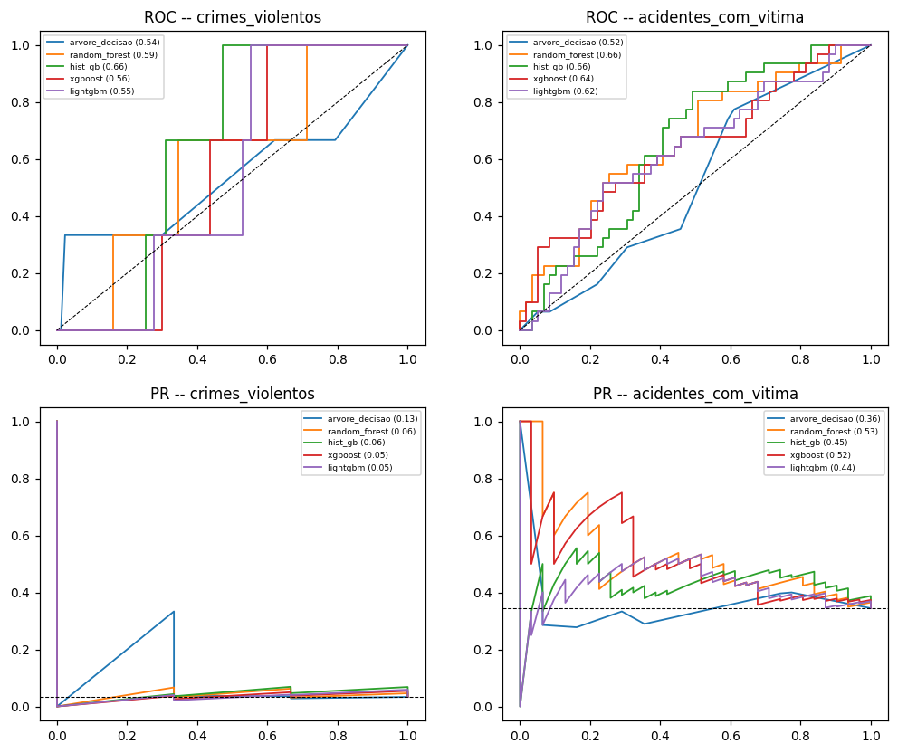
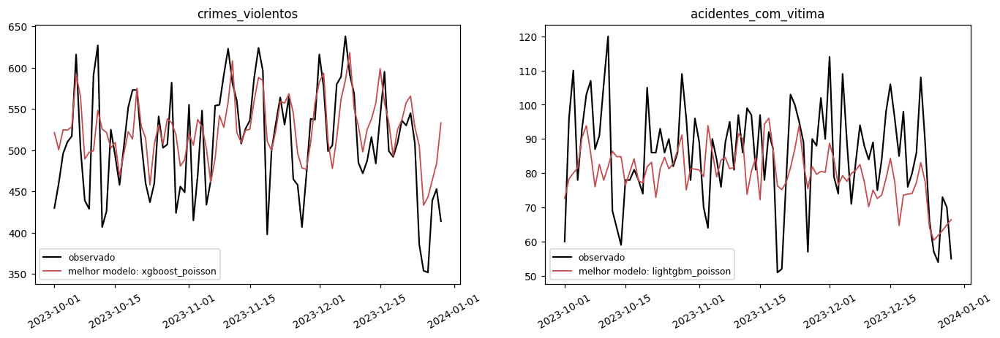
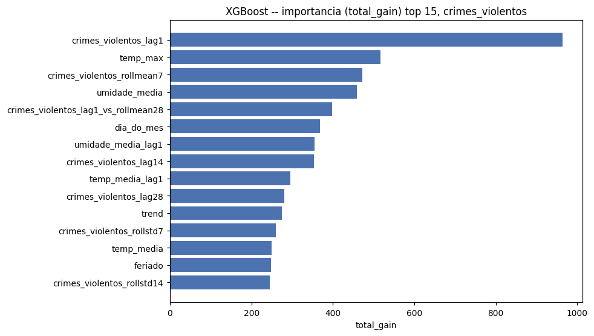
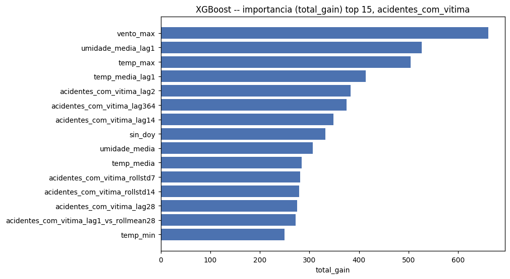

# Etapa 14 -- Modelos de Machine Learning

_Gerado por `scripts/11_modelos.py` em 2026-09-04. Fontes: `data/gold/features_dia_sp.csv`, `fato_dia_sp.csv`, `reports/etapa13/tabelas/*.csv`._

> Regra 9: todo modelo e comparado ao scoreboard de baselines da Etapa 13 na mesma tabela. Regra 8: leitura por Recall/F1/PR-AUC, nao so Accuracy. Regra 6: hiperparametros propositalmente rasos.

## 1. Setup

Mesmo split da Etapa 13 (treino < 2023-10-01, teste >= 2023-10-01) e mesma redefinicao de alvo de pico (calendario + limiar P90 reajustados SO no treino) -- necessario para comparar linha a linha com o scoreboard de baselines. **Isso tambem herda o problema ja documentado la**: o teste de `crimes_violentos` tem so 3 dias-pico (de 90) -- qualquer metrica de classificacao para esse desfecho aqui e ilustrativa, nao conclusiva.

**Features**: mesmo conjunto leakage-safe da Etapa 13 (temporal + futebol + clima + historico do proprio desfecho) **+ lag364**, que a Etapa 13 tinha excluido so por causa da imputacao do LogReg -- arvores/boosting toleram bem uma coluna esparsa (49,9% NaN).

**NaN**: `arvore_decisao`/`random_forest`/`logreg` recebem imputacao por mediana (ajustada so no treino); `hist_gb`/`xgboost`/`lightgbm` usam o NaN nativamente (sem imputar) -- vantagem pratica desses algoritmos aqui.

**Desbalanceamento** (classificacao): `sample_weight` balanceado (n/(2·n_classe), calculado so no treino) em todos os classificadores, mesmo espirito do `class_weight='balanced'` da Etapa 13.

**Hiperparametros rasos e nao otimizados** (Regra 6 do briefing: nao usar modelo complexo so por ser sofisticado): profundidade <=6, poucas arvores, sem busca de hiperparametros -- adequado a ~640 linhas de treino. Uma busca formal (RandomizedSearch/Optuna) fica fora do escopo desta etapa.

## 2. Classificacao (prever pico)

Accuracy/Precision/Recall/F1 no limiar 0.5; ROC-AUC/PR-AUC sao livres de limiar (Regra 8: nao julgar so por Accuracy).

### crimes_violentos

| origem | baseline | n_teste | n_pico_teste | accuracy | precision | recall | f1 | roc_auc | pr_auc |
| --- | --- | --- | --- | --- | --- | --- | --- | --- | --- |
| baseline (Etapa 13) | logreg | 90 | 3 | 0.944 | 0.250 | 0.333 | 0.286 | 0.636 | 0.367 |
| baseline (Etapa 13) | logreg_balanced | 90 | 3 | 0.789 | 0.056 | 0.333 | 0.095 | 0.686 | 0.217 |
| modelo (Etapa 14) | arvore_decisao | 90 | 3 | 0.689 | 0.037 | 0.333 | 0.067 | 0.542 | 0.134 |
| modelo (Etapa 14) | hist_gb | 90 | 3 | 0.900 | 0.000 | 0.000 | 0.000 | 0.655 | 0.060 |
| modelo (Etapa 14) | random_forest | 90 | 3 | 0.944 | 0.000 | 0.000 | 0.000 | 0.594 | 0.058 |
| modelo (Etapa 14) | xgboost | 90 | 3 | 0.867 | 0.000 | 0.000 | 0.000 | 0.556 | 0.047 |
| modelo (Etapa 14) | lightgbm | 90 | 3 | 0.889 | 0.000 | 0.000 | 0.000 | 0.548 | 0.047 |
| baseline (Etapa 13) | dia_semana_risco (domingo/segunda/sábado) | 90 | 3 | 0.544 | 0.000 | 0.000 | 0.000 | 0.282 | 0.033 |
| baseline (Etapa 13) | classe_majoritaria | 90 | 3 | 0.967 | 0.000 | 0.000 | 0.000 |  |  |

### acidentes_com_vitima

| origem | baseline | n_teste | n_pico_teste | accuracy | precision | recall | f1 | roc_auc | pr_auc |
| --- | --- | --- | --- | --- | --- | --- | --- | --- | --- |
| modelo (Etapa 14) | random_forest | 90 | 31 | 0.678 | 1.000 | 0.065 | 0.121 | 0.663 | 0.532 |
| modelo (Etapa 14) | xgboost | 90 | 31 | 0.667 | 0.571 | 0.129 | 0.211 | 0.640 | 0.521 |
| baseline (Etapa 13) | logreg | 90 | 31 | 0.622 | 0.400 | 0.194 | 0.261 | 0.646 | 0.451 |
| modelo (Etapa 14) | hist_gb | 90 | 31 | 0.644 | 0.400 | 0.065 | 0.111 | 0.655 | 0.450 |
| modelo (Etapa 14) | lightgbm | 90 | 31 | 0.622 | 0.286 | 0.065 | 0.105 | 0.623 | 0.437 |
| baseline (Etapa 13) | logreg_balanced | 90 | 31 | 0.578 | 0.434 | 0.742 | 0.548 | 0.635 | 0.436 |
| baseline (Etapa 13) | dia_semana_risco (segunda/quarta/sexta/sábado) | 90 | 31 | 0.533 | 0.392 | 0.645 | 0.488 | 0.560 | 0.375 |
| modelo (Etapa 14) | arvore_decisao | 90 | 31 | 0.522 | 0.397 | 0.742 | 0.517 | 0.521 | 0.359 |
| baseline (Etapa 13) | classe_majoritaria | 90 | 31 | 0.656 | 0.000 | 0.000 | 0.000 |  |  |

Melhor modelo por PR-AUC em `crimes_violentos`: **arvore_decisao** (PR-AUC=0.134, F1=0.067). Matriz de confusao:

| index | prev: nao-pico | prev: pico |
| --- | --- | --- |
| real: nao-pico | 61 | 26 |
| real: pico | 2 | 1 |

_'Melhor' aqui e relativo -- 26 falsos positivos para 1 verdadeiro(s) positivo(s), sobre so 3 casos reais no teste. Nao e um modelo utilizavel, e o menos ruim entre opcoes ruins (ver ressalva da secao 1)._

Melhor modelo por PR-AUC em `acidentes_com_vitima`: **random_forest** (PR-AUC=0.532, F1=0.121). Matriz de confusao:

| index | prev: nao-pico | prev: pico |
| --- | --- | --- |
| real: nao-pico | 59 | 0 |
| real: pico | 29 | 2 |

## 3. Regressao (prever a contagem)

### crimes_violentos

| origem | baseline | n | MAE | RMSE | R2 | MAPE_% |
| --- | --- | --- | --- | --- | --- | --- |
| modelo (Etapa 14) | xgboost_poisson | 90 | 39.22 | 49.88 | 0.41 | 8.23 |
| modelo (Etapa 14) | lightgbm_poisson | 90 | 40.24 | 50.60 | 0.40 | 8.37 |
| modelo (Etapa 14) | hist_gb_poisson | 90 | 41.38 | 52.58 | 0.35 | 8.65 |
| modelo (Etapa 14) | random_forest | 90 | 42.14 | 54.17 | 0.31 | 8.77 |
| modelo (Etapa 14) | arvore_decisao | 90 | 50.14 | 63.35 | 0.05 | 10.39 |
| baseline (Etapa 13) | media_movel_7d | 90 | 51.32 | 63.90 | 0.04 | 10.51 |
| baseline (Etapa 13) | media_movel_28d | 90 | 53.53 | 65.62 | -0.02 | 11.03 |
| baseline (Etapa 13) | media_historica | 90 | 53.98 | 65.69 | -0.02 | 11.19 |
| baseline (Etapa 13) | mesmo_dia_semana_ant | 90 | 60.01 | 77.62 | -0.42 | 12.27 |

### acidentes_com_vitima

| origem | baseline | n | MAE | RMSE | R2 | MAPE_% |
| --- | --- | --- | --- | --- | --- | --- |
| modelo (Etapa 14) | lightgbm_poisson | 90 | 11.77 | 14.79 | -0.00 | 13.86 |
| modelo (Etapa 14) | hist_gb_poisson | 90 | 11.79 | 14.75 | 0.01 | 13.84 |
| baseline (Etapa 13) | media_movel_7d | 90 | 11.82 | 15.33 | -0.07 | 15.17 |
| modelo (Etapa 14) | xgboost_poisson | 90 | 11.89 | 14.84 | -0.01 | 14.09 |
| baseline (Etapa 13) | media_movel_28d | 90 | 11.89 | 15.24 | -0.06 | 15.44 |
| modelo (Etapa 14) | random_forest | 90 | 12.35 | 15.44 | -0.09 | 14.64 |
| baseline (Etapa 13) | media_historica | 90 | 12.78 | 15.71 | -0.13 | 15.32 |
| baseline (Etapa 13) | mesmo_dia_semana_ant | 90 | 15.48 | 20.20 | -0.87 | 19.77 |
| modelo (Etapa 14) | arvore_decisao | 90 | 15.59 | 19.20 | -0.69 | 18.79 |

## 4. Importancia de features (previa -- SHAP formal e a Etapa 18)

**`total_gain`** (ganho total acumulado, soma do ganho de TODOS os splits que usam a feature) como medida principal -- nao o `gain` medio por split, que **infla features binarias raras**: um unico split muito puro numa feature usada poucas vezes da um `gain` medio alto mesmo sem peso real no modelo. Reportamos `weight` (nº de splits) e `gain` junto para auditar esse efeito -- mesmo cuidado ja aplicado ao RR aparente do Morumbi na Etapa 10. A analise definitiva de interpretabilidade (SHAP, com direcao do efeito) e a Etapa 18.

_Features de futebol no top 15 por total_gain: 0 (nenhuma). Top 1 geral: `crimes_violentos_lag1` (965)._

_Atencao -- top-5 por `gain` medio que NAO entra no top-10 por `total_gain` (provavel artefato de feature binaria rara, poucos splits mas puros): `fim_de_semana` (gain medio alto, so 2 splits, total_gain rank #36), `feriado_nacional` (gain medio alto, so 1 splits, total_gain rank #41), `feriado_municipal` (gain medio alto, so 1 splits, total_gain rank #43), `pico_p90_crimes_violentos_lag1` (gain medio alto, so 3 splits, total_gain rank #39). Nao interpretar como achado sem checar `total_gain`/`weight`._

_Features de futebol no top 15 por total_gain: 0 (nenhuma). Top 1 geral: `vento_max` (661)._

_Atencao -- top-5 por `gain` medio que NAO entra no top-10 por `total_gain` (provavel artefato de feature binaria rara, poucos splits mas puros): `classico_d_menos_1` (gain medio alto, so 2 splits, total_gain rank #37), `classico_x_fds` (gain medio alto, so 4 splits, total_gain rank #35), `semana_ano` (gain medio alto, so 7 splits, total_gain rank #34). Nao interpretar como achado sem checar `total_gain`/`weight`._

## 5. Sensibilidade ao outlier de 2022-06-19

Pendencia da Etapa 12: comparar `crimes_violentos` **com** o tratamento (contagem do dia -> missing, como ja rodou em todo o projeto) e **sem** (dia mantido cru, `furtos_total`=2633/`crimes_violentos`=715). So XGBoost, so `crimes_violentos` (unico desfecho afetado pelo outlier).

| tratamento | tarefa | n_teste | n_pico_teste | recall | f1 | pr_auc | MAE | RMSE |
| --- | --- | --- | --- | --- | --- | --- | --- | --- |
| com tratamento (projeto) | classificacao | 90 | 3.000 | 0.000 | 0.000 | 0.047 |  |  |
| com tratamento (projeto) | regressao | 90 |  |  |  |  | 39.215 | 49.880 |
| sem tratamento (sensibilidade) | classificacao | 92 | 3.000 | 0.000 | 0.000 | 0.055 |  |  |
| sem tratamento (sensibilidade) | regressao | 92 |  |  |  |  | 43.050 | 62.667 |

_Diferencas grandes entre as linhas indicariam que a decisao da Etapa 12 (tratar 2022-06-19 como missing) muda a conclusao; diferencas pequenas confirmam que o tratamento e so uma correcao pontual, nao um fator que decide o resultado._

## 6. Escolha do modelo e sintese

| base | melhor_classificador_PR_AUC | PR_AUC | F1_desse | Recall_desse | melhor_regressor | MAE | RMSE |
| --- | --- | --- | --- | --- | --- | --- | --- |
| crimes_violentos | arvore_decisao | 0.134 | 0.067 | 0.333 | xgboost_poisson | 39.215 | 49.880 |
| acidentes_com_vitima | random_forest | 0.532 | 0.121 | 0.065 | lightgbm_poisson | 11.774 | 14.791 |

**Atencao -- PR-AUC e F1@0.5 discordam do 'melhor modelo' em pelo menos um desfecho** (comparando TODAS as linhas, baselines incluidos):

| base | melhor_PR_AUC | PR_AUC | F1_do_PR_AUC | Recall_do_PR_AUC | melhor_F1 | F1 | Recall_do_F1 | PR_AUC_do_F1 |
| --- | --- | --- | --- | --- | --- | --- | --- | --- |
| crimes_violentos | arvore_decisao | 0.134 | 0.067 | 0.333 | logreg | 0.286 | 0.333 | 0.367 |
| acidentes_com_vitima | random_forest | 0.532 | 0.121 | 0.065 | logreg_balanced | 0.548 | 0.742 | 0.436 |

PR-AUC (livre de limiar) recompensa a qualidade do ranking; F1/Recall em 0.5 medem o classificador no ponto de operacao real. Um modelo pode ordenar bem os dias de risco e ainda assim, no limiar padrao, marcar quase nada como pico (alta precisao, recall baixo) -- e o caso de `random_forest` em `acidentes_com_vitima`: PR-AUC mais alto do grupo, mas so 2 dias previstos como pico em 90 (recall 0,065), contra recall 0,74 do `logreg_balanced` da Etapa 13. **Para um sistema de alerta de pico, recall costuma pesar mais que ranking abstrato** -- a escolha final do artigo deveria considerar ajuste de limiar (nao feito aqui) antes de declarar um vencedor so pelo PR-AUC.

- **Criterio de escolha**: nao e so a metrica -- entre modelos com desempenho
  parecido, prefere-se o mais simples/interpretavel (Regra: nao usar
  complexidade so por ser sofisticado). Se Random Forest ou HistGB chegam
  perto do XGBoost/LightGBM em PR-AUC/MAE, a simplicidade extra pesa a favor
  deles na escolha final do artigo.
- **`crimes_violentos` classificacao**: leitura ilustrativa (n=3 positivos no
  teste, herdado da Etapa 13) -- nao usar esse numero como conclusao forte
  sem a validacao walk-forward da Etapa 15.
- **Importancia de features**: por `total_gain` (nao o `gain` medio, que
  infla features binarias raras -- ver secao 4), as features lideres seguem
  sendo historico do proprio desfecho e clima, nao futebol -- reconfirma
  Etapas 7-10. O unico candidato a contra-exemplo (`classico_d_menos_1` em
  `acidentes_com_vitima`) foi auditado na propria secao 4 e e o mesmo sinal
  fraco de classico com amostra pequena ja visto e nao confirmado nas
  Etapas 7-9 -- nao e um achado novo.
- **Sensibilidade ao outlier**: ver secao 5 -- a decisao da Etapa 12 muda
  (ou nao) a leitura de forma relevante.
- **Proximo**: Etapa 15 -- validacao temporal formal (walk-forward /
  TimeSeriesSplit com varios folds), a resposta definitiva para a fragilidade
  do split unico ja demonstrada na Etapa 13 e herdada aqui.
