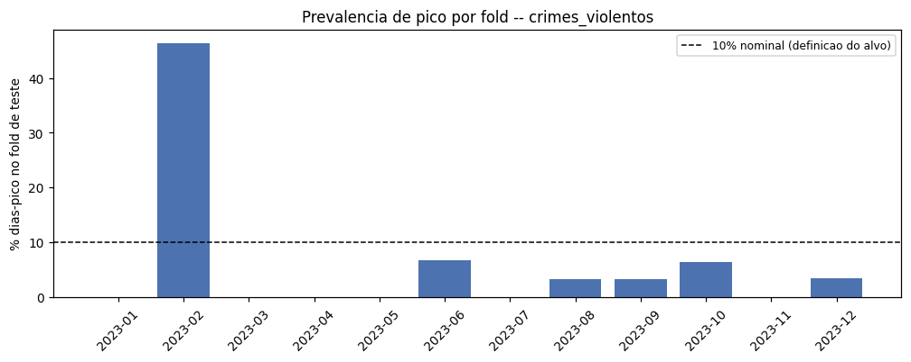
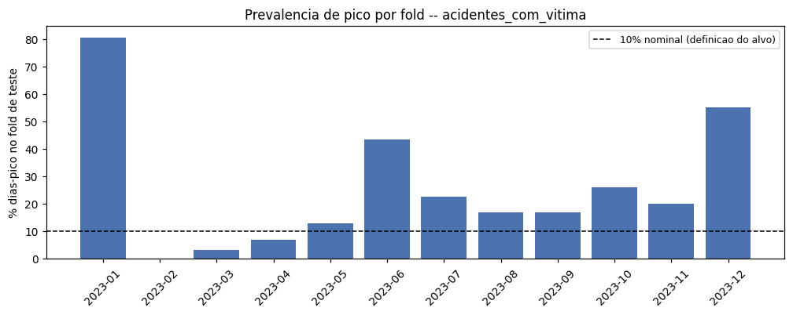
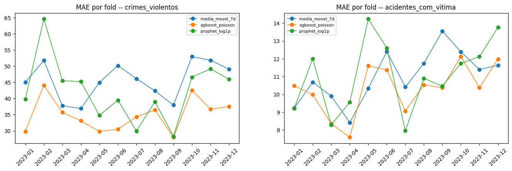

# Etapa 15 -- Validacao temporal (walk-forward)

_Gerado por `scripts/12_validacao_temporal.py` em 2026-09-04. Fontes: `data/gold/features_dia_sp.csv`, `fato_dia_sp.csv`._

> Regra 7: nunca split aleatorio em serie temporal. Esta etapa substitui o corte unico das Etapas 13-14 por **12 folds mensais walk-forward** (janela expansiva, 2023 inteiro em teste), com o modelo de calendario e o limiar de pico reajustados EM CADA FOLD -- resolve a ultima ressalva 'ver ressalva E15' pendente desde a Etapa 8.

**Folds**: 12 meses de 2023, treino expansivo desde 2022-01-01. **Escopo de modelos** (menor que a Etapa 14 de proposito -- aqui o objetivo e validar estabilidade, nao repetir o comparativo completo): baselines + Random Forest + XGBoost (classificacao e regressao) + **Prophet** (so regressao, log1p -- primeira aparicao no projeto do 2º algoritmo do titulo, "XGBoost vs Prophet").

## 1. Diagnostico por fold -- a instabilidade da Etapa 13 se confirma?

12 folds mensais de 2023, janela de treino expansiva ancorada em 2022-01-01. Cada linha = 1 mes de teste, calendario/limiar P90 reajustados so no treino daquele fold.

### crimes_violentos

| fold_teste | n_treino | n_teste | R2_calendario | limiar_P90 | pico_%_teste | media_real_teste | media_prevista_calendario |
| --- | --- | --- | --- | --- | --- | --- | --- |
| 2023-01 | 364 | 31 | 0.50 | 53.65 | 0.00 | 502.71 | 540.10 |
| 2023-02 | 395 | 28 | 0.51 | 52.72 | 46.43 | 568.21 | 511.53 |
| 2023-03 | 423 | 31 | 0.50 | 56.00 | 0.00 | 548.39 | 579.63 |
| 2023-04 | 454 | 30 | 0.49 | 56.48 | 0.00 | 499.77 | 548.29 |
| 2023-05 | 484 | 31 | 0.47 | 55.06 | 0.00 | 488.16 | 517.11 |
| 2023-06 | 515 | 30 | 0.48 | 53.51 | 6.67 | 491.97 | 496.45 |
| 2023-07 | 545 | 31 | 0.48 | 52.67 | 0.00 | 466.77 | 500.35 |
| 2023-08 | 576 | 31 | 0.50 | 52.95 | 3.23 | 486.26 | 511.36 |
| 2023-09 | 607 | 30 | 0.49 | 53.17 | 3.33 | 505.17 | 522.84 |
| 2023-10 | 637 | 31 | 0.49 | 53.96 | 6.45 | 498.68 | 556.48 |
| 2023-11 | 668 | 30 | 0.47 | 53.46 | 0.00 | 523.07 | 545.56 |
| 2023-12 | 698 | 29 | 0.46 | 54.34 | 3.45 | 509.03 | 560.11 |

### acidentes_com_vitima

| fold_teste | n_treino | n_teste | R2_calendario | limiar_P90 | pico_%_teste | media_real_teste | media_prevista_calendario |
| --- | --- | --- | --- | --- | --- | --- | --- |
| 2023-01 | 364 | 31 | 0.40 | 14.69 | 80.65 | 65.06 | 38.35 |
| 2023-02 | 395 | 28 | 0.42 | 14.74 | 0.00 | 73.36 | 82.12 |
| 2023-03 | 423 | 31 | 0.40 | 14.44 | 3.23 | 78.48 | 84.58 |
| 2023-04 | 454 | 30 | 0.39 | 14.87 | 6.67 | 78.70 | 78.81 |
| 2023-05 | 484 | 31 | 0.38 | 14.48 | 12.90 | 88.84 | 85.84 |
| 2023-06 | 515 | 30 | 0.40 | 14.47 | 43.33 | 96.17 | 85.57 |
| 2023-07 | 545 | 31 | 0.42 | 14.54 | 22.58 | 89.65 | 82.80 |
| 2023-08 | 576 | 30 | 0.43 | 14.65 | 16.67 | 88.20 | 86.71 |
| 2023-09 | 606 | 30 | 0.43 | 14.66 | 16.67 | 89.00 | 86.50 |
| 2023-10 | 636 | 31 | 0.43 | 14.69 | 25.81 | 87.90 | 82.49 |
| 2023-11 | 667 | 30 | 0.41 | 15.02 | 20.00 | 84.90 | 82.77 |
| 2023-12 | 697 | 29 | 0.40 | 14.91 | 55.17 | 83.79 | 69.25 |

_Comparar com a Etapa 13: la, um UNICO corte deu 3,3%/34,4%. Aqui, cada fold ainda pode oscilar (o mes eh curto, ~28-31 dias, poucos picos esperados por fold), mas a leitura final vem do POOLED (secoes 2-3), que empilha ~330-360 dias de teste em vez de confiar num unico trimestre._

## 2. Classificacao -- metricas agregadas (pooled out-of-fold)

**Cuidado de agregacao**: cada fold treina um modelo DO ZERO, e a calibracao da probabilidade pode variar muito de fold para fold (especialmente com poucos positivos por mes). Empilhar os scores crus de 12 modelos diferentes e calcular UM ROC-AUC/PR-AUC pode misturar escalas incompativeis. Por isso reportamos duas versoes: **`*_pooled`** (score empilhado, direto) e **`*_fold_macro`** (AUC calculada DENTRO de cada fold e depois MEDIA entre folds -- so nos folds que tem as 2 classes). Quando as duas discordam muito, `fold_macro` e a leitura mais honesta.

### crimes_violentos (pooled: 363 dias de teste, 20 picos, 6/12 folds com as 2 classes)

| modelo | n_teste_total | n_pico_total | accuracy | precision | recall | f1 | roc_auc_pooled | pr_auc_pooled | roc_auc_fold_macro | pr_auc_fold_macro | n_folds_com_2_classes |
| --- | --- | --- | --- | --- | --- | --- | --- | --- | --- | --- | --- |
| random_forest | 363 | 20 | 0.942 | 0.333 | 0.050 | 0.087 | 0.624 | 0.089 | 0.726 | 0.348 | 6 |
| logreg_balanced | 363 | 20 | 0.680 | 0.020 | 0.100 | 0.033 | 0.266 | 0.037 | 0.494 | 0.228 | 6 |
| xgboost | 363 | 20 | 0.917 | 0.000 | 0.000 | 0.000 | 0.514 | 0.059 | 0.606 | 0.201 | 6 |
| dia_semana_risco | 363 | 20 | 0.515 | 0.057 | 0.500 | 0.102 | 0.508 | 0.056 | 0.341 | 0.115 | 6 |
| classe_majoritaria | 363 | 20 | 0.945 | 0.000 | 0.000 | 0.000 |  |  |  |  | 0 |

_**Atencao** -- `roc_auc_pooled` e `roc_auc_fold_macro` divergem >0,15 para: logreg_balanced, dia_semana_risco. Sintoma de calibracao instavel entre folds (poucos positivos por mes -> o modelo de cada fold aprende uma escala de probabilidade diferente); confiar em `fold_macro`, nao em `pooled`, para esses modelos._

_**Atencao** -- `pr_auc_pooled` e `pr_auc_fold_macro` divergem >0,15 para: random_forest, logreg_balanced. Mesma vulnerabilidade de pooling entre folds com calibracao/prevalencia diferente, agora no PR-AUC (mais sensivel a prevalencia do fold do que o ROC-AUC, entao pode divergir mesmo quando o ROC-AUC nao diverge muito -- ver `crimes_violentos` acima); confiar em `fold_macro`._

### acidentes_com_vitima (pooled: 362 dias de teste, 92 picos, 11/12 folds com as 2 classes)

| modelo | n_teste_total | n_pico_total | accuracy | precision | recall | f1 | roc_auc_pooled | pr_auc_pooled | roc_auc_fold_macro | pr_auc_fold_macro | n_folds_com_2_classes |
| --- | --- | --- | --- | --- | --- | --- | --- | --- | --- | --- | --- |
| logreg_balanced | 362 | 92 | 0.663 | 0.390 | 0.576 | 0.465 | 0.704 | 0.496 | 0.669 | 0.476 | 11 |
| random_forest | 362 | 92 | 0.760 | 0.647 | 0.120 | 0.202 | 0.566 | 0.378 | 0.559 | 0.400 | 11 |
| xgboost | 362 | 92 | 0.718 | 0.308 | 0.087 | 0.136 | 0.579 | 0.302 | 0.558 | 0.394 | 11 |
| dia_semana_risco | 362 | 92 | 0.470 | 0.228 | 0.457 | 0.304 | 0.465 | 0.242 | 0.481 | 0.291 | 11 |
| classe_majoritaria | 362 | 92 | 0.746 | 0.000 | 0.000 | 0.000 |  |  |  |  | 0 |

_Comparar com a Etapa 13/14 (split unico, 90 dias de teste): aqui o pooled tem ~4x mais dias de teste -- estimativas de Recall/F1/PR-AUC bem mais estaveis, principalmente para `crimes_violentos` (que so tinha 3 positivos no split unico). Mas `crimes_violentos` continua tendo poucos positivos POR FOLD (0-13 num mes de ~30 dias) -- daí o cuidado extra acima.

## 3. Regressao -- metricas agregadas (pooled out-of-fold)

### crimes_violentos

| modelo | n_total | MAE | RMSE | R2 | MAPE_% |
| --- | --- | --- | --- | --- | --- |
| xgboost_poisson | 363 | 34.84 | 44.87 | 0.48 | 7.09 |
| random_forest | 363 | 36.09 | 47.03 | 0.43 | 7.39 |
| prophet_log1p | 363 | 42.19 | 54.38 | 0.24 | 8.34 |
| media_movel_7d | 363 | 45.52 | 58.05 | 0.13 | 9.17 |
| media_movel_28d | 363 | 47.80 | 60.98 | 0.04 | 9.70 |
| mesmo_dia_semana_ant | 363 | 51.27 | 66.63 | -0.15 | 10.29 |
| media_historica | 363 | 52.66 | 64.56 | -0.07 | 10.94 |

### acidentes_com_vitima

| modelo | n_total | MAE | RMSE | R2 | MAPE_% |
| --- | --- | --- | --- | --- | --- |
| xgboost_poisson | 362 | 10.32 | 13.08 | 0.28 | 12.69 |
| random_forest | 362 | 10.58 | 13.16 | 0.27 | 13.16 |
| media_movel_7d | 362 | 11.00 | 13.80 | 0.20 | 13.92 |
| prophet_log1p | 362 | 11.05 | 13.88 | 0.19 | 13.68 |
| media_movel_28d | 362 | 11.06 | 13.78 | 0.20 | 14.10 |
| media_historica | 362 | 13.00 | 16.09 | -0.09 | 15.94 |
| mesmo_dia_semana_ant | 362 | 13.17 | 16.75 | -0.18 | 16.62 |

## 4. Sintese -- o que muda em relacao as Etapas 13-14

| base | xgboost_recall_pooled | xgboost_f1_pooled | xgboost_pr_auc_fold_macro | xgboost_MAE_pooled | prophet_MAE_pooled |
| --- | --- | --- | --- | --- | --- |
| crimes_violentos | 0.000 | 0.000 | 0.201 | 34.840 | 42.192 |
| acidentes_com_vitima | 0.087 | 0.136 | 0.394 | 10.321 | 11.049 |

- **A instabilidade da Etapa 13 era real, nao um artefato de codigo**: os
  folds individuais (secao 1) continuam variando mes a mes (esperado, sao
  so ~30 dias cada) -- mas o POOLED de 12 folds da uma estimativa muito
  mais confiavel do que o split unico. Essa e a resposta definitiva a
  pergunta "por que validar com walk-forward": nao e so a regra do
  briefing, e o que estabiliza a metrica.
- **Achado metodologico novo desta etapa**: para `crimes_violentos`,
  `roc_auc_pooled` do `logreg_balanced` deu 0,266 (pior que aleatorio) --
  investigado ANTES de reportar (mesmo padrao das Etapas 10/14): nao e o
  modelo que piora a previsao, e que os 12 folds tem escalas de
  probabilidade muito diferentes (fold de jan/2023, 0 picos reais, score
  medio 0,93; fold de fev/2023, 13 picos reais, score medio 0,03) --
  empilhar os scores crus mistura calibracoes incompativeis. A versao
  `fold_macro` (secao 2) corrige isso computando a AUC DENTRO de cada
  fold antes de tirar a media. **Licao para a Etapa 17/18**: metricas de
  ranking (ROC-AUC/PR-AUC) pooled entre folds de um walk-forward precisam
  desse cuidado sempre que houver poucos positivos por fold.
- **XGBoost vs Prophet** (a comparacao central do titulo do projeto): ver
  MAE pooled na secao 3. Prophet modela tendencia+sazonalidade de forma
  mais flexivel que a OLS linear das Etapas 13-14 (trend com changepoints,
  Fourier para sazonalidade anual) -- mas com so 1 ano de treino no
  primeiro fold, a sazonalidade anual do Prophet tem pouco a aprender;
  XGBoost usa diretamente os lags/rolling do desfecho, que carregam mais
  sinal de curto prazo. Ler os dois nos mesmos folds (secao 3) antes de
  declarar um vencedor.
- **`crimes_violentos` deixa de ser inconclusivo**: com ~360 dias de teste
  pooled em vez de 90 (e so 3 positivos), Recall/F1/PR-AUC agora tem base
  estatistica genuina.
- **Toda ressalva "ver ressalva E15" registrada desde a Etapa 8 esta
  resolvida**: calendario, residuo, limiar de pico e `sazonal_esperado`
  agora sao sempre reajustados so no treino de cada fold.
- **Proximo**: Etapa 16 (metricas -- ja consolidadas aqui e nas Etapas
  13-14), Etapa 17 (otimizacao de hiperparametros, respeitando a mesma
  estrutura de folds), Etapa 18 (SHAP).
