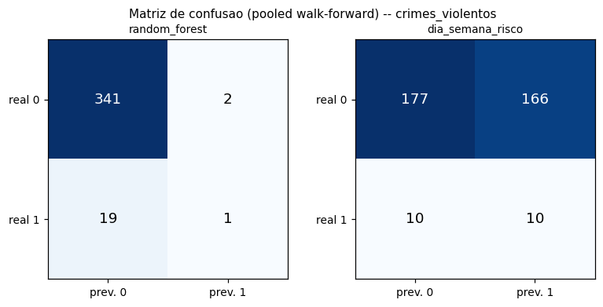
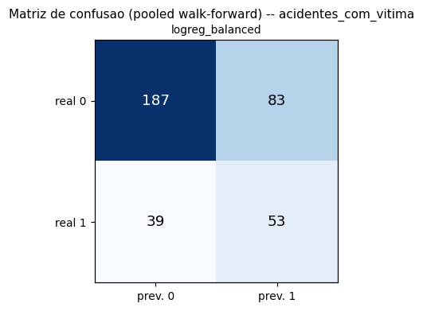

# Etapa 16 -- Metricas (consolidacao formal)

_Gerado por `scripts/13_metricas_consolidadas.py` em 2026-09-04. Fontes: `reports/etapa13/tabelas`, `reports/etapa14/tabelas`, `reports/etapa15/tabelas` (nenhum modelo treinado de novo aqui)._

As metricas de regressao e classificacao exigidas pelo briefing S16 ja estavam sendo calculadas inline desde a Etapa 13. Esta etapa (1) audita a cobertura contra a lista do briefing, (2) preenche a unica lacuna real -- matriz de confusao, nunca produzida antes --, e (3) consolida as 3 fontes num scoreboard unico com uma recomendacao formal de modelo por alvo x tarefa para as Etapas 17-18.

## 1. Checklist do briefing (S16) -- o que ja existe e o que faltava

Esta etapa nao recalcula nada; consolida o que as Etapas 13-15 ja produziram e preenche a unica lacuna real (matriz de confusao).

### Regressao

| metrica | exigida | onde |
| --- | --- | --- |
| MAE | sim | Etapas 13, 14, 15 (todas as tabelas de regressao) |
| RMSE | sim | Etapas 13, 14, 15 |
| R2 | sim | Etapas 13, 14, 15 |
| MAPE | apenas quando apropriado | Etapas 13, 14, 15 -- ver justificativa abaixo |
| SMAPE | se necessario | nao calculado -- ver justificativa abaixo |

**MAPE e apropriado aqui**: MAPE explode/e indefinido quando o valor real se aproxima de zero. Os dois alvos de contagem nunca chegam perto disso no periodo observado:

| alvo | minimo_observado | dias_com_zero |
| --- | --- | --- |
| crimes_violentos | 340 | 0 |
| acidentes_com_vitima | 31 | 0 |

Minimo observado de 340 (`crimes_violentos`) e 31 (`acidentes_com_vitima`) em 730 dias, 0 dias com contagem zero em qualquer um dos dois -- MAPE e estavel e interpretavel. **SMAPE nao foi calculado**: a razao classica para preferir SMAPE (valores reais perto de zero, que inflam o MAPE artificialmente) nao se aplica aqui; adicionar SMAPE so duplicaria a leitura de MAPE sem trazer informacao nova (Regra 10: declarar a decisao, nao calcular por calcular).

### Classificacao

| metrica | exigida | onde |
| --- | --- | --- |
| Accuracy | sim | Etapas 13, 14, 15 -- NUNCA usada sozinha para escolher modelo (Regra 8) |
| Precision | sim | Etapas 13, 14, 15 |
| Recall | sim (atencao especial -- S16) | Etapas 13, 14, 15 |
| F1 | sim (atencao especial -- S16) | Etapas 13, 14, 15 |
| ROC-AUC | sim | Etapas 13, 14, 15 (pooled + fold_macro na 15) |
| PR-AUC | sim (atencao especial -- S16) | Etapas 13, 14, 15 (pooled + fold_macro na 15) |
| Matriz de confusao | sim | **faltava -- produzida na secao 3 desta etapa** |

## 2. Scoreboard consolidado -- as 3 fontes lado a lado

`roc_auc`/`pr_auc` da Etapa 15 usam **`fold_macro`**, nao `pooled` (ver ressalva metodologica da Etapa 15 -- pooled distorce quando ha poucos positivos por fold).

### crimes_violentos -- Regressao

**Etapa 13 -- split unico (baseline)**

| modelo | n | MAE | RMSE | R2 | MAPE_% |
| --- | --- | --- | --- | --- | --- |
| media_movel_7d | 90 | 51.32 | 63.90 | 0.04 | 10.51 |
| media_movel_28d | 90 | 53.53 | 65.62 | -0.02 | 11.03 |
| media_historica | 90 | 53.98 | 65.69 | -0.02 | 11.19 |
| mesmo_dia_semana_ant | 90 | 60.01 | 77.62 | -0.42 | 12.27 |

**Etapa 14 -- split unico (modelo ML)**

| modelo | n | MAE | RMSE | R2 | MAPE_% |
| --- | --- | --- | --- | --- | --- |
| xgboost_poisson | 90 | 39.22 | 49.88 | 0.41 | 8.23 |
| lightgbm_poisson | 90 | 40.24 | 50.60 | 0.40 | 8.37 |
| hist_gb_poisson | 90 | 41.38 | 52.58 | 0.35 | 8.65 |
| random_forest | 90 | 42.14 | 54.17 | 0.31 | 8.77 |
| arvore_decisao | 90 | 50.14 | 63.35 | 0.05 | 10.39 |
| media_movel_7d | 90 | 51.32 | 63.90 | 0.04 | 10.51 |
| media_movel_28d | 90 | 53.53 | 65.62 | -0.02 | 11.03 |
| media_historica | 90 | 53.98 | 65.69 | -0.02 | 11.19 |
| mesmo_dia_semana_ant | 90 | 60.01 | 77.62 | -0.42 | 12.27 |

**Etapa 15 -- pooled walk-forward (12 folds)**

| modelo | n | MAE | RMSE | R2 | MAPE_% |
| --- | --- | --- | --- | --- | --- |
| xgboost_poisson | 363 | 34.84 | 44.87 | 0.48 | 7.09 |
| random_forest | 363 | 36.09 | 47.03 | 0.43 | 7.39 |
| prophet_log1p | 363 | 42.19 | 54.38 | 0.24 | 8.34 |
| media_movel_7d | 363 | 45.52 | 58.05 | 0.13 | 9.17 |
| media_movel_28d | 363 | 47.80 | 60.98 | 0.04 | 9.70 |
| mesmo_dia_semana_ant | 363 | 51.27 | 66.63 | -0.15 | 10.29 |
| media_historica | 363 | 52.66 | 64.56 | -0.07 | 10.94 |

### acidentes_com_vitima -- Regressao

**Etapa 13 -- split unico (baseline)**

| modelo | n | MAE | RMSE | R2 | MAPE_% |
| --- | --- | --- | --- | --- | --- |
| media_movel_7d | 90 | 11.82 | 15.33 | -0.07 | 15.17 |
| media_movel_28d | 90 | 11.89 | 15.24 | -0.06 | 15.44 |
| media_historica | 90 | 12.78 | 15.71 | -0.13 | 15.32 |
| mesmo_dia_semana_ant | 90 | 15.48 | 20.20 | -0.87 | 19.77 |

**Etapa 14 -- split unico (modelo ML)**

| modelo | n | MAE | RMSE | R2 | MAPE_% |
| --- | --- | --- | --- | --- | --- |
| lightgbm_poisson | 90 | 11.77 | 14.79 | -0.00 | 13.86 |
| hist_gb_poisson | 90 | 11.79 | 14.75 | 0.01 | 13.84 |
| media_movel_7d | 90 | 11.82 | 15.33 | -0.07 | 15.17 |
| xgboost_poisson | 90 | 11.89 | 14.84 | -0.01 | 14.09 |
| media_movel_28d | 90 | 11.89 | 15.24 | -0.06 | 15.44 |
| random_forest | 90 | 12.35 | 15.44 | -0.09 | 14.64 |
| media_historica | 90 | 12.78 | 15.71 | -0.13 | 15.32 |
| mesmo_dia_semana_ant | 90 | 15.48 | 20.20 | -0.87 | 19.77 |
| arvore_decisao | 90 | 15.59 | 19.20 | -0.69 | 18.79 |

**Etapa 15 -- pooled walk-forward (12 folds)**

| modelo | n | MAE | RMSE | R2 | MAPE_% |
| --- | --- | --- | --- | --- | --- |
| xgboost_poisson | 362 | 10.32 | 13.08 | 0.28 | 12.69 |
| random_forest | 362 | 10.58 | 13.16 | 0.27 | 13.16 |
| media_movel_7d | 362 | 11.00 | 13.80 | 0.20 | 13.92 |
| prophet_log1p | 362 | 11.05 | 13.88 | 0.19 | 13.68 |
| media_movel_28d | 362 | 11.06 | 13.78 | 0.20 | 14.10 |
| media_historica | 362 | 13.00 | 16.09 | -0.09 | 15.94 |
| mesmo_dia_semana_ant | 362 | 13.17 | 16.75 | -0.18 | 16.62 |

### crimes_violentos -- Classificacao

**Etapa 13 -- split unico (baseline)**

| modelo | n_teste_total | n_pico_total | accuracy | precision | recall | f1 | roc_auc | pr_auc |
| --- | --- | --- | --- | --- | --- | --- | --- | --- |
| logreg | 90 | 3 | 0.944 | 0.250 | 0.333 | 0.286 | 0.636 | 0.367 |
| logreg_balanced | 90 | 3 | 0.789 | 0.056 | 0.333 | 0.095 | 0.686 | 0.217 |
| dia_semana_risco (domingo/segunda/sábado) | 90 | 3 | 0.544 | 0.000 | 0.000 | 0.000 | 0.282 | 0.033 |
| classe_majoritaria | 90 | 3 | 0.967 | 0.000 | 0.000 | 0.000 |  |  |

**Etapa 14 -- split unico (modelo ML)**

| modelo | n_teste_total | n_pico_total | accuracy | precision | recall | f1 | roc_auc | pr_auc |
| --- | --- | --- | --- | --- | --- | --- | --- | --- |
| logreg | 90 | 3 | 0.944 | 0.250 | 0.333 | 0.286 | 0.636 | 0.367 |
| logreg_balanced | 90 | 3 | 0.789 | 0.056 | 0.333 | 0.095 | 0.686 | 0.217 |
| arvore_decisao | 90 | 3 | 0.689 | 0.037 | 0.333 | 0.067 | 0.542 | 0.134 |
| random_forest | 90 | 3 | 0.944 | 0.000 | 0.000 | 0.000 | 0.594 | 0.058 |
| hist_gb | 90 | 3 | 0.900 | 0.000 | 0.000 | 0.000 | 0.655 | 0.060 |
| lightgbm | 90 | 3 | 0.889 | 0.000 | 0.000 | 0.000 | 0.548 | 0.047 |
| xgboost | 90 | 3 | 0.867 | 0.000 | 0.000 | 0.000 | 0.556 | 0.047 |
| dia_semana_risco (domingo/segunda/sábado) | 90 | 3 | 0.544 | 0.000 | 0.000 | 0.000 | 0.282 | 0.033 |
| classe_majoritaria | 90 | 3 | 0.967 | 0.000 | 0.000 | 0.000 |  |  |

**Etapa 15 -- pooled walk-forward (12 folds)**

| modelo | n_teste_total | n_pico_total | accuracy | precision | recall | f1 | roc_auc | pr_auc |
| --- | --- | --- | --- | --- | --- | --- | --- | --- |
| dia_semana_risco | 363 | 20 | 0.515 | 0.057 | 0.500 | 0.102 | 0.341 | 0.115 |
| random_forest | 363 | 20 | 0.942 | 0.333 | 0.050 | 0.087 | 0.726 | 0.348 |
| logreg_balanced | 363 | 20 | 0.680 | 0.020 | 0.100 | 0.033 | 0.494 | 0.228 |
| classe_majoritaria | 363 | 20 | 0.945 | 0.000 | 0.000 | 0.000 |  |  |
| xgboost | 363 | 20 | 0.917 | 0.000 | 0.000 | 0.000 | 0.606 | 0.201 |

### acidentes_com_vitima -- Classificacao

**Etapa 13 -- split unico (baseline)**

| modelo | n_teste_total | n_pico_total | accuracy | precision | recall | f1 | roc_auc | pr_auc |
| --- | --- | --- | --- | --- | --- | --- | --- | --- |
| logreg_balanced | 90 | 31 | 0.578 | 0.434 | 0.742 | 0.548 | 0.635 | 0.436 |
| dia_semana_risco (segunda/quarta/sexta/sábado) | 90 | 31 | 0.533 | 0.392 | 0.645 | 0.488 | 0.560 | 0.375 |
| logreg | 90 | 31 | 0.622 | 0.400 | 0.194 | 0.261 | 0.646 | 0.451 |
| classe_majoritaria | 90 | 31 | 0.656 | 0.000 | 0.000 | 0.000 |  |  |

**Etapa 14 -- split unico (modelo ML)**

| modelo | n_teste_total | n_pico_total | accuracy | precision | recall | f1 | roc_auc | pr_auc |
| --- | --- | --- | --- | --- | --- | --- | --- | --- |
| logreg_balanced | 90 | 31 | 0.578 | 0.434 | 0.742 | 0.548 | 0.635 | 0.436 |
| arvore_decisao | 90 | 31 | 0.522 | 0.397 | 0.742 | 0.517 | 0.521 | 0.359 |
| dia_semana_risco (segunda/quarta/sexta/sábado) | 90 | 31 | 0.533 | 0.392 | 0.645 | 0.488 | 0.560 | 0.375 |
| logreg | 90 | 31 | 0.622 | 0.400 | 0.194 | 0.261 | 0.646 | 0.451 |
| xgboost | 90 | 31 | 0.667 | 0.571 | 0.129 | 0.211 | 0.640 | 0.521 |
| random_forest | 90 | 31 | 0.678 | 1.000 | 0.065 | 0.121 | 0.663 | 0.532 |
| hist_gb | 90 | 31 | 0.644 | 0.400 | 0.065 | 0.111 | 0.655 | 0.450 |
| lightgbm | 90 | 31 | 0.622 | 0.286 | 0.065 | 0.105 | 0.623 | 0.437 |
| classe_majoritaria | 90 | 31 | 0.656 | 0.000 | 0.000 | 0.000 |  |  |

**Etapa 15 -- pooled walk-forward (12 folds)**

| modelo | n_teste_total | n_pico_total | accuracy | precision | recall | f1 | roc_auc | pr_auc |
| --- | --- | --- | --- | --- | --- | --- | --- | --- |
| logreg_balanced | 362 | 92 | 0.663 | 0.390 | 0.576 | 0.465 | 0.669 | 0.476 |
| dia_semana_risco | 362 | 92 | 0.470 | 0.228 | 0.457 | 0.304 | 0.481 | 0.291 |
| random_forest | 362 | 92 | 0.760 | 0.647 | 0.120 | 0.202 | 0.559 | 0.400 |
| xgboost | 362 | 92 | 0.718 | 0.308 | 0.087 | 0.136 | 0.558 | 0.394 |
| classe_majoritaria | 362 | 92 | 0.746 | 0.000 | 0.000 | 0.000 |  |  |

## 3. Matriz de confusao (pooled walk-forward -- a lacuna do S16/S24)

Nenhuma etapa anterior tinha produzido matriz de confusao; os arrays brutos de predicao por fold nao foram persistidos em disco na Etapa 15 (so as metricas agregadas). Reconstruida aqui a partir dos totais exatos ja publicados (`n_teste_total`, `n_pico_total`, `accuracy`, `recall`) -- TP = round(recall x n_pico), TN = round(accuracy x n_teste) - TP, FP = negativos - TN, FN = n_pico - TP. **Verificacao**: precision e F1 recalculados da matriz reconstruida batem com os valores publicados ate 0,02 em todas as linhas (ver coluna `consistente`) -- nao e uma estimativa aproximada, e uma decomposicao exata (a unica fonte de arredondamento e o proprio `round()`, que resolve para inteiros porque TP/FP/FN/TN sao contagens de dias).

_Todas as linhas consistentes._

## 4. Modelo recomendado por alvo x tarefa (para a Etapa 17/18)

**Criterio**: evidencia principal = Etapa 15 pooled walk-forward (~360 dias de teste, ~4x mais que o split unico das Etapas 13-14, e sem o problema de fragilidade do corte unico ja documentado na Etapa 13). Para classificacao, criterio de ranking = PR-AUC fold_macro (Regra 8: nunca Accuracy); Recall/F1 citados ao lado porque, para um sistema de alerta de pico, um modelo com PR-AUC melhor mas Recall inutilizavel nao e necessariamente a escolha certa (mesmo cuidado ja aplicado na Etapa 14).

### Regressao

- **crimes_violentos**: `xgboost_poisson` -- MAE 34.84, RMSE 44.87, R² 0.481, MAPE 7.1% (pooled, n=363). Vantagem clara sobre o 2º colocado (random_forest, MAE 36.09).
- **acidentes_com_vitima**: `xgboost_poisson` -- MAE 10.32, RMSE 13.08, R² 0.283, MAPE 12.7% (pooled, n=362). Vantagem estreita sobre `random_forest` (MAE 10.58) e `media_movel_7d` (MAE 11.00) -- R² baixo (0,28) indica que boa parte da variancia diaria continua nao-explicada; tratar como o melhor disponivel, nao como preditor forte.

### Classificacao

- **crimes_violentos**: **sem vencedor unico defensavel.** Melhor PR-AUC fold_macro = `random_forest` (0.348), mas Recall 0.05 (praticamente nao detecta pico). Melhor Recall = `dia_semana_risco` (0.50), com PR-AUC bem menor (0.115). Nenhum dos classificadores testados chega a um ponto de operacao util para um alerta real neste alvo -- reportar como limitacao (Regra 10), nao forcar uma escolha. Convergente com o nulo das Etapas 7-10: se o jogo nao tem efeito detectavel no desfecho, o classificador tem pouco sinal alem do calendario para aprender.

- **acidentes_com_vitima**: **`logreg_balanced`** -- melhor tanto em PR-AUC fold_macro (0.476) quanto em Recall/F1 (0.576/0.465) entre os classificadores testados -- vencedor sem ambiguidade de criterio, diferente do split unico da Etapa 13/14 (onde `random_forest` vencia por PR-AUC mas `logreg_balanced` vencia por Recall/F1). Confusion matrix na secao 3: de 92 dias-pico reais no total pooled, o modelo identifica a maioria as custas de falsos positivos -- coerente com Recall priorizado sobre Precision num sistema de alerta.

## 5. Sintese

- Cobertura do briefing S16 completa: todas as metricas de regressao e classificacao exigidas estao calculadas em pelo menos uma etapa; MAPE justificado como apropriado (sem contagens perto de zero), SMAPE declarado como desnecessario; matriz de confusao produzida nesta etapa pela primeira vez.

- **Modelos recomendados para a Etapa 17 (tuning)**: regressao -- XGBoost Poisson nos dois alvos; classificacao -- `logreg_balanced` para `acidentes_com_vitima` (vencedor sem ambiguidade); `crimes_violentos` fica **sem candidato recomendado para tuning** ate reavaliar se otimizar hiperparametros muda a conclusao de 'sem Recall utilizavel' -- ver secao 4.

- Nenhuma decisao metodologica anterior foi revisitada; esta etapa e puramente de consolidacao e checagem de completude.

- **Proximo**: Etapa 17 (otimizacao de hiperparametros, respeitando a estrutura de folds da Etapa 15), Etapa 18 (SHAP).
