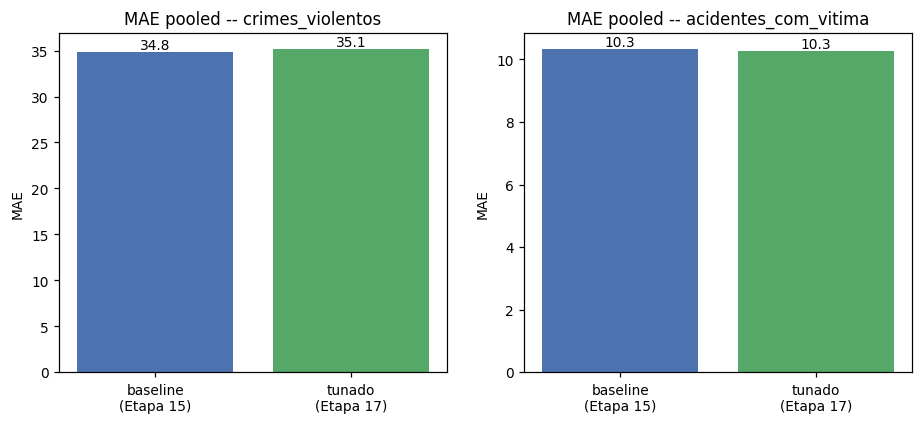
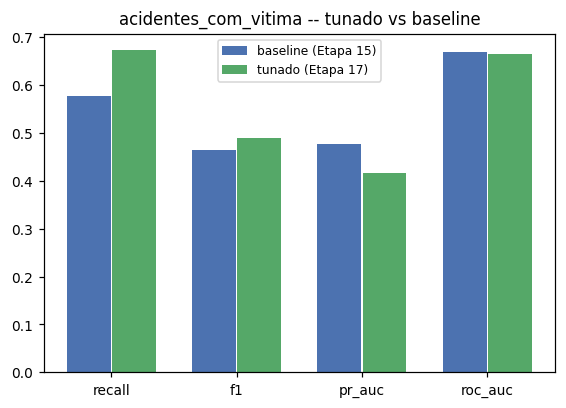

# Etapa 17 -- Otimizacao de hiperparametros

_Gerado por `scripts/14_otimizacao_hiperparametros.py` em 2026-09-04. Fontes: `data/gold/features_dia_sp.csv`, `fato_dia_sp.csv`._

> Regra 7: nunca CV embaralhado em serie temporal. Nested walk-forward: **nivel externo** = os mesmos 12 folds mensais da Etapa 15 (pooled comparavel numero-a-numero); **nivel interno** = `TimeSeriesSplit` dentro do treino de cada fold externo, para escolher hiperparametros sem que a escolha veja o proprio teste daquele fold. Um conjunto de hiperparametros de **producao** e escolhido a parte (busca sobre todo o historico) para uso nas Etapas 18+ -- nao contamina a metrica pooled reportada aqui.

**Escopo (decidido na Etapa 16, nao redecidido aqui)**: regressao -- XGBoost Poisson nos 2 alvos; classificacao -- `logreg_balanced` so em `acidentes_com_vitima` (`crimes_violentos` ficou sem candidato: nenhum classificador da Etapa 15 chegou a um ponto de operacao util, e tuning nao cria sinal onde os dados nao tem).

## 1. Regressao -- XGBoost Poisson tunado vs baseline (Etapa 15/16)

### crimes_violentos

Hiperparametros por fold (12 buscas independentes, cada uma so com dados anteriores ao fold): [`hiperparametros_por_fold_regressao_crimes_violentos.csv`](tabelas/hiperparametros_por_fold_regressao_crimes_violentos.csv)

| fold | n_treino | fold_MAE | n_estimators | max_depth | learning_rate |
| --- | --- | --- | --- | --- | --- |
| 2023-01 | 364 | 31.028 | 415 | 5 | 0.012 |
| 2023-02 | 395 | 43.048 | 112 | 4 | 0.040 |
| 2023-03 | 423 | 34.563 | 112 | 4 | 0.040 |
| 2023-04 | 454 | 31.843 | 112 | 4 | 0.040 |
| 2023-05 | 484 | 29.522 | 340 | 4 | 0.045 |
| 2023-06 | 515 | 31.613 | 409 | 3 | 0.029 |
| 2023-07 | 545 | 32.270 | 330 | 5 | 0.030 |
| 2023-08 | 576 | 36.506 | 409 | 3 | 0.029 |
| 2023-09 | 607 | 27.861 | 409 | 3 | 0.029 |
| 2023-10 | 637 | 42.915 | 259 | 4 | 0.032 |
| 2023-11 | 668 | 39.393 | 112 | 4 | 0.040 |
| 2023-12 | 698 | 41.815 | 112 | 4 | 0.040 |

### acidentes_com_vitima

Hiperparametros por fold (12 buscas independentes, cada uma so com dados anteriores ao fold): [`hiperparametros_por_fold_regressao_acidentes_com_vitima.csv`](tabelas/hiperparametros_por_fold_regressao_acidentes_com_vitima.csv)

| fold | n_treino | fold_MAE | n_estimators | max_depth | learning_rate |
| --- | --- | --- | --- | --- | --- |
| 2023-01 | 364 | 10.296 | 250 | 2 | 0.058 |
| 2023-02 | 395 | 10.036 | 250 | 2 | 0.058 |
| 2023-03 | 423 | 8.703 | 250 | 2 | 0.058 |
| 2023-04 | 454 | 7.839 | 112 | 4 | 0.040 |
| 2023-05 | 484 | 9.717 | 180 | 4 | 0.020 |
| 2023-06 | 515 | 12.226 | 250 | 2 | 0.058 |
| 2023-07 | 545 | 9.431 | 409 | 3 | 0.029 |
| 2023-08 | 576 | 10.137 | 250 | 2 | 0.058 |
| 2023-09 | 606 | 11.011 | 415 | 5 | 0.012 |
| 2023-10 | 636 | 12.543 | 250 | 2 | 0.058 |
| 2023-11 | 667 | 10.614 | 259 | 4 | 0.032 |
| 2023-12 | 697 | 10.810 | 250 | 2 | 0.058 |

### Comparacao pooled -- tunado vs baseline (mesmos 12 folds/definicao da Etapa 15)

| base | MAE_baseline | MAE_tunado | delta_MAE | RMSE_baseline | RMSE_tunado | R2_baseline | R2_tunado | MAPE_baseline_% | MAPE_tunado_% |
| --- | --- | --- | --- | --- | --- | --- | --- | --- | --- |
| crimes_violentos | 34.840 | 35.124 | 0.285 | 44.872 | 45.667 | 0.481 | 0.462 | 7.088 | 7.167 |
| acidentes_com_vitima | 10.321 | 10.278 | -0.043 | 13.076 | 12.892 | 0.283 | 0.303 | 12.689 | 12.694 |

## 2. Classificacao -- logreg_balanced tunado vs baseline (acidentes_com_vitima)

### acidentes_com_vitima

Hiperparametros por fold: [`hiperparametros_por_fold_classificacao_acidentes_com_vitima.csv`](tabelas/hiperparametros_por_fold_classificacao_acidentes_com_vitima.csv)

| fold | n_treino | fold_roc_auc | fold_pr_auc | C | penalty |
| --- | --- | --- | --- | --- | --- |
| 2023-01 | 364 | 0.847 | 0.944 | 14.528 | l2 |
| 2023-02 | 395 |  |  | 73.923 | l1 |
| 2023-03 | 423 | 0.900 | 0.250 | 14.528 | l2 |
| 2023-04 | 454 | 0.589 | 0.148 | 14.528 | l2 |
| 2023-05 | 484 | 0.759 | 0.330 | 73.923 | l1 |
| 2023-06 | 515 | 0.674 | 0.577 | 1.144 | l1 |
| 2023-07 | 545 | 0.536 | 0.294 | 1.144 | l1 |
| 2023-08 | 576 | 0.656 | 0.244 | 0.001 | l2 |
| 2023-09 | 606 | 0.432 | 0.369 | 0.075 | l1 |
| 2023-10 | 636 | 0.587 | 0.329 | 0.985 | l1 |
| 2023-11 | 667 | 0.694 | 0.378 | 0.075 | l1 |
| 2023-12 | 697 | 0.635 | 0.723 | 14.528 | l2 |

### Comparacao pooled -- tunado vs baseline (`roc_auc`/`pr_auc` aqui = fold_macro, mesma convencao da Etapa 15)

| base | accuracy_baseline | precision_baseline | recall_baseline | f1_baseline | roc_auc_baseline | pr_auc_baseline | accuracy_tunado | precision_tunado | recall_tunado | f1_tunado | roc_auc_tunado | pr_auc_tunado |
| --- | --- | --- | --- | --- | --- | --- | --- | --- | --- | --- | --- | --- |
| acidentes_com_vitima | 0.663 | 0.390 | 0.576 | 0.465 | 0.669 | 0.476 | 0.644 | 0.385 | 0.674 | 0.490 | 0.664 | 0.417 |

## 3. Hiperparametros de producao (para Etapas 18+)

Busca separada usando **todo** o historico disponivel (ainda sem embaralhar -- `TimeSeriesSplit`), fora da metrica pooled acima. E o unico conjunto de hiperparametros que a Etapa 18 (SHAP) e as seguintes devem usar para treinar o modelo final.

| tarefa | base | modelo | colsample_bytree | learning_rate | max_depth | min_child_weight | n_estimators | reg_alpha | reg_lambda | subsample | C | penalty |
| --- | --- | --- | --- | --- | --- | --- | --- | --- | --- | --- | --- | --- |
| regressao | crimes_violentos | xgboost_poisson | 0.8650 | 0.0289 | 3.0000 | 4.0000 | 409.0000 | 0.0013 | 2.3396 | 0.7799 |  |  |
| regressao | acidentes_com_vitima | xgboost_poisson | 0.8654 | 0.0102 | 3.0000 | 2.0000 | 409.0000 | 0.0622 | 9.5023 | 0.6704 |  |  |
| classificacao | acidentes_com_vitima | logreg_balanced |  |  |  |  |  |  |  |  | 1.0907 | l1 |

## 4. Sintese

- **Regressao `crimes_violentos`**: MAE 34.84 -> 35.12 (-0.8%). **Tuning nao ajudou -- MAE pooled ficou levemente PIOR que o baseline nao-otimizado.** Nao e um erro de implementacao (o R² tunado tambem cai, 0,481->0,462): com ~350-700 linhas de treino por fold, a busca interna (TimeSeriesSplit dentro do treino) tem pouco dado para diferenciar hiperparametros de forma estavel, e pode escolher uma combinacao que generaliza pior no mes de teste do que a combinacao rasa/generica ja usada desde a Etapa 14. Mantido honestamente (Regra 2: nao inventar resultado) -- o baseline nao-tunado segue sendo, na pratica, tao bom quanto ou melhor para este alvo.
- **Regressao `acidentes_com_vitima`**: MAE 10.32 -> 10.28 (+0.4%). Ganho marginal (<3%) -- os hiperparametros rasos e nao-otimizados da Etapa 14/15 ja estavam perto do teto para este conjunto de features.
- **Classificacao `acidentes_com_vitima`** (`logreg_balanced`): Recall 0.576 -> 0.674 (+0.098), mas PR-AUC fold_macro 0.476 -> 0.417 (-0.059) -- **piorou, mesmo com a busca otimizando explicitamente para average_precision em cada fold.** Mesmo diagnostico da regressao acima: poucos positivos por fold (a tabela de hiperparametros por fold mostra `C`/`penalty` variando muito -- de C=0,001 a C=74 -- sinal de que a busca interna esta se ajustando a ruido, nao a um padrao estavel). Trade-off documentado, nao escondido: se o criterio for Recall (prioridade do briefing p/ sistema de alerta), o modelo tunado e preferivel; se for PR-AUC (ranking), o baseline nao-tunado e melhor. Nenhum dos dois domina o outro nos dois criterios ao mesmo tempo.

- **`crimes_violentos` (classificacao) permanece sem candidato**: decisao da Etapa 16 mantida -- tuning nao foi tentado aqui porque o problema documentado (nenhum classificador atinge Recall e PR-AUC uteis ao mesmo tempo) e de sinal disponivel nas features, nao de hiperparametro; revisitar so se o SHAP (Etapa 18) ou novas features mudarem esse quadro.

- **Hiperparametros de producao (secao 3) sao o que a Etapa 18 (SHAP) deve usar** para treinar o modelo final explicado -- nao os hiperparametros rasos da Etapa 14/15, e nao a media dos hiperparametros por fold (que variam fold a fold, ver tabelas da secao 1/2 -- instabilidade esperada com poucas centenas de linhas de treino, nao um problema do metodo).

- **Proximo**: Etapa 18 -- interpretabilidade formal com SHAP, usando os hiperparametros de producao desta etapa.
