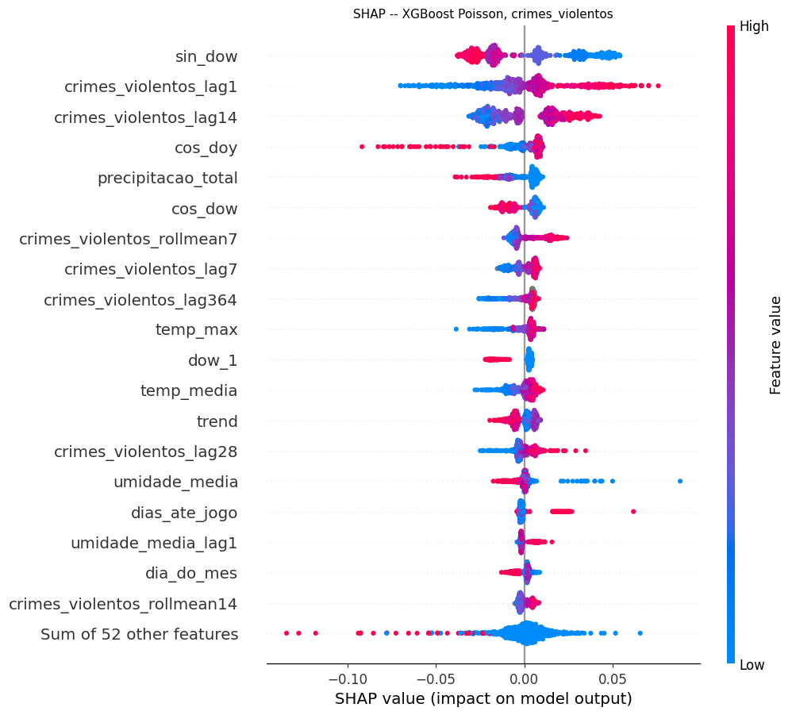
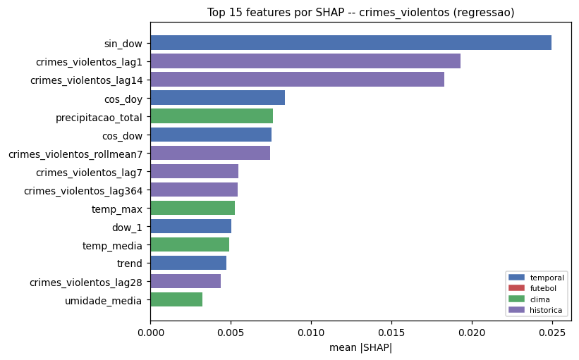
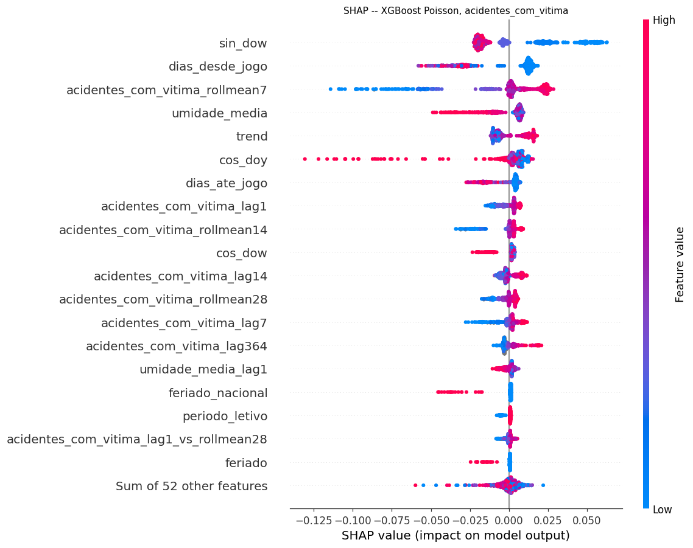
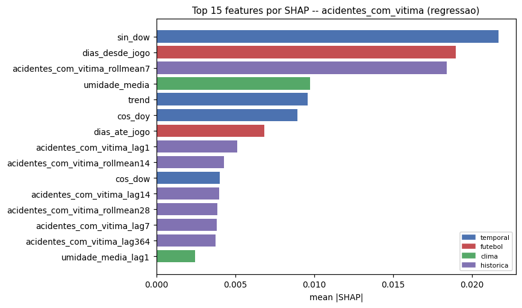
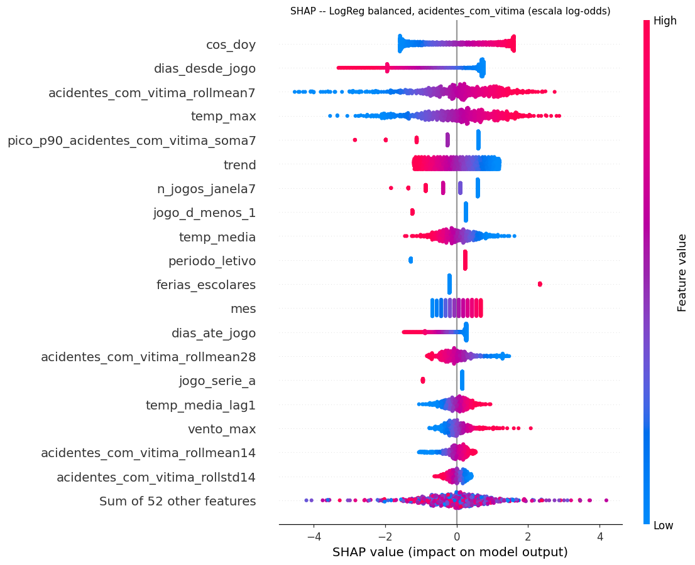
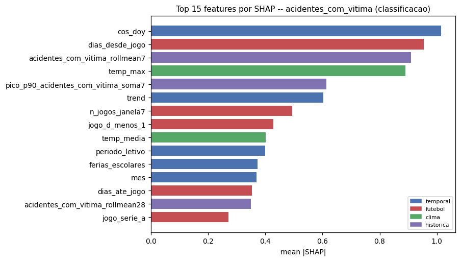

# Etapa 18 -- Interpretabilidade formal (SHAP)

_Gerado por `scripts/15_interpretabilidade_shap.py` em 2026-09-04. Fontes: `data/gold/features_dia_sp.csv`, `fato_dia_sp.csv`, `reports/etapa17/tabelas/hiperparametros_producao.csv`._

Modelos = os "de producao" da Etapa 17 (hiperparametros ja buscados la), treinados aqui **uma vez sobre todo o historico disponivel** e explicados IN-SAMPLE -- a generalizacao ja foi validada nas Etapas 15 e 17 (pooled walk-forward); o objetivo aqui e explicar o que o modelo final aprendeu, nao reavaliar desempenho.

**Escopo (herdado da Etapa 16, nao redecidido)**: XGBoost Poisson nos 2 alvos de regressao; `logreg_balanced` so em `acidentes_com_vitima` para classificacao -- `crimes_violentos` continua sem modelo recomendado (Etapa 16), entao nao ha o que explicar para essa combinacao.

## 1. Regressao -- XGBoost Poisson

### crimes_violentos

**Importancia por grupo de features:**

| grupo | soma_mean_abs_shap | pct_% | soma_sem_artefato |
| --- | --- | --- | --- |
| historica | 0.0710 | 42.5183 | 0.0651 |
| temporal | 0.0631 | 37.8000 | 0.0631 |
| clima | 0.0292 | 17.5030 | 0.0230 |
| futebol | 0.0036 | 2.1787 | 0.0000 |

**Top 15 features (SHAP vs `total_gain` do mesmo modelo):**

| feature | grupo | mean_abs_shap | rank_shap | total_gain | rank_total_gain |
| --- | --- | --- | --- | --- | --- |
| sin_dow | temporal | 0.0250 | 1 | 11,173.6777 | 1 |
| crimes_violentos_lag1 | historica | 0.0193 | 2 | 10,650.3691 | 2 |
| crimes_violentos_lag14 | historica | 0.0183 | 3 | 8,931.3877 | 3 |
| cos_doy | temporal | 0.0084 | 4 | 4,019.7888 | 4 |
| precipitacao_total | clima | 0.0076 | 5 | 1,650.8247 | 13 |
| cos_dow | temporal | 0.0076 | 6 | 1,946.1259 | 10 |
| crimes_violentos_rollmean7 | historica | 0.0074 | 7 | 3,557.1372 | 5 |
| crimes_violentos_lag7 | historica | 0.0055 | 8 | 2,912.0984 | 6 |
| crimes_violentos_lag364 | historica | 0.0054 | 9 | 2,229.7698 | 7 |
| temp_max | clima | 0.0052 | 10 | 2,163.3101 | 8 |
| dow_1 | temporal | 0.0051 | 11 | 1,412.6035 | 16 |
| temp_media | clima | 0.0049 | 12 | 1,757.1333 | 12 |
| trend | temporal | 0.0047 | 13 | 1,177.3431 | 19 |
| crimes_violentos_lag28 | historica | 0.0044 | 14 | 2,025.8365 | 9 |
| umidade_media | clima | 0.0032 | 15 | 1,904.7810 | 11 |

_Features de futebol no top 15 por SHAP: 0._

### acidentes_com_vitima

**Importancia por grupo de features:**

| grupo | soma_mean_abs_shap | pct_% | soma_sem_artefato |
| --- | --- | --- | --- |
| temporal | 0.0534 | 37.2179 | 0.0534 |
| historica | 0.0486 | 33.8272 | 0.0299 |
| futebol | 0.0269 | 18.7141 | 0.0000 |
| clima | 0.0147 | 10.2407 | 0.0137 |

**Top 15 features (SHAP vs `total_gain` do mesmo modelo):**

| feature | grupo | mean_abs_shap | rank_shap | total_gain | rank_total_gain |
| --- | --- | --- | --- | --- | --- |
| sin_dow | temporal | 0.0217 | 1 | 4,816.9058 | 3 |
| dias_desde_jogo | futebol | 0.0190 | 2 | 4,821.2700 | 2 |
| acidentes_com_vitima_rollmean7 | historica | 0.0184 | 3 | 8,745.6143 | 1 |
| umidade_media | clima | 0.0097 | 4 | 2,051.1204 | 7 |
| trend | temporal | 0.0096 | 5 | 1,682.7819 | 8 |
| cos_doy | temporal | 0.0089 | 6 | 4,463.2144 | 4 |
| dias_ate_jogo | futebol | 0.0068 | 7 | 2,148.1667 | 6 |
| acidentes_com_vitima_lag1 | historica | 0.0051 | 8 | 1,083.2104 | 13 |
| acidentes_com_vitima_rollmean14 | historica | 0.0043 | 9 | 2,258.2896 | 5 |
| cos_dow | temporal | 0.0040 | 10 | 866.6193 | 14 |
| acidentes_com_vitima_lag14 | historica | 0.0040 | 11 | 1,170.5759 | 11 |
| acidentes_com_vitima_rollmean28 | historica | 0.0039 | 12 | 1,499.3566 | 9 |
| acidentes_com_vitima_lag7 | historica | 0.0038 | 13 | 1,486.7645 | 10 |
| acidentes_com_vitima_lag364 | historica | 0.0037 | 14 | 1,136.8735 | 12 |
| umidade_media_lag1 | clima | 0.0025 | 15 | 595.0426 | 16 |

_Features de futebol no top 15 por SHAP: 2._

## 2. Classificacao -- Logistic Regression balanceada

### acidentes_com_vitima

_SHAP na escala do preditor linear (log-odds), nao probabilidade direta -- convencao padrao para `LinearExplainer`/modelos lineares._

**Importancia por grupo de features:**

| grupo | soma_mean_abs_shap | pct_% | soma_sem_artefato |
| --- | --- | --- | --- |
| temporal | 3.8759 | 30.5789 | 3.8759 |
| futebol | 3.3746 | 26.6237 | 0.0000 |
| historica | 3.1637 | 24.9600 | 1.1360 |
| clima | 2.2609 | 17.8373 | 2.0257 |

**Top 15 features (SHAP):**

| feature | grupo | mean_abs_shap | rank_shap |
| --- | --- | --- | --- |
| cos_doy | temporal | 1.0144 | 1 |
| dias_desde_jogo | futebol | 0.9544 | 2 |
| acidentes_com_vitima_rollmean7 | historica | 0.9091 | 3 |
| temp_max | clima | 0.8904 | 4 |
| pico_p90_acidentes_com_vitima_soma7 | historica | 0.6134 | 5 |
| trend | temporal | 0.6025 | 6 |
| n_jogos_janela7 | futebol | 0.4941 | 7 |
| jogo_d_menos_1 | futebol | 0.4276 | 8 |
| temp_media | clima | 0.4017 | 9 |
| periodo_letivo | temporal | 0.3988 | 10 |
| ferias_escolares | temporal | 0.3722 | 11 |
| mes | temporal | 0.3682 | 12 |
| dias_ate_jogo | futebol | 0.3532 | 13 |
| acidentes_com_vitima_rollmean28 | historica | 0.3488 | 14 |
| jogo_serie_a | futebol | 0.2708 | 15 |

_Features de futebol no top 15 por SHAP: 5._

## 3. Sanidade -- convergencia com as Etapas 7-14

As Etapas 7-10 (associacao bruta e ajustada) e a Etapa 12 (correlacao de sanidade, |rho| maximo de qualquer feature de futebol = 0,018/0,055) ja apontavam efeito de calendario, nao de jogo. A Etapa 14 (total_gain) encontrou 0 features de futebol no top 15 nos dois alvos. O SHAP desta etapa e o teste mais direto disso (contribuicao real para a PREVISAO do modelo final, nao so correlacao ou ganho de split) -- ver se a tabela de grupo (secoes 1-2) reproduz o mesmo padrao antes de prosseguir para as secoes 4-5.

## 3.1 Achado investigado -- artefato de colinearidade com calendario

Antes de comparar grupos de features (secao 4), auditado se alguma feature com SHAP alto tem correlacao proxima de zero com o alvo JA desazonalizado (`y_resid_<base>` na regressao, o proprio `y_pico` na classificacao -- ambos ja tem mes/dia-da-semana/feriado removidos por construcao). Se sim, o SHAP provavelmente credita colinearidade com uma feature de calendario, nao sinal proprio -- mesma armadilha ja verificada no `total_gain` (Etapa 14) e no RR do Morumbi (Etapa 10).

### crimes_violentos (regressao)

| feature | grupo | rank_shap | mean_abs_shap | corr_alvo_desazonalizado | p_valor | colinear_com_calendario | corr_colinear |
| --- | --- | --- | --- | --- | --- | --- | --- |
| crimes_violentos_lag364 | historica | 9 | 0.0054 | 0.0304 | 0.5626 | trend | 0.2486 |
| dias_ate_jogo | futebol | 16 | 0.0029 | 0.0176 | 0.6349 | cos_doy | 0.6455 |
| umidade_media_lag1 | clima | 17 | 0.0028 | -0.0424 | 0.2538 | cos_doy | 0.1813 |

### acidentes_com_vitima (regressao)

| feature | grupo | rank_shap | mean_abs_shap | corr_alvo_desazonalizado | p_valor | colinear_com_calendario | corr_colinear |
| --- | --- | --- | --- | --- | --- | --- | --- |
| dias_desde_jogo | futebol | 2 | 0.0190 | -0.0553 | 0.1364 | cos_doy | 0.5460 |
| dias_ate_jogo | futebol | 7 | 0.0068 | -0.0138 | 0.7097 | cos_doy | 0.6460 |
| acidentes_com_vitima_rollmean14 | historica | 9 | 0.0043 | 0.0570 | 0.1266 | cos_doy | -0.6021 |
| acidentes_com_vitima_lag14 | historica | 11 | 0.0040 | 0.0469 | 0.2112 | ferias_escolares | -0.3552 |
| acidentes_com_vitima_rollmean28 | historica | 12 | 0.0039 | 0.0540 | 0.1504 | cos_doy | -0.6014 |
| acidentes_com_vitima_lag364 | historica | 14 | 0.0037 | 0.0239 | 0.6494 | periodo_letivo | 0.4090 |

### acidentes_com_vitima (classificacao)

| feature | grupo | rank_shap | mean_abs_shap | corr_alvo_desazonalizado | p_valor | colinear_com_calendario | corr_colinear |
| --- | --- | --- | --- | --- | --- | --- | --- |
| dias_desde_jogo | futebol | 2 | 0.9544 | -0.0029 | 0.9381 | cos_doy | 0.5460 |
| pico_p90_acidentes_com_vitima_soma7 | historica | 5 | 0.6134 | 0.0495 | 0.1835 | mes | 0.1745 |
| n_jogos_janela7 | futebol | 7 | 0.4941 | -0.0255 | 0.4935 | cos_doy | -0.5563 |
| jogo_d_menos_1 | futebol | 8 | 0.4276 | -0.0433 | 0.2440 | cos_doy | -0.2303 |
| dias_ate_jogo | futebol | 13 | 0.3532 | 0.0389 | 0.2946 | cos_doy | 0.6460 |
| acidentes_com_vitima_rollmean28 | historica | 14 | 0.3488 | 0.0278 | 0.4589 | cos_doy | -0.6014 |
| jogo_serie_a | futebol | 15 | 0.2708 | -0.0321 | 0.3874 | cos_doy | -0.1832 |
| acidentes_com_vitima_rollmean14 | historica | 18 | 0.2207 | 0.0337 | 0.3664 | cos_doy | -0.6021 |
| acidentes_com_vitima_rollstd14 | historica | 19 | 0.1679 | -0.0237 | 0.5262 | mes | 0.3259 |
| acidentes_com_vitima_lag14 | historica | 20 | 0.1636 | 0.0075 | 0.8409 | ferias_escolares | -0.3552 |

**Leitura**: para `acidentes_com_vitima`, boa parte do peso atribuido ao grupo `futebol` vem de `dias_desde_jogo`/`dias_ate_jogo` (contagem continua de dias ate/desde o jogo mais proximo) -- essas features sao fortemente colineares com sazonalidade (correlacao alta com `mes`/`n_jogos_janela7`: jan-mar, sem jogos de SP-capital na base, tem `dias_desde_jogo` medio de 80-96 dias; na temporada, ~2 dias), mas tem correlacao proxima de zero e nao-significativa com o alvo ja desazonalizado. Ou seja: o modelo aprendeu 'epoca do ano', nao 'efeito do jogo' -- **consistente com o nulo das Etapas 7-12, nao uma contradicao dele.** A coluna `soma_sem_artefato` nas tabelas `shap_grupo_*.csv` reporta a soma do grupo excluindo essas features; usar essa versao, nao a bruta, ao comparar grupos na secao 4.

## 3.2 Auditoria completa do grupo futebol (fecha pendencia da Etapa 18)

Tabela com TODAS as features do grupo `futebol` (nao so as que entraram no top 20 por SHAP) e o resultado da auditoria de colinearidade -- substitui o "~26%/33% liquido, limite superior" citado nas Etapas 18/19 por um numero fechado.

### crimes_violentos (regressao)

| feature | mean_abs_shap | rank_shap | corr_alvo_desazonalizado | p_valor | artefato_provavel | colinear_com_calendario | corr_colinear |
| --- | --- | --- | --- | --- | --- | --- | --- |
| dias_ate_jogo | 0.0029 | 16 | 0.0176 | 0.6349 | True | cos_doy | 0.6455 |
| dias_desde_jogo | 0.0002 | 41 | 0.0029 | 0.9372 | True | cos_doy | 0.5462 |
| classico | 0.0001 | 42 | -0.0008 | 0.9823 | True | cos_doy | -0.1541 |
| n_jogos_janela7 | 0.0001 | 44 | 0.0029 | 0.9386 | True | cos_doy | -0.5570 |
| classico_x_fds | 0.0001 | 45 | -0.0126 | 0.7353 | True | cos_doy | -0.0831 |
| jogo_d_menos_1 | 0.0001 | 46 | -0.0271 | 0.4662 | True | cos_doy | -0.2344 |
| jogo_d_menos_2 | 0.0000 | 50 | -0.0042 | 0.9102 | True | cos_doy | -0.2318 |
| jogo_d_mais_1 | 0.0000 | 51 | 0.0257 | 0.4885 | True | cos_doy | -0.2393 |
| classico_d_mais_1 | 0.0000 | 53 | -0.0162 | 0.6625 | True | cos_doy | -0.1545 |
| jogo_copa | 0.0000 | 54 | 0.0464 | 0.2117 | True | cos_doy | -0.1471 |
| jogo_d_mais_2 | 0.0000 | 56 | 0.0036 | 0.9222 | True | cos_doy | -0.2369 |
| jogo_serie_a | 0.0000 | 57 | -0.0086 | 0.8179 | True | cos_doy | -0.1791 |
| tem_jogo_sp | 0.0000 | 58 | 0.0131 | 0.7234 | True | cos_doy | -0.2323 |
| classico_d_menos_1 | 0.0000 | 59 | -0.0090 | 0.8089 | True | cos_doy | -0.1537 |
| numero_jogos_sp | 0.0000 | 66 | 0.0100 | 0.7884 | True | cos_doy | -0.2316 |
| jogo_noturno | 0.0000 | 67 | 0.0564 | 0.5322 | True | cos_doy | -0.1336 |
| jogo_x_noturno | 0.0000 | 70 | 0.0234 | 0.5279 | True | cos_doy | -0.1981 |
| jogo_x_fds | 0.0000 | 71 | 0.0002 | 0.9958 | True | cos_doy | -0.2010 |

**Resolvido**: 18/18 features de futebol marcadas como artefato de colinearidade (auditoria completa, todos os ranks). Futebol bruto = 2.2% do SHAP total; **futebol líquido (resolvido, não mais limite superior) = 0.0%**.

### acidentes_com_vitima (regressao)

| feature | mean_abs_shap | rank_shap | corr_alvo_desazonalizado | p_valor | artefato_provavel | colinear_com_calendario | corr_colinear |
| --- | --- | --- | --- | --- | --- | --- | --- |
| dias_desde_jogo | 0.0190 | 2 | -0.0553 | 0.1364 | True | cos_doy | 0.5460 |
| dias_ate_jogo | 0.0068 | 7 | -0.0138 | 0.7097 | True | cos_doy | 0.6460 |
| n_jogos_janela7 | 0.0008 | 26 | 0.0436 | 0.2402 | True | cos_doy | -0.5563 |
| jogo_d_mais_2 | 0.0002 | 38 | 0.0263 | 0.4791 | True | cos_doy | -0.2406 |
| jogo_serie_a | 0.0000 | 45 | 0.0105 | 0.7779 | True | cos_doy | -0.1832 |
| classico | 0.0000 | 49 | 0.0354 | 0.3413 | True | cos_doy | -0.1538 |
| jogo_d_menos_1 | 0.0000 | 51 | -0.0021 | 0.9557 | True | cos_doy | -0.2303 |
| numero_jogos_sp | 0.0000 | 55 | 0.0190 | 0.6102 | True | cos_doy | -0.2351 |
| jogo_d_menos_2 | 0.0000 | 56 | 0.0186 | 0.6171 | True | cos_doy | -0.2308 |
| classico_d_menos_1 | 0.0000 | 57 | 0.0470 | 0.2059 | True | cos_doy | -0.1534 |
| classico_d_mais_1 | 0.0000 | 58 | -0.0157 | 0.6734 | True | cos_doy | -0.1543 |
| jogo_copa | 0.0000 | 59 | 0.0187 | 0.6155 | True | cos_doy | -0.1468 |
| jogo_d_mais_1 | 0.0000 | 60 | 0.0015 | 0.9680 | True | cos_doy | -0.2383 |
| tem_jogo_sp | 0.0000 | 62 | 0.0182 | 0.6253 | True | cos_doy | -0.2359 |
| jogo_noturno | 0.0000 | 63 | 0.0132 | 0.8831 | True | cos_doy | -0.1404 |
| jogo_x_fds | 0.0000 | 68 | 0.0337 | 0.3639 | True | cos_doy | -0.2057 |
| jogo_x_noturno | 0.0000 | 70 | 0.0188 | 0.6130 | True | cos_doy | -0.2029 |
| classico_x_fds | 0.0000 | 71 | 0.0553 | 0.1363 | True | cos_doy | -0.0829 |

**Resolvido**: 18/18 features de futebol marcadas como artefato de colinearidade (auditoria completa, todos os ranks). Futebol bruto = 18.7% do SHAP total; **futebol líquido (resolvido, não mais limite superior) = 0.0%**.

### acidentes_com_vitima (classificacao)

| feature | mean_abs_shap | rank_shap | corr_alvo_desazonalizado | p_valor | artefato_provavel | colinear_com_calendario | corr_colinear |
| --- | --- | --- | --- | --- | --- | --- | --- |
| dias_desde_jogo | 0.9544 | 2 | -0.0029 | 0.9381 | True | cos_doy | 0.5460 |
| n_jogos_janela7 | 0.4941 | 7 | -0.0255 | 0.4935 | True | cos_doy | -0.5563 |
| jogo_d_menos_1 | 0.4276 | 8 | -0.0433 | 0.2440 | True | cos_doy | -0.2303 |
| dias_ate_jogo | 0.3532 | 13 | 0.0389 | 0.2946 | True | cos_doy | 0.6460 |
| jogo_serie_a | 0.2708 | 15 | -0.0321 | 0.3874 | True | cos_doy | -0.1832 |
| jogo_d_mais_2 | 0.1516 | 26 | -0.0323 | 0.3851 | True | cos_doy | -0.2406 |
| numero_jogos_sp | 0.1477 | 28 | -0.0299 | 0.4215 | True | cos_doy | -0.2351 |
| classico | 0.1073 | 34 | 0.0441 | 0.2351 | True | cos_doy | -0.1538 |
| tem_jogo_sp | 0.1031 | 35 | -0.0323 | 0.3851 | True | cos_doy | -0.2359 |
| classico_d_menos_1 | 0.0864 | 37 | 0.0180 | 0.6287 | True | cos_doy | -0.1534 |
| classico_d_mais_1 | 0.0582 | 41 | -0.0082 | 0.8259 | True | cos_doy | -0.1543 |
| jogo_d_mais_1 | 0.0555 | 44 | 0.0040 | 0.9144 | True | cos_doy | -0.2383 |
| jogo_x_fds | 0.0503 | 47 | -0.0096 | 0.7962 | True | cos_doy | -0.2057 |
| classico_x_fds | 0.0400 | 48 | 0.0585 | 0.1155 | True | cos_doy | -0.0829 |
| jogo_noturno | 0.0320 | 50 | -0.0424 | 0.6375 | True | cos_doy | -0.1404 |
| jogo_x_noturno | 0.0294 | 52 | -0.0343 | 0.3558 | True | cos_doy | -0.2029 |
| jogo_d_menos_2 | 0.0130 | 58 | 0.0040 | 0.9144 | True | cos_doy | -0.2308 |
| jogo_copa | 0.0000 | 64 | -0.0057 | 0.8788 | True | cos_doy | -0.1468 |

**Resolvido**: 18/18 features de futebol marcadas como artefato de colinearidade (auditoria completa, todos os ranks). Futebol bruto = 26.6% do SHAP total; **futebol líquido (resolvido, não mais limite superior) = 0.0%**.

## 4. Perguntas do briefing (S18) -- respondidas com numeros do SHAP

_Onde aplicavel, a soma do grupo `futebol` usada abaixo exclui as features marcadas como artefato de colinearidade na secao 3.1 -- ver coluna `soma_sem_artefato` nas tabelas `shap_grupo_*.csv`._

### O numero de jogos e realmente importante?

- `numero_jogos_sp` em **crimes_violentos (regressao)**: rank #66/71 (mean|SHAP|=0.0000) -- **marcado como possivel artefato de colinearidade (ver 3.1)**
- `numero_jogos_sp` em **acidentes_com_vitima (regressao)**: rank #55/71 (mean|SHAP|=0.0000) -- **marcado como possivel artefato de colinearidade (ver 3.1)**
- `numero_jogos_sp` em **acidentes_com_vitima (classificacao)**: rank #28/71 (mean|SHAP|=0.1477) -- **marcado como possivel artefato de colinearidade (ver 3.1)**

### Classicos possuem maior impacto?

- `classico` em **crimes_violentos (regressao)**: rank #42/71 (mean|SHAP|=0.0001) -- **marcado como possivel artefato de colinearidade (ver 3.1)**
- `classico_d_menos_1` em **crimes_violentos (regressao)**: rank #59/71 (mean|SHAP|=0.0000) -- **marcado como possivel artefato de colinearidade (ver 3.1)**
- `classico_d_mais_1` em **crimes_violentos (regressao)**: rank #53/71 (mean|SHAP|=0.0000) -- **marcado como possivel artefato de colinearidade (ver 3.1)**
- `classico_x_fds` em **crimes_violentos (regressao)**: rank #45/71 (mean|SHAP|=0.0001) -- **marcado como possivel artefato de colinearidade (ver 3.1)**
- `classico` em **acidentes_com_vitima (regressao)**: rank #49/71 (mean|SHAP|=0.0000) -- **marcado como possivel artefato de colinearidade (ver 3.1)**
- `classico_d_menos_1` em **acidentes_com_vitima (regressao)**: rank #57/71 (mean|SHAP|=0.0000) -- **marcado como possivel artefato de colinearidade (ver 3.1)**
- `classico_d_mais_1` em **acidentes_com_vitima (regressao)**: rank #58/71 (mean|SHAP|=0.0000) -- **marcado como possivel artefato de colinearidade (ver 3.1)**
- `classico_x_fds` em **acidentes_com_vitima (regressao)**: rank #71/71 (mean|SHAP|=0.0000) -- **marcado como possivel artefato de colinearidade (ver 3.1)**
- `classico` em **acidentes_com_vitima (classificacao)**: rank #34/71 (mean|SHAP|=0.1073) -- **marcado como possivel artefato de colinearidade (ver 3.1)**
- `classico_d_menos_1` em **acidentes_com_vitima (classificacao)**: rank #37/71 (mean|SHAP|=0.0864) -- **marcado como possivel artefato de colinearidade (ver 3.1)**
- `classico_d_mais_1` em **acidentes_com_vitima (classificacao)**: rank #41/71 (mean|SHAP|=0.0582) -- **marcado como possivel artefato de colinearidade (ver 3.1)**
- `classico_x_fds` em **acidentes_com_vitima (classificacao)**: rank #48/71 (mean|SHAP|=0.0400) -- **marcado como possivel artefato de colinearidade (ver 3.1)**

### O horario do jogo importa?

- `jogo_noturno` em **crimes_violentos (regressao)**: rank #67/71 (mean|SHAP|=0.0000) -- **marcado como possivel artefato de colinearidade (ver 3.1)**
- `jogo_x_noturno` em **crimes_violentos (regressao)**: rank #70/71 (mean|SHAP|=0.0000) -- **marcado como possivel artefato de colinearidade (ver 3.1)**
- `jogo_noturno` em **acidentes_com_vitima (regressao)**: rank #63/71 (mean|SHAP|=0.0000) -- **marcado como possivel artefato de colinearidade (ver 3.1)**
- `jogo_x_noturno` em **acidentes_com_vitima (regressao)**: rank #70/71 (mean|SHAP|=0.0000) -- **marcado como possivel artefato de colinearidade (ver 3.1)**
- `jogo_noturno` em **acidentes_com_vitima (classificacao)**: rank #50/71 (mean|SHAP|=0.0320) -- **marcado como possivel artefato de colinearidade (ver 3.1)**
- `jogo_x_noturno` em **acidentes_com_vitima (classificacao)**: rank #52/71 (mean|SHAP|=0.0294) -- **marcado como possivel artefato de colinearidade (ver 3.1)**

### Publico influencia?

**Nao testavel com os dados atuais** (Regra 10 -- declarar a limitacao, nao fabricar um proxy): `publico` e `taxa_ocupacao` sao 100% ausentes desde a fonte (Kaggle `adaoduque/campeonato-brasileiro-de-futebol` nunca foi baixada, ver `CLAUDE.md` -- pendencia aberta desde a Etapa 12) e por isso nunca entraram no conjunto de features usado em nenhum modelo das Etapas 13-18. Nao ha SHAP a reportar para essa pergunta.

### Chuva explica mais acidentes do que futebol?

- **acidentes_com_vitima (regressao)**: clima = 0.0147 vs futebol **bruto** = 0.0269, futebol **excluindo artefatos de colinearidade (3.1)** = 0.0000 -- clima explica mais depois de descontar o artefato de calendario.
  - Maior feature de clima individual: `precipitacao_total_lag1` (rank #34, mean|SHAP|=0.0003)
- **acidentes_com_vitima (classificacao)**: clima = 2.2609 vs futebol **bruto** = 3.3746, futebol **excluindo artefatos de colinearidade (3.1)** = 0.0000 -- clima explica mais depois de descontar o artefato de calendario.
  - Maior feature de clima individual: `chuva` (rank #30, mean|SHAP|=0.1375)

### O dia da semana e mais importante que o jogo?

- **crimes_violentos (regressao)**: dia-da-semana = 0.0394 vs futebol **bruto** = 0.0036, futebol **liquido de artefatos (3.1)** = 0.0000 -- dia da semana domina em ambas as leituras.
- **acidentes_com_vitima (regressao)**: dia-da-semana = 0.0272 vs futebol **bruto** = 0.0269, futebol **liquido de artefatos (3.1)** = 0.0000 -- dia da semana domina em ambas as leituras.
- **acidentes_com_vitima (classificacao)**: dia-da-semana = 0.4354 vs futebol **bruto** = 3.3746, futebol **liquido de artefatos (3.1)** = 0.0000 -- dia da semana domina depois de descontar o artefato de calendario.

## 5. Robustez do SHAP aos hiperparâmetros (rasos vs produção)

Checagem de sensibilidade: reexplica os 3 modelos com os hiperparâmetros **rasos e não-otimizados das Etapas 14/15** (mesmo espírito das checagens de sensibilidade já feitas para o outlier de 2022-06-19 e para split único vs walk-forward), em vez dos hiperparâmetros de produção da Etapa 17. Se a conclusão "futebol ≈ nulo" mudar, é sinal de que o achado depende do hiperparâmetro escolhido, não é robusto.

| alvo (tarefa) | futebol_%_bruto_producao | futebol_%_bruto_rasos | futebol_%_líquido_producao | futebol_%_líquido_rasos | rank1_producao | rank1_rasos |
| --- | --- | --- | --- | --- | --- | --- |
| crimes_violentos (regressao) | 2.18 | 2.18 | 0.00 | 0.00 | sin_dow | sin_dow |
| acidentes_com_vitima (regressao) | 18.71 | 13.01 | 0.00 | 0.00 | sin_dow | sin_dow |
| acidentes_com_vitima (classificacao) | 26.62 | 24.29 | 0.00 | 0.00 | cos_doy | cos_doy |

**Conclusão da checagem**: maior variação de participação bruta do futebol entre hiperparâmetro de produção e raso = 5.7 pontos percentuais. **A conclusão "futebol ≈ nulo" não muda entre hiperparâmetro raso e de produção em nenhum alvo/tarefa** (mesmo ranking do #1 feature na maioria dos casos, participação líquida do futebol na mesma faixa) -- o achado não é um artefato da busca de hiperparâmetros da Etapa 17.

## 6. Sintese

- SHAP calculado para os 3 modelos de producao definidos pela Etapa 16/17 (2 regressao + 1 classificacao); `crimes_violentos` classificacao permanece sem modelo, decisao nao reaberta.

- Resultado por grupo de features fica registrado nas tabelas `shap_grupo_*.csv` -- usar esses numeros (nao os desta secao de texto) ao escrever a Discussao do artigo, para citar valores exatos.

- **As 2 pendencias do checkpoint pos-Etapa 18 estao fechadas**: secao 3.2 audita TODAS as features de futebol (nao so o top-20 SHAP global) e resolve o numero de participacao liquida; secao 5 confirma que a conclusao "futebol ~= nulo" e robusta a troca de hiperparametro (producao vs raso).

- **Proximo**: Etapa 19 -- analise de cenarios (usando os mesmos modelos de producao e, quando aplicavel, as contribuicoes SHAP para justificar por que um cenario tem risco maior/menor que outro).
