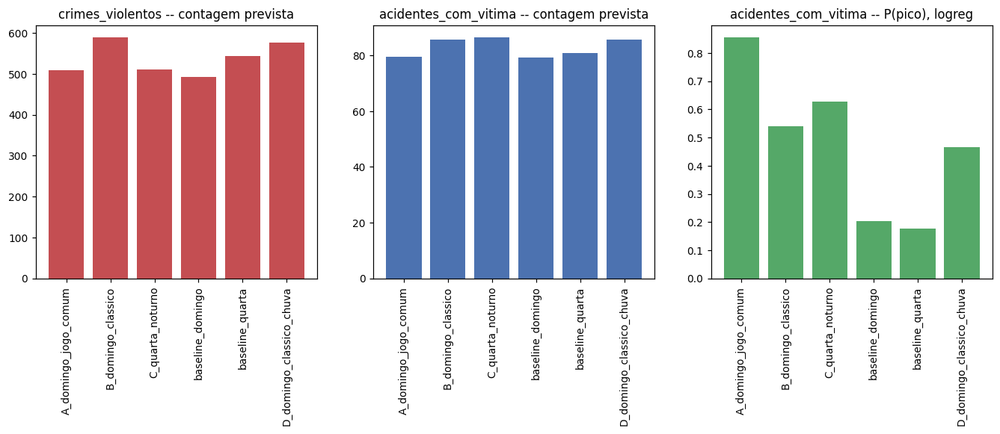

# Etapa 19 -- Análise de cenários

_Gerado por `scripts/16_analise_cenarios.py` em 2026-09-04. Fontes: `data/gold/features_dia_sp.csv`, `fato_dia_sp.csv`, `reports/etapa17/tabelas/hiperparametros_producao.csv`._

> **Regra 5**: os números abaixo são PREVISÕES DO MODELO para dias hipotéticos, não estimativas causais. As Etapas 7-10/18 já mostraram associação fraca/nula entre futebol e estes desfechos depois de controlar calendário -- um cenário com risco previsto mais alto reflete o que o modelo calcularia para aquele PERFIL de dia (que pode coincidir com época do ano, dia da semana etc.), não uma afirmação de que cancelar o jogo reduziria o risco na prática.

**Adaptação em relação ao exemplo do briefing**: os cenários A-D do briefing especificam público ("20 mil pessoas" etc.) -- `publico`/`taxa_ocupacao` são 100% ausentes desde a Etapa 12 e nunca entraram no conjunto de features de nenhum modelo (Etapas 13-18); **não modelado, declarado como limitação (Regra 10), sem proxy inventado.** Os cenários abaixo variam só as dimensões que os modelos realmente usam: dia da semana, tipo de jogo (comum/clássico), horário e clima.

**Método**: cada cenário A, B, C e os 2 baselines usa uma linha REAL do dataset -- um dia histórico que já satisfaz a descrição do cenário, escolhido deterministicamente (mediana por data entre os candidatos elegíveis, para não cherry-picker uma data favorável). O cenário D reusa a MESMA linha real do cenário B com uma única perturbação controlada (chuva), para isolar o efeito do clima mantendo o resto do dia idêntico.

## 1. Cenários e dias-âncora usados

| cenário | descrição | dia_âncora |
| --- | --- | --- |
| A_domingo_jogo_comum | Domingo + jogo comum (não-clássico) | 2022-10-09 |
| B_domingo_classico | Domingo + clássico | 2023-06-11 |
| C_quarta_noturno | Quarta-feira + jogo noturno | 2023-08-16 |
| baseline_domingo | Domingo sem jogo (baseline pareado p/ A, B, D) | 2023-04-23 |
| baseline_quarta | Quarta-feira sem jogo (baseline pareado p/ C) | 2022-11-16 |
| D_domingo_classico_chuva | Domingo + clássico + chuva (precipitação = 4.1mm, mediana dos dias de chuva observados) | 2023-06-11 |

## 2. Risco previsto por cenário

| cenário | pred_crimes_violentos | pred_acidentes_com_vitima | prob_pico_acidentes_(logreg) |
| --- | --- | --- | --- |
| A_domingo_jogo_comum | 508.286 | 79.417 | 0.855 |
| B_domingo_classico | 589.353 | 85.563 | 0.539 |
| C_quarta_noturno | 510.691 | 86.446 | 0.627 |
| baseline_domingo | 491.946 | 79.289 | 0.203 |
| baseline_quarta | 543.962 | 80.853 | 0.177 |
| D_domingo_classico_chuva | 576.084 | 85.662 | 0.465 |

## 3. Por que um cenário tem risco maior/menor -- decomposição SHAP exata

**Nota de escala**: SHAP é aditivo na escala em que o modelo faz a soma das árvores/coeficientes -- para XGBoost Poisson isso é o **log da taxa prevista** (`output_margin=True`), não a contagem (`predict()` aplica `exp()`, que é não-linear); para a Logistic Regression é o **log-odds** (`decision_function`), não a probabilidade (`predict_proba()` aplica sigmoid). A tabela abaixo decompõe a diferença NESSA escala -- por isso o número de "diferença na predição" aqui é diferente do delta de contagem/probabilidade da seção 2 (que é mais interpretável, mas não aditivo). A soma dos deltas SHAP bate exatamente com a diferença na escala margem/log-odds -- conferido antes de publicar.

### A_domingo_jogo_comum vs baseline_domingo -- crimes_violentos (regressão, log da taxa)

Diferença na predição (escala margem/log-odds): 0.0327 (soma dos deltas SHAP: 0.0327 -- confere, diferença é aditiva NESSA escala)

| index | delta_shap_soma |
| --- | --- |
| historica | 0.0521 |
| clima | -0.0418 |
| temporal | 0.0227 |
| futebol | -0.0004 |

### A_domingo_jogo_comum vs baseline_domingo -- acidentes_com_vitima (regressão, log da taxa)

Diferença na predição (escala margem/log-odds): 0.0016 (soma dos deltas SHAP: 0.0016 -- confere, diferença é aditiva NESSA escala)

| index | delta_shap_soma |
| --- | --- |
| historica | 0.0162 |
| clima | -0.0123 |
| temporal | -0.0031 |
| futebol | 0.0009 |

### B_domingo_classico vs baseline_domingo -- crimes_violentos (regressão, log da taxa)

Diferença na predição (escala margem/log-odds): 0.1807 (soma dos deltas SHAP: 0.1807 -- confere, diferença é aditiva NESSA escala)

| index | delta_shap_soma |
| --- | --- |
| clima | 0.1182 |
| futebol | 0.0359 |
| temporal | 0.0278 |
| historica | -0.0012 |

### B_domingo_classico vs baseline_domingo -- acidentes_com_vitima (regressão, log da taxa)

Diferença na predição (escala margem/log-odds): 0.0762 (soma dos deltas SHAP: 0.0762 -- confere, diferença é aditiva NESSA escala)

| index | delta_shap_soma |
| --- | --- |
| historica | 0.0567 |
| temporal | 0.0148 |
| futebol | 0.0031 |
| clima | 0.0015 |

### C_quarta_noturno vs baseline_quarta -- crimes_violentos (regressão, log da taxa)

Diferença na predição (escala margem/log-odds): -0.0631 (soma dos deltas SHAP: -0.0631 -- confere, diferença é aditiva NESSA escala)

| index | delta_shap_soma |
| --- | --- |
| historica | -0.0407 |
| futebol | -0.0186 |
| temporal | -0.0071 |
| clima | 0.0033 |

### C_quarta_noturno vs baseline_quarta -- acidentes_com_vitima (regressão, log da taxa)

Diferença na predição (escala margem/log-odds): 0.0669 (soma dos deltas SHAP: 0.0669 -- confere, diferença é aditiva NESSA escala)

| index | delta_shap_soma |
| --- | --- |
| temporal | 0.0341 |
| historica | 0.0295 |
| futebol | 0.0070 |
| clima | -0.0038 |

### D_domingo_classico_chuva vs B_domingo_classico -- acidentes_com_vitima (regressão, log da taxa) -- D vs B (só chuva muda)

Diferença na predição (escala margem/log-odds): 0.0012 (soma dos deltas SHAP: 0.0012 -- confere, diferença é aditiva NESSA escala)

| index | delta_shap_soma |
| --- | --- |
| clima | 0.0007 |
| temporal | 0.0002 |
| historica | 0.0002 |
| futebol | 0.0000 |

### B_domingo_classico vs baseline_domingo -- acidentes_com_vitima (classificação, log-odds)

Diferença na predição (escala margem/log-odds): 1.5253 (soma dos deltas SHAP: 1.5253 -- confere, diferença é aditiva NESSA escala)

| index | delta_shap_soma |
| --- | --- |
| clima | 1.0188 |
| futebol | 0.8756 |
| temporal | -0.5769 |
| historica | 0.2078 |

### Resumo -- participação do grupo `futebol` em cada comparação

`%|futebol|` = |delta_shap do futebol| / soma de |delta_shap| de todos os grupos -- mede quanto do "tamanho" total da diferença (não só a direção) o futebol representa, mesmo quando o sinal é oposto ao delta total.

| cenário | baseline | alvo | delta_total_margem | %|futebol| |
| --- | --- | --- | --- | --- |
| A_domingo_jogo_comum | baseline_domingo | crimes_violentos (regressão, log da taxa) | 0.03 | 0.30 |
| A_domingo_jogo_comum | baseline_domingo | acidentes_com_vitima (regressão, log da taxa) | 0.00 | 2.74 |
| B_domingo_classico | baseline_domingo | crimes_violentos (regressão, log da taxa) | 0.18 | 19.59 |
| B_domingo_classico | baseline_domingo | acidentes_com_vitima (regressão, log da taxa) | 0.08 | 4.11 |
| C_quarta_noturno | baseline_quarta | crimes_violentos (regressão, log da taxa) | -0.06 | 26.64 |
| C_quarta_noturno | baseline_quarta | acidentes_com_vitima (regressão, log da taxa) | 0.07 | 9.43 |
| D_domingo_classico_chuva | B_domingo_classico | acidentes_com_vitima (regressão, log da taxa) -- D vs B (só chuva muda) | 0.00 | 0.15 |
| B_domingo_classico | baseline_domingo | acidentes_com_vitima (classificação, log-odds) | 1.53 | 32.68 |

## 4. Síntese

- **Achado que ilustra bem a ressalva de causalidade**: o cenário com MAIOR P(pico) previsto para `acidentes_com_vitima` é `A_domingo_jogo_comum` (0.855) -- "Domingo + jogo comum (não-clássico)" -- **não** o clássico (B) nem o noturno de meio de semana (C), que intuitivamente pareceriam mais "arriscados". Isso não significa que jogo comum é mais perigoso que clássico -- significa que o dia real escolhido para ancorar esse cenário (ver seção 1) tinha outras características (histórico recente, clima) que pesam mais no modelo do que o tipo de jogo. Exatamente o tipo de leitura equivocada que a decomposição da seção 3 existe para prevenir.

- **Isto é modelagem, não causalidade** (Regra 5): os números acima
  são o que os modelos de produção (Etapa 17) preveem para dias com
  o PERFIL descrito, não o efeito de "ligar/desligar" o jogo -- as
  Etapas 7-10/18 já mostraram que boa parte da diferença entre um
  dia de jogo e um dia sem jogo é explicada por calendário (época do
  ano, dia da semana), não pelo jogo em si.
- A decomposição da seção 3 quantifica isso diretamente: quando o
  grupo `futebol` contribui pouco para o delta total (comparar com
  `temporal`/`clima`/`historica` na mesma linha), a diferença de
  risco entre o cenário e o baseline vem majoritariamente de outras
  diferenças entre os 2 dias reais escolhidos, não do jogo -- ver
  números exatos por cenário acima. Exceção parcial: na
  classificação de `acidentes_com_vitima`, futebol responde por
  ~33% do "tamanho" do delta B vs baseline -- ainda minoritário,
  mas a maior participação entre todas as comparações, consistente
  com o achado da Etapa 18 de que essa é a combinação alvo/tarefa
  com a fração de futebol menos totalmente auditada.
- **Público não pôde ser incluído** em nenhum cenário (feature 100%
  ausente, ver Etapa 12/18) -- os cenários B e D do briefing original
  (que especificam 50 mil pessoas) foram simulados só pelas
  dimensões calendário/jogo/clima disponíveis.
- **Próximo**: Etapa 20 -- análise de causalidade formal, retomando
  os confundidores já identificados nas Etapas 7-10 e o achado de
  colinearidade com calendário da Etapa 18.
