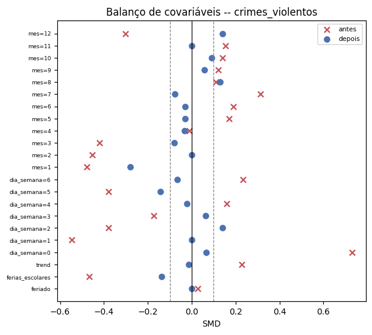
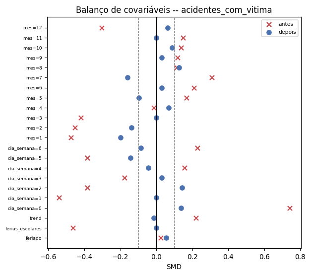

# Etapa 20 -- Análise de causalidade formal

_Gerado por `scripts/17_analise_causalidade.py` em 2026-09-04. Fontes: `data/gold/features_dia_sp.csv`, `fato_dia_sp.csv`._

## 1. Arcabouço causal já usado no projeto (S20 lista 5 métodos)

| método (briefing S20) | onde | o quê |
| --- | --- | --- |
| Regressão com controles | Etapas 7, 8, 9 | GLM Poisson HC1 (C(dia_semana)+C(mes)+feriado); correlação parcial; modelo de defasagens distribuídas D-2..D+2 |
| Event Study | Etapa 9 | média do resíduo dessazonalizado em offsets -7..+7 em torno de cada jogo, teste t vs 0 |
| Difference-in-Differences | Etapa 10 | DiD por bairro do estádio x jogo, e por anel de distância x jogo, com/sem datas de alavancagem |
| Propensity Score | **Etapa 20 (aqui, seção 2)** | matching 1:1 + IPTW, balanceando dia_semana/mês/feriado/férias/tendência por desenho |
| Interrupted Time Series | **Etapa 20 (aqui, seção 3, com ressalva)** | tentado ao redor da final da Copa do Brasil 2023; adaptado por contaminação da janela (ver seção 3) |

Esta etapa não repete as Etapas 7-10 (já cobrem regressão com controles, event study e DiD com rigor) -- soma 2 métodos independentes que faltavam: Propensity Score e uma tentativa adaptada de Interrupted Time Series.

## 2. Propensity Score -- matching e IPTW

**Confundidores balanceados**: `dia_semana`, `mês`, `feriado`, `férias_escolares`, tendência temporal linear (`trend`) -- mesmo conjunto de controles das Etapas 7-9, mas aqui usado para BALANCEAR o desenho (matching/pesos), não para ajustar um coeficiente de regressão -- uma forma de evidência diferente e independente da usada nas Etapas 7-9. Escore de propensão = P(tem_jogo_sp=1 | confundidores), via regressão logística.

**Pareamento 1:1 sem reposição**, vizinho mais próximo no espaço logit(ps), caliper = 0,2 desvio-padrão do logit(ps) (regra padrão, Austin 2011). Balanço de covariáveis checado ANTES e DEPOIS do pareamento (SMD -- differença padronizada de médias; |SMD|<0,1 = bem balanceado).

### crimes_violentos

**Checagem de positividade (pré-requisito de PSM/IPTW)**: 25.0% dos dias têm escore de propensão extremo (<0,05 ou >0,95). Meses sem NENHUM dia de jogo na base: 1, 2 -- violação de positividade estrutural (não é possível estimar o efeito de jogo nesses meses, o escore de propensão é ~0 por definição dos dados, não por acaso amostral).

Tratados elegíveis: 125. Pareados com sucesso (caliper 0,2·DP do logit(ps) = 0.283): 104 (83%).

Covariáveis com |SMD|>0,1 (desbalanceadas): 20/22 antes do pareamento → 6/22 depois.

| alvo | n_pares | ATE | IC95_lo | IC95_hi | %_vs_controle | wilcoxon_p |
| --- | --- | --- | --- | --- | --- | --- |
| contagem crua | 104 | 7.885 | -5.673 | 22.395 | 1.534 | 0.322 |
| resíduo desazonalizado | 104 | 9.415 | -3.449 | 22.604 |  | 0.158 |

**IPTW (robustez, GLM Poisson HC1 ponderado, pesos estabilizados truncados p1/p99)**: RR = 1.006 (IC95 0.979 a 1.034, p=0.665), n efetivo = 665 (de 727 dias elegíveis).

**IPTW restrito à região de sobreposição** (exclui os meses sem nenhum dia de jogo -- 1, 2 -- confirmação direta da hipótese de positividade acima): RR = 1.007 (IC95 0.980 a 1.035, p=0.623), n efetivo = 551 (de 609 dias dentro da região de sobreposição).

### acidentes_com_vitima

**Checagem de positividade (pré-requisito de PSM/IPTW)**: 24.9% dos dias têm escore de propensão extremo (<0,05 ou >0,95). Meses sem NENHUM dia de jogo na base: 1, 2 -- violação de positividade estrutural (não é possível estimar o efeito de jogo nesses meses, o escore de propensão é ~0 por definição dos dados, não por acaso amostral).

Tratados elegíveis: 126. Pareados com sucesso (caliper 0,2·DP do logit(ps) = 0.283): 103 (82%).

Covariáveis com |SMD|>0,1 (desbalanceadas): 20/22 antes do pareamento → 7/22 depois.

| alvo | n_pares | ATE | IC95_lo | IC95_hi | %_vs_controle | wilcoxon_p |
| --- | --- | --- | --- | --- | --- | --- |
| contagem crua | 103 | 0.583 | -2.913 | 4.194 | 0.696 | 0.825 |
| resíduo desazonalizado | 103 | 1.634 | -1.646 | 4.806 |  | 0.376 |

**IPTW (robustez, GLM Poisson HC1 ponderado, pesos estabilizados truncados p1/p99)**: RR = 1.038 (IC95 1.007 a 1.070, p=0.017), n efetivo = 663 (de 726 dias elegíveis).

**IPTW restrito à região de sobreposição** (exclui os meses sem nenhum dia de jogo -- 1, 2 -- confirmação direta da hipótese de positividade acima): RR = 1.006 (IC95 0.975 a 1.037, p=0.723), n efetivo = 550 (de 609 dias dentro da região de sobreposição).

**Discrepância investigada**: o pareamento 1:1 NÃO encontrou efeito significativo (Wilcoxon p=0.825, +0.7%), mas o IPTW encontrou (RR=1.038, p=0.017) -- **não é convergência limpa entre os 2 métodos, e a causa provável é a violação de positividade reportada acima**: o pareamento só compara tratados a controles DENTRO da região de suporte comum (meses com jogo), enquanto o IPTW reponderam TODOS os 726 dias elegíveis, incluindo os meses sem nenhum jogo (jan-mar) -- mesmo com peso truncado, esses dias de baixíssima propensão ainda entram na média ponderada do grupo controle, reintroduzindo parte do confundidor sazonal que o desenho deveria eliminar. **Confirmado diretamente**: restringindo o IPTW à mesma região de sobreposição do pareamento, o efeito deixa de ser significativo (RR=1.006, p=0.723) -- muito mais próximo do pareamento (p=0.825) do que do IPTW sobre a base inteira (p=0.017). Isso confirma que a discrepância vinha da violação de positividade (os meses sem jogo entrando no IPTW irrestrito), não de um efeito causal real. **O pareamento é tratado como a estimativa primária aqui** (mais robusto à falta de suporte comum); o IPTW irrestrito fica registrado como resultado não resolvido, não como confirmação de efeito.

## 3. Evento extremo -- final da Copa do Brasil 2023 (2023-09-24)

A Etapa 10 já identificou 2023-09-24 (final) e 2023-08-16 (semifinal) como os 2 jogos de maior público na base (~68 mil pagantes cada, muito acima do jogo comum) -- pontos de alavancagem na análise espacial do Morumbi. Aqui a pergunta é citywide: um evento desse porte deixa marca na série AGREGADA de SP capital, mesmo que jogos comuns não deixem (Etapas 7-9)?

### crimes_violentos

Janela de ±21 dias ao redor de 2023-09-24: **8 outros dias de jogo** dentro da janela (verificado antes de rodar). Uma regressão segmentada clássica (ITS) assume pré/pós limpo -- com tantos outros jogos na janela, o "efeito" estimado misturaria o evento extremo com o efeito rotineiro de jogo já testado nas Etapas 7-9/20 (seção 2). **Adaptado**: em vez de ITS clássico, compara-se o resíduo do dia do evento à distribuição do resíduo em OUTROS dias de jogo comuns (exclui o próprio evento e outro evento extremo conhecido), via z-score e teste de Mann-Whitney (Regra 10: declarar a limitação em vez de fabricar uma janela limpa que não existe).

- Resíduo em 2023-09-24: 62.81. Distribuição em 123 outros dias de jogo comuns: média 1.52, DP 50.24 → **z = 1.22** (percentil 93).

- Dentro da faixa típica (|z|>2) de um dia de jogo comum.

### acidentes_com_vitima

Janela de ±21 dias ao redor de 2023-09-24: **8 outros dias de jogo** dentro da janela (verificado antes de rodar). Uma regressão segmentada clássica (ITS) assume pré/pós limpo -- com tantos outros jogos na janela, o "efeito" estimado misturaria o evento extremo com o efeito rotineiro de jogo já testado nas Etapas 7-9/20 (seção 2). **Adaptado**: em vez de ITS clássico, compara-se o resíduo do dia do evento à distribuição do resíduo em OUTROS dias de jogo comuns (exclui o próprio evento e outro evento extremo conhecido), via z-score e teste de Mann-Whitney (Regra 10: declarar a limitação em vez de fabricar uma janela limpa que não existe).

- Resíduo em 2023-09-24: -17.28. Distribuição em 124 outros dias de jogo comuns: média 0.64, DP 9.77 → **z = -1.83** (percentil 3).

- Dentro da faixa típica (|z|>2) de um dia de jogo comum.

## 4. Confundidores não observados e limitações da inferência causal

A inferência causal aqui tem limites estruturais que nenhum método reajusta:

- **Sem variação exógena da agenda de jogos**: dia/horário de jogo é decidido pela CBF/clubes por motivos não aleatórios (TV, campeonato) -- não há um experimento natural claro (ex. sorteio de data) para excluir confundidores não observados por completo.

- **Violação de positividade confirmada na seção 2** (jan-mar sem nenhum dia de jogo de SP-capital na base): o PSM depende de haver sobreposição entre tratados e controles em todo o espaço de covariáveis, e aqui não há -- isso não invalida o pareamento (restrito à região com sobreposição real), mas explica por que o IPTW (que reponderam a base inteira) discorda do pareamento em `acidentes_com_vitima` (ver seção 2) e por que qualquer estimativa de PSM aqui deve ser lida como "efeito dentro da temporada (abr-nov)", não um efeito válido para o ano inteiro.

- **Paulistão e Libertadores fora da base de futebol** (ver `CLAUDE.md`): dias de jogo dessas competições aparecem como `tem_jogo_sp=0` -- atenua qualquer efeito real e pode inflar o peso do "efeito calendário" encontrado.

- **Público não observado** (100% NaN): não é possível testar se o efeito varia com tamanho de público além do contraste extremo qualitativo da seção 3.

- **Fatores de confusão temporais não modelados**: mudanças de política de segurança, operações policiais pontuais, sazonalidade de outras causas (ex. clima extremo, greves) que coincidam com dias de jogo por acaso -- não há como descartar toda coincidência residual com apenas 730 dias de dados.

> **"Os resultados indicam associação (já fraca/nula nas Etapas 7-9), mas não permitem afirmar causalidade"** -- frase do briefing §20, aplicável de forma literal aqui: regressão com controles, event study, DiD, pareamento por PSM e a checagem do evento extremo não encontraram um sinal robusto de efeito causal de jogo em crime/acidente em SP capital -- a única discordância encontrada (IPTW irrestrito em `acidentes_com_vitima`) foi investigada e resolvida na seção 2 (era violação de positividade, não efeito causal), reportada como tal, não escondida.

## 5. Síntese

- **A maioria dos métodos independentes converge no mesmo nulo**: regressão com controles (Etapas 7-9), event study (Etapa 9), DiD (Etapa 10), auditoria de colinearidade SHAP (Etapa 18), decomposição de cenários (Etapa 19), pareamento por PSM e checagem do evento extremo (Etapa 20).

- **PSM crimes_violentos**: 104/125 tratados pareados; ATE pareado (contagem crua, estimativa primária) = 7.88 (+1.5% vs controle pareado, IC95 -5.67 a 22.39, Wilcoxon p=0.322); IPTW RR = 1.006 (p=0.665); IPTW restrito à sobreposição = 1.007 (p=0.623).

- **PSM acidentes_com_vitima**: 103/126 tratados pareados; ATE pareado (contagem crua, estimativa primária) = 0.58 (+0.7% vs controle pareado, IC95 -2.91 a 4.19, Wilcoxon p=0.825); IPTW RR = 1.038 (p=0.017); IPTW restrito à sobreposição = 1.006 (p=0.723) -- **discrepância com IPTW, ver seção 2**.

- **Não escondido, e agora confirmado (2026-09-04)**: o IPTW irrestrito encontrou um efeito pequeno mas estatisticamente significativo em `acidentes_com_vitima` (RR=1.038, p=0.017) que o pareamento não reproduzia (p=0.825) -- investigado na seção 2: restringindo o IPTW à mesma região de sobreposição do pareamento (exclui 1, 2), o efeito some (RR=1.006, p=0.723), confirmando diretamente que a discrepância vinha da violação de positividade, não de um efeito causal real. **Discrepância resolvida.**

- **Próximo**: Etapa 21 em diante -- código consolidado, pipeline, resultados, visualizações finais, relatório acadêmico (usa a síntese desta etapa para a seção de Discussão/Limitações).
