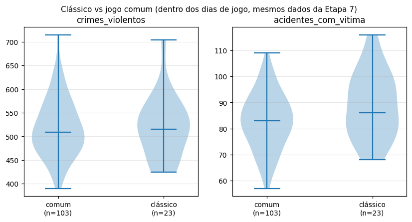
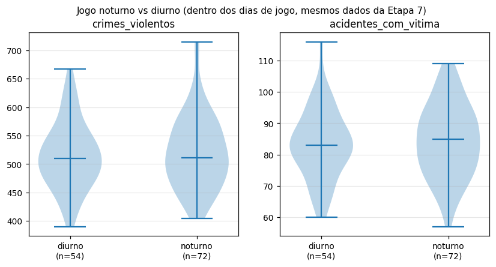

# Etapa 24 -- Visualizações finais (galeria dos 15 itens do briefing)

_Gerado por `scripts/19_visualizacoes_finais.py` em 2026-09-04. 13 dos 15 itens já existiam como figuras publicadas em etapas anteriores -- este script só gera os 2 que faltavam (itens 6 e 7, clássico e noturno, que a Etapa 7 só tinha publicado como tabela) e monta o índice abaixo, citando a etapa de origem de cada figura._

## Índice (15 itens do briefing §24)

| # | Visualização | Arquivo(s) | Origem |
| --- | --- | --- | --- |
| 1 | Série temporal de crimes | `reports/eda/figures/05_ts_crimes.png` | EDA (Etapa 6) |
| 2 | Série temporal de acidentes | `reports/eda/figures/06_ts_acidentes.png` | EDA (Etapa 6) |
| 3 | Jogos ao longo do tempo | `reports/eda/figures/07_ts_jogos.png` | EDA (Etapa 6) |
| 4 | Crimes em dias com/sem jogos | `reports/etapa7/figures/01_dist_crime.png` | Etapa 7 |
| 5 | Acidentes em dias com/sem jogos | `reports/etapa7/figures/01_dist_acidente.png` | Etapa 7 |
| 6 | Clássico vs jogo comum | `reports/etapa24/figures/00_classico_vs_comum.png` | Etapa 24 (novo -- Etapa 7 só tinha tabela) |
| 7 | Jogo diurno vs noturno | `reports/etapa24/figures/01_noturno_vs_diurno.png` | Etapa 24 (novo -- Etapa 7 só tinha tabela) |
| 8 | Heatmap por dia da semana × mês (adaptado — sem granularidade horária na base) | `reports/eda/figures/11_heatmap_crimes.png / 12_heatmap_acidentes.png` | EDA (Etapa 6) |
| 9 | Distribuição de ocorrências | `reports/eda/figures/02_hist_contagens.png` | EDA (Etapa 6) |
| 10 | Importância das features (total_gain XGBoost) | `reports/etapa14/figures/03_importancia_crimes_violentos.png / 03_importancia_acidentes_com_vitima.png` | Etapa 14 |
| 11 | SHAP summary plot (beeswarm) | `reports/etapa18/figures/00_beeswarm_crimes_violentos_regressao.png / 00_beeswarm_acidentes_com_vitima_regressao.png / 02_beeswarm_acidentes_com_vitima_classificacao.png` | Etapa 18 |
| 12 | Matriz de confusão | `reports/etapa16/figures/00_matriz_confusao_crimes_violentos.png / 01_matriz_confusao_acidentes_com_vitima.png` | Etapa 16 |
| 13 | Curva Precision-Recall | `reports/etapa14/figures/01_roc_pr_modelos.png` | Etapa 14 (combinada com ROC) |
| 14 | Curva ROC | `reports/etapa14/figures/01_roc_pr_modelos.png` | Etapa 14 (combinada com PR) |
| 15 | Previsão vs observado | `reports/etapa14/figures/02_melhor_regressao.png` | Etapa 14 |

## Novas figuras (itens 6 e 7)

Violino dentro dos dias de jogo (mesmo filtro/exclusão de dias censurados da Etapa 7 -- `secao_recortes`), para os 2 alvos principais do projeto. Números (médias, Mann-Whitney p, effect size) já publicados em `reports/etapa7/tabelas/recorte_classico.csv` e `recorte_jogo_noturno.csv` -- nenhum teste recalculado aqui, só a visualização que faltava.

**Leitura** (já registrada na Etapa 7/23): nenhuma diferença é significativa após correção de múltiplas comparações para os 2 alvos principais -- os violinos mostram visualmente a sobreposição quase total das distribuições.

## Nota sobre o item 8 (heatmap dia da semana × horário)

O briefing pede heatmap por dia da semana **e horário**; a unidade de análise do projeto é 1 dia (Etapa 4), sem granularidade horária para crime/acidente -- adaptado para dia da semana × **mês** (já feito na EDA, Etapa 6), que é a granularidade temporal mais fina disponível de forma consistente nas 3 fontes principais. Declarado como adaptação, não substituição silenciosa (Regra 10).
