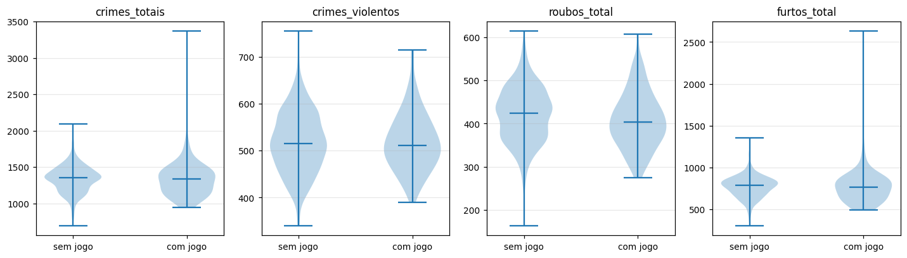
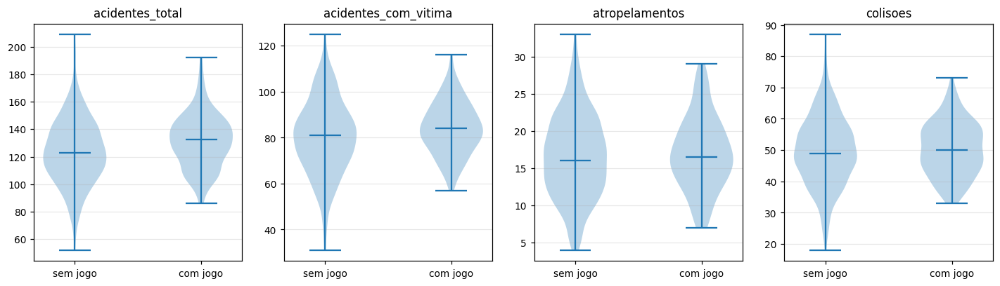
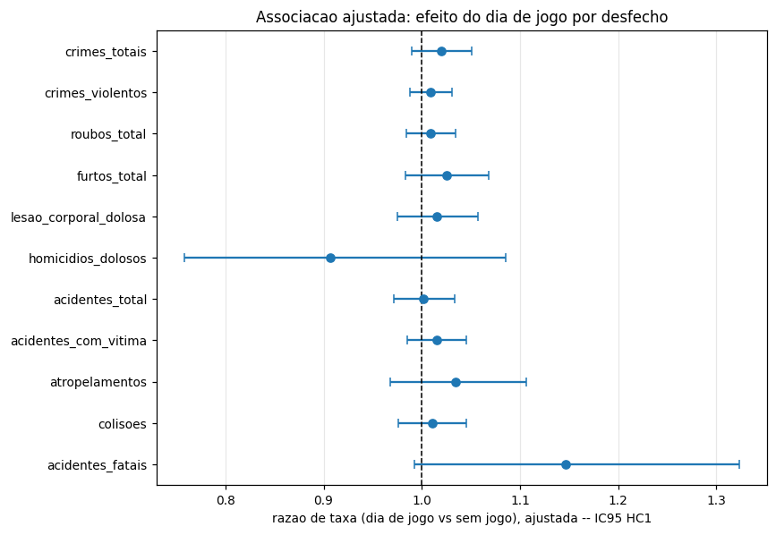

# Etapa 7 -- Dia com jogo vs dia sem jogo

_Gerado por `scripts/04_analise_jogo_vs_naojogo.py` em 2026-09-03. Fonte: `data/gold/fato_dia_sp.csv`._

> **Aviso de interpretacao:** tudo abaixo e **associacao / diferenca observada**, nao causalidade. 'Dia de jogo' vem junto de fim de semana, ferias, calendario de campeonato e outros fatores nao medidos. Inferencia causal formal = Etapa 20.

**Exclusoes (decididas na EDA):** crime remove 2023-12-30/31; acidente remove esses 2 + 2022-01-17 e 2023-08-07 (lacunas de registro, nao dias reais baixos).

**Hipoteses (todas as comparacoes de grupo):** H0: as duas distribuicoes tem a mesma tendencia central (Mann-Whitney: P(X>Y)=P(Y>X)). H1: diferem. alpha=0.05, bilateral, com correcao de Benjamini-Hochberg para o conjunto de desfechos.

## 1. Dia com jogo vs dia sem jogo -- comparacao bruta

Teste primario: **Mann-Whitney U** (bilateral); a EDA (Etapa 6) rejeitou normalidade em quase todas as contagens. t de Welch reportado como secundario. IC 95% por **bootstrap percentil** (10 000 reamostragens, semente fixa). Effect size: **Cliff's delta** (= r rank-biserial) e Hedges' g.

| familia | variavel | n_com jogo | n_sem jogo | media_com jogo | media_sem jogo | dif_abs_media | dif_pct_media | IC95_dif_media_lo | IC95_dif_media_hi | MannWhitney_p | MW_p_BH | cliffs_delta | efeito | hedges_g |
| --- | --- | --- | --- | --- | --- | --- | --- | --- | --- | --- | --- | --- | --- | --- |
| crime | crimes_totais | 126 | 602 | 1,340.944 | 1,337.314 | 3.630 | 0.271 | -43.520 | 57.181 | 0.293 | 0.460 | -0.060 | desprezivel | 0.018 |
| crime | crimes_violentos | 126 | 602 | 517.690 | 517.977 | -0.286 | -0.055 | -12.365 | 11.834 | 0.775 | 0.775 | -0.016 | desprezivel | -0.004 |
| crime | roubos_total | 126 | 602 | 407.317 | 421.012 | -13.694 | -3.253 | -26.133 | -1.541 | 0.015 | 0.032 | -0.138 | desprezivel | -0.213 |
| crime | furtos_total | 126 | 602 | 775.937 | 770.470 | 5.466 | 0.709 | -32.542 | 52.280 | 0.228 | 0.418 | -0.068 | desprezivel | 0.035 |
| crime | lesao_corporal_dolosa | 126 | 602 | 100.548 | 87.480 | 13.068 | 14.938 | 8.200 | 18.021 | 0.000 | 0.000 | 0.294 | pequeno | 0.567 |
| crime | homicidios_dolosos | 126 | 602 | 1.468 | 1.400 | 0.068 | 4.850 | -0.169 | 0.307 | 0.485 | 0.547 | 0.038 | desprezivel | 0.054 |
| acidente | acidentes_total | 126 | 600 | 131.357 | 123.518 | 7.839 | 6.346 | 3.911 | 11.706 | 0.000 | 0.001 | 0.202 | pequeno | 0.340 |
| acidente | acidentes_com_vitima | 126 | 600 | 83.952 | 80.283 | 3.669 | 4.570 | 1.312 | 6.044 | 0.013 | 0.032 | 0.141 | desprezivel | 0.237 |
| acidente | atropelamentos | 126 | 600 | 17.000 | 16.642 | 0.358 | 2.153 | -0.621 | 1.341 | 0.498 | 0.547 | 0.038 | desprezivel | 0.065 |
| acidente | colisoes | 126 | 600 | 50.397 | 49.677 | 0.720 | 1.450 | -0.999 | 2.470 | 0.482 | 0.547 | 0.040 | desprezivel | 0.067 |
| acidente | acidentes_fatais | 126 | 600 | 3.095 | 2.232 | 0.864 | 38.696 | 0.508 | 1.243 | 0.000 | 0.000 | 0.260 | pequeno | 0.502 |

- **dif_pct_media**: variacao percentual da media do grupo com jogo sobre o sem jogo.
- **IC95_dif_media**: se cruza 0, a diferenca de medias nao e estatisticamente distinta de 0.
- **MW_p_BH**: p-value de Mann-Whitney apos correcao de Benjamini-Hochberg (11 desfechos testados). `signif_BH_5pct` no CSV.
- **cliffs_delta**: |0.11| ja seria 'pequeno'; a EDA leva a esperar efeitos pequenos e confundidos por dia da semana -- ver secoes 2 e 3.

## 2. O confundidor: dia da semana

Distribuicao dos jogos pelos dias da semana:

| nome_dia_semana | dias_sem_jogo | dias_com_jogo | % dias com jogo |
| --- | --- | --- | --- |
| domingo | 56 | 49 | 46.7 |
| segunda | 102 | 2 | 1.9 |
| terça | 98 | 6 | 5.8 |
| quarta | 92 | 12 | 11.5 |
| quinta | 80 | 24 | 23.1 |
| sexta | 98 | 6 | 5.8 |
| sábado | 78 | 27 | 25.7 |

Os jogos **nao** se distribuem uniformemente. Como o proprio nivel de crime/acidente varia por dia da semana (Etapa 6), qualquer diferenca bruta mistura 'efeito jogo' com 'efeito dia da semana'. As secoes 2.1 e 3 tentam separar.

### 2.1 Comparacao estratificada por dia da semana

**crimes_totais**

| dia | n_jogo | n_sem | media_jogo | media_sem | dif_% | MW_p |
| --- | --- | --- | --- | --- | --- | --- |
| domingo | 49 | 55 | 1,240.10 | 1,171.84 | 5.83 | 0.62 |
| segunda | 2 | 102 | 1,124.50 | 1,189.58 | -5.47 |  |
| terça | 6 | 98 | 1,315.83 | 1,320.83 | -0.38 | 0.71 |
| quarta | 12 | 92 | 1,443.00 | 1,365.95 | 5.64 | 0.16 |
| quinta | 24 | 80 | 1,401.50 | 1,391.81 | 0.70 | 0.64 |
| sexta | 6 | 98 | 1,480.17 | 1,462.10 | 1.24 | 0.81 |
| sábado | 27 | 77 | 1,415.44 | 1,422.55 | -0.50 | 0.87 |

**crimes_violentos**

| dia | n_jogo | n_sem | media_jogo | media_sem | dif_% | MW_p |
| --- | --- | --- | --- | --- | --- | --- |
| domingo | 49 | 55 | 502.63 | 505.55 | -0.58 | 0.55 |
| segunda | 2 | 102 | 448.00 | 462.97 | -3.23 |  |
| terça | 6 | 98 | 479.00 | 490.60 | -2.36 | 0.52 |
| quarta | 12 | 92 | 502.17 | 515.37 | -2.56 | 0.35 |
| quinta | 24 | 80 | 530.67 | 526.99 | 0.70 | 0.65 |
| sexta | 6 | 98 | 572.83 | 570.95 | 0.33 | 0.91 |
| sábado | 27 | 77 | 541.89 | 560.90 | -3.39 | 0.17 |

**acidentes_total**

| dia | n_jogo | n_sem | media_jogo | media_sem | dif_% | MW_p |
| --- | --- | --- | --- | --- | --- | --- |
| domingo | 49 | 55 | 134.33 | 120.56 | 11.42 | 0.00 |
| segunda | 2 | 100 | 116.00 | 118.23 | -1.89 |  |
| terça | 6 | 98 | 115.67 | 113.77 | 1.67 | 0.73 |
| quarta | 12 | 92 | 123.92 | 116.16 | 6.67 | 0.12 |
| quinta | 24 | 80 | 121.29 | 121.56 | -0.22 | 0.90 |
| sexta | 6 | 98 | 140.50 | 138.33 | 1.57 | 0.73 |
| sábado | 27 | 77 | 140.81 | 136.88 | 2.87 | 0.57 |

**acidentes_com_vitima**

| dia | n_jogo | n_sem | media_jogo | media_sem | dif_% | MW_p |
| --- | --- | --- | --- | --- | --- | --- |
| domingo | 49 | 55 | 80.43 | 68.40 | 17.59 | 0.00 |
| segunda | 2 | 100 | 81.00 | 78.92 | 2.64 |  |
| terça | 6 | 98 | 80.67 | 77.92 | 3.53 | 0.57 |
| quarta | 12 | 92 | 85.83 | 78.18 | 9.78 | 0.06 |
| quinta | 24 | 80 | 83.38 | 80.60 | 3.44 | 0.45 |
| sexta | 6 | 98 | 91.33 | 90.42 | 1.01 | 0.95 |
| sábado | 27 | 77 | 89.33 | 82.83 | 7.85 | 0.05 |

## 3. Associacao ajustada -- GLM Poisson com erros-padrao robustos (HC1)

Modelo por desfecho: `y ~ tem_jogo_sp + C(dia_semana) + feriado + C(mes)`. Familia Poisson (dado de contagem); IC/p por erros-padrao **robustos HC1** (consistentes sob sobredispersao). O coeficiente de `tem_jogo_sp` vira **razao de taxa** `exp(coef)`: 1.05 = +5% no desfecho num dia de jogo, ja descontados dia da semana, feriado e mes.

| familia | variavel | rate_ratio_jogo | IC95_lo | IC95_hi | efeito_% | p_value | p_BH | signif_BH_5pct | sobredispersao |
| --- | --- | --- | --- | --- | --- | --- | --- | --- | --- |
| crime | crimes_totais | 1.020 | 0.990 | 1.050 | 1.975 | 0.197 | 0.575 | False | 22.615 |
| crime | crimes_violentos | 1.009 | 0.988 | 1.031 | 0.920 | 0.399 | 0.575 | False | 5.114 |
| crime | roubos_total | 1.009 | 0.984 | 1.035 | 0.920 | 0.471 | 0.575 | False | 5.661 |
| crime | furtos_total | 1.025 | 0.983 | 1.068 | 2.485 | 0.249 | 0.575 | False | 24.692 |
| crime | lesao_corporal_dolosa | 1.015 | 0.975 | 1.057 | 1.524 | 0.462 | 0.575 | False | 2.809 |
| crime | homicidios_dolosos | 0.907 | 0.758 | 1.085 | -9.298 | 0.286 | 0.575 | False | 1.016 |
| acidente | acidentes_total | 1.002 | 0.972 | 1.033 | 0.193 | 0.902 | 0.902 | False | 3.006 |
| acidente | acidentes_com_vitima | 1.015 | 0.985 | 1.046 | 1.485 | 0.333 | 0.575 | False | 2.021 |
| acidente | atropelamentos | 1.035 | 0.968 | 1.106 | 3.476 | 0.315 | 0.575 | False | 1.620 |
| acidente | colisoes | 1.010 | 0.976 | 1.046 | 1.039 | 0.556 | 0.612 | False | 1.601 |
| acidente | acidentes_fatais | 1.146 | 0.993 | 1.323 | 14.620 | 0.063 | 0.575 | False | 1.082 |

- **sobredispersao > 1** (esperado): a variancia excede a media Poisson. Por isso os erros-padrao HC1 (robustos) e nao os ingenuos; uma alternativa seria Binomial Negativa -- a direcao e a magnitude do rate ratio nao mudam materialmente, so a largura do IC. A sobredispersao muito alta de `crimes_totais` e `furtos_total` (~22-25) e inflada pelo outlier de 2022-06-19 (`furtos_total`=2633, registro em lote -- ver EDA); teste de sensibilidade sem esse dia fica para a Etapa 12.
- **IC95 cruzando 1.0** => associacao ajustada nao distinguivel de 'nenhum efeito'.
- Ajuste **nao** e prova de causalidade: variaveis nao observadas (transporte, fluxo de torcida, eventos simultaneos) seguem fora. Ver Etapa 20.

## 4. Recortes dentro dos dias de jogo

Amostra pequena (126 dias com jogo). Testes nao-parametricos, effect size reportado, resultados lidos com cautela.

### 4.1 Classico vs jogo comum

| variavel | n_classico | n_comum | media_classico | media_comum | dif_% | MW_p | cliffs_delta |
| --- | --- | --- | --- | --- | --- | --- | --- |
| crimes_totais | 23 | 103 | 1,386.65 | 1,330.74 | 4.20 | 0.39 | 0.12 |
| crimes_violentos | 23 | 103 | 518.13 | 517.59 | 0.10 | 0.94 | 0.01 |
| lesao_corporal_dolosa | 23 | 103 | 97.30 | 101.27 | -3.92 | 0.57 | -0.08 |
| acidentes_total | 23 | 103 | 136.48 | 130.21 | 4.81 | 0.28 | 0.15 |
| acidentes_com_vitima | 23 | 103 | 88.74 | 82.88 | 7.06 | 0.06 | 0.25 |

### 4.2 Jogo noturno vs diurno

| variavel | n_noturno | n_diurno | media_noturno | media_diurno | dif_% | MW_p | cliffs_delta |
| --- | --- | --- | --- | --- | --- | --- | --- |
| crimes_totais | 72 | 54 | 1,353.56 | 1,324.13 | 2.22 | 0.66 | -0.05 |
| crimes_violentos | 72 | 54 | 519.85 | 514.81 | 0.98 | 0.77 | 0.03 |
| lesao_corporal_dolosa | 72 | 54 | 107.24 | 91.63 | 17.03 | 0.00 | 0.38 |
| acidentes_total | 72 | 54 | 133.64 | 128.31 | 4.15 | 0.08 | 0.18 |
| acidentes_com_vitima | 72 | 54 | 84.47 | 83.26 | 1.46 | 0.56 | 0.06 |

### 4.3 Alto vs baixo publico -- BLOQUEADO

`publico` tem 0 valores nao-nulos de 730. A fonte de publico pagante (Kaggle `adaoduque/campeonato-brasileiro-de-futebol`) ainda nao foi integrada (hook pronto em `clean_football(kaggle_publico_path=...)`). A comparacao 'alto vs baixo publico' pedida no roteiro §7 fica **pendente** ate essa fonte entrar -- limitacao declarada, nao contornada com proxy inventado.

## 5. Previa D-1 / D0 / D+1 (a analise de defasagem completa e a Etapa 9)

**crimes_totais** -- Kruskal-Wallis H=23.41, p=0.0000

| janela | count | mean | median | dif_%_vs_sem_relacao |
| --- | --- | --- | --- | --- |
| D+1 (pos-jogo) | 76 | 1,392.91 | 1,399.00 | 3.92 |
| D-1 (vespera) | 100 | 1,282.08 | 1,244.00 | -4.35 |
| D0 (dia do jogo) | 126 | 1,340.94 | 1,342.00 | 0.04 |
| sem relacao | 426 | 1,340.36 | 1,354.00 | 0.00 |

**crimes_violentos** -- Kruskal-Wallis H=18.30, p=0.0004

| janela | count | mean | median | dif_%_vs_sem_relacao |
| --- | --- | --- | --- | --- |
| D+1 (pos-jogo) | 76 | 528.07 | 533.00 | 1.19 |
| D-1 (vespera) | 100 | 493.81 | 482.00 | -5.37 |
| D0 (dia do jogo) | 126 | 517.69 | 510.50 | -0.80 |
| sem relacao | 426 | 521.85 | 517.00 | 0.00 |

**acidentes_total** -- Kruskal-Wallis H=37.23, p=0.0000

| janela | count | mean | median | dif_%_vs_sem_relacao |
| --- | --- | --- | --- | --- |
| D+1 (pos-jogo) | 76 | 133.67 | 131.50 | 10.77 |
| D-1 (vespera) | 99 | 127.95 | 128.00 | 6.03 |
| D0 (dia do jogo) | 126 | 131.36 | 132.50 | 8.86 |
| sem relacao | 425 | 120.67 | 120.00 | 0.00 |

**acidentes_com_vitima** -- Kruskal-Wallis H=39.06, p=0.0000

| janela | count | mean | median | dif_%_vs_sem_relacao |
| --- | --- | --- | --- | --- |
| D+1 (pos-jogo) | 76 | 87.17 | 87.00 | 11.93 |
| D-1 (vespera) | 99 | 85.32 | 83.00 | 9.56 |
| D0 (dia do jogo) | 126 | 83.95 | 84.00 | 7.80 |
| sem relacao | 425 | 77.88 | 78.00 | 0.00 |

_Leitura so exploratoria. Note que **D-1, D0 e D+1 estao TODOS ~+6 a +12% acima de 'sem relacao' para acidentes** -- a janela inteira em torno do jogo, nao so o dia. Como a temporada de futebol (abr-nov) nao cobre o verao (dez-mar), que tem menos acidentes, boa parte disso e **efeito de calendario/mes**, nao do jogo: o modelo ajustado da secao 3 (que controla `C(mes)`) ja nao acha efeito em D0. A correlacao cruzada e o modelo com defasagens controladas ficam para a Etapa 9._

## 6. Sintese da Etapa 7

**Bruto (sem ajuste):** aparecem diferencas em `lesao_corporal_dolosa`
(+14,9%, MW p<0,001 apos BH, Hedges' g 0,57), `acidentes_total` (+6,3%,
p<0,001), `acidentes_fatais` (+38,7%, p<0,001) e `roubos_total` **menor**
em dia de jogo (-3,3%, p=0,03). `crimes_totais`, `crimes_violentos`,
`furtos_total`, `homicidios` nao diferem. Todos os effect sizes sao
pequenos ou despreziveis (|Cliff's delta| <= 0,29).

**Ajustado (Poisson/HC1, controla dia da semana + feriado + mes):**
**nenhum desfecho permanece significativo apos correcao de multiplas
comparacoes** (todos p_BH > 0,5). O maior efeito residual e
`acidentes_fatais` (rate ratio 1,15; IC95 0,99-1,32; p=0,06 sem BH) --
sugestivo, nao conclusivo, e sobre contagem pequena (media ~2-3/dia).
Ou seja: **a maior parte da diferenca bruta era confundimento por dia da
semana e mes** (jogos concentram em domingo/quinta/sabado e na temporada
abr-nov). A comparacao estratificada (secao 2.1) mostra o mesmo: o unico
contraste bruto que sobra dentro de um mesmo dia da semana e acidentes no
**domingo** (+11% a +18%, p<0,01), que ainda assim pode carregar efeito
de mes.

**Recortes (amostra pequena, 126 dias com jogo):**
- Classico vs comum: sem diferenca robusta; o maior sinal e
  `acidentes_com_vitima` +7% (p=0,06, delta 0,25) -- indicativo.
- Noturno vs diurno: `lesao_corporal_dolosa` +17% em jogo noturno
  (p<0,01, delta 0,38) -- mas noturno/diurno tambem se confunde com dia
  da semana e campeonato; checar na Etapa 9/feature engineering.
- Alto vs baixo publico: **nao avaliavel** (`publico` 100% ausente).

**Resposta as perguntas do roteiro (§23), so com o que a Etapa 7 permite:**
1. Associacao jogo x violencia: fraca e majoritariamente explicada por
   dia da semana; nao robusta apos ajuste. Excecao a investigar: lesao
   corporal em jogo noturno.
2. Associacao jogo x acidentes: existe no bruto (+6%), enfraquece muito
   apos ajuste; o sinal mais persistente e em acidentes fatais e no
   domingo.
3-5. Classico / noturno / publico: inconclusivo, pendente ou nao
   avaliavel (ver acima).

**Aviso obrigatorio (Regra 5):** os resultados indicam *associacao*, com
magnitude pequena e sensivel a controle de confundidores. **Nao** permitem
afirmar que jogos causam mais crime ou acidente. Inferencia causal = Etapa 20.

**Proximo:** Etapa 8 (Pearson/Spearman/correlacao parcial formais) e
Etapa 9 (defasagem D-2..D+2 com correlacao cruzada, controlando mes).
