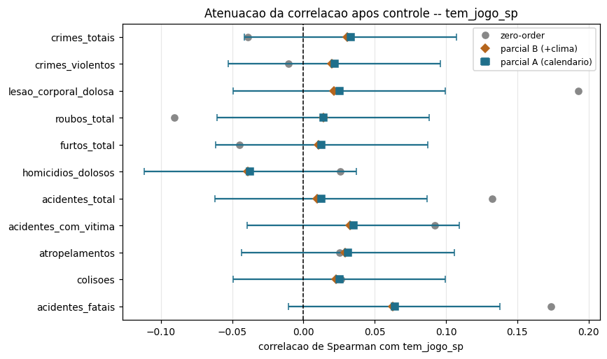
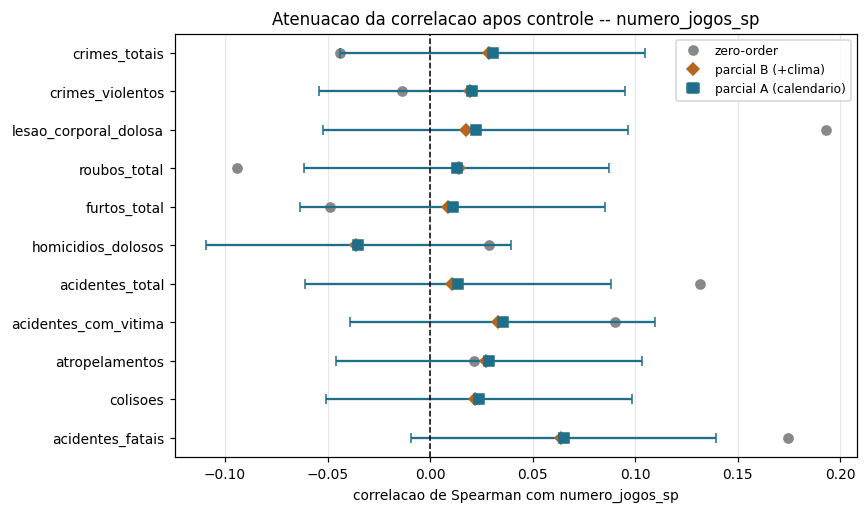
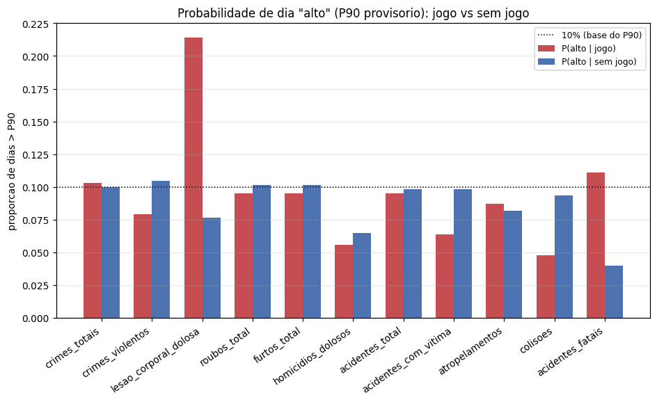

# Etapa 8 -- Analise estatistica

_Gerado por `scripts/05_analise_estatistica.py` em 2026-09-03. Fonte: `data/gold/fato_dia_sp.csv`._

> **Regra 5 do briefing:** os testes abaixo medem *correlacao / associacao*. Nenhum autoriza afirmar causalidade. A pergunta desta etapa e mais modesta: *a associacao jogo x desfecho continua existindo depois de controlar dia da semana, mes e clima?* Inferencia causal formal = Etapa 20.

**Exclusoes (Etapa 6):** crime remove 2023-12-30/31; acidente remove +2022-01-17 e 2023-08-07.

## 1. Correlacao simples (zero-order): Pearson e Spearman

**H0:** rho = 0 (sem associacao monotona/linear entre driver e desfecho). **H1:** rho != 0. alpha = 0.05 bilateral, com Benjamini-Hochberg sobre o conjunto (driver x desfecho). IC 95% por transformacao de Fisher.

Spearman e o foco (contagens nao-normais, Etapa 6); Pearson vai junto para comparacao.

| familia | desfecho | driver | n | pearson_r | spearman_r | spearman_IC95_lo | spearman_IC95_hi | spearman_p | spearman_p_BH | signif_BH_5pct |
| --- | --- | --- | --- | --- | --- | --- | --- | --- | --- | --- |
| crime | crimes_totais | tem_jogo_sp | 728 | 0.007 | -0.039 | -0.111 | 0.034 | 0.293 | 0.548 | False |
| crime | crimes_totais | numero_jogos_sp | 728 | -0.018 | -0.044 | -0.116 | 0.029 | 0.238 | 0.477 | False |
| crime | crimes_totais | classico | 728 | 0.043 | 0.019 | -0.054 | 0.091 | 0.610 | 0.767 | False |
| crime | crimes_totais | jogo_noturno | 126 | 0.052 | -0.039 | -0.212 | 0.137 | 0.664 | 0.793 | False |
| crime | crimes_violentos | tem_jogo_sp | 728 | -0.002 | -0.011 | -0.083 | 0.062 | 0.775 | 0.835 | False |
| crime | crimes_violentos | numero_jogos_sp | 728 | -0.017 | -0.014 | -0.086 | 0.059 | 0.713 | 0.825 | False |
| crime | crimes_violentos | classico | 728 | 0.001 | -0.003 | -0.076 | 0.069 | 0.925 | 0.925 | False |
| crime | crimes_violentos | jogo_noturno | 126 | 0.041 | 0.026 | -0.149 | 0.200 | 0.771 | 0.835 | False |
| crime | lesao_corporal_dolosa | tem_jogo_sp | 728 | 0.210 | 0.193 | 0.122 | 0.262 | 0.000 | 0.000 | True |
| crime | lesao_corporal_dolosa | numero_jogos_sp | 728 | 0.205 | 0.193 | 0.122 | 0.262 | 0.000 | 0.000 | True |
| crime | lesao_corporal_dolosa | classico | 728 | 0.058 | 0.060 | -0.013 | 0.132 | 0.105 | 0.288 | False |
| crime | lesao_corporal_dolosa | jogo_noturno | 126 | 0.291 | 0.325 | 0.159 | 0.473 | 0.000 | 0.002 | True |
| crime | roubos_total | tem_jogo_sp | 728 | -0.081 | -0.090 | -0.162 | -0.018 | 0.015 | 0.053 | False |
| crime | roubos_total | numero_jogos_sp | 728 | -0.097 | -0.094 | -0.165 | -0.021 | 0.011 | 0.053 | False |
| crime | roubos_total | classico | 728 | -0.018 | -0.010 | -0.083 | 0.062 | 0.778 | 0.835 | False |
| crime | roubos_total | jogo_noturno | 126 | -0.089 | -0.093 | -0.264 | 0.083 | 0.299 | 0.548 | False |
| crime | furtos_total | tem_jogo_sp | 728 | 0.013 | -0.045 | -0.117 | 0.028 | 0.228 | 0.477 | False |
| crime | furtos_total | numero_jogos_sp | 728 | -0.011 | -0.049 | -0.121 | 0.024 | 0.186 | 0.432 | False |
| crime | furtos_total | classico | 728 | 0.058 | 0.031 | -0.042 | 0.104 | 0.400 | 0.677 | False |
| crime | furtos_total | jogo_noturno | 126 | 0.052 | -0.063 | -0.235 | 0.113 | 0.485 | 0.707 | False |
| crime | homicidios_dolosos | tem_jogo_sp | 728 | 0.021 | 0.026 | -0.047 | 0.098 | 0.486 | 0.707 | False |
| crime | homicidios_dolosos | numero_jogos_sp | 728 | 0.035 | 0.029 | -0.044 | 0.101 | 0.436 | 0.707 | False |
| crime | homicidios_dolosos | classico | 728 | 0.010 | 0.005 | -0.068 | 0.077 | 0.900 | 0.925 | False |
| crime | homicidios_dolosos | jogo_noturno | 126 | 0.107 | 0.106 | -0.070 | 0.276 | 0.236 | 0.477 | False |
| acidente | acidentes_total | tem_jogo_sp | 726 | 0.128 | 0.132 | 0.060 | 0.203 | 0.000 | 0.002 | True |
| acidente | acidentes_total | numero_jogos_sp | 726 | 0.121 | 0.132 | 0.060 | 0.203 | 0.000 | 0.002 | True |
| acidente | acidentes_total | classico | 726 | 0.091 | 0.083 | 0.011 | 0.155 | 0.025 | 0.077 | False |
| acidente | acidentes_total | jogo_noturno | 126 | 0.135 | 0.156 | -0.019 | 0.322 | 0.080 | 0.236 | False |
| acidente | acidentes_com_vitima | tem_jogo_sp | 726 | 0.090 | 0.092 | 0.020 | 0.164 | 0.013 | 0.053 | False |
| acidente | acidentes_com_vitima | numero_jogos_sp | 726 | 0.080 | 0.090 | 0.018 | 0.162 | 0.015 | 0.053 | False |
| acidente | acidentes_com_vitima | classico | 726 | 0.091 | 0.090 | 0.017 | 0.161 | 0.016 | 0.053 | False |
| acidente | acidentes_com_vitima | jogo_noturno | 126 | 0.053 | 0.053 | -0.123 | 0.226 | 0.558 | 0.728 | False |
| acidente | atropelamentos | tem_jogo_sp | 726 | 0.025 | 0.025 | -0.048 | 0.098 | 0.498 | 0.707 | False |
| acidente | atropelamentos | numero_jogos_sp | 726 | 0.008 | 0.022 | -0.051 | 0.094 | 0.563 | 0.728 | False |
| acidente | atropelamentos | classico | 726 | 0.040 | 0.034 | -0.039 | 0.106 | 0.363 | 0.639 | False |
| acidente | atropelamentos | jogo_noturno | 126 | 0.013 | 0.039 | -0.137 | 0.212 | 0.667 | 0.793 | False |
| acidente | colisoes | tem_jogo_sp | 726 | 0.026 | 0.026 | -0.047 | 0.099 | 0.482 | 0.707 | False |
| acidente | colisoes | numero_jogos_sp | 726 | 0.009 | 0.022 | -0.051 | 0.095 | 0.549 | 0.728 | False |
| acidente | colisoes | classico | 726 | 0.057 | 0.055 | -0.018 | 0.127 | 0.141 | 0.345 | False |
| acidente | colisoes | jogo_noturno | 126 | 0.003 | 0.009 | -0.166 | 0.183 | 0.922 | 0.925 | False |
| acidente | acidentes_fatais | tem_jogo_sp | 726 | 0.187 | 0.174 | 0.102 | 0.243 | 0.000 | 0.000 | True |
| acidente | acidentes_fatais | numero_jogos_sp | 726 | 0.193 | 0.175 | 0.103 | 0.244 | 0.000 | 0.000 | True |
| acidente | acidentes_fatais | classico | 726 | 0.140 | 0.112 | 0.040 | 0.184 | 0.002 | 0.014 | True |
| acidente | acidentes_fatais | jogo_noturno | 126 | 0.145 | 0.136 | -0.040 | 0.303 | 0.130 | 0.336 | False |

## 2. Correlacao parcial -- a associacao sobrevive aos confundidores?

**H0:** rho_parcial = 0 depois de remover o efeito linear dos controles. **H1:** != 0. Metodo: residualizar desfecho e driver (nas RANKS, para a versao Spearman) sobre os controles via OLS e correlacionar os residuos.

- **Modelo A (calendario):** controla `C(dia_semana) + C(mes) + feriado`.
- **Modelo B (calendario + clima):** A + `temp_media + precipitacao_total + umidade_media` (subconjunto com clima observado).

**Placar:** dos 44 pares driver x desfecho -- **8** significativos na correlacao simples (secao 1), **0** apos controle de calendario (modelo A), **0** apos controle de calendario + clima (modelo B).

| familia | desfecho | driver | spearman_zero | parcial_A_r | parcial_A_IC_lo | parcial_A_IC_hi | parcial_A_p_BH | A_signif_BH | parcial_B_r | parcial_B_p_BH | B_signif_BH |
| --- | --- | --- | --- | --- | --- | --- | --- | --- | --- | --- | --- |
| crime | crimes_totais | tem_jogo_sp | -0.039 | 0.033 | -0.041 | 0.107 | 0.850 | False | 0.031 | 0.958 | False |
| crime | crimes_totais | numero_jogos_sp | -0.044 | 0.031 | -0.044 | 0.105 | 0.850 | False | 0.029 | 0.958 | False |
| crime | crimes_totais | classico | 0.019 | 0.045 | -0.030 | 0.119 | 0.850 | False | 0.034 | 0.958 | False |
| crime | crimes_totais | jogo_noturno | -0.039 | 0.014 | -0.174 | 0.202 | 0.978 | False | -0.007 | 0.958 | False |
| crime | crimes_violentos | tem_jogo_sp | -0.011 | 0.022 | -0.053 | 0.096 | 0.879 | False | 0.020 | 0.958 | False |
| crime | crimes_violentos | numero_jogos_sp | -0.014 | 0.021 | -0.054 | 0.095 | 0.882 | False | 0.019 | 0.958 | False |
| crime | crimes_violentos | classico | -0.003 | 0.013 | -0.062 | 0.087 | 0.882 | False | 0.002 | 0.958 | False |
| crime | crimes_violentos | jogo_noturno | 0.026 | 0.005 | -0.183 | 0.193 | 0.978 | False | -0.029 | 0.958 | False |
| crime | lesao_corporal_dolosa | tem_jogo_sp | 0.193 | 0.025 | -0.049 | 0.100 | 0.879 | False | 0.022 | 0.958 | False |
| crime | lesao_corporal_dolosa | numero_jogos_sp | 0.193 | 0.022 | -0.052 | 0.097 | 0.879 | False | 0.018 | 0.958 | False |
| crime | lesao_corporal_dolosa | classico | 0.060 | 0.030 | -0.045 | 0.104 | 0.850 | False | 0.006 | 0.958 | False |
| crime | lesao_corporal_dolosa | jogo_noturno | 0.325 | 0.040 | -0.149 | 0.227 | 0.882 | False | 0.067 | 0.958 | False |
| crime | roubos_total | tem_jogo_sp | -0.090 | 0.014 | -0.061 | 0.088 | 0.882 | False | 0.014 | 0.958 | False |
| crime | roubos_total | numero_jogos_sp | -0.094 | 0.013 | -0.061 | 0.087 | 0.882 | False | 0.014 | 0.958 | False |
| crime | roubos_total | classico | -0.010 | 0.029 | -0.046 | 0.103 | 0.850 | False | 0.027 | 0.958 | False |
| crime | roubos_total | jogo_noturno | -0.093 | 0.001 | -0.187 | 0.189 | 0.990 | False | -0.036 | 0.958 | False |
| crime | furtos_total | tem_jogo_sp | -0.045 | 0.013 | -0.062 | 0.087 | 0.882 | False | 0.011 | 0.958 | False |
| crime | furtos_total | numero_jogos_sp | -0.049 | 0.011 | -0.063 | 0.086 | 0.888 | False | 0.009 | 0.958 | False |
| crime | furtos_total | classico | 0.031 | 0.052 | -0.023 | 0.126 | 0.850 | False | 0.045 | 0.958 | False |
| crime | furtos_total | jogo_noturno | -0.063 | 0.008 | -0.181 | 0.195 | 0.978 | False | -0.006 | 0.958 | False |
| crime | homicidios_dolosos | tem_jogo_sp | 0.026 | -0.038 | -0.112 | 0.037 | 0.850 | False | -0.039 | 0.958 | False |
| crime | homicidios_dolosos | numero_jogos_sp | 0.029 | -0.035 | -0.109 | 0.039 | 0.850 | False | -0.036 | 0.958 | False |
| crime | homicidios_dolosos | classico | 0.005 | 0.003 | -0.072 | 0.077 | 0.978 | False | -0.003 | 0.958 | False |
| crime | homicidios_dolosos | jogo_noturno | 0.106 | 0.116 | -0.074 | 0.297 | 0.850 | False | 0.101 | 0.958 | False |
| acidente | acidentes_total | tem_jogo_sp | 0.132 | 0.012 | -0.062 | 0.087 | 0.882 | False | 0.010 | 0.958 | False |
| acidente | acidentes_total | numero_jogos_sp | 0.132 | 0.014 | -0.061 | 0.088 | 0.882 | False | 0.011 | 0.958 | False |
| acidente | acidentes_total | classico | 0.083 | 0.031 | -0.044 | 0.105 | 0.850 | False | 0.019 | 0.958 | False |
| acidente | acidentes_total | jogo_noturno | 0.156 | -0.155 | -0.333 | 0.034 | 0.850 | False | -0.138 | 0.958 | False |
| acidente | acidentes_com_vitima | tem_jogo_sp | 0.092 | 0.035 | -0.040 | 0.109 | 0.850 | False | 0.033 | 0.958 | False |
| acidente | acidentes_com_vitima | numero_jogos_sp | 0.090 | 0.036 | -0.039 | 0.110 | 0.850 | False | 0.033 | 0.958 | False |
| acidente | acidentes_com_vitima | classico | 0.090 | 0.045 | -0.030 | 0.119 | 0.850 | False | 0.033 | 0.958 | False |
| acidente | acidentes_com_vitima | jogo_noturno | 0.053 | -0.079 | -0.264 | 0.110 | 0.850 | False | -0.070 | 0.958 | False |
| acidente | atropelamentos | tem_jogo_sp | 0.025 | 0.031 | -0.043 | 0.106 | 0.850 | False | 0.029 | 0.958 | False |
| acidente | atropelamentos | numero_jogos_sp | 0.022 | 0.029 | -0.046 | 0.103 | 0.850 | False | 0.027 | 0.958 | False |
| acidente | atropelamentos | classico | 0.034 | 0.019 | -0.056 | 0.093 | 0.882 | False | 0.008 | 0.958 | False |
| acidente | atropelamentos | jogo_noturno | 0.039 | 0.076 | -0.114 | 0.260 | 0.850 | False | 0.057 | 0.958 | False |
| acidente | colisoes | tem_jogo_sp | 0.026 | 0.025 | -0.049 | 0.100 | 0.879 | False | 0.023 | 0.958 | False |
| acidente | colisoes | numero_jogos_sp | 0.022 | 0.024 | -0.051 | 0.098 | 0.879 | False | 0.022 | 0.958 | False |
| acidente | colisoes | classico | 0.055 | 0.038 | -0.037 | 0.112 | 0.850 | False | 0.022 | 0.958 | False |
| acidente | colisoes | jogo_noturno | 0.009 | -0.009 | -0.196 | 0.180 | 0.978 | False | -0.013 | 0.958 | False |
| acidente | acidentes_fatais | tem_jogo_sp | 0.174 | 0.064 | -0.011 | 0.138 | 0.850 | False | 0.063 | 0.958 | False |
| acidente | acidentes_fatais | numero_jogos_sp | 0.175 | 0.065 | -0.009 | 0.139 | 0.850 | False | 0.064 | 0.958 | False |
| acidente | acidentes_fatais | classico | 0.112 | 0.081 | 0.006 | 0.154 | 0.850 | False | 0.070 | 0.958 | False |
| acidente | acidentes_fatais | jogo_noturno | 0.136 | -0.106 | -0.288 | 0.084 | 0.850 | False | -0.106 | 0.958 | False |

Leitura: comparar `spearman_zero` -> `parcial_A_r` -> `parcial_B_r`. Se a correlacao cai para perto de 0 e o IC passa a cruzar 0, a associacao simples era confundimento (dia da semana / mes / clima), nao efeito do jogo.

## 3. Teste de proporcoes -- dia "alto" em jogo vs sem jogo

Limiar **PROVISORIO** (a definicao formal de pico e a Etapa 11): dia alto = desfecho > P90 (e P95) calculado sobre TODOS os dias da familia. **H0:** P(alto | jogo) = P(alto | sem jogo). **H1:** != . Testes: z de duas proporcoes (principal), qui-quadrado e Fisher exato (robustez). Effect size: risco relativo (RR), diferenca de risco (RD), odds ratio (OR), todos com IC 95%.

| familia | desfecho | limiar | P(alto|jogo) | P(alto|sem) | RR | RR_IC_lo | RR_IC_hi | RD | OR | z_p | z_p_BH | signif_BH_5pct |
| --- | --- | --- | --- | --- | --- | --- | --- | --- | --- | --- | --- | --- |
| crime | crimes_totais | P90 | 0.103 | 0.100 | 1.035 | 0.587 | 1.827 | 0.004 | 1.039 | 0.905 | 0.915 | False |
| crime | crimes_totais | P95 | 0.063 | 0.047 | 1.365 | 0.637 | 2.925 | 0.017 | 1.390 | 0.424 | 0.848 | False |
| crime | crimes_violentos | P90 | 0.079 | 0.105 | 0.758 | 0.400 | 1.437 | -0.025 | 0.738 | 0.390 | 0.848 | False |
| crime | crimes_violentos | P95 | 0.056 | 0.050 | 1.115 | 0.501 | 2.481 | 0.006 | 1.122 | 0.790 | 0.915 | False |
| crime | lesao_corporal_dolosa | P90 | 0.214 | 0.076 | 2.804 | 1.816 | 4.331 | 0.138 | 3.296 | 0.000 | 0.000 | True |
| crime | lesao_corporal_dolosa | P95 | 0.119 | 0.037 | 3.258 | 1.739 | 6.102 | 0.083 | 3.563 | 0.000 | 0.001 | True |
| crime | roubos_total | P90 | 0.095 | 0.101 | 0.940 | 0.522 | 1.693 | -0.006 | 0.934 | 0.836 | 0.915 | False |
| crime | roubos_total | P95 | 0.056 | 0.048 | 1.153 | 0.517 | 2.574 | 0.007 | 1.162 | 0.728 | 0.915 | False |
| crime | furtos_total | P90 | 0.095 | 0.101 | 0.940 | 0.522 | 1.693 | -0.006 | 0.934 | 0.836 | 0.915 | False |
| crime | furtos_total | P95 | 0.079 | 0.045 | 1.770 | 0.879 | 3.562 | 0.035 | 1.836 | 0.109 | 0.399 | False |
| crime | homicidios_dolosos | P90 | 0.056 | 0.065 | 0.858 | 0.393 | 1.873 | -0.009 | 0.849 | 0.699 | 0.915 | False |
| crime | homicidios_dolosos | P95 | 0.024 | 0.015 | 1.593 | 0.437 | 5.800 | 0.009 | 1.607 | 0.478 | 0.876 | False |
| acidente | acidentes_total | P90 | 0.095 | 0.098 | 0.969 | 0.537 | 1.748 | -0.003 | 0.965 | 0.915 | 0.915 | False |
| acidente | acidentes_total | P95 | 0.056 | 0.047 | 1.190 | 0.532 | 2.665 | 0.009 | 1.202 | 0.672 | 0.915 | False |
| acidente | acidentes_com_vitima | P90 | 0.063 | 0.098 | 0.646 | 0.316 | 1.317 | -0.035 | 0.622 | 0.219 | 0.536 | False |
| acidente | acidentes_com_vitima | P95 | 0.024 | 0.053 | 0.446 | 0.139 | 1.435 | -0.030 | 0.433 | 0.160 | 0.491 | False |
| acidente | atropelamentos | P90 | 0.087 | 0.082 | 1.069 | 0.572 | 1.997 | 0.006 | 1.076 | 0.835 | 0.915 | False |
| acidente | atropelamentos | P95 | 0.040 | 0.045 | 0.882 | 0.346 | 2.246 | -0.005 | 0.877 | 0.792 | 0.915 | False |
| acidente | colisoes | P90 | 0.048 | 0.093 | 0.510 | 0.225 | 1.158 | -0.046 | 0.486 | 0.095 | 0.399 | False |
| acidente | colisoes | P95 | 0.024 | 0.052 | 0.461 | 0.143 | 1.484 | -0.028 | 0.448 | 0.178 | 0.491 | False |
| acidente | acidentes_fatais | P90 | 0.111 | 0.040 | 2.778 | 1.479 | 5.218 | 0.071 | 3.000 | 0.001 | 0.008 | True |
| acidente | acidentes_fatais | P95 | 0.063 | 0.020 | 3.175 | 1.325 | 7.606 | 0.043 | 3.322 | 0.007 | 0.037 | True |

RR > 1 com IC que nao cruza 1 => dia de jogo tem mais chance de ser dia alto. Como o limiar aqui e provisorio e nao controla dia da semana, este resultado e um indicativo que a Etapa 11 (definicao de pico) e a modelagem (Etapa 14) vao refinar.

## 4. Kruskal-Wallis / ANOVA -- fatores de mais de 2 niveis

**H0:** todos os grupos tem a mesma distribuicao (mesma mediana). **H1:** ao menos um difere. Kruskal-Wallis (principal, nao-parametrico) + ANOVA (robustez). Effect size: epsilon^2 (KW) e eta^2 (ANOVA). Post-hoc: Mann-Whitney par a par com Benjamini-Hochberg, apenas quando KW p < 0.05.

| fator | familia | desfecho | n_grupos | KW_H | KW_p | KW_p_BH | epsilon2 | eta2 |
| --- | --- | --- | --- | --- | --- | --- | --- | --- |
| dia_semana | crime | crimes_totais | 7 | 275.0473 | 0.0000 | 0.0000 | 0.3732 | 0.2287 |
| dia_semana | crime | crimes_violentos | 7 | 219.5129 | 0.0000 | 0.0000 | 0.2961 | 0.2782 |
| dia_semana | crime | lesao_corporal_dolosa | 7 | 300.5562 | 0.0000 | 0.0000 | 0.4085 | 0.4463 |
| dia_semana | crime | furtos_total | 7 | 259.9069 | 0.0000 | 0.0000 | 0.3522 | 0.1859 |
| dia_semana | acidente | acidentes_total | 7 | 121.9046 | 0.0000 | 0.0000 | 0.1612 | 0.1591 |
| dia_semana | acidente | acidentes_com_vitima | 7 | 72.2807 | 0.0000 | 0.0000 | 0.0922 | 0.0995 |
| dia_semana | acidente | atropelamentos | 7 | 48.4365 | 0.0000 | 0.0000 | 0.0590 | 0.0703 |
| numero_jogos_sp | crime | crimes_totais | 3 | 6.8647 | 0.0323 | 0.0346 | 0.0067 | 0.0082 |
| numero_jogos_sp | crime | crimes_violentos | 3 | 2.4336 | 0.2962 | 0.2962 | 0.0006 | 0.0033 |
| numero_jogos_sp | acidente | acidentes_total | 3 | 12.7212 | 0.0017 | 0.0022 | 0.0148 | 0.0165 |
| numero_jogos_sp | acidente | acidentes_com_vitima | 3 | 6.8685 | 0.0322 | 0.0346 | 0.0067 | 0.0085 |
| janela | crime | crimes_totais | 4 | 23.4094 | 0.0000 | 0.0000 | 0.0282 | 0.0177 |
| janela | crime | crimes_violentos | 4 | 18.3031 | 0.0004 | 0.0005 | 0.0211 | 0.0231 |
| janela | acidente | acidentes_total | 4 | 37.2265 | 0.0000 | 0.0000 | 0.0474 | 0.0503 |
| janela | acidente | acidentes_com_vitima | 4 | 39.0610 | 0.0000 | 0.0000 | 0.0499 | 0.0573 |

_epsilon^2 / eta^2: ~0.01 pequeno, ~0.06 medio, ~0.14 grande._

### 4.1 Post-hoc (Mann-Whitney par a par, BH) -- so onde KW foi significativo

Para `dia_semana` (21 pares por desfecho) o quadro completo esta em `tabelas/kruskal_posthoc.csv`; resumo: a grande maioria dos pares difere, com **domingo e segunda** consistentemente abaixo dos dias uteis do meio/fim de semana. Abaixo so os fatores ligados ao futebol.

| fator | desfecho | par | media_1 | media_2 | MW_p_BH | signif_BH |
| --- | --- | --- | --- | --- | --- | --- |
| numero_jogos_sp | crimes_totais | 0 vs 1 | 1,337.314 | 1,354.730 | 0.724 | False |
| numero_jogos_sp | crimes_totais | 0 vs 2 | 1,337.314 | 1,196.818 | 0.024 | True |
| numero_jogos_sp | crimes_totais | 1 vs 2 | 1,354.730 | 1,196.818 | 0.042 | True |
| numero_jogos_sp | acidentes_total | 0 vs 1 | 123.518 | 131.522 | 0.002 | True |
| numero_jogos_sp | acidentes_total | 0 vs 2 | 123.518 | 129.636 | 0.477 | False |
| numero_jogos_sp | acidentes_total | 1 vs 2 | 131.522 | 129.636 | 0.856 | False |
| numero_jogos_sp | acidentes_com_vitima | 0 vs 1 | 80.283 | 84.209 | 0.027 | True |
| numero_jogos_sp | acidentes_com_vitima | 0 vs 2 | 80.283 | 81.273 | 0.970 | False |
| numero_jogos_sp | acidentes_com_vitima | 1 vs 2 | 84.209 | 81.273 | 0.468 | False |
| janela | crimes_totais | D+1 vs D-1 | 1,392.908 | 1,282.080 | 0.000 | True |
| janela | crimes_totais | D+1 vs D0 | 1,392.908 | 1,340.944 | 0.003 | True |
| janela | crimes_totais | D+1 vs sem relacao | 1,392.908 | 1,340.362 | 0.003 | True |
| janela | crimes_totais | D-1 vs D0 | 1,282.080 | 1,340.944 | 0.181 | False |
| janela | crimes_totais | D-1 vs sem relacao | 1,282.080 | 1,340.362 | 0.003 | True |
| janela | crimes_totais | D0 vs sem relacao | 1,340.944 | 1,340.362 | 0.273 | False |
| janela | crimes_violentos | D+1 vs D-1 | 528.066 | 493.810 | 0.001 | True |
| janela | crimes_violentos | D+1 vs D0 | 528.066 | 517.690 | 0.133 | False |
| janela | crimes_violentos | D+1 vs sem relacao | 528.066 | 521.850 | 0.280 | False |
| janela | crimes_violentos | D-1 vs D0 | 493.810 | 517.690 | 0.010 | True |
| janela | crimes_violentos | D-1 vs sem relacao | 493.810 | 521.850 | 0.001 | True |
| janela | crimes_violentos | D0 vs sem relacao | 517.690 | 521.850 | 0.407 | False |
| janela | acidentes_total | D+1 vs D-1 | 133.671 | 127.949 | 0.169 | False |
| janela | acidentes_total | D+1 vs D0 | 133.671 | 131.357 | 0.478 | False |
| janela | acidentes_total | D+1 vs sem relacao | 133.671 | 120.671 | 0.000 | True |
| janela | acidentes_total | D-1 vs D0 | 127.949 | 131.357 | 0.379 | False |
| janela | acidentes_total | D-1 vs sem relacao | 127.949 | 120.671 | 0.006 | True |
| janela | acidentes_total | D0 vs sem relacao | 131.357 | 120.671 | 0.000 | True |
| janela | acidentes_com_vitima | D+1 vs D-1 | 87.171 | 85.323 | 0.425 | False |
| janela | acidentes_com_vitima | D+1 vs D0 | 87.171 | 83.952 | 0.139 | False |
| janela | acidentes_com_vitima | D+1 vs sem relacao | 87.171 | 77.878 | 0.000 | True |
| janela | acidentes_com_vitima | D-1 vs D0 | 85.323 | 83.952 | 0.534 | False |
| janela | acidentes_com_vitima | D-1 vs sem relacao | 85.323 | 77.878 | 0.000 | True |
| janela | acidentes_com_vitima | D0 vs sem relacao | 83.952 | 77.878 | 0.000 | True |

_`numero_jogos_sp`: o contraste '0 vs 2 jogos' tem so 11 dias com 2 jogos -- instavel. `janela` (D-1/D0/D+1): mesmo padrao ja visto na Etapa 7 -- toda a janela em torno do jogo fica acima de 'sem relacao' para acidente, o que aponta efeito de calendario da temporada, resolvido na Etapa 9._

## 5. Sintese da Etapa 8

- **Correlacao simples (secao 1):** 8 pares significativos apos BH, todos com
  |rho| pequeno (0.11-0.19): `lesao_corporal_dolosa`, `acidentes_total` e
  `acidentes_fatais` com `tem_jogo_sp` e com `numero_jogos_sp` (6);
  `lesao_corporal_dolosa` com `jogo_noturno`; `acidentes_fatais` com
  `classico`. `roubos_total` aparece com sinal **negativo** (menos roubo em
  dia de jogo), no limite da significancia (p_BH = 0.053).
- **Correlacao parcial (secao 2 -- resultado principal):** apos controlar
  dia da semana + mes, **nenhum** dos 44 pares continua significativo
  (todos p_BH > 0.8); com clima idem. Exemplos: `lesao_corporal_dolosa` x
  `tem_jogo_sp` cai de rho 0.19 -> 0.03; `acidentes_fatais` x `tem_jogo_sp`
  de 0.17 -> 0.06; `acidentes_total` de 0.13 -> 0.01. **A associacao bruta
  jogo x desfecho e inteiramente explicada por calendario (dia da semana e
  mes).** Bate com a Etapa 7 (GLM ajustado tambem nao achou efeito).
- **Teste de proporcoes (secao 3):** com limiar provisorio P90, dia de jogo
  tem RR ~2.8 de ser "dia alto" para `lesao_corporal_dolosa` e
  `acidentes_fatais` -- mas isso **nao** controla dia da semana, entao
  reflete o mesmo agrupamento de calendario. A Etapa 11 refaz com a
  definicao formal de pico e a Etapa 14 modela com controles.
- **Kruskal-Wallis (secao 4):** `dia_semana` tem epsilon^2 = 0.16 a 0.41
  (efeito grande); `numero_jogos_sp` tem epsilon^2 = 0.006 a 0.015
  (desprezivel). O dia da semana e, de longe, o principal fator de
  variacao das contagens -- nao o jogo.
- **Resposta as perguntas do roteiro (§23):** ha *associacao* fraca entre
  dia de jogo e alguns desfechos de acidente/lesao no cru, mas ela
  **desaparece** apos controle de calendario e clima. Os dados **nao**
  sustentam efeito do jogo em si sobre crime ou acidente nesta janela, e
  **nao** permitem afirmar causalidade (Regra 5).
- **Ressalvas:** janela curta (2 anos), Paulistao/Libertadores fora da base
  de jogos (dias de jogo subcontados), `publico` ausente. Um efeito real
  pequeno pode estar mascarado por essas limitacoes.
- **Proximo:** Etapa 9 -- defasagem D-2..D+2 com correlacao cruzada,
  controlando mes, para fechar a questao de "antes / durante / depois".
