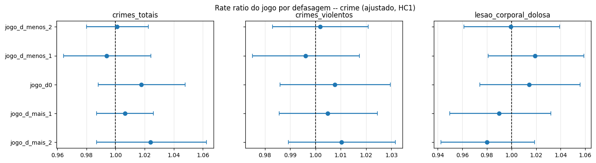
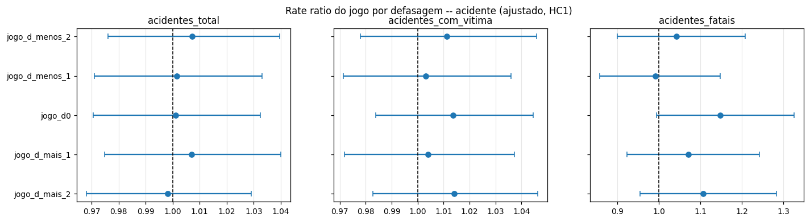
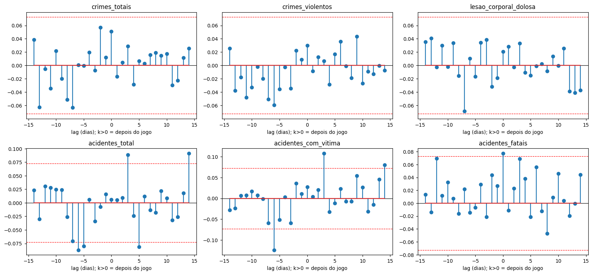
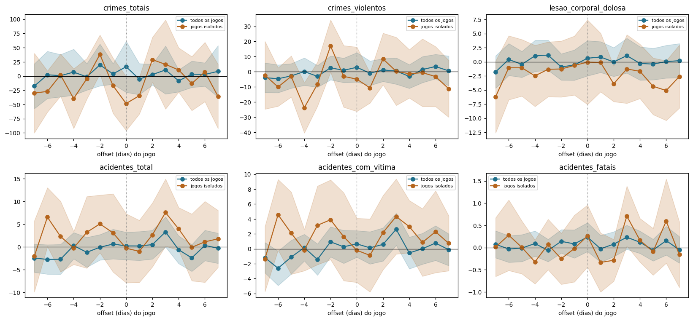

# Etapa 9 -- Analise de defasagem temporal (`jogo_d_menos_2` .. `jogo_d_mais_2`)

_Gerado por `scripts/06_analise_defasagem.py` em 2026-09-03. Fonte: `data/gold/fato_dia_sp.csv`._

> **Regra 5:** defasagem e associacao, nao causalidade. A questao aqui: *depois de tirar dia da semana e mes, sobra algum efeito do jogo -- e em qual posicao relativa (antes/durante/depois)?* Inferencia causal = Etapa 20.

**Convencao de defasagem (identica a do gold `fato_dia_sp.csv`, relativa ao
DIA DO DESFECHO, nao ao dia do jogo):**

| termo | definicao | mede |
| --- | --- | --- |
| `jogo_d_menos_2` | `tem_jogo_sp.shift(2)` -- houve jogo ha 2 dias | efeito **posterior** (rescaldo, +2d) |
| `jogo_d_menos_1` | `tem_jogo_sp.shift(1)` -- houve jogo ontem  | efeito **posterior** (rescaldo, +1d) |
| `jogo_d0` | `tem_jogo_sp` -- jogo hoje | efeito no **proprio dia** |
| `jogo_d_mais_1` | `tem_jogo_sp.shift(-1)` -- ha jogo amanha | efeito **antecipatorio** (vespera) |
| `jogo_d_mais_2` | `tem_jogo_sp.shift(-2)` -- ha jogo em 2 dias | efeito **antecipatorio** (-2d) |

`jogo_d_menos_1` e `jogo_d_mais_1` sao exatamente as colunas homonimas do
gold. "Antecipatorio" (D-1/D-2 no sentido antigo) = `jogo_d_mais_*`;
"posterior" (D+1/D+2 no sentido antigo) = `jogo_d_menos_*`.

**Exclusoes (Etapa 6):** crime 2023-12-30/31; acidente +2022-01-17 e 2023-08-07 (defasagens construidas antes de excluir).

## 1. Modelo de defasagens distribuidas (GLM Poisson, HC1)

**Convencao (igual a do gold):** `jogo_d_menos_k` = houve jogo ha k dias (desfecho medido k dias DEPOIS do jogo -> efeito **posterior / rescaldo**); `jogo_d_mais_k` = ha jogo daqui a k dias (desfecho na **vespera** -> efeito **antecipatorio**); `jogo_d0` = jogo no mesmo dia.

**H0:** o coeficiente daquela defasagem = 0 (rate ratio = 1), controlando as outras defasagens + dia da semana + mes + feriado. **H1:** != 0. Rate ratio `exp(coef)`: 1.05 = +5% no desfecho naquela posicao relativa ao jogo. IC 95% e p por HC1; Benjamini-Hochberg sobre as 5 defasagens x 6 desfechos.

| familia | desfecho | defasagem | rate_ratio | IC95_lo | IC95_hi | efeito_% | p_value | p_BH | signif_BH_5pct |
| --- | --- | --- | --- | --- | --- | --- | --- | --- | --- |
| crime | crimes_totais | jogo_d_menos_2 | 1.001 | 0.980 | 1.023 | 0.114 | 0.916 | 0.976 | False |
| crime | crimes_totais | jogo_d_menos_1 | 0.994 | 0.964 | 1.024 | -0.618 | 0.686 | 0.976 | False |
| crime | crimes_totais | jogo_d0 | 1.018 | 0.988 | 1.048 | 1.757 | 0.245 | 0.976 | False |
| crime | crimes_totais | jogo_d_mais_1 | 1.006 | 0.987 | 1.026 | 0.636 | 0.522 | 0.976 | False |
| crime | crimes_totais | jogo_d_mais_2 | 1.024 | 0.987 | 1.063 | 2.406 | 0.207 | 0.976 | False |
| crime | crimes_violentos | jogo_d_menos_2 | 1.002 | 0.983 | 1.021 | 0.179 | 0.852 | 0.976 | False |
| crime | crimes_violentos | jogo_d_menos_1 | 0.996 | 0.975 | 1.017 | -0.398 | 0.713 | 0.976 | False |
| crime | crimes_violentos | jogo_d0 | 1.008 | 0.986 | 1.030 | 0.758 | 0.493 | 0.976 | False |
| crime | crimes_violentos | jogo_d_mais_1 | 1.005 | 0.986 | 1.024 | 0.485 | 0.623 | 0.976 | False |
| crime | crimes_violentos | jogo_d_mais_2 | 1.010 | 0.989 | 1.032 | 1.023 | 0.339 | 0.976 | False |
| crime | lesao_corporal_dolosa | jogo_d_menos_2 | 0.999 | 0.961 | 1.039 | -0.057 | 0.977 | 0.977 | False |
| crime | lesao_corporal_dolosa | jogo_d_menos_1 | 1.019 | 0.981 | 1.059 | 1.914 | 0.331 | 0.976 | False |
| crime | lesao_corporal_dolosa | jogo_d0 | 1.014 | 0.974 | 1.056 | 1.438 | 0.486 | 0.976 | False |
| crime | lesao_corporal_dolosa | jogo_d_mais_1 | 0.990 | 0.950 | 1.032 | -0.999 | 0.635 | 0.976 | False |
| crime | lesao_corporal_dolosa | jogo_d_mais_2 | 0.980 | 0.943 | 1.019 | -2.008 | 0.305 | 0.976 | False |
| acidente | acidentes_total | jogo_d_menos_2 | 1.007 | 0.976 | 1.040 | 0.730 | 0.651 | 0.976 | False |
| acidente | acidentes_total | jogo_d_menos_1 | 1.002 | 0.971 | 1.033 | 0.161 | 0.919 | 0.976 | False |
| acidente | acidentes_total | jogo_d0 | 1.001 | 0.971 | 1.032 | 0.112 | 0.943 | 0.976 | False |
| acidente | acidentes_total | jogo_d_mais_1 | 1.007 | 0.975 | 1.040 | 0.699 | 0.673 | 0.976 | False |
| acidente | acidentes_total | jogo_d_mais_2 | 0.998 | 0.968 | 1.029 | -0.186 | 0.905 | 0.976 | False |
| acidente | acidentes_com_vitima | jogo_d_menos_2 | 1.011 | 0.978 | 1.046 | 1.128 | 0.513 | 0.976 | False |
| acidente | acidentes_com_vitima | jogo_d_menos_1 | 1.003 | 0.971 | 1.036 | 0.315 | 0.849 | 0.976 | False |
| acidente | acidentes_com_vitima | jogo_d0 | 1.014 | 0.984 | 1.044 | 1.369 | 0.372 | 0.976 | False |
| acidente | acidentes_com_vitima | jogo_d_mais_1 | 1.004 | 0.972 | 1.037 | 0.409 | 0.806 | 0.976 | False |
| acidente | acidentes_com_vitima | jogo_d_mais_2 | 1.014 | 0.983 | 1.046 | 1.400 | 0.384 | 0.976 | False |
| acidente | acidentes_fatais | jogo_d_menos_2 | 1.043 | 0.900 | 1.209 | 4.294 | 0.577 | 0.976 | False |
| acidente | acidentes_fatais | jogo_d_menos_1 | 0.992 | 0.857 | 1.147 | -0.813 | 0.913 | 0.976 | False |
| acidente | acidentes_fatais | jogo_d0 | 1.148 | 0.995 | 1.326 | 14.840 | 0.059 | 0.976 | False |
| acidente | acidentes_fatais | jogo_d_mais_1 | 1.071 | 0.924 | 1.243 | 7.140 | 0.362 | 0.976 | False |
| acidente | acidentes_fatais | jogo_d_mais_2 | 1.107 | 0.954 | 1.283 | 10.668 | 0.179 | 0.976 | False |

## 2. Correlacao cruzada (CCF) -- series dessazonalizadas

Ambas as series (indicador de jogo e desfecho) foram **residualizadas** sobre `C(dia_semana) + C(mes) + feriado` antes do cruzamento, para o CCF medir o que sobra alem da sazonalidade. Lag k>0 = desfecho **depois** do jogo (efeito posterior, equivale a `jogo_d_menos_k` da secao 1); k<0 = desfecho antes do jogo (efeito antecipatorio / vespera, equivale a `jogo_d_mais_|k|`). Banda tracejada = +-1.96/sqrt(n) (referencia aproximada; autocorrelacao residual pode inflar cruzamentos -- a inferencia firme e a secao 1).

| desfecho | band_+- | ccf_lag0 | lag_pico_|ccf| | ccf_no_pico |
| --- | --- | --- | --- | --- |
| crimes_totais | 0.0726 | 0.0510 | -7 | -0.0631 |
| crimes_violentos | 0.0726 | 0.0302 | -6 | -0.0596 |
| lesao_corporal_dolosa | 0.0726 | 0.0206 | -7 | -0.0686 |
| acidentes_total | 0.0727 | 0.0059 | 14 | 0.0914 |
| acidentes_com_vitima | 0.0727 | 0.0276 | -6 | -0.1240 |
| acidentes_fatais | 0.0727 | 0.0774 | 0 | 0.0774 |

## 3. Event study -- residuo dessazonalizado em torno do jogo

Para cada dia de jogo, pega-se o residuo dessazonalizado do desfecho nos offsets -7..+7. Media +- IC95 (erro-padrao da media). 'Isolado' = nenhum outro jogo em +-3 dias, para janelas limpas. **offset e relativo ao jogo**: offset 0 = dia do jogo; offset +k (depois do jogo) = `jogo_d_menos_k` da secao 1; offset -k (antes do jogo) = `jogo_d_mais_k`.

| desfecho | offset | janela_gold | n | media_residuo | t_p_vs_0 | p_BH |
| --- | --- | --- | --- | --- | --- | --- |
| crimes_totais | -1 | jogo_d_mais_1 (vespera) | 126 | 3.840 | 0.678 | 0.913 |
| crimes_totais | 0 | jogo_d0 (dia do jogo) | 126 | 16.349 | 0.479 | 0.913 |
| crimes_totais | 1 | jogo_d_menos_1 (dia seguinte) | 126 | -5.326 | 0.704 | 0.913 |
| crimes_violentos | -1 | jogo_d_mais_1 (vespera) | 126 | 0.929 | 0.823 | 0.913 |
| crimes_violentos | 0 | jogo_d0 (dia do jogo) | 126 | 2.915 | 0.559 | 0.913 |
| crimes_violentos | 1 | jogo_d_menos_1 (dia seguinte) | 126 | -0.973 | 0.814 | 0.913 |
| lesao_corporal_dolosa | -1 | jogo_d_mais_1 (vespera) | 126 | -0.585 | 0.671 | 0.913 |
| lesao_corporal_dolosa | 0 | jogo_d0 (dia do jogo) | 126 | 0.621 | 0.698 | 0.913 |
| lesao_corporal_dolosa | 1 | jogo_d_menos_1 (dia seguinte) | 126 | 0.837 | 0.551 | 0.913 |
| acidentes_total | -1 | jogo_d_mais_1 (vespera) | 126 | 0.627 | 0.708 | 0.913 |
| acidentes_total | 0 | jogo_d0 (dia do jogo) | 126 | 0.214 | 0.890 | 0.913 |
| acidentes_total | 1 | jogo_d_menos_1 (dia seguinte) | 125 | 0.204 | 0.900 | 0.913 |
| acidentes_com_vitima | -1 | jogo_d_mais_1 (vespera) | 126 | 0.263 | 0.817 | 0.913 |
| acidentes_com_vitima | 0 | jogo_d0 (dia do jogo) | 126 | 0.657 | 0.473 | 0.913 |
| acidentes_com_vitima | 1 | jogo_d_menos_1 (dia seguinte) | 125 | 0.122 | 0.913 | 0.913 |
| acidentes_fatais | -1 | jogo_d_mais_1 (vespera) | 126 | 0.082 | 0.616 | 0.913 |
| acidentes_fatais | 0 | jogo_d0 (dia do jogo) | 126 | 0.235 | 0.160 | 0.913 |
| acidentes_fatais | 1 | jogo_d_menos_1 (dia seguinte) | 125 | -0.028 | 0.855 | 0.913 |

_media_residuo = quanto o desfecho fica acima (+) ou abaixo (-) do esperado pelo calendario, naquele offset. `janela_gold` traduz o offset para a convencao do gold/secao 1. t_p_vs_0 testa se difere de 0._

## 4. Kruskal-Wallis nos residuos dessazonalizados por janela

Convencao do gold (mesma da secao 1): `jogo_d_menos_k` = dia k dias DEPOIS de um jogo (rescaldo); `jogo_d_mais_k` = dia k dias ANTES de um jogo (vespera); `jogo_d0` = dia do jogo; `baseline` = nenhum jogo em +-2 dias.

**H0:** o residuo (desfecho menos o esperado pelo calendario) tem a mesma distribuicao nessas 6 janelas. **H1:** ao menos uma difere. Se o efeito fosse so do calendario, os residuos nao deveriam separar as janelas.

| familia | desfecho | KW_H | KW_p | KW_p_BH | epsilon2 | res_baseline | res_jogo_d_menos_1 | res_jogo_d0 | res_jogo_d_mais_1 |
| --- | --- | --- | --- | --- | --- | --- | --- | --- | --- |
| crime | crimes_totais | 9.6014 | 0.0874 | 0.5241 | 0.0064 | -2.7342 | -30.9432 | 16.3492 | 0.9227 |
| crime | crimes_violentos | 6.1511 | 0.2918 | 0.8754 | 0.0016 | -1.5760 | -10.0900 | 2.9146 | 2.6021 |
| crime | lesao_corporal_dolosa | 1.9716 | 0.8531 | 0.9897 | -0.0042 | 0.5215 | -0.4630 | 0.6211 | -0.7411 |
| acidente | acidentes_total | 0.5614 | 0.9897 | 0.9897 | -0.0062 | -0.3634 | 0.8246 | 0.2137 | -0.5678 |
| acidente | acidentes_com_vitima | 0.7998 | 0.9770 | 0.9897 | -0.0058 | -0.3826 | 0.3838 | 0.6570 | -0.5736 |
| acidente | acidentes_fatais | 2.6215 | 0.7581 | 0.9897 | -0.0033 | -0.0932 | 0.1010 | 0.2352 | -0.0108 |

_`res_jogo_d_menos_1` = residuo medio no dia SEGUINTE a um jogo (rescaldo); `res_jogo_d_mais_1` = residuo medio na VESPERA de um jogo._

## 5. Sintese da Etapa 9

**Resultado: nenhuma defasagem (`jogo_d_menos_2` .. `jogo_d_mais_2`) mostra
efeito robusto do jogo.**

- **Defasagens distribuidas (secao 1, inferencia principal):** das 30
  estimativas (6 desfechos x 5 defasagens), **zero** sao significativas
  apos BH (todas p_BH >= 0.97). O maior efeito e `acidentes_fatais` em
  `jogo_d0` (rate ratio 1.15, IC95 0.99-1.33, p = 0.06 sem BH) -- o mesmo
  sinal marginal ja visto nas Etapas 7 e 8, agora tambem nao robusto.
  Nada antecipatorio (`jogo_d_mais_1/2`, vespera) nem posterior
  (`jogo_d_menos_1/2`, rescaldo).
- **CCF (secao 2):** nas series dessazonalizadas, o valor em lag 0 fica
  dentro da banda +-0.073 para todos os desfechos. Alguns picos passam a
  banda em lags -6/-7 (desfecho ANTES do jogo, sem sentido causal) -- sao
  os falsos positivos esperados por autocorrelacao residual, nao efeito.
- **Event study (secao 3):** as curvas de residuo em torno do jogo
  (offset -7..+7) sao planas em torno de 0; nem a vespera, nem o dia do
  jogo, nem o dia seguinte diferem de 0 (todos p_BH = 0.91), com ou sem
  restricao a jogos isolados. O +16 em `crimes_totais` no dia do jogo e
  media inflada pelo outlier de 2022-06-19 (p = 0.48).
- **Kruskal-Wallis nos residuos (secao 4):** epsilon^2 <= 0.006 e p_BH
  >= 0.52 para todos -- as janelas em torno do jogo nao se distinguem do
  baseline depois de remover o calendario.
- **Coerencia com Etapas 7-8:** os tres relatorios convergem. A associacao
  bruta jogo x desfecho e **sazonalidade de calendario** (dia da semana e
  mes), nao efeito temporal do jogo -- nem antes, nem durante, nem depois.
- **Texto para o relatorio final:** *"nao ha evidencia de efeito
  antecipatorio (vespera) nem posterior (rescaldo) do jogo sobre crime ou
  acidente apos controle de dia da semana e mes. O unico sinal residual --
  acidentes fatais no proprio dia do jogo, ~+15% -- nao e estatisticamente
  robusto e merece reexame com serie mais longa. Os dados nao permitem
  afirmar causalidade."*
- **Limitacoes:** 730 dias; Paulistao/Libertadores fora da base (dias de
  jogo subcontados, o que ATENUA qualquer efeito real); sem dado de
  publico; CCF sem pre-branqueamento ARIMA completo (a secao 1 nao depende
  disso).
- **Proximo:** Etapa 10 (espacial, limitada) e Etapa 11 (definicao de pico).
