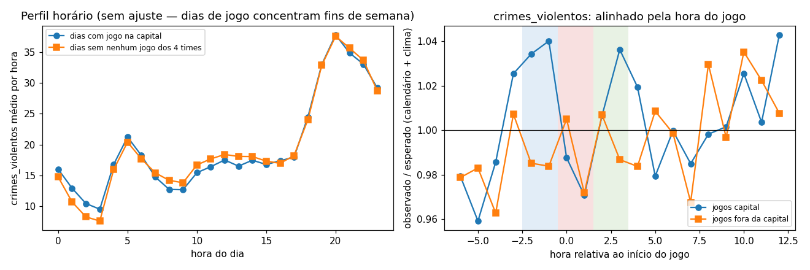
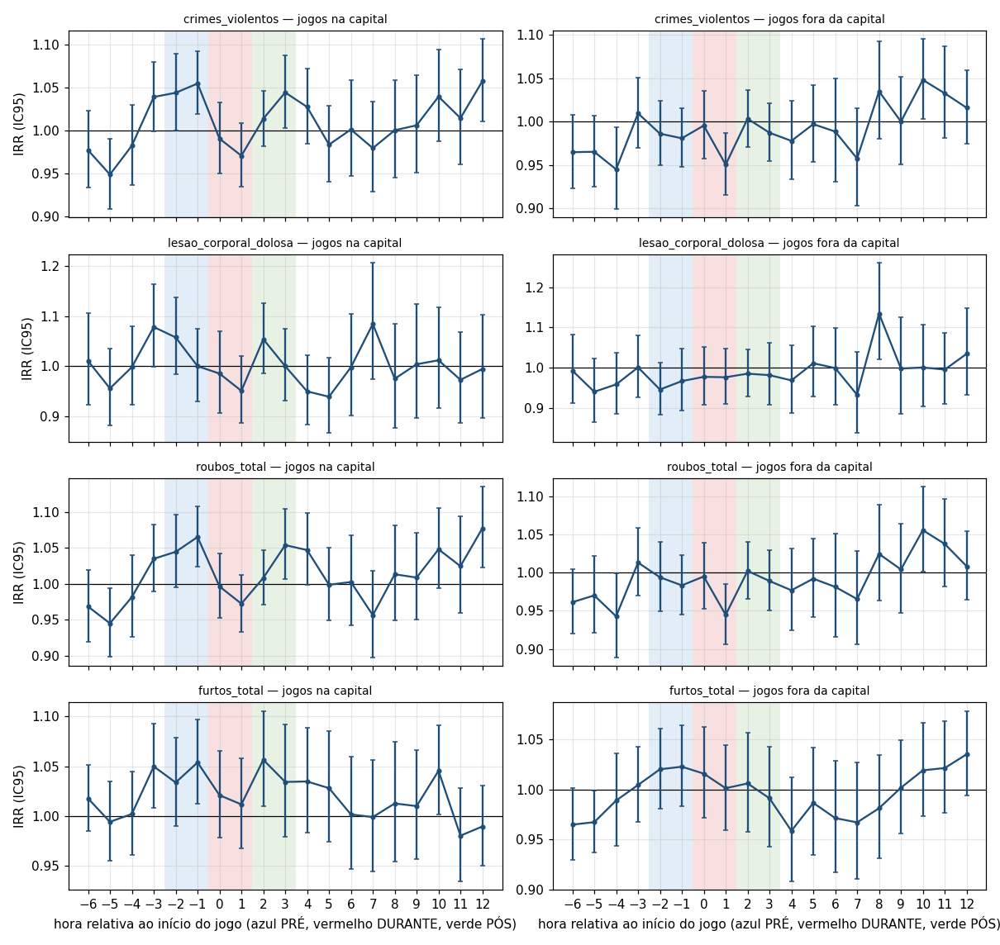

# V2 / Fase 2 — CRIMES (SSP): análise por janelas de horário

Gerado por `scripts/33_analise_janelas.py`. Domínio analisado **isoladamente** (modelos, BH, pico e conclusão próprios). Desfechos: `crimes_violentos`, `lesao_corporal_dolosa`, `roubos_total`, `furtos_total` (principal: `crimes_violentos`). Amostra: painel horário 2022–2023 sem os dias excluídos do domínio, sem as horas dos 4 eventos de grande público sem os times monitorados (robustez com elas de volta) e sem horas sem temperatura após interpolação de até 24 h. Contagens horárias usam só registros com hora.

## Resposta direta

- **Jogos na capital (multidão perto do estádio)**, `crimes_violentos`: PRÉ +4.7% (p=0.003, p_BH=0.041, placebo p=0.000) → **robusto no GLM, pareado inconclusivo**; DURANTE -2.1% (p=0.191, p_BH=0.412, placebo p=0.428) → **sem evidência**; PÓS +2.7% (p=0.048, p_BH=0.223, placebo p=0.036) → **sinal não robusto**.
- **Jogos fora da capital (TV / bares)**, `crimes_violentos`: PRÉ -1.5% (p=0.278, p_BH=0.519, placebo p=0.192) → **sem evidência**; DURANTE -2.5% (p=0.127, p_BH=0.374, placebo p=0.108) → **sem evidência**; PÓS -0.2% (p=0.906, p_BH=0.939, placebo p=0.666) → **sem evidência**.
- Desfechos secundários com algum sinal: `roubos_total` capital PRÉ +5.3% (robusto no GLM, pareado inconclusivo, p_BH=0.041); `furtos_total` capital PRÉ +4.1% (sinal não robusto, p_BH=0.147); `furtos_total` capital PÓS +4.1% (sinal não robusto, p_BH=0.195).
- **Onde:** entorno de 3 km dos estádios (3 estádios agregados): durante +15.0% (p=0.035, p_BH=0.055); pos +31.0% (p=0.000, p_BH=0.000); pre +5.3% (p=0.439, p_BH=0.479); resto da cidade: pre +4.9% (p=0.002); durante -2.5% (p=0.115); pos +1.6% (p=0.227).
- **Picos (nível hora, P90 Pearson):** capital pre RR 1.31 (Fisher p=0.041); capital durante RR 1.15 (Fisher p=0.325); capital pos RR 1.20 (Fisher p=0.190); fora da capital pre RR 0.87 (Fisher p=0.421); fora da capital durante RR 0.99 (Fisher p=1.000); fora da capital pos RR 1.02 (Fisher p=0.874).
- Exploratório — horas tardias do event study (+4..+12 h) com p < 0,05: capital k=+12 IRR 1.058 (p=0.016, p_BH=0.263); fora da capital k=+10 IRR 1.048 (p=0.037, p_BH=0.347).
- **Controles pareados (DiD):** capital pre +1.2% (IC95 -3.1 a +5.0); capital durante -6.8% (IC95 -10.4 a -2.7); capital pos +1.2% (IC95 -3.1 a +5.5); fora da capital pre -3.6% (IC95 -7.4 a +0.2); fora da capital durante -0.7% (IC95 -4.2 a +3.0); fora da capital pos -2.4% (IC95 -6.6 a +1.6).

Regra do veredito (revista na Fase 2b): candidato = p_BH < 0,05 no modelo principal **e** placebo p < 0,05 **e** mesmo sinal com p < 0,10 na Binomial Negativa e no cluster por dia. Entre os candidatos: **efeito robusto** só se o desenho pareado **confirma** (mesmo sinal, IC95 sem o 1); **robusto no GLM, pareado inconclusivo** se o pareado não confirma mas também não contradiz (IC95 do pareado contém a estimativa do GLM); **contradito pelo pareado** se o IC95 do pareado exclui a estimativa do GLM. **Sinal não robusto** = p < 0,05 sem ser candidato; **sem evidência** = p ≥ 0,05. Associação, não causalidade.

## Ressalvas que pesam na leitura

- **Pré-tendência (event study):** teste conjunto k=−6..−3 p=0.007 (capital) e p=0.084 (fora). Coeficientes da capital em −6..−3: k=-6 0.977, k=-5 0.949, k=-4 0.982, k=-3 1.039. Rejeição com sinais mistos: parte vem de uma hora isolada abaixo e de k=−3 já acima de 1 (subida começando ~3 h antes do jogo). Não é a pré-tendência monotônica que invalidaria o desenho, mas reduz a confiança de que o PRÉ seja só efeito do jogo.
- **Controles pareados vs GLM:** no desenho pareado (só jogos com ≥2 dias-controle livres; n=112) o PRÉ da capital dá +1.2% (IC95 -3.1 a +5.0). Não confirma o GLM (+4.7%, p_BH=0.041): o efeito PRÉ depende do estimador/amostra.
  - DURANTE no pareado: -6.8% (IC95 -10.4 a -2.7) — queda durante o jogo, como em Ivandić et al. (2024); no GLM a queda é menor e não significativa.
- **Placebo:** maior desvio do centro da distribuição placebo em relação a 0: capital 0.7%, fora_da_capital 1.3%. Distribuição centrada; placebo confiável.
- **Heterogeneidade com n pequeno** (< 20 horas, erro-padrão agrupado degenerado, **não interpretar**): fora_da_capital classico=True pre (16 h); fora_da_capital comp4=Outros pre (2 h); fora_da_capital comp4=Outros durante (2 h); fora_da_capital comp4=Outros pos (2 h).
- **Morumbi sem a semifinal e a final da Copa do Brasil 2023** (os 2 jogos que explicavam o sinal diário da Etapa 10), disco de 3 km: pre 1.26→1.24 (p=0.127); durante 1.58→1.54 (p=0.003); pos 1.64→1.41 (p=0.021). Tabela em `crimes/tabelas/espaco_sensibilidade_sem_2_jogos_copa_do_brasil.csv`.
- Contagens só com registros que têm hora (furtos: ~53% sem hora). Associação, não causalidade: não há variação exógena da agenda; o desenho controla calendário, clima e hora × dia da semana.

## 1. Descritivo

Média por hora em cada janela vs as **mesmas horas do relógio, no mesmo dia da semana, em horas sem nenhum jogo dos 4 times** (sem outro ajuste):

| categoria | janela | desfecho | n_horas | media_janela | media_mesmas_horas_dia_semana_sem_jogo | razao |
|---|---|---|---|---|---|---|
| capital | pre | crimes_violentos | 430 | 26.386 | 25.551 | 1.033 |
| capital | pre | lesao_corporal_dolosa | 430 | 4.540 | 4.460 | 1.018 |
| capital | pre | roubos_total | 430 | 21.505 | 20.770 | 1.035 |
| capital | pre | furtos_total | 430 | 19.126 | 18.184 | 1.052 |
| capital | durante | crimes_violentos | 430 | 29.249 | 30.184 | 0.969 |
| capital | durante | lesao_corporal_dolosa | 430 | 4.537 | 4.735 | 0.958 |
| capital | durante | roubos_total | 430 | 24.372 | 25.112 | 0.971 |
| capital | durante | furtos_total | 430 | 15.912 | 15.107 | 1.053 |
| capital | pos | crimes_violentos | 430 | 27.902 | 27.496 | 1.015 |
| capital | pos | lesao_corporal_dolosa | 430 | 4.774 | 4.719 | 1.012 |
| capital | pos | roubos_total | 430 | 22.744 | 22.439 | 1.014 |
| capital | pos | furtos_total | 430 | 13.140 | 12.169 | 1.080 |
| fora_da_capital | pre | crimes_violentos | 451 | 24.082 | 24.575 | 0.980 |
| fora_da_capital | pre | lesao_corporal_dolosa | 451 | 4.217 | 4.394 | 0.960 |
| fora_da_capital | pre | roubos_total | 451 | 19.557 | 19.865 | 0.984 |
| fora_da_capital | pre | furtos_total | 451 | 18.976 | 18.253 | 1.040 |
| fora_da_capital | durante | crimes_violentos | 541 | 29.248 | 29.949 | 0.977 |
| fora_da_capital | durante | lesao_corporal_dolosa | 541 | 4.654 | 4.772 | 0.975 |
| fora_da_capital | durante | roubos_total | 541 | 24.216 | 24.842 | 0.975 |
| fora_da_capital | durante | furtos_total | 541 | 16.072 | 15.244 | 1.054 |
| fora_da_capital | pos | crimes_violentos | 465 | 26.473 | 26.817 | 0.987 |
| fora_da_capital | pos | lesao_corporal_dolosa | 465 | 4.557 | 4.748 | 0.960 |
| fora_da_capital | pos | roubos_total | 465 | 21.540 | 21.731 | 0.991 |
| fora_da_capital | pos | furtos_total | 465 | 12.471 | 12.004 | 1.039 |

## 2. Modelo principal

`log E[y] = β·(PRÉ, DURANTE, PÓS na capital) + β_fdj·(mesmo dia de jogo na capital, fora das janelas) + γ·(PRÉ, DURANTE, PÓS de jogos fora da capital) + EF(hora do dia × dia da semana) + EF(ano × mês) + feriado + véspera + férias + log(1+chuva) + indicador de chuva ausente + temperatura`, GLM Poisson, erros agrupados por semana. Referência = hora sem nenhum jogo dos 4 times.

**Por que EF hora × dia da semana:** os jogos acontecem em horários que já têm um nível próprio de ocorrências (domingo 16h, quarta 21h30). Sem esse controle, o modelo confunde "horário do jogo" com "efeito do jogo" — é a versão horária do confundidor de calendário que já derrubou o efeito no grão diário (Etapas 7–10).

| desfecho | janela | IRR | var_pct | IC95_lo | IC95_hi | p | p_BH_dominio |
|---|---|---|---|---|---|---|---|
| crimes_violentos | capital PRÉ | 1.047 | 4.722 | 1.016 | 1.079 | 0.003 | 0.041 |
| crimes_violentos | capital DURANTE | 0.979 | -2.060 | 0.949 | 1.010 | 0.191 | 0.412 |
| crimes_violentos | capital PÓS | 1.027 | 2.674 | 1.000 | 1.054 | 0.048 | 0.223 |
| crimes_violentos | capital mesmo dia, fora das janelas | 1.008 | 0.801 | 0.992 | 1.024 | 0.328 | 0.520 |
| crimes_violentos | fora da capital PRÉ | 0.985 | -1.503 | 0.958 | 1.012 | 0.278 | 0.519 |
| crimes_violentos | fora da capital DURANTE | 0.975 | -2.540 | 0.943 | 1.007 | 0.127 | 0.374 |
| crimes_violentos | fora da capital PÓS | 0.998 | -0.155 | 0.973 | 1.024 | 0.906 | 0.939 |
| lesao_corporal_dolosa | capital PRÉ | 1.025 | 2.470 | 0.974 | 1.078 | 0.344 | 0.520 |
| lesao_corporal_dolosa | capital DURANTE | 0.969 | -3.088 | 0.918 | 1.024 | 0.260 | 0.519 |
| lesao_corporal_dolosa | capital PÓS | 1.034 | 3.449 | 0.987 | 1.084 | 0.159 | 0.404 |
| lesao_corporal_dolosa | capital mesmo dia, fora das janelas | 1.014 | 1.359 | 0.985 | 1.043 | 0.353 | 0.520 |
| lesao_corporal_dolosa | fora da capital PRÉ | 0.961 | -3.924 | 0.906 | 1.019 | 0.181 | 0.412 |
| lesao_corporal_dolosa | fora da capital DURANTE | 0.977 | -2.329 | 0.925 | 1.031 | 0.396 | 0.528 |
| lesao_corporal_dolosa | fora da capital PÓS | 0.982 | -1.834 | 0.934 | 1.032 | 0.469 | 0.571 |
| roubos_total | capital PRÉ | 1.053 | 5.282 | 1.018 | 1.089 | 0.003 | 0.041 |
| roubos_total | capital DURANTE | 0.982 | -1.752 | 0.950 | 1.016 | 0.307 | 0.520 |
| roubos_total | capital PÓS | 1.026 | 2.556 | 0.996 | 1.056 | 0.090 | 0.359 |
| roubos_total | capital mesmo dia, fora das janelas | 1.007 | 0.705 | 0.989 | 1.026 | 0.451 | 0.571 |
| roubos_total | fora da capital PRÉ | 0.989 | -1.064 | 0.958 | 1.022 | 0.520 | 0.606 |
| roubos_total | fora da capital DURANTE | 0.972 | -2.803 | 0.937 | 1.008 | 0.124 | 0.374 |
| roubos_total | fora da capital PÓS | 1.000 | 0.008 | 0.971 | 1.030 | 0.996 | 0.996 |
| furtos_total | capital PRÉ | 1.041 | 4.149 | 1.006 | 1.078 | 0.021 | 0.147 |
| furtos_total | capital DURANTE | 1.014 | 1.443 | 0.982 | 1.048 | 0.389 | 0.528 |
| furtos_total | capital PÓS | 1.041 | 4.112 | 1.003 | 1.081 | 0.035 | 0.195 |
| furtos_total | capital mesmo dia, fora das janelas | 1.019 | 1.889 | 1.004 | 1.034 | 0.015 | 0.144 |
| furtos_total | fora da capital PRÉ | 1.024 | 2.375 | 0.993 | 1.056 | 0.134 | 0.374 |
| furtos_total | fora da capital DURANTE | 1.011 | 1.098 | 0.976 | 1.047 | 0.543 | 0.609 |
| furtos_total | fora da capital PÓS | 1.004 | 0.413 | 0.967 | 1.043 | 0.830 | 0.894 |

BH: uma família por domínio (todos os desfechos × todos os termos acima).

### Robustezes

| desfecho | termo | Binomial Negativa (alpha=0.015) | Binomial Negativa (alpha=0.026) | Binomial Negativa (alpha=0.027) | Binomial Negativa (alpha=0.034) | cluster por dia | com horas dos eventos de grande publico | so base original (janela_base_original) | so janela (sem jogos fora da capital) |
|---|---|---|---|---|---|---|---|---|---|
| crimes_violentos | C_durante |  | 0.983 (p=0.293) |  |  | 0.979 (p=0.217) | 0.979 (p=0.183) | 0.980 (p=0.359) | 0.982 (p=0.272) |
| crimes_violentos | C_fdj |  | 1.008 (p=0.311) |  |  | 1.008 (p=0.330) | 1.008 (p=0.336) | 1.001 (p=0.958) | 1.008 (p=0.355) |
| crimes_violentos | C_pos |  | 1.029 (p=0.035) |  |  | 1.027 (p=0.075) | 1.026 (p=0.054) | 1.024 (p=0.147) | 1.026 (p=0.049) |
| crimes_violentos | C_pre |  | 1.048 (p=0.003) |  |  | 1.047 (p=0.002) | 1.047 (p=0.003) | 1.050 (p=0.007) | 1.047 (p=0.003) |
| crimes_violentos | F_durante |  | 0.977 (p=0.167) |  |  | 0.975 (p=0.094) | 0.974 (p=0.121) | 0.977 (p=0.171) |  |
| crimes_violentos | F_pos |  | 0.998 (p=0.899) |  |  | 0.998 (p=0.916) | 0.998 (p=0.878) | 0.996 (p=0.733) |  |
| crimes_violentos | F_pre |  | 0.985 (p=0.295) |  |  | 0.985 (p=0.337) | 0.985 (p=0.283) | 0.982 (p=0.187) |  |
| furtos_total | C_durante | 1.015 (p=0.370) |  |  |  | 1.014 (p=0.412) | 1.013 (p=0.433) | 1.026 (p=0.249) | 1.015 (p=0.388) |
| furtos_total | C_fdj | 1.019 (p=0.014) |  |  |  | 1.019 (p=0.028) | 1.019 (p=0.015) | 1.003 (p=0.714) | 1.019 (p=0.013) |
| furtos_total | C_pos | 1.041 (p=0.033) |  |  |  | 1.041 (p=0.040) | 1.041 (p=0.035) | 1.054 (p=0.023) | 1.042 (p=0.028) |
| furtos_total | C_pre | 1.043 (p=0.017) |  |  |  | 1.041 (p=0.018) | 1.041 (p=0.024) | 1.034 (p=0.070) | 1.039 (p=0.026) |
| furtos_total | F_durante | 1.010 (p=0.582) |  |  |  | 1.011 (p=0.541) | 1.010 (p=0.584) | 1.012 (p=0.519) |  |
| furtos_total | F_pos | 1.004 (p=0.831) |  |  |  | 1.004 (p=0.830) | 1.004 (p=0.827) | 1.003 (p=0.874) |  |
| furtos_total | F_pre | 1.024 (p=0.133) |  |  |  | 1.024 (p=0.140) | 1.024 (p=0.139) | 1.021 (p=0.192) |  |
| lesao_corporal_dolosa | C_durante |  |  | 0.970 (p=0.272) |  | 0.969 (p=0.278) | 0.970 (p=0.275) | 0.975 (p=0.499) | 0.968 (p=0.252) |
| lesao_corporal_dolosa | C_fdj |  |  | 1.013 (p=0.357) |  | 1.014 (p=0.330) | 1.012 (p=0.404) | 1.014 (p=0.415) | 1.012 (p=0.392) |
| lesao_corporal_dolosa | C_pos |  |  | 1.035 (p=0.152) |  | 1.034 (p=0.216) | 1.035 (p=0.155) | 1.035 (p=0.233) | 1.035 (p=0.132) |
| lesao_corporal_dolosa | C_pre |  |  | 1.026 (p=0.326) |  | 1.025 (p=0.367) | 1.026 (p=0.322) | 0.996 (p=0.890) | 1.028 (p=0.284) |
| lesao_corporal_dolosa | F_durante |  |  | 0.976 (p=0.384) |  | 0.977 (p=0.397) | 0.978 (p=0.429) | 0.981 (p=0.488) |  |
| lesao_corporal_dolosa | F_pos |  |  | 0.980 (p=0.424) |  | 0.982 (p=0.486) | 0.982 (p=0.482) | 0.978 (p=0.378) |  |
| lesao_corporal_dolosa | F_pre |  |  | 0.960 (p=0.176) |  | 0.961 (p=0.179) | 0.963 (p=0.210) | 0.957 (p=0.141) |  |
| roubos_total | C_durante |  |  |  | 0.986 (p=0.452) | 0.982 (p=0.340) | 0.982 (p=0.293) | 0.983 (p=0.456) | 0.986 (p=0.428) |
| roubos_total | C_fdj |  |  |  | 1.007 (p=0.471) | 1.007 (p=0.455) | 1.007 (p=0.439) | 0.998 (p=0.884) | 1.007 (p=0.470) |
| roubos_total | C_pos |  |  |  | 1.029 (p=0.066) | 1.026 (p=0.118) | 1.025 (p=0.103) | 1.024 (p=0.230) | 1.025 (p=0.096) |
| roubos_total | C_pre |  |  |  | 1.054 (p=0.004) | 1.053 (p=0.002) | 1.053 (p=0.003) | 1.062 (p=0.003) | 1.051 (p=0.003) |
| roubos_total | F_durante |  |  |  | 0.975 (p=0.184) | 0.972 (p=0.095) | 0.971 (p=0.115) | 0.974 (p=0.153) |  |
| roubos_total | F_pos |  |  |  | 1.001 (p=0.966) | 1.000 (p=0.996) | 0.999 (p=0.968) | 0.998 (p=0.867) |  |
| roubos_total | F_pre |  |  |  | 0.989 (p=0.526) | 0.989 (p=0.544) | 0.989 (p=0.506) | 0.986 (p=0.386) |  |

**Total diário (com + sem hora)** — checagem da seleção vista na Fase 1 (`lesao_corporal_dolosa`, `crimes_violentos`): GLM Poisson diário com dia da semana, ano × mês, feriado e férias.

| desfecho | termo | IRR | var_pct | IC95_lo | IC95_hi | p |
|---|---|---|---|---|---|---|
| crimes_violentos | dia_jogo_capital | 1.014 | 1.358 | 0.998 | 1.029 | 0.083 |
| crimes_violentos | dia_jogo_fora | 0.990 | -0.964 | 0.976 | 1.005 | 0.204 |
| lesao_corporal_dolosa | dia_jogo_capital | 1.023 | 2.305 | 0.994 | 1.053 | 0.122 |
| lesao_corporal_dolosa | dia_jogo_fora | 0.994 | -0.615 | 0.964 | 1.025 | 0.696 |

## 3. Event study (−6 a +12 h) — as duas categorias

Dummies para cada hora relativa ao início, separadamente para jogos na capital e fora da capital, no mesmo modelo, com os mesmos EF (+ dummy para as outras horas do dia de jogo na capital). Horas −6 a −3 = checagem de pré-tendência; até +12 porque Ivandić et al. (2024) acham efeito até ~10 h depois.

Teste conjunto de pré-tendência (k = −6..−3 iguais a zero):

| desfecho | categoria | p |
|---|---|---|
| crimes_violentos | capital | 0.007 |
| crimes_violentos | fora_da_capital | 0.084 |
| lesao_corporal_dolosa | capital | 0.194 |
| lesao_corporal_dolosa | fora_da_capital | 0.540 |
| roubos_total | capital | 0.033 |
| roubos_total | fora_da_capital | 0.124 |
| furtos_total | capital | 0.126 |
| furtos_total | fora_da_capital | 0.139 |

Horas +4..+12 com p < 0,05 (sem correção múltipla; 18 testes por desfecho e categoria):

| desfecho | categoria | k | IRR | p |
|---|---|---|---|---|
| crimes_violentos | capital | 12.000 | 1.058 | 0.016 |
| crimes_violentos | fora_da_capital | 10.000 | 1.048 | 0.037 |
| lesao_corporal_dolosa | fora_da_capital | 8.000 | 1.134 | 0.019 |
| roubos_total | capital | 12.000 | 1.077 | 0.005 |
| roubos_total | fora_da_capital | 10.000 | 1.056 | 0.043 |
| furtos_total | capital | 10.000 | 1.045 | 0.043 |

## 4. Placebo / permutação

1000 sorteios: cada jogo recebe um início falso no mesmo horário, mesmo dia da semana, ±6 semanas, em dia sem jogo na capital (e, para a categoria fora da capital, sem nenhum jogo dos 4 times) e sem feriado. Para caber 1.000 reestimações, usa-se a versão em dois passos: o modelo de calendário + clima + a outra categoria é ajustado uma vez e o β de cada janela vira `log(Σobs/Σesperado)` nas horas da janela; o β real é recalculado do mesmo jeito.

| desfecho | categoria | janela | IRR_real_2passos | placebo_p2.5 | placebo_p97.5 | percentil_real | p_permutacao_bilateral |
|---|---|---|---|---|---|---|---|
| crimes_violentos | capital | pre | 1.053 | 0.972 | 1.021 | 100.000 | 0.000 |
| crimes_violentos | capital | durante | 0.992 | 0.978 | 1.027 | 21.400 | 0.428 |
| crimes_violentos | capital | pos | 1.032 | 0.977 | 1.029 | 98.200 | 0.036 |
| lesao_corporal_dolosa | capital | pre | 1.027 | 0.955 | 1.050 | 85.200 | 0.296 |
| lesao_corporal_dolosa | capital | durante | 0.989 | 0.957 | 1.048 | 26.200 | 0.524 |
| lesao_corporal_dolosa | capital | pos | 1.021 | 0.961 | 1.059 | 70.200 | 0.596 |
| roubos_total | capital | pre | 1.060 | 0.970 | 1.024 | 100.000 | 0.000 |
| roubos_total | capital | durante | 0.994 | 0.972 | 1.033 | 30.700 | 0.614 |
| roubos_total | capital | pos | 1.034 | 0.974 | 1.034 | 97.500 | 0.050 |
| furtos_total | capital | pre | 1.042 | 0.975 | 1.028 | 99.700 | 0.006 |
| furtos_total | capital | durante | 1.025 | 0.969 | 1.031 | 92.500 | 0.150 |
| furtos_total | capital | pos | 1.053 | 0.968 | 1.039 | 99.400 | 0.012 |
| crimes_violentos | fora_da_capital | pre | 0.985 | 0.978 | 1.023 | 9.600 | 0.192 |
| crimes_violentos | fora_da_capital | durante | 0.974 | 0.971 | 1.017 | 5.400 | 0.108 |
| crimes_violentos | fora_da_capital | pos | 0.999 | 0.968 | 1.020 | 66.700 | 0.666 |
| lesao_corporal_dolosa | fora_da_capital | pre | 0.966 | 0.944 | 1.033 | 16.300 | 0.326 |
| lesao_corporal_dolosa | fora_da_capital | durante | 0.984 | 0.953 | 1.037 | 29.600 | 0.592 |
| lesao_corporal_dolosa | fora_da_capital | pos | 0.988 | 0.956 | 1.045 | 28.100 | 0.562 |
| roubos_total | fora_da_capital | pre | 0.987 | 0.979 | 1.028 | 11.400 | 0.228 |
| roubos_total | fora_da_capital | durante | 0.971 | 0.970 | 1.020 | 2.900 | 0.058 |
| roubos_total | fora_da_capital | pos | 1.000 | 0.968 | 1.020 | 67.000 | 0.660 |
| furtos_total | fora_da_capital | pre | 1.016 | 0.977 | 1.026 | 86.100 | 0.278 |
| furtos_total | fora_da_capital | durante | 1.019 | 0.961 | 1.014 | 98.800 | 0.024 |
| furtos_total | fora_da_capital | pos | 1.007 | 0.970 | 1.030 | 71.000 | 0.580 |

(placebo_p2.5/p97.5 em escala de IRR.)

## 5. Heterogeneidade

Desfecho principal `crimes_violentos` (todos os desfechos em `tabelas/heterogeneidade.csv`). Resultado do mandante só na janela PÓS (só é conhecido depois do jogo). Por time: modelo separado para cada time, com as janelas dos jogos daquele time vs as dos outros jogos (um clássico conta para os dois times).

| categoria | atributo | janela | nivel | n_horas | IRR | IC95_lo | IC95_hi | p | p_BH_dominio_atributo | obs |
|---|---|---|---|---|---|---|---|---|---|---|
| capital | classico | pre | False | 358 | 1.032 | 0.999 | 1.065 | 0.055 | 0.190 |  |
| capital | classico | pre | True | 72 | 1.142 | 1.066 | 1.223 | 0.000 | 0.004 |  |
| capital | classico | durante | False | 358 | 0.969 | 0.939 | 0.999 | 0.042 | 0.190 |  |
| capital | classico | durante | True | 72 | 1.042 | 0.956 | 1.136 | 0.347 | 0.463 |  |
| capital | classico | pos | False | 358 | 1.027 | 0.998 | 1.056 | 0.064 | 0.192 |  |
| capital | classico | pos | True | 72 | 1.030 | 0.972 | 1.091 | 0.315 | 0.447 |  |
| capital | noturno | pre | False | 166 | 1.093 | 1.015 | 1.176 | 0.018 | 0.109 |  |
| capital | noturno | pre | True | 264 | 1.036 | 1.001 | 1.072 | 0.041 | 0.109 |  |
| capital | noturno | durante | False | 166 | 1.025 | 0.949 | 1.107 | 0.533 | 0.713 |  |
| capital | noturno | durante | True | 264 | 0.966 | 0.935 | 0.998 | 0.036 | 0.109 |  |
| capital | noturno | pos | False | 166 | 1.057 | 1.006 | 1.110 | 0.028 | 0.109 |  |
| capital | noturno | pos | True | 264 | 1.010 | 0.975 | 1.046 | 0.588 | 0.743 |  |
| capital | fim_de_semana | pre | False | 222 | 1.039 | 1.001 | 1.078 | 0.042 | 0.127 |  |
| capital | fim_de_semana | pre | True | 208 | 1.065 | 1.009 | 1.124 | 0.022 | 0.127 |  |
| capital | fim_de_semana | durante | False | 222 | 0.968 | 0.932 | 1.005 | 0.089 | 0.215 |  |
| capital | fim_de_semana | durante | True | 208 | 1.000 | 0.941 | 1.062 | 0.990 | 0.990 |  |
| capital | fim_de_semana | pos | False | 222 | 1.010 | 0.973 | 1.049 | 0.590 | 0.749 |  |
| capital | fim_de_semana | pos | True | 208 | 1.045 | 1.001 | 1.090 | 0.042 | 0.127 |  |
| capital | comp4 | pre | CONMEBOL | 72 | 1.021 | 0.963 | 1.082 | 0.491 | 0.715 |  |
| capital | comp4 | pre | Campeonato Paulista | 98 | 1.062 | 0.992 | 1.137 | 0.082 | 0.395 |  |
| capital | comp4 | pre | Copa do Brasil | 44 | 1.110 | 1.043 | 1.181 | 0.001 | 0.037 |  |
| capital | comp4 | pre | Serie A | 216 | 1.037 | 0.996 | 1.079 | 0.074 | 0.395 |  |
| capital | comp4 | durante | CONMEBOL | 72 | 0.968 | 0.903 | 1.037 | 0.355 | 0.626 |  |
| capital | comp4 | durante | Campeonato Paulista | 98 | 0.982 | 0.925 | 1.042 | 0.539 | 0.739 |  |
| capital | comp4 | durante | Copa do Brasil | 44 | 0.960 | 0.877 | 1.051 | 0.378 | 0.626 |  |
| capital | comp4 | durante | Serie A | 216 | 0.988 | 0.942 | 1.036 | 0.622 | 0.793 |  |
| capital | comp4 | pos | CONMEBOL | 72 | 1.007 | 0.935 | 1.084 | 0.859 | 0.896 |  |
| capital | comp4 | pos | Campeonato Paulista | 98 | 1.037 | 0.987 | 1.088 | 0.148 | 0.540 |  |
| capital | comp4 | pos | Copa do Brasil | 44 | 1.051 | 0.970 | 1.139 | 0.225 | 0.540 |  |
| capital | comp4 | pos | Serie A | 216 | 1.024 | 0.986 | 1.062 | 0.218 | 0.540 |  |
| capital | resultado | pos | derrota | 56 | 1.053 | 0.975 | 1.137 | 0.192 | 0.439 |  |
| capital | resultado | pos | empate | 106 | 1.034 | 0.980 | 1.090 | 0.221 | 0.439 |  |
| capital | resultado | pos | vitoria | 268 | 1.019 | 0.986 | 1.054 | 0.261 | 0.439 |  |
| capital | time:Corinthians | pre | Corinthians | 160 | 1.043 | 1.000 | 1.087 | 0.051 | 0.203 |  |
| capital | time:Corinthians | pre | outros_times | 270 | 1.050 | 1.014 | 1.088 | 0.007 | 0.082 |  |
| capital | time:Corinthians | durante | Corinthians | 160 | 0.962 | 0.914 | 1.012 | 0.138 | 0.288 |  |
| capital | time:Corinthians | durante | outros_times | 270 | 0.989 | 0.953 | 1.027 | 0.574 | 0.689 |  |
| capital | time:Corinthians | pos | Corinthians | 160 | 1.049 | 1.008 | 1.093 | 0.020 | 0.122 |  |
| capital | time:Corinthians | pos | outros_times | 270 | 1.014 | 0.981 | 1.047 | 0.410 | 0.547 |  |
| capital | time:Palmeiras | pre | Palmeiras | 156 | 1.064 | 1.022 | 1.109 | 0.003 | 0.035 |  |
| capital | time:Palmeiras | pre | outros_times | 274 | 1.037 | 1.002 | 1.074 | 0.037 | 0.126 |  |
| capital | time:Palmeiras | durante | Palmeiras | 156 | 1.002 | 0.951 | 1.057 | 0.936 | 0.971 |  |
| capital | time:Palmeiras | durante | outros_times | 274 | 0.967 | 0.931 | 1.004 | 0.077 | 0.185 |  |
| capital | time:Palmeiras | pos | Palmeiras | 156 | 0.998 | 0.951 | 1.048 | 0.943 | 0.971 |  |
| capital | time:Palmeiras | pos | outros_times | 274 | 1.043 | 1.008 | 1.080 | 0.016 | 0.103 |  |
| capital | time:Sao Paulo | pre | Sao Paulo | 164 | 1.053 | 1.003 | 1.104 | 0.036 | 0.142 |  |
| capital | time:Sao Paulo | pre | outros_times | 266 | 1.045 | 1.008 | 1.083 | 0.017 | 0.142 |  |
| capital | time:Sao Paulo | durante | Sao Paulo | 164 | 1.001 | 0.953 | 1.052 | 0.968 | 0.968 |  |
| capital | time:Sao Paulo | durante | outros_times | 266 | 0.967 | 0.932 | 1.003 | 0.070 | 0.209 |  |
| capital | time:Sao Paulo | pos | Sao Paulo | 164 | 1.038 | 0.997 | 1.080 | 0.069 | 0.209 |  |
| capital | time:Sao Paulo | pos | outros_times | 266 | 1.020 | 0.987 | 1.053 | 0.236 | 0.448 |  |
| capital | time:Santos | pre | Santos | 22 | 1.218 | 1.062 | 1.397 | 0.005 | 0.102 |  |
| capital | time:Santos | pre | outros_times | 408 | 1.040 | 1.008 | 1.072 | 0.014 | 0.102 |  |
| capital | time:Santos | durante | Santos | 22 | 0.972 | 0.895 | 1.056 | 0.508 | 0.633 |  |
| capital | time:Santos | durante | outros_times | 408 | 0.981 | 0.950 | 1.012 | 0.229 | 0.374 |  |
| capital | time:Santos | pos | Santos | 22 | 0.995 | 0.903 | 1.097 | 0.926 | 0.967 |  |
| capital | time:Santos | pos | outros_times | 408 | 1.029 | 1.002 | 1.056 | 0.038 | 0.102 |  |
| fora_da_capital | classico | pre | False | 435 | 0.986 | 0.959 | 1.013 | 0.305 | 0.924 |  |
| fora_da_capital | classico | pre | True | 16 | 0.963 | 0.884 | 1.048 | 0.378 | 0.924 | n<20: não interpretar |
| fora_da_capital | classico | durante | False | 520 | 0.973 | 0.941 | 1.006 | 0.113 | 0.870 |  |
| fora_da_capital | classico | durante | True | 21 | 1.011 | 0.878 | 1.163 | 0.882 | 0.991 |  |
| fora_da_capital | classico | pos | False | 445 | 0.998 | 0.973 | 1.024 | 0.895 | 0.991 |  |
| fora_da_capital | classico | pos | True | 20 | 1.005 | 0.858 | 1.177 | 0.950 | 0.991 |  |
| fora_da_capital | noturno | pre | False | 184 | 0.934 | 0.872 | 1.001 | 0.052 | 0.369 |  |
| fora_da_capital | noturno | pre | True | 267 | 1.003 | 0.974 | 1.033 | 0.860 | 0.898 |  |
| fora_da_capital | noturno | durante | False | 208 | 0.973 | 0.915 | 1.035 | 0.390 | 0.669 |  |
| fora_da_capital | noturno | durante | True | 333 | 0.977 | 0.942 | 1.013 | 0.201 | 0.537 |  |
| fora_da_capital | noturno | pos | False | 172 | 1.039 | 0.991 | 1.090 | 0.113 | 0.453 |  |
| fora_da_capital | noturno | pos | True | 293 | 0.973 | 0.944 | 1.003 | 0.083 | 0.396 |  |
| fora_da_capital | fim_de_semana | pre | False | 238 | 0.990 | 0.957 | 1.023 | 0.538 | 0.925 |  |
| fora_da_capital | fim_de_semana | pre | True | 213 | 0.976 | 0.922 | 1.033 | 0.403 | 0.806 |  |
| fora_da_capital | fim_de_semana | durante | False | 280 | 0.963 | 0.929 | 0.998 | 0.039 | 0.411 |  |
| fora_da_capital | fim_de_semana | durante | True | 261 | 0.995 | 0.945 | 1.047 | 0.842 | 0.925 |  |
| fora_da_capital | fim_de_semana | pos | False | 242 | 0.978 | 0.940 | 1.018 | 0.287 | 0.806 |  |
| fora_da_capital | fim_de_semana | pos | True | 223 | 1.018 | 0.979 | 1.058 | 0.379 | 0.806 |  |
| fora_da_capital | comp4 | pre | CONMEBOL | 82 | 1.004 | 0.955 | 1.055 | 0.878 | 0.926 |  |
| fora_da_capital | comp4 | pre | Campeonato Paulista | 74 | 0.929 | 0.868 | 0.994 | 0.033 | 0.115 |  |
| fora_da_capital | comp4 | pre | Copa do Brasil | 46 | 0.972 | 0.907 | 1.041 | 0.411 | 0.685 |  |
| fora_da_capital | comp4 | pre | Outros | 2 | 1.256 | 1.186 | 1.329 | 0.000 | 0.000 | n<20: não interpretar |
| fora_da_capital | comp4 | pre | Serie A | 247 | 0.993 | 0.954 | 1.033 | 0.729 | 0.926 |  |
| fora_da_capital | comp4 | durante | CONMEBOL | 100 | 0.895 | 0.851 | 0.941 | 0.000 | 0.000 |  |
| fora_da_capital | comp4 | durante | Campeonato Paulista | 90 | 0.992 | 0.921 | 1.068 | 0.826 | 0.926 |  |
| fora_da_capital | comp4 | durante | Copa do Brasil | 53 | 0.966 | 0.904 | 1.032 | 0.302 | 0.565 |  |
| fora_da_capital | comp4 | durante | Outros | 2 | 1.513 | 1.386 | 1.651 | 0.000 | 0.000 | n<20: não interpretar |
| fora_da_capital | comp4 | durante | Serie A | 296 | 1.004 | 0.961 | 1.049 | 0.850 | 0.926 |  |
| fora_da_capital | comp4 | pos | CONMEBOL | 86 | 0.956 | 0.890 | 1.026 | 0.208 | 0.478 |  |
| fora_da_capital | comp4 | pos | Campeonato Paulista | 80 | 1.066 | 1.004 | 1.131 | 0.037 | 0.124 |  |
| fora_da_capital | comp4 | pos | Copa do Brasil | 44 | 0.918 | 0.852 | 0.988 | 0.023 | 0.091 |  |
| fora_da_capital | comp4 | pos | Outros | 2 | 0.845 | 0.788 | 0.906 | 0.000 | 0.000 | n<20: não interpretar |
| fora_da_capital | comp4 | pos | Serie A | 253 | 1.005 | 0.970 | 1.041 | 0.794 | 0.926 |  |
| fora_da_capital | rmsp | pre | False | 420 | 0.985 | 0.958 | 1.014 | 0.309 | 0.825 |  |
| fora_da_capital | rmsp | pre | True | 31 | 0.978 | 0.871 | 1.097 | 0.699 | 0.934 |  |
| fora_da_capital | rmsp | durante | False | 508 | 0.973 | 0.942 | 1.006 | 0.107 | 0.429 |  |
| fora_da_capital | rmsp | durante | True | 33 | 0.994 | 0.900 | 1.098 | 0.904 | 0.944 |  |
| fora_da_capital | rmsp | pos | False | 435 | 1.002 | 0.976 | 1.029 | 0.884 | 0.944 |  |
| fora_da_capital | rmsp | pos | True | 30 | 0.951 | 0.877 | 1.032 | 0.228 | 0.742 |  |
| fora_da_capital | time:Corinthians | pre | Corinthians | 101 | 1.002 | 0.951 | 1.057 | 0.931 | 0.977 |  |
| fora_da_capital | time:Corinthians | pre | outros_times | 350 | 0.980 | 0.950 | 1.011 | 0.204 | 0.571 |  |
| fora_da_capital | time:Corinthians | durante | Corinthians | 163 | 0.995 | 0.947 | 1.046 | 0.858 | 0.977 |  |
| fora_da_capital | time:Corinthians | durante | outros_times | 378 | 0.965 | 0.929 | 1.003 | 0.072 | 0.508 |  |
| fora_da_capital | time:Corinthians | pos | Corinthians | 120 | 1.028 | 0.982 | 1.076 | 0.238 | 0.571 |  |
| fora_da_capital | time:Corinthians | pos | outros_times | 345 | 0.989 | 0.961 | 1.017 | 0.436 | 0.698 |  |
| fora_da_capital | time:Palmeiras | pre | Palmeiras | 112 | 0.985 | 0.934 | 1.038 | 0.565 | 0.996 |  |
| fora_da_capital | time:Palmeiras | pre | outros_times | 339 | 0.986 | 0.956 | 1.016 | 0.346 | 0.996 |  |
| fora_da_capital | time:Palmeiras | durante | Palmeiras | 166 | 0.996 | 0.942 | 1.053 | 0.888 | 0.996 |  |
| fora_da_capital | time:Palmeiras | durante | outros_times | 375 | 0.966 | 0.933 | 1.000 | 0.048 | 0.518 |  |
| fora_da_capital | time:Palmeiras | pos | Palmeiras | 122 | 0.995 | 0.947 | 1.045 | 0.838 | 0.996 |  |
| fora_da_capital | time:Palmeiras | pos | outros_times | 343 | 1.000 | 0.972 | 1.028 | 0.998 | 0.998 |  |
| fora_da_capital | time:Sao Paulo | pre | Sao Paulo | 116 | 0.990 | 0.939 | 1.043 | 0.695 | 0.952 |  |
| fora_da_capital | time:Sao Paulo | pre | outros_times | 335 | 0.983 | 0.953 | 1.014 | 0.283 | 0.835 |  |
| fora_da_capital | time:Sao Paulo | durante | Sao Paulo | 167 | 0.950 | 0.910 | 0.991 | 0.018 | 0.221 |  |
| fora_da_capital | time:Sao Paulo | durante | outros_times | 374 | 0.986 | 0.951 | 1.022 | 0.437 | 0.952 |  |
| fora_da_capital | time:Sao Paulo | pos | Sao Paulo | 113 | 0.997 | 0.956 | 1.039 | 0.873 | 0.952 |  |
| fora_da_capital | time:Sao Paulo | pos | outros_times | 352 | 0.999 | 0.971 | 1.028 | 0.943 | 0.984 |  |
| fora_da_capital | time:Santos | pre | Santos | 197 | 0.962 | 0.924 | 1.001 | 0.057 | 0.460 |  |
| fora_da_capital | time:Santos | pre | outros_times | 254 | 1.001 | 0.968 | 1.035 | 0.950 | 0.967 |  |
| fora_da_capital | time:Santos | durante | Santos | 294 | 0.968 | 0.930 | 1.008 | 0.113 | 0.542 |  |
| fora_da_capital | time:Santos | durante | outros_times | 247 | 0.983 | 0.945 | 1.022 | 0.386 | 0.847 |  |
| fora_da_capital | time:Santos | pos | Santos | 198 | 0.997 | 0.961 | 1.035 | 0.878 | 0.967 |  |
| fora_da_capital | time:Santos | pos | outros_times | 267 | 0.999 | 0.966 | 1.033 | 0.967 | 0.967 |  |

### Dose-resposta do público (só jogos na capital)

Interação de cada janela com log(público) centrado na média dos jogos (coeficiente = variação do IRR para +1 em log, ≈ ×2,7 de público) e recorte por tercis (cortes 34.941 e 40.651). Jogo de portões fechados fora deste modelo.

| area | spec | termo | IRR | IC95_lo | IC95_hi | p |
|---|---|---|---|---|---|---|
| cidade toda | log | C_pre__x_logpub | 1.101 | 0.995 | 1.218 | 0.062 |
| cidade toda | log | C_durante__x_logpub | 1.066 | 0.967 | 1.175 | 0.200 |
| cidade toda | log | C_pos__x_logpub | 1.107 | 1.026 | 1.195 | 0.009 |
| cidade toda | log | C_pre | 1.050 | 1.019 | 1.082 | 0.001 |
| cidade toda | log | C_durante | 0.981 | 0.951 | 1.012 | 0.231 |
| cidade toda | log | C_pos | 1.027 | 1.001 | 1.053 | 0.045 |
| cidade toda | tercis | C_pre__T1 | 1.017 | 0.968 | 1.067 | 0.504 |
| cidade toda | tercis | C_pre__T2 | 1.045 | 1.001 | 1.091 | 0.045 |
| cidade toda | tercis | C_pre__T3 | 1.091 | 1.041 | 1.144 | 0.000 |
| cidade toda | tercis | C_durante__T1 | 0.973 | 0.933 | 1.014 | 0.197 |
| cidade toda | tercis | C_durante__T2 | 0.979 | 0.929 | 1.031 | 0.414 |
| cidade toda | tercis | C_durante__T3 | 0.991 | 0.932 | 1.052 | 0.758 |
| cidade toda | tercis | C_pos__T1 | 1.007 | 0.964 | 1.053 | 0.744 |
| cidade toda | tercis | C_pos__T2 | 1.021 | 0.973 | 1.071 | 0.401 |
| cidade toda | tercis | C_pos__T3 | 1.053 | 1.011 | 1.098 | 0.013 |
| entorno do estádio (3 km) | log | C_pre__x_logpub | 1.245 | 0.846 | 1.833 | 0.266 |
| entorno do estádio (3 km) | log | C_durante__x_logpub | 1.569 | 0.967 | 2.545 | 0.068 |
| entorno do estádio (3 km) | log | C_pos__x_logpub | 1.866 | 0.816 | 4.268 | 0.139 |
| entorno do estádio (3 km) | log | C_pre | 1.046 | 0.897 | 1.221 | 0.565 |
| entorno do estádio (3 km) | log | C_durante | 1.191 | 1.034 | 1.371 | 0.015 |
| entorno do estádio (3 km) | log | C_pos | 1.301 | 1.117 | 1.515 | 0.001 |
| entorno do estádio (3 km) | tercis | C_pre__T1 | 0.961 | 0.765 | 1.206 | 0.730 |
| entorno do estádio (3 km) | tercis | C_pre__T2 | 1.039 | 0.798 | 1.353 | 0.774 |
| entorno do estádio (3 km) | tercis | C_pre__T3 | 1.144 | 0.899 | 1.456 | 0.273 |
| entorno do estádio (3 km) | tercis | C_durante__T1 | 1.100 | 0.890 | 1.360 | 0.377 |
| entorno do estádio (3 km) | tercis | C_durante__T2 | 1.250 | 0.967 | 1.617 | 0.089 |
| entorno do estádio (3 km) | tercis | C_durante__T3 | 1.236 | 0.967 | 1.579 | 0.090 |
| entorno do estádio (3 km) | tercis | C_pos__T1 | 1.260 | 0.972 | 1.635 | 0.081 |
| entorno do estádio (3 km) | tercis | C_pos__T2 | 1.396 | 1.111 | 1.753 | 0.004 |
| entorno do estádio (3 km) | tercis | C_pos__T3 | 1.324 | 0.980 | 1.787 | 0.067 |

## 6. Espaço × tempo

Contagem horária no disco de 3 km de cada estádio (Neo Química Arena, Allianz Parque, Morumbi), com as janelas dos jogos **daquele** estádio vs as dos jogos em outro estádio, mesmos EF; resto da cidade = registros fora dos 3 discos. Jogo no Canindé (Santos) não entra (sem coordenada). 
Crime: coordenada válida (critério da Etapa 10) e **sem as células de empilhamento de geocodificação** (coordenadas arredondadas a 3 casas, a até 1 km do estádio, com mais de 20× a mediana do disco); alternativa por **bairros do entorno** (regra da Etapa 10).

| estadio | celulas_empilhamento_excluidas | registros_excluidos | bairros_entorno |
|---|---|---|---|
| Neo Quimica Arena | -23.548,-46.473 | 92 | ARTUR ALVIM, ITAQUERA |
| Allianz Parque | -23.526,-46.677; -23.53,-46.677 | 352 | BARRA FUNDA, PERDIZES |
| Morumbi | -23.598,-46.72; -23.599,-46.712 | 275 | MORUMBI, VILA SONIA |

| estadio | area | janela | IRR | IC95_lo | IC95_hi | p |
|---|---|---|---|---|---|---|
| Neo Quimica Arena | disco | pre | 0.916 | 0.706 | 1.189 | 0.511 |
| Neo Quimica Arena | disco | durante | 1.065 | 0.867 | 1.307 | 0.550 |
| Neo Quimica Arena | disco | pos | 1.314 | 1.036 | 1.666 | 0.024 |
| Neo Quimica Arena | bairros | pre | 0.785 | 0.559 | 1.101 | 0.160 |
| Neo Quimica Arena | bairros | durante | 1.040 | 0.845 | 1.280 | 0.711 |
| Neo Quimica Arena | bairros | pos | 1.171 | 0.891 | 1.539 | 0.257 |
| Allianz Parque | disco | pre | 1.039 | 0.866 | 1.247 | 0.683 |
| Allianz Parque | disco | durante | 1.041 | 0.845 | 1.284 | 0.704 |
| Allianz Parque | disco | pos | 1.214 | 0.995 | 1.480 | 0.056 |
| Allianz Parque | bairros | pre | 1.246 | 0.915 | 1.697 | 0.162 |
| Allianz Parque | bairros | durante | 1.298 | 1.011 | 1.667 | 0.041 |
| Allianz Parque | bairros | pos | 1.340 | 1.000 | 1.797 | 0.050 |
| Morumbi | disco | pre | 1.257 | 0.961 | 1.645 | 0.095 |
| Morumbi | disco | durante | 1.580 | 1.196 | 2.088 | 0.001 |
| Morumbi | disco | pos | 1.640 | 1.162 | 2.315 | 0.005 |
| Morumbi | bairros | pre | 1.369 | 1.017 | 1.843 | 0.038 |
| Morumbi | bairros | durante | 1.778 | 1.218 | 2.596 | 0.003 |
| Morumbi | bairros | pos | 1.901 | 1.296 | 2.789 | 0.001 |
| resto da cidade | resto | pre | 1.049 | 1.018 | 1.081 | 0.002 |
| resto da cidade | resto | durante | 0.975 | 0.945 | 1.006 | 0.115 |
| resto da cidade | resto | pos | 1.016 | 0.990 | 1.042 | 0.227 |
| 3 estádios (inverso da variância) | bairros | durante | 1.218 | 1.051 | 1.411 | 0.009 |
| 3 estádios (inverso da variância) | bairros | pos | 1.365 | 1.143 | 1.629 | 0.001 |
| 3 estádios (inverso da variância) | bairros | pre | 1.131 | 0.944 | 1.355 | 0.183 |
| 3 estádios (inverso da variância) | disco | durante | 1.150 | 1.010 | 1.309 | 0.035 |
| 3 estádios (inverso da variância) | disco | pos | 1.310 | 1.140 | 1.506 | 0.000 |
| 3 estádios (inverso da variância) | disco | pre | 1.053 | 0.924 | 1.200 | 0.439 |

## 7. Robustez com controles pareados

Para cada jogo: controles = mesmo dia da semana, ±4 semanas, sem jogo dos 4 times (nem na capital nem fora) e sem feriado. Compara a soma nas horas da janela com as mesmas horas dos controles e faz a diferença em relação às horas FORA (sem janela) dos mesmos dias: `DiD = log(janela_jogo/janela_ctrl) − log(fora_jogo/fora_ctrl)`; IC por bootstrap de jogos (1.000).

| categoria | desfecho | janela | n_jogos | razao_janela_jogo_vs_ctrl | razao_fora_jogo_vs_ctrl | DiD_IRR | IC95_lo | IC95_hi |
|---|---|---|---|---|---|---|---|---|
| capital | crimes_violentos | pre | 112 | 1.013 | 1.000 | 1.012 | 0.969 | 1.050 |
| capital | crimes_violentos | durante | 112 | 0.932 | 1.000 | 0.932 | 0.896 | 0.973 |
| capital | crimes_violentos | pos | 112 | 1.013 | 1.000 | 1.012 | 0.969 | 1.055 |
| capital | furtos_total | pre | 112 | 1.029 | 1.025 | 1.004 | 0.962 | 1.048 |
| capital | furtos_total | durante | 112 | 1.034 | 1.025 | 1.008 | 0.965 | 1.051 |
| capital | furtos_total | pos | 112 | 1.064 | 1.025 | 1.038 | 0.987 | 1.088 |
| capital | lesao_corporal_dolosa | pre | 112 | 1.024 | 1.013 | 1.011 | 0.936 | 1.082 |
| capital | lesao_corporal_dolosa | durante | 112 | 0.942 | 1.013 | 0.930 | 0.853 | 1.022 |
| capital | lesao_corporal_dolosa | pos | 112 | 1.027 | 1.013 | 1.014 | 0.930 | 1.103 |
| capital | roubos_total | pre | 112 | 1.009 | 0.996 | 1.013 | 0.967 | 1.060 |
| capital | roubos_total | durante | 112 | 0.930 | 0.996 | 0.934 | 0.891 | 0.979 |
| capital | roubos_total | pos | 112 | 1.011 | 0.996 | 1.015 | 0.966 | 1.064 |
| fora_da_capital | crimes_violentos | pre | 140 | 0.979 | 1.016 | 0.964 | 0.926 | 1.002 |
| fora_da_capital | crimes_violentos | durante | 140 | 1.009 | 1.016 | 0.993 | 0.958 | 1.030 |
| fora_da_capital | crimes_violentos | pos | 140 | 0.991 | 1.016 | 0.976 | 0.934 | 1.016 |
| fora_da_capital | furtos_total | pre | 140 | 1.012 | 1.005 | 1.007 | 0.970 | 1.042 |
| fora_da_capital | furtos_total | durante | 140 | 1.036 | 1.005 | 1.031 | 0.994 | 1.068 |
| fora_da_capital | furtos_total | pos | 140 | 1.009 | 1.005 | 1.004 | 0.960 | 1.051 |
| fora_da_capital | lesao_corporal_dolosa | pre | 140 | 1.018 | 1.041 | 0.978 | 0.912 | 1.046 |
| fora_da_capital | lesao_corporal_dolosa | durante | 140 | 0.976 | 1.041 | 0.937 | 0.865 | 1.006 |
| fora_da_capital | lesao_corporal_dolosa | pos | 140 | 0.966 | 1.041 | 0.928 | 0.866 | 0.994 |
| fora_da_capital | roubos_total | pre | 140 | 0.969 | 1.007 | 0.962 | 0.922 | 1.001 |
| fora_da_capital | roubos_total | durante | 140 | 1.012 | 1.007 | 1.005 | 0.964 | 1.049 |
| fora_da_capital | roubos_total | pos | 140 | 0.992 | 1.007 | 0.985 | 0.940 | 1.028 |

## 8. Pico no grão horário

Esperado = modelo só de calendário e clima (sem nenhuma variável de jogo) para `crimes_violentos`. Resíduo de Pearson `(obs−esp)/√esp` e cauda de Poisson `−log10 P(Y≥obs|esp)`. Pico = acima do P90 (P95 robustez). 

Frequência de pico por janela vs controle (hora sem jogo):

| nivel | categoria | janela | n_unidades | freq_pico | freq_pico_controle | RR | IC95_lo | IC95_hi | p_fisher |
|---|---|---|---|---|---|---|---|---|---|
| hora | capital | pre | 430 | 0.130 | 0.099 | 1.313 | 1.022 | 1.687 | 0.041 |
| hora | capital | durante | 430 | 0.114 | 0.099 | 1.149 | 0.878 | 1.504 | 0.325 |
| hora | capital | pos | 430 | 0.119 | 0.099 | 1.196 | 0.919 | 1.556 | 0.190 |
| hora | fora_da_capital | pre | 451 | 0.086 | 0.099 | 0.872 | 0.643 | 1.183 | 0.421 |
| hora | fora_da_capital | durante | 541 | 0.098 | 0.099 | 0.988 | 0.760 | 1.283 | 1.000 |
| hora | fora_da_capital | pos | 465 | 0.101 | 0.099 | 1.019 | 0.773 | 1.344 | 0.874 |

Validação (esperado e limiar reestimados só no treino de cada fold mensal de 2023; ideal ≈ 0,10 / 0,05):

| nivel | fold | n_teste | prev_P90_pearson | prev_P95_pearson | prev_P90_cauda |
|---|---|---|---|---|---|
| hora | 2023-01 | 738 | 0.111 | 0.070 | 0.111 |
| hora | 2023-02 | 672 | 0.199 | 0.140 | 0.199 |
| hora | 2023-03 | 744 | 0.105 | 0.046 | 0.105 |
| hora | 2023-04 | 720 | 0.058 | 0.031 | 0.057 |
| hora | 2023-05 | 744 | 0.070 | 0.038 | 0.069 |
| hora | 2023-06 | 720 | 0.100 | 0.049 | 0.100 |
| hora | 2023-07 | 744 | 0.082 | 0.043 | 0.082 |
| hora | 2023-08 | 744 | 0.062 | 0.028 | 0.065 |
| hora | 2023-09 | 714 | 0.066 | 0.032 | 0.066 |
| hora | 2023-10 | 744 | 0.036 | 0.015 | 0.036 |
| hora | 2023-11 | 686 | 0.048 | 0.028 | 0.050 |
| hora | 2023-12 | 696 | 0.040 | 0.014 | 0.043 |

Desvio médio absoluto da prevalência P90 em relação a 10%: hora: Pearson 0.038, cauda 0.037.

Concordância entre definições:

| nivel | def_1 | def_2 | jaccard | kappa |
|---|---|---|---|---|
| hora | P90_pearson | P95_pearson | 0.500 | 0.643 |
| hora | P90_pearson | P90_cauda_poisson | 0.972 | 0.984 |
| hora | P95_pearson | P90_cauda_poisson | 0.500 | 0.643 |

**Nível escolhido: hora.** Contagens horárias de `crimes_violentos` são grandes o bastante (dezenas por hora); o pico horário é usado diretamente.

