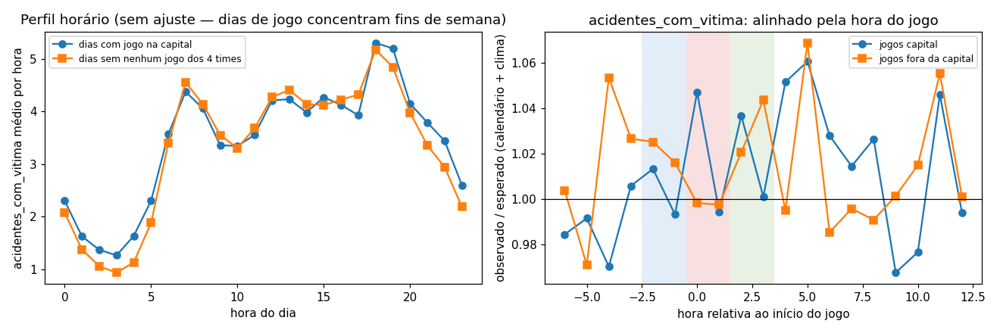
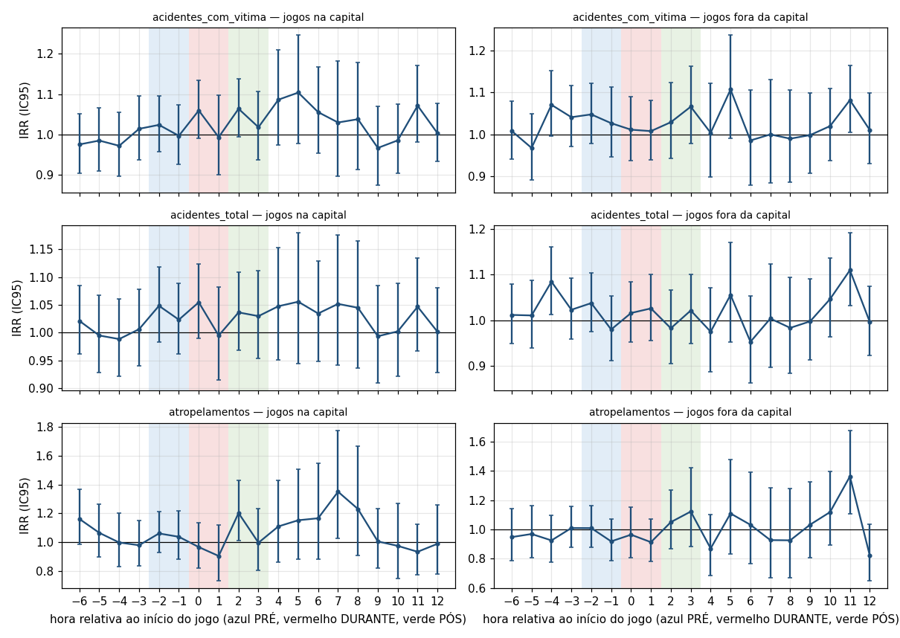

# V2 / Fase 2 — SINISTROS DE TRÂNSITO (Infosiga): análise por janelas de horário

Gerado por `scripts/33_analise_janelas.py`. Domínio analisado **isoladamente** (modelos, BH, pico e conclusão próprios). Desfechos: `acidentes_com_vitima`, `acidentes_total`, `atropelamentos` (principal: `acidentes_com_vitima`). Amostra: painel horário 2022–2023 sem os dias excluídos do domínio, sem as horas dos 4 eventos de grande público sem os times monitorados (robustez com elas de volta) e sem horas sem temperatura após interpolação de até 24 h. Contagens horárias usam só registros com hora.

## Resposta direta

- **Jogos na capital (multidão perto do estádio)**, `acidentes_com_vitima`: PRÉ +1.5% (p=0.585, p_BH=0.723, placebo p=0.436) → **sem evidência**; DURANTE +2.9% (p=0.376, p_BH=0.692, placebo p=0.272) → **sem evidência**; PÓS +3.9% (p=0.192, p_BH=0.692, placebo p=0.024) → **sem evidência**.
- **Jogos fora da capital (TV / bares)**, `acidentes_com_vitima`: PRÉ +2.6% (p=0.343, p_BH=0.692, placebo p=0.042) → **sem evidência**; DURANTE +0.6% (p=0.823, p_BH=0.910, placebo p=0.240) → **sem evidência**; PÓS +4.3% (p=0.134, p_BH=0.692, placebo p=0.002) → **sem evidência**.
- Desfechos secundários: sem sinal (p ≥ 0,05 em todas as janelas).
- **Onde (exploratório):** entorno de 3 km dos estádios (3 estádios agregados): durante +17.9% (p=0.232, p_BH=0.418); pos +5.5% (p=0.730, p_BH=0.777); pre +46.3% (p=0.001, p_BH=0.004); resto da cidade: pre -0.2% (p=0.939); durante +2.7% (p=0.429); pos +4.4% (p=0.166).
- **Picos (nível hora, P90 Pearson):** capital pre RR 0.98 (Fisher p=1.000); capital durante RR 1.06 (Fisher p=0.682); capital pos RR 1.22 (Fisher p=0.141); fora da capital pre RR 1.12 (Fisher p=0.378); fora da capital durante RR 0.99 (Fisher p=1.000); fora da capital pos RR 1.13 (Fisher p=0.344).
- Exploratório — horas tardias do event study (+4..+12 h) com p < 0,05: fora da capital k=+11 IRR 1.082 (p=0.034, p_BH=0.692).
- **Controles pareados (DiD):** capital pre +2.3% (IC95 -4.8 a +10.6); capital durante +4.2% (IC95 -3.0 a +12.9); capital pos -2.4% (IC95 -12.4 a +6.7); fora da capital pre +4.6% (IC95 -3.1 a +11.7); fora da capital durante +2.8% (IC95 -5.4 a +10.5); fora da capital pos +5.7% (IC95 -3.0 a +15.1).

Regra do veredito (revista na Fase 2b): candidato = p_BH < 0,05 no modelo principal **e** placebo p < 0,05 **e** mesmo sinal com p < 0,10 na Binomial Negativa e no cluster por dia. Entre os candidatos: **efeito robusto** só se o desenho pareado **confirma** (mesmo sinal, IC95 sem o 1); **robusto no GLM, pareado inconclusivo** se o pareado não confirma mas também não contradiz (IC95 do pareado contém a estimativa do GLM); **contradito pelo pareado** se o IC95 do pareado exclui a estimativa do GLM. **Sinal não robusto** = p < 0,05 sem ser candidato; **sem evidência** = p ≥ 0,05. Associação, não causalidade.

## Ressalvas que pesam na leitura

- **Pré-tendência (event study):** teste conjunto k=−6..−3 p=0.890 (capital) e p=0.210 (fora). Coeficientes da capital em −6..−3: k=-6 0.975, k=-5 0.985, k=-4 0.972, k=-3 1.014. Sem pré-tendência detectável.
- **Controles pareados vs GLM:** no desenho pareado (só jogos com ≥2 dias-controle livres; n=112) o PRÉ da capital dá +2.3% (IC95 -4.8 a +10.6). Consistente com o GLM, que também não acha efeito no PRÉ (+1.5%, p_BH=0.723).
- **Placebo:** maior desvio do centro da distribuição placebo em relação a 0: capital 1.1%, fora_da_capital 6.4%. Ainda há descentramento relevante em horas tardias — o p do placebo, sozinho, não é confiável aqui; vale o GLM.
- **Heterogeneidade com n pequeno** (< 20 horas, erro-padrão agrupado degenerado, **não interpretar**): fora_da_capital classico=True pre (16 h); fora_da_capital comp4=Outros pre (2 h); fora_da_capital comp4=Outros durante (2 h); fora_da_capital comp4=Outros pos (2 h).
- **Morumbi sem a semifinal e a final da Copa do Brasil 2023** (os 2 jogos que explicavam o sinal diário da Etapa 10), disco de 3 km: pre 1.27→1.31 (p=0.211); durante 1.09→1.07 (p=0.775); pos 1.08→1.05 (p=0.856). Tabela em `crimes/tabelas/espaco_sensibilidade_sem_2_jogos_copa_do_brasil.csv`.
- Contagens só com registros que têm hora (furtos: ~53% sem hora). Associação, não causalidade: não há variação exógena da agenda; o desenho controla calendário, clima e hora × dia da semana.

## 1. Descritivo

Média por hora em cada janela vs as **mesmas horas do relógio, no mesmo dia da semana, em horas sem nenhum jogo dos 4 times** (sem outro ajuste):

| categoria | janela | desfecho | n_horas | media_janela | media_mesmas_horas_dia_semana_sem_jogo | razao |
|---|---|---|---|---|---|---|
| capital | pre | acidentes_com_vitima | 432 | 4.340 | 3.938 | 1.102 |
| capital | pre | acidentes_total | 432 | 7.116 | 6.615 | 1.076 |
| capital | pre | atropelamentos | 432 | 1.104 | 0.968 | 1.141 |
| capital | durante | acidentes_com_vitima | 432 | 3.743 | 3.342 | 1.120 |
| capital | durante | acidentes_total | 432 | 6.086 | 5.849 | 1.040 |
| capital | durante | atropelamentos | 432 | 0.829 | 0.814 | 1.018 |
| capital | pos | acidentes_com_vitima | 432 | 3.343 | 2.900 | 1.153 |
| capital | pos | acidentes_total | 432 | 5.528 | 5.178 | 1.068 |
| capital | pos | atropelamentos | 432 | 0.766 | 0.662 | 1.158 |
| fora_da_capital | pre | acidentes_com_vitima | 451 | 4.399 | 3.970 | 1.108 |
| fora_da_capital | pre | acidentes_total | 451 | 6.840 | 6.635 | 1.031 |
| fora_da_capital | pre | atropelamentos | 451 | 1.024 | 0.963 | 1.064 |
| fora_da_capital | durante | acidentes_com_vitima | 541 | 3.680 | 3.366 | 1.093 |
| fora_da_capital | durante | acidentes_total | 541 | 6.155 | 5.885 | 1.046 |
| fora_da_capital | durante | atropelamentos | 541 | 0.850 | 0.821 | 1.036 |
| fora_da_capital | pos | acidentes_com_vitima | 466 | 3.290 | 2.866 | 1.148 |
| fora_da_capital | pos | acidentes_total | 466 | 5.307 | 5.113 | 1.038 |
| fora_da_capital | pos | atropelamentos | 466 | 0.751 | 0.657 | 1.144 |

## 2. Modelo principal

`log E[y] = β·(PRÉ, DURANTE, PÓS na capital) + β_fdj·(mesmo dia de jogo na capital, fora das janelas) + γ·(PRÉ, DURANTE, PÓS de jogos fora da capital) + EF(hora do dia × dia da semana) + EF(ano × mês) + feriado + véspera + férias + log(1+chuva) + indicador de chuva ausente + temperatura`, GLM Poisson, erros agrupados por semana. Referência = hora sem nenhum jogo dos 4 times.

**Por que EF hora × dia da semana:** os jogos acontecem em horários que já têm um nível próprio de ocorrências (domingo 16h, quarta 21h30). Sem esse controle, o modelo confunde "horário do jogo" com "efeito do jogo" — é a versão horária do confundidor de calendário que já derrubou o efeito no grão diário (Etapas 7–10).

| desfecho | janela | IRR | var_pct | IC95_lo | IC95_hi | p | p_BH_dominio |
|---|---|---|---|---|---|---|---|
| acidentes_com_vitima | capital PRÉ | 1.015 | 1.482 | 0.963 | 1.070 | 0.585 | 0.723 |
| acidentes_com_vitima | capital DURANTE | 1.029 | 2.913 | 0.966 | 1.097 | 0.376 | 0.692 |
| acidentes_com_vitima | capital PÓS | 1.039 | 3.882 | 0.981 | 1.100 | 0.192 | 0.692 |
| acidentes_com_vitima | capital mesmo dia, fora das janelas | 1.015 | 1.513 | 0.988 | 1.043 | 0.276 | 0.692 |
| acidentes_com_vitima | fora da capital PRÉ | 1.026 | 2.634 | 0.973 | 1.083 | 0.343 | 0.692 |
| acidentes_com_vitima | fora da capital DURANTE | 1.006 | 0.644 | 0.951 | 1.065 | 0.823 | 0.910 |
| acidentes_com_vitima | fora da capital PÓS | 1.043 | 4.326 | 0.987 | 1.103 | 0.134 | 0.692 |
| acidentes_total | capital PRÉ | 1.040 | 3.986 | 0.991 | 1.092 | 0.115 | 0.692 |
| acidentes_total | capital DURANTE | 1.026 | 2.561 | 0.966 | 1.089 | 0.409 | 0.692 |
| acidentes_total | capital PÓS | 1.028 | 2.845 | 0.972 | 1.088 | 0.331 | 0.692 |
| acidentes_total | capital mesmo dia, fora das janelas | 1.010 | 0.964 | 0.983 | 1.037 | 0.484 | 0.692 |
| acidentes_total | fora da capital PRÉ | 0.999 | -0.055 | 0.949 | 1.052 | 0.983 | 0.986 |
| acidentes_total | fora da capital DURANTE | 1.019 | 1.864 | 0.966 | 1.074 | 0.494 | 0.692 |
| acidentes_total | fora da capital PÓS | 1.000 | 0.046 | 0.951 | 1.052 | 0.986 | 0.986 |
| atropelamentos | capital PRÉ | 1.044 | 4.354 | 0.936 | 1.163 | 0.442 | 0.692 |
| atropelamentos | capital DURANTE | 0.930 | -6.998 | 0.816 | 1.060 | 0.277 | 0.692 |
| atropelamentos | capital PÓS | 1.084 | 8.370 | 0.942 | 1.246 | 0.260 | 0.692 |
| atropelamentos | capital mesmo dia, fora das janelas | 1.012 | 1.223 | 0.952 | 1.076 | 0.696 | 0.813 |
| atropelamentos | fora da capital PRÉ | 0.966 | -3.396 | 0.860 | 1.086 | 0.562 | 0.723 |
| atropelamentos | fora da capital DURANTE | 0.947 | -5.307 | 0.838 | 1.070 | 0.383 | 0.692 |
| atropelamentos | fora da capital PÓS | 1.096 | 9.599 | 0.944 | 1.272 | 0.229 | 0.692 |

BH: uma família por domínio (todos os desfechos × todos os termos acima).

### Robustezes

| desfecho | termo | Binomial Negativa (alpha=0.017) | Binomial Negativa (alpha=0.058) | Binomial Negativa (alpha=0.148) | cluster por dia | com horas dos eventos de grande publico | so base original (janela_base_original) | so janela (sem jogos fora da capital) |
|---|---|---|---|---|---|---|---|---|
| acidentes_com_vitima | C_durante | 1.029 (p=0.381) |  |  | 1.029 (p=0.349) | 1.029 (p=0.380) | 1.035 (p=0.371) | 1.035 (p=0.279) |
| acidentes_com_vitima | C_fdj | 1.015 (p=0.268) |  |  | 1.015 (p=0.279) | 1.014 (p=0.307) | 1.005 (p=0.779) | 1.016 (p=0.244) |
| acidentes_com_vitima | C_pos | 1.039 (p=0.192) |  |  | 1.039 (p=0.254) | 1.038 (p=0.198) | 1.023 (p=0.518) | 1.033 (p=0.256) |
| acidentes_com_vitima | C_pre | 1.015 (p=0.571) |  |  | 1.015 (p=0.619) | 1.015 (p=0.589) | 1.013 (p=0.679) | 1.012 (p=0.649) |
| acidentes_com_vitima | F_durante | 1.006 (p=0.828) |  |  | 1.006 (p=0.817) | 1.006 (p=0.838) | 1.006 (p=0.836) |  |
| acidentes_com_vitima | F_pos | 1.044 (p=0.133) |  |  | 1.043 (p=0.173) | 1.043 (p=0.137) | 1.041 (p=0.143) |  |
| acidentes_com_vitima | F_pre | 1.026 (p=0.343) |  |  | 1.026 (p=0.325) | 1.024 (p=0.377) | 1.026 (p=0.348) |  |
| acidentes_total | C_durante |  | 1.026 (p=0.407) |  | 1.026 (p=0.387) | 1.026 (p=0.407) | 1.022 (p=0.546) | 1.023 (p=0.454) |
| acidentes_total | C_fdj |  | 1.011 (p=0.427) |  | 1.010 (p=0.478) | 1.009 (p=0.521) | 0.999 (p=0.932) | 1.010 (p=0.479) |
| acidentes_total | C_pos |  | 1.032 (p=0.276) |  | 1.028 (p=0.357) | 1.028 (p=0.338) | 0.998 (p=0.957) | 1.029 (p=0.315) |
| acidentes_total | C_pre |  | 1.043 (p=0.094) |  | 1.040 (p=0.141) | 1.040 (p=0.114) | 1.025 (p=0.406) | 1.042 (p=0.090) |
| acidentes_total | F_durante |  | 1.015 (p=0.580) |  | 1.019 (p=0.477) | 1.019 (p=0.493) | 1.020 (p=0.446) |  |
| acidentes_total | F_pos |  | 0.998 (p=0.948) |  | 1.000 (p=0.987) | 1.000 (p=0.992) | 0.999 (p=0.968) |  |
| acidentes_total | F_pre |  | 1.001 (p=0.977) |  | 0.999 (p=0.982) | 0.999 (p=0.978) | 0.997 (p=0.916) |  |
| atropelamentos | C_durante |  |  | 0.930 (p=0.279) | 0.930 (p=0.277) | 0.933 (p=0.302) | 0.986 (p=0.875) | 0.945 (p=0.392) |
| atropelamentos | C_fdj |  |  | 1.013 (p=0.677) | 1.012 (p=0.693) | 1.012 (p=0.711) | 1.033 (p=0.396) | 1.012 (p=0.695) |
| atropelamentos | C_pos |  |  | 1.082 (p=0.267) | 1.084 (p=0.269) | 1.088 (p=0.240) | 1.097 (p=0.255) | 1.066 (p=0.364) |
| atropelamentos | C_pre |  |  | 1.045 (p=0.430) | 1.044 (p=0.434) | 1.043 (p=0.442) | 1.118 (p=0.124) | 1.046 (p=0.413) |
| atropelamentos | F_durante |  |  | 0.945 (p=0.365) | 0.947 (p=0.374) | 0.950 (p=0.412) | 0.948 (p=0.389) |  |
| atropelamentos | F_pos |  |  | 1.104 (p=0.197) | 1.096 (p=0.225) | 1.099 (p=0.215) | 1.078 (p=0.322) |  |
| atropelamentos | F_pre |  |  | 0.965 (p=0.556) | 0.966 (p=0.562) | 0.962 (p=0.513) | 0.963 (p=0.525) |  |

## 3. Event study (−6 a +12 h) — as duas categorias

Dummies para cada hora relativa ao início, separadamente para jogos na capital e fora da capital, no mesmo modelo, com os mesmos EF (+ dummy para as outras horas do dia de jogo na capital). Horas −6 a −3 = checagem de pré-tendência; até +12 porque Ivandić et al. (2024) acham efeito até ~10 h depois.

Teste conjunto de pré-tendência (k = −6..−3 iguais a zero):

| desfecho | categoria | p |
|---|---|---|
| acidentes_com_vitima | capital | 0.890 |
| acidentes_com_vitima | fora_da_capital | 0.210 |
| acidentes_total | capital | 0.949 |
| acidentes_total | fora_da_capital | 0.218 |
| atropelamentos | capital | 0.402 |
| atropelamentos | fora_da_capital | 0.820 |

Horas +4..+12 com p < 0,05 (sem correção múltipla; 18 testes por desfecho e categoria):

| desfecho | categoria | k | IRR | p |
|---|---|---|---|---|
| acidentes_com_vitima | fora_da_capital | 11.000 | 1.082 | 0.034 |
| acidentes_total | fora_da_capital | 11.000 | 1.109 | 0.005 |
| atropelamentos | capital | 7.000 | 1.350 | 0.032 |
| atropelamentos | fora_da_capital | 11.000 | 1.361 | 0.004 |

## 4. Placebo / permutação

1000 sorteios: cada jogo recebe um início falso no mesmo horário, mesmo dia da semana, ±6 semanas, em dia sem jogo na capital (e, para a categoria fora da capital, sem nenhum jogo dos 4 times) e sem feriado. Para caber 1.000 reestimações, usa-se a versão em dois passos: o modelo de calendário + clima + a outra categoria é ajustado uma vez e o β de cada janela vira `log(Σobs/Σesperado)` nas horas da janela; o β real é recalculado do mesmo jeito.

| desfecho | categoria | janela | IRR_real_2passos | placebo_p2.5 | placebo_p97.5 | percentil_real | p_permutacao_bilateral |
|---|---|---|---|---|---|---|---|
| acidentes_com_vitima | capital | pre | 1.017 | 0.948 | 1.048 | 78.200 | 0.436 |
| acidentes_com_vitima | capital | durante | 1.029 | 0.942 | 1.047 | 86.400 | 0.272 |
| acidentes_com_vitima | capital | pos | 1.055 | 0.938 | 1.045 | 98.800 | 0.024 |
| acidentes_total | capital | pre | 1.048 | 0.953 | 1.044 | 98.600 | 0.028 |
| acidentes_total | capital | durante | 1.030 | 0.945 | 1.048 | 91.200 | 0.176 |
| acidentes_total | capital | pos | 1.040 | 0.937 | 1.047 | 95.700 | 0.086 |
| atropelamentos | capital | pre | 1.068 | 0.900 | 1.109 | 88.400 | 0.232 |
| atropelamentos | capital | durante | 0.926 | 0.889 | 1.106 | 10.100 | 0.202 |
| atropelamentos | capital | pos | 1.084 | 0.864 | 1.124 | 90.300 | 0.194 |
| acidentes_com_vitima | fora_da_capital | pre | 1.031 | 0.945 | 1.029 | 97.900 | 0.042 |
| acidentes_com_vitima | fora_da_capital | durante | 1.004 | 0.932 | 1.023 | 88.000 | 0.240 |
| acidentes_com_vitima | fora_da_capital | pos | 1.046 | 0.909 | 1.005 | 99.900 | 0.002 |
| acidentes_total | fora_da_capital | pre | 1.002 | 0.951 | 1.026 | 76.200 | 0.476 |
| acidentes_total | fora_da_capital | durante | 1.015 | 0.944 | 1.030 | 89.300 | 0.214 |
| acidentes_total | fora_da_capital | pos | 1.001 | 0.935 | 1.029 | 79.800 | 0.404 |
| atropelamentos | fora_da_capital | pre | 0.975 | 0.881 | 1.073 | 46.000 | 0.920 |
| atropelamentos | fora_da_capital | durante | 0.969 | 0.913 | 1.102 | 22.500 | 0.450 |
| atropelamentos | fora_da_capital | pos | 1.097 | 0.956 | 1.179 | 70.100 | 0.598 |

(placebo_p2.5/p97.5 em escala de IRR.)

## 5. Heterogeneidade

Desfecho principal `acidentes_com_vitima` (todos os desfechos em `tabelas/heterogeneidade.csv`). Resultado do mandante só na janela PÓS (só é conhecido depois do jogo). Por time: modelo separado para cada time, com as janelas dos jogos daquele time vs as dos outros jogos (um clássico conta para os dois times).

| categoria | atributo | janela | nivel | n_horas | IRR | IC95_lo | IC95_hi | p | p_BH_dominio_atributo | obs |
|---|---|---|---|---|---|---|---|---|---|---|
| capital | classico | pre | False | 360 | 1.021 | 0.965 | 1.081 | 0.465 | 0.679 |  |
| capital | classico | pre | True | 72 | 0.979 | 0.883 | 1.085 | 0.686 | 0.727 |  |
| capital | classico | durante | False | 360 | 1.028 | 0.962 | 1.099 | 0.415 | 0.679 |  |
| capital | classico | durante | True | 72 | 1.033 | 0.920 | 1.159 | 0.584 | 0.679 |  |
| capital | classico | pos | False | 360 | 1.039 | 0.971 | 1.111 | 0.270 | 0.679 |  |
| capital | classico | pos | True | 72 | 1.040 | 0.922 | 1.174 | 0.524 | 0.679 |  |
| capital | noturno | pre | False | 168 | 1.029 | 0.938 | 1.130 | 0.541 | 0.851 |  |
| capital | noturno | pre | True | 264 | 1.010 | 0.950 | 1.075 | 0.742 | 0.851 |  |
| capital | noturno | durante | False | 168 | 1.027 | 0.942 | 1.120 | 0.540 | 0.851 |  |
| capital | noturno | durante | True | 264 | 1.032 | 0.951 | 1.120 | 0.447 | 0.851 |  |
| capital | noturno | pos | False | 168 | 1.090 | 1.004 | 1.184 | 0.039 | 0.709 |  |
| capital | noturno | pos | True | 264 | 0.988 | 0.901 | 1.084 | 0.803 | 0.851 |  |
| capital | fim_de_semana | pre | False | 222 | 0.999 | 0.932 | 1.071 | 0.975 | 0.975 |  |
| capital | fim_de_semana | pre | True | 210 | 1.039 | 0.962 | 1.122 | 0.335 | 0.678 |  |
| capital | fim_de_semana | durante | False | 222 | 0.992 | 0.904 | 1.088 | 0.864 | 0.975 |  |
| capital | fim_de_semana | durante | True | 210 | 1.068 | 0.988 | 1.154 | 0.096 | 0.678 |  |
| capital | fim_de_semana | pos | False | 222 | 1.046 | 0.933 | 1.174 | 0.441 | 0.794 |  |
| capital | fim_de_semana | pos | True | 210 | 1.039 | 0.961 | 1.123 | 0.339 | 0.678 |  |
| capital | comp4 | pre | CONMEBOL | 72 | 1.041 | 0.937 | 1.157 | 0.454 | 0.985 |  |
| capital | comp4 | pre | Campeonato Paulista | 98 | 0.980 | 0.863 | 1.112 | 0.752 | 0.985 |  |
| capital | comp4 | pre | Copa do Brasil | 44 | 1.023 | 0.901 | 1.162 | 0.724 | 0.985 |  |
| capital | comp4 | pre | Serie A | 218 | 1.017 | 0.947 | 1.091 | 0.648 | 0.985 |  |
| capital | comp4 | durante | CONMEBOL | 72 | 0.975 | 0.820 | 1.158 | 0.771 | 0.985 |  |
| capital | comp4 | durante | Campeonato Paulista | 98 | 1.028 | 0.936 | 1.129 | 0.561 | 0.985 |  |
| capital | comp4 | durante | Copa do Brasil | 44 | 1.001 | 0.871 | 1.151 | 0.986 | 0.990 |  |
| capital | comp4 | durante | Serie A | 218 | 1.048 | 0.968 | 1.135 | 0.245 | 0.985 |  |
| capital | comp4 | pos | CONMEBOL | 72 | 1.110 | 0.922 | 1.337 | 0.271 | 0.985 |  |
| capital | comp4 | pos | Campeonato Paulista | 98 | 1.032 | 0.905 | 1.176 | 0.642 | 0.985 |  |
| capital | comp4 | pos | Copa do Brasil | 44 | 0.997 | 0.803 | 1.239 | 0.981 | 0.990 |  |
| capital | comp4 | pos | Serie A | 218 | 1.034 | 0.961 | 1.113 | 0.368 | 0.985 |  |
| capital | resultado | pos | derrota | 56 | 0.919 | 0.779 | 1.085 | 0.320 | 0.479 |  |
| capital | resultado | pos | empate | 106 | 1.016 | 0.928 | 1.114 | 0.726 | 0.728 |  |
| capital | resultado | pos | vitoria | 270 | 1.073 | 0.999 | 1.153 | 0.055 | 0.435 |  |
| capital | time:Corinthians | pre | Corinthians | 162 | 1.076 | 0.998 | 1.160 | 0.055 | 0.701 |  |
| capital | time:Corinthians | pre | outros_times | 270 | 0.980 | 0.918 | 1.046 | 0.544 | 0.754 |  |
| capital | time:Corinthians | durante | Corinthians | 162 | 1.039 | 0.946 | 1.141 | 0.429 | 0.754 |  |
| capital | time:Corinthians | durante | outros_times | 270 | 1.024 | 0.951 | 1.103 | 0.530 | 0.754 |  |
| capital | time:Corinthians | pos | Corinthians | 162 | 1.015 | 0.929 | 1.109 | 0.748 | 0.827 |  |
| capital | time:Corinthians | pos | outros_times | 270 | 1.053 | 0.977 | 1.135 | 0.180 | 0.754 |  |
| capital | time:Palmeiras | pre | Palmeiras | 156 | 1.023 | 0.946 | 1.106 | 0.573 | 0.922 |  |
| capital | time:Palmeiras | pre | outros_times | 276 | 1.010 | 0.946 | 1.079 | 0.760 | 0.959 |  |
| capital | time:Palmeiras | durante | Palmeiras | 156 | 1.047 | 0.966 | 1.134 | 0.265 | 0.674 |  |
| capital | time:Palmeiras | durante | outros_times | 276 | 1.019 | 0.946 | 1.098 | 0.615 | 0.922 |  |
| capital | time:Palmeiras | pos | Palmeiras | 156 | 1.049 | 0.952 | 1.155 | 0.336 | 0.674 |  |
| capital | time:Palmeiras | pos | outros_times | 276 | 1.033 | 0.960 | 1.112 | 0.380 | 0.683 |  |
| capital | time:Sao Paulo | pre | Sao Paulo | 164 | 0.944 | 0.865 | 1.030 | 0.197 | 0.505 |  |
| capital | time:Sao Paulo | pre | outros_times | 268 | 1.059 | 0.995 | 1.126 | 0.071 | 0.395 |  |
| capital | time:Sao Paulo | durante | Sao Paulo | 164 | 0.974 | 0.889 | 1.068 | 0.579 | 0.802 |  |
| capital | time:Sao Paulo | durante | outros_times | 268 | 1.064 | 0.991 | 1.141 | 0.088 | 0.395 |  |
| capital | time:Sao Paulo | pos | Sao Paulo | 164 | 1.035 | 0.945 | 1.133 | 0.461 | 0.697 |  |
| capital | time:Sao Paulo | pos | outros_times | 268 | 1.042 | 0.967 | 1.122 | 0.283 | 0.516 |  |
| capital | time:Santos | pre | Santos | 22 | 0.917 | 0.754 | 1.115 | 0.385 | 0.688 |  |
| capital | time:Santos | pre | outros_times | 410 | 1.019 | 0.965 | 1.075 | 0.503 | 0.697 |  |
| capital | time:Santos | durante | Santos | 22 | 1.245 | 1.056 | 1.469 | 0.009 | 0.166 |  |
| capital | time:Santos | durante | outros_times | 410 | 1.016 | 0.952 | 1.085 | 0.634 | 0.713 |  |
| capital | time:Santos | pos | Santos | 22 | 1.167 | 0.963 | 1.414 | 0.115 | 0.688 |  |
| capital | time:Santos | pos | outros_times | 410 | 1.033 | 0.974 | 1.095 | 0.277 | 0.688 |  |
| fora_da_capital | classico | pre | False | 435 | 1.025 | 0.971 | 1.082 | 0.375 | 0.749 |  |
| fora_da_capital | classico | pre | True | 16 | 1.069 | 0.892 | 1.283 | 0.469 | 0.768 | n<20: não interpretar |
| fora_da_capital | classico | durante | False | 520 | 1.004 | 0.948 | 1.064 | 0.892 | 0.901 |  |
| fora_da_capital | classico | durante | True | 21 | 1.068 | 0.852 | 1.339 | 0.566 | 0.849 |  |
| fora_da_capital | classico | pos | False | 446 | 1.041 | 0.982 | 1.103 | 0.179 | 0.538 |  |
| fora_da_capital | classico | pos | True | 20 | 1.102 | 0.911 | 1.333 | 0.317 | 0.713 |  |
| fora_da_capital | noturno | pre | False | 184 | 1.055 | 0.962 | 1.156 | 0.254 | 0.766 |  |
| fora_da_capital | noturno | pre | True | 267 | 1.014 | 0.952 | 1.081 | 0.662 | 0.794 |  |
| fora_da_capital | noturno | durante | False | 208 | 1.027 | 0.944 | 1.118 | 0.531 | 0.772 |  |
| fora_da_capital | noturno | durante | True | 333 | 0.996 | 0.929 | 1.066 | 0.898 | 0.951 |  |
| fora_da_capital | noturno | pos | False | 172 | 1.066 | 0.983 | 1.155 | 0.121 | 0.766 |  |
| fora_da_capital | noturno | pos | True | 294 | 1.022 | 0.939 | 1.112 | 0.617 | 0.793 |  |
| fora_da_capital | fim_de_semana | pre | False | 238 | 1.003 | 0.935 | 1.076 | 0.933 | 0.933 |  |
| fora_da_capital | fim_de_semana | pre | True | 213 | 1.064 | 0.986 | 1.149 | 0.112 | 0.669 |  |
| fora_da_capital | fim_de_semana | durante | False | 280 | 0.973 | 0.894 | 1.060 | 0.532 | 0.684 |  |
| fora_da_capital | fim_de_semana | durante | True | 261 | 1.040 | 0.971 | 1.114 | 0.257 | 0.669 |  |
| fora_da_capital | fim_de_semana | pos | False | 242 | 1.034 | 0.939 | 1.139 | 0.494 | 0.684 |  |
| fora_da_capital | fim_de_semana | pos | True | 224 | 1.053 | 0.980 | 1.131 | 0.159 | 0.669 |  |
| fora_da_capital | comp4 | pre | CONMEBOL | 82 | 1.101 | 0.985 | 1.231 | 0.092 | 0.257 |  |
| fora_da_capital | comp4 | pre | Campeonato Paulista | 74 | 0.981 | 0.872 | 1.104 | 0.754 | 0.893 |  |
| fora_da_capital | comp4 | pre | Copa do Brasil | 46 | 1.040 | 0.908 | 1.191 | 0.569 | 0.853 |  |
| fora_da_capital | comp4 | pre | Outros | 2 | 1.831 | 1.611 | 2.081 | 0.000 | 0.000 | n<20: não interpretar |
| fora_da_capital | comp4 | pre | Serie A | 247 | 0.999 | 0.932 | 1.070 | 0.977 | 0.977 |  |
| fora_da_capital | comp4 | durante | CONMEBOL | 100 | 0.988 | 0.870 | 1.123 | 0.855 | 0.897 |  |
| fora_da_capital | comp4 | durante | Campeonato Paulista | 90 | 0.974 | 0.845 | 1.124 | 0.719 | 0.875 |  |
| fora_da_capital | comp4 | durante | Copa do Brasil | 53 | 0.936 | 0.764 | 1.147 | 0.525 | 0.844 |  |
| fora_da_capital | comp4 | durante | Outros | 2 | 1.440 | 1.230 | 1.686 | 0.000 | 0.000 | n<20: não interpretar |
| fora_da_capital | comp4 | durante | Serie A | 296 | 1.028 | 0.971 | 1.090 | 0.342 | 0.690 |  |
| fora_da_capital | comp4 | pos | CONMEBOL | 86 | 0.980 | 0.826 | 1.163 | 0.816 | 0.897 |  |
| fora_da_capital | comp4 | pos | Campeonato Paulista | 80 | 1.129 | 1.003 | 1.270 | 0.044 | 0.160 |  |
| fora_da_capital | comp4 | pos | Copa do Brasil | 44 | 0.933 | 0.780 | 1.117 | 0.451 | 0.752 |  |
| fora_da_capital | comp4 | pos | Outros | 2 | 1.312 | 1.145 | 1.503 | 0.000 | 0.001 | n<20: não interpretar |
| fora_da_capital | comp4 | pos | Serie A | 254 | 1.042 | 0.977 | 1.110 | 0.208 | 0.468 |  |
| fora_da_capital | rmsp | pre | False | 420 | 1.024 | 0.967 | 1.084 | 0.415 | 0.733 |  |
| fora_da_capital | rmsp | pre | True | 31 | 1.063 | 0.877 | 1.289 | 0.533 | 0.733 |  |
| fora_da_capital | rmsp | durante | False | 508 | 1.004 | 0.947 | 1.065 | 0.890 | 0.896 |  |
| fora_da_capital | rmsp | durante | True | 33 | 1.039 | 0.926 | 1.165 | 0.516 | 0.733 |  |
| fora_da_capital | rmsp | pos | False | 436 | 1.057 | 0.997 | 1.122 | 0.063 | 0.567 |  |
| fora_da_capital | rmsp | pos | True | 30 | 0.880 | 0.723 | 1.070 | 0.200 | 0.733 |  |
| fora_da_capital | time:Corinthians | pre | Corinthians | 101 | 1.049 | 0.930 | 1.183 | 0.439 | 0.858 |  |
| fora_da_capital | time:Corinthians | pre | outros_times | 350 | 1.020 | 0.971 | 1.072 | 0.430 | 0.858 |  |
| fora_da_capital | time:Corinthians | durante | Corinthians | 163 | 1.030 | 0.948 | 1.120 | 0.482 | 0.858 |  |
| fora_da_capital | time:Corinthians | durante | outros_times | 378 | 0.996 | 0.936 | 1.060 | 0.898 | 0.951 |  |
| fora_da_capital | time:Corinthians | pos | Corinthians | 120 | 1.022 | 0.904 | 1.155 | 0.728 | 0.951 |  |
| fora_da_capital | time:Corinthians | pos | outros_times | 346 | 1.050 | 0.985 | 1.121 | 0.136 | 0.592 |  |
| fora_da_capital | time:Palmeiras | pre | Palmeiras | 112 | 1.001 | 0.926 | 1.083 | 0.974 | 0.974 |  |
| fora_da_capital | time:Palmeiras | pre | outros_times | 339 | 1.034 | 0.971 | 1.101 | 0.299 | 0.862 |  |
| fora_da_capital | time:Palmeiras | durante | Palmeiras | 166 | 1.015 | 0.932 | 1.106 | 0.728 | 0.962 |  |
| fora_da_capital | time:Palmeiras | durante | outros_times | 375 | 1.002 | 0.942 | 1.066 | 0.938 | 0.974 |  |
| fora_da_capital | time:Palmeiras | pos | Palmeiras | 122 | 1.063 | 0.949 | 1.191 | 0.291 | 0.862 |  |
| fora_da_capital | time:Palmeiras | pos | outros_times | 344 | 1.036 | 0.974 | 1.103 | 0.261 | 0.862 |  |
| fora_da_capital | time:Sao Paulo | pre | Sao Paulo | 116 | 1.096 | 1.002 | 1.200 | 0.045 | 0.618 |  |
| fora_da_capital | time:Sao Paulo | pre | outros_times | 335 | 1.002 | 0.941 | 1.067 | 0.945 | 0.987 |  |
| fora_da_capital | time:Sao Paulo | durante | Sao Paulo | 167 | 1.051 | 0.968 | 1.143 | 0.237 | 0.618 |  |
| fora_da_capital | time:Sao Paulo | durante | outros_times | 374 | 0.986 | 0.926 | 1.049 | 0.646 | 0.894 |  |
| fora_da_capital | time:Sao Paulo | pos | Sao Paulo | 113 | 1.050 | 0.959 | 1.149 | 0.296 | 0.618 |  |
| fora_da_capital | time:Sao Paulo | pos | outros_times | 353 | 1.041 | 0.971 | 1.116 | 0.259 | 0.618 |  |
| fora_da_capital | time:Santos | pre | Santos | 197 | 0.982 | 0.918 | 1.050 | 0.591 | 0.752 |  |
| fora_da_capital | time:Santos | pre | outros_times | 254 | 1.062 | 0.991 | 1.137 | 0.088 | 0.752 |  |
| fora_da_capital | time:Santos | durante | Santos | 294 | 0.999 | 0.939 | 1.063 | 0.979 | 0.979 |  |
| fora_da_capital | time:Santos | durante | outros_times | 247 | 1.016 | 0.933 | 1.107 | 0.708 | 0.796 |  |
| fora_da_capital | time:Santos | pos | Santos | 199 | 1.039 | 0.959 | 1.126 | 0.348 | 0.752 |  |
| fora_da_capital | time:Santos | pos | outros_times | 267 | 1.046 | 0.974 | 1.123 | 0.217 | 0.752 |  |

### Dose-resposta do público (só jogos na capital)

Interação de cada janela com log(público) centrado na média dos jogos (coeficiente = variação do IRR para +1 em log, ≈ ×2,7 de público) e recorte por tercis (cortes 34.941 e 40.651). Jogo de portões fechados fora deste modelo.

| area | spec | termo | IRR | IC95_lo | IC95_hi | p |
|---|---|---|---|---|---|---|
| cidade toda | log | C_pre__x_logpub | 1.019 | 0.864 | 1.201 | 0.827 |
| cidade toda | log | C_durante__x_logpub | 0.914 | 0.764 | 1.094 | 0.326 |
| cidade toda | log | C_pos__x_logpub | 1.052 | 0.858 | 1.289 | 0.626 |
| cidade toda | log | C_pre | 1.016 | 0.964 | 1.071 | 0.550 |
| cidade toda | log | C_durante | 1.029 | 0.965 | 1.096 | 0.384 |
| cidade toda | log | C_pos | 1.037 | 0.978 | 1.100 | 0.229 |
| cidade toda | tercis | C_pre__T1 | 1.007 | 0.928 | 1.093 | 0.865 |
| cidade toda | tercis | C_pre__T2 | 0.997 | 0.905 | 1.098 | 0.944 |
| cidade toda | tercis | C_pre__T3 | 1.049 | 0.964 | 1.142 | 0.269 |
| cidade toda | tercis | C_durante__T1 | 1.095 | 0.991 | 1.211 | 0.074 |
| cidade toda | tercis | C_durante__T2 | 0.999 | 0.914 | 1.092 | 0.985 |
| cidade toda | tercis | C_durante__T3 | 0.993 | 0.910 | 1.084 | 0.871 |
| cidade toda | tercis | C_pos__T1 | 1.050 | 0.939 | 1.175 | 0.390 |
| cidade toda | tercis | C_pos__T2 | 1.034 | 0.926 | 1.156 | 0.548 |
| cidade toda | tercis | C_pos__T3 | 1.031 | 0.951 | 1.117 | 0.458 |
| entorno do estádio (3 km) | log | C_pre__x_logpub | 0.772 | 0.372 | 1.602 | 0.487 |
| entorno do estádio (3 km) | log | C_durante__x_logpub | 0.890 | 0.417 | 1.896 | 0.762 |
| entorno do estádio (3 km) | log | C_pos__x_logpub | 1.676 | 0.673 | 4.172 | 0.267 |
| entorno do estádio (3 km) | log | C_pre | 1.506 | 1.188 | 1.909 | 0.001 |
| entorno do estádio (3 km) | log | C_durante | 1.223 | 0.938 | 1.596 | 0.138 |
| entorno do estádio (3 km) | log | C_pos | 1.043 | 0.763 | 1.427 | 0.790 |
| entorno do estádio (3 km) | tercis | C_pre__T1 | 1.453 | 0.983 | 2.146 | 0.061 |
| entorno do estádio (3 km) | tercis | C_pre__T2 | 1.784 | 1.269 | 2.508 | 0.001 |
| entorno do estádio (3 km) | tercis | C_pre__T3 | 1.270 | 0.848 | 1.902 | 0.246 |
| entorno do estádio (3 km) | tercis | C_durante__T1 | 1.451 | 0.946 | 2.225 | 0.088 |
| entorno do estádio (3 km) | tercis | C_durante__T2 | 0.802 | 0.483 | 1.331 | 0.393 |
| entorno do estádio (3 km) | tercis | C_durante__T3 | 1.436 | 0.964 | 2.139 | 0.075 |
| entorno do estádio (3 km) | tercis | C_pos__T1 | 0.819 | 0.428 | 1.568 | 0.547 |
| entorno do estádio (3 km) | tercis | C_pos__T2 | 1.414 | 0.850 | 2.353 | 0.183 |
| entorno do estádio (3 km) | tercis | C_pos__T3 | 0.960 | 0.622 | 1.480 | 0.853 |

## 6. Espaço × tempo

Contagem horária no disco de 3 km de cada estádio (Neo Química Arena, Allianz Parque, Morumbi), com as janelas dos jogos **daquele** estádio vs as dos jogos em outro estádio, mesmos EF; resto da cidade = registros fora dos 3 discos. Jogo no Canindé (Santos) não entra (sem coordenada). 
Sinistros: coordenada 99,5% válida.

| estadio | area | janela | IRR | IC95_lo | IC95_hi | p |
|---|---|---|---|---|---|---|
| Neo Quimica Arena | disco | pre | 1.689 | 1.174 | 2.429 | 0.005 |
| Neo Quimica Arena | disco | durante | 1.379 | 0.884 | 2.153 | 0.157 |
| Neo Quimica Arena | disco | pos | 1.084 | 0.559 | 2.100 | 0.812 |
| Allianz Parque | disco | pre | 1.383 | 0.915 | 2.089 | 0.124 |
| Allianz Parque | disco | durante | 1.053 | 0.629 | 1.762 | 0.844 |
| Allianz Parque | disco | pos | 1.019 | 0.624 | 1.663 | 0.941 |
| Morumbi | disco | pre | 1.269 | 0.822 | 1.957 | 0.282 |
| Morumbi | disco | durante | 1.094 | 0.696 | 1.721 | 0.697 |
| Morumbi | disco | pos | 1.077 | 0.663 | 1.750 | 0.764 |
| resto da cidade | resto | pre | 0.998 | 0.946 | 1.053 | 0.939 |
| resto da cidade | resto | durante | 1.027 | 0.962 | 1.097 | 0.429 |
| resto da cidade | resto | pos | 1.044 | 0.982 | 1.111 | 0.166 |
| 3 estádios (inverso da variância) | disco | durante | 1.179 | 0.900 | 1.545 | 0.232 |
| 3 estádios (inverso da variância) | disco | pos | 1.055 | 0.777 | 1.433 | 0.730 |
| 3 estádios (inverso da variância) | disco | pre | 1.463 | 1.161 | 1.843 | 0.001 |

## 7. Robustez com controles pareados

Para cada jogo: controles = mesmo dia da semana, ±4 semanas, sem jogo dos 4 times (nem na capital nem fora) e sem feriado. Compara a soma nas horas da janela com as mesmas horas dos controles e faz a diferença em relação às horas FORA (sem janela) dos mesmos dias: `DiD = log(janela_jogo/janela_ctrl) − log(fora_jogo/fora_ctrl)`; IC por bootstrap de jogos (1.000).

| categoria | desfecho | janela | n_jogos | razao_janela_jogo_vs_ctrl | razao_fora_jogo_vs_ctrl | DiD_IRR | IC95_lo | IC95_hi |
|---|---|---|---|---|---|---|---|---|
| capital | acidentes_com_vitima | pre | 112 | 1.067 | 1.044 | 1.023 | 0.952 | 1.106 |
| capital | acidentes_com_vitima | durante | 112 | 1.087 | 1.044 | 1.042 | 0.970 | 1.129 |
| capital | acidentes_com_vitima | pos | 112 | 1.019 | 1.044 | 0.976 | 0.876 | 1.067 |
| capital | acidentes_total | pre | 112 | 1.053 | 1.027 | 1.025 | 0.961 | 1.102 |
| capital | acidentes_total | durante | 112 | 1.036 | 1.027 | 1.008 | 0.942 | 1.075 |
| capital | acidentes_total | pos | 112 | 1.020 | 1.027 | 0.992 | 0.903 | 1.089 |
| capital | atropelamentos | pre | 112 | 1.143 | 1.067 | 1.071 | 0.923 | 1.257 |
| capital | atropelamentos | durante | 112 | 0.945 | 1.067 | 0.885 | 0.736 | 1.049 |
| capital | atropelamentos | pos | 112 | 1.066 | 1.067 | 0.999 | 0.789 | 1.213 |
| fora_da_capital | acidentes_com_vitima | pre | 140 | 1.094 | 1.046 | 1.046 | 0.969 | 1.117 |
| fora_da_capital | acidentes_com_vitima | durante | 140 | 1.074 | 1.046 | 1.028 | 0.946 | 1.105 |
| fora_da_capital | acidentes_com_vitima | pos | 140 | 1.106 | 1.046 | 1.057 | 0.970 | 1.151 |
| fora_da_capital | acidentes_total | pre | 140 | 1.064 | 1.035 | 1.029 | 0.953 | 1.100 |
| fora_da_capital | acidentes_total | durante | 140 | 1.065 | 1.035 | 1.029 | 0.962 | 1.101 |
| fora_da_capital | acidentes_total | pos | 140 | 1.054 | 1.035 | 1.018 | 0.944 | 1.096 |
| fora_da_capital | atropelamentos | pre | 140 | 1.024 | 1.039 | 0.985 | 0.845 | 1.136 |
| fora_da_capital | atropelamentos | durante | 140 | 1.106 | 1.039 | 1.064 | 0.915 | 1.236 |
| fora_da_capital | atropelamentos | pos | 140 | 1.197 | 1.039 | 1.151 | 0.943 | 1.387 |

## 8. Pico no grão horário

Esperado = modelo só de calendário e clima (sem nenhuma variável de jogo) para `acidentes_com_vitima`. Resíduo de Pearson `(obs−esp)/√esp` e cauda de Poisson `−log10 P(Y≥obs|esp)`. Pico = acima do P90 (P95 robustez). Sinistros: também soma móvel de 2 h (contagens horárias pequenas). 

Frequência de pico por janela vs controle (hora sem jogo):

| nivel | categoria | janela | n_unidades | freq_pico | freq_pico_controle | RR | IC95_lo | IC95_hi | p_fisher |
|---|---|---|---|---|---|---|---|---|---|
| hora | capital | pre | 432 | 0.097 | 0.099 | 0.985 | 0.735 | 1.319 | 1.000 |
| hora | capital | durante | 432 | 0.104 | 0.099 | 1.055 | 0.796 | 1.399 | 0.682 |
| hora | capital | pos | 432 | 0.120 | 0.099 | 1.219 | 0.939 | 1.583 | 0.141 |
| hora | fora_da_capital | pre | 451 | 0.111 | 0.099 | 1.123 | 0.860 | 1.467 | 0.378 |
| hora | fora_da_capital | durante | 541 | 0.098 | 0.099 | 0.992 | 0.764 | 1.289 | 1.000 |
| hora | fora_da_capital | pos | 466 | 0.112 | 0.099 | 1.130 | 0.870 | 1.469 | 0.344 |
| 2h | capital | pre | 198 | 0.116 | 0.099 | 1.179 | 0.799 | 1.738 | 0.400 |
| 2h | capital | durante | 190 | 0.095 | 0.099 | 0.961 | 0.617 | 1.497 | 1.000 |
| 2h | capital | pos | 196 | 0.122 | 0.099 | 1.242 | 0.851 | 1.815 | 0.276 |
| 2h | fora_da_capital | pre | 201 | 0.104 | 0.099 | 1.060 | 0.705 | 1.595 | 0.721 |
| 2h | fora_da_capital | durante | 267 | 0.094 | 0.099 | 0.950 | 0.651 | 1.386 | 0.917 |
| 2h | fora_da_capital | pos | 182 | 0.132 | 0.099 | 1.338 | 0.918 | 1.951 | 0.134 |

Validação (esperado e limiar reestimados só no treino de cada fold mensal de 2023; ideal ≈ 0,10 / 0,05):

| nivel | fold | n_teste | prev_P90_pearson | prev_P95_pearson | prev_P90_cauda |
|---|---|---|---|---|---|
| hora | 2023-01 | 738 | 0.137 | 0.073 | 0.131 |
| hora | 2023-02 | 672 | 0.088 | 0.046 | 0.085 |
| hora | 2023-03 | 744 | 0.075 | 0.032 | 0.081 |
| hora | 2023-04 | 720 | 0.121 | 0.062 | 0.121 |
| hora | 2023-05 | 744 | 0.099 | 0.048 | 0.106 |
| hora | 2023-06 | 720 | 0.149 | 0.083 | 0.151 |
| hora | 2023-07 | 744 | 0.132 | 0.073 | 0.136 |
| hora | 2023-08 | 720 | 0.121 | 0.053 | 0.124 |
| hora | 2023-09 | 714 | 0.132 | 0.076 | 0.134 |
| hora | 2023-10 | 744 | 0.138 | 0.069 | 0.141 |
| hora | 2023-11 | 686 | 0.143 | 0.077 | 0.147 |
| hora | 2023-12 | 696 | 0.211 | 0.142 | 0.208 |
| 2h | 2023-01 | 678 | 0.156 | 0.090 | 0.152 |
| 2h | 2023-02 | 594 | 0.088 | 0.044 | 0.088 |
| 2h | 2023-03 | 711 | 0.053 | 0.025 | 0.058 |
| 2h | 2023-04 | 627 | 0.107 | 0.051 | 0.108 |
| 2h | 2023-05 | 655 | 0.102 | 0.052 | 0.101 |
| 2h | 2023-06 | 637 | 0.157 | 0.089 | 0.155 |
| 2h | 2023-07 | 651 | 0.163 | 0.098 | 0.175 |
| 2h | 2023-08 | 614 | 0.111 | 0.049 | 0.125 |
| 2h | 2023-09 | 640 | 0.130 | 0.069 | 0.130 |
| 2h | 2023-10 | 669 | 0.164 | 0.094 | 0.169 |
| 2h | 2023-11 | 615 | 0.128 | 0.086 | 0.130 |
| 2h | 2023-12 | 675 | 0.256 | 0.169 | 0.259 |

Desvio médio absoluto da prevalência P90 em relação a 10%: 2h: Pearson 0.044, cauda 0.047; hora: Pearson 0.035, cauda 0.036.

Concordância entre definições:

| nivel | def_1 | def_2 | jaccard | kappa |
|---|---|---|---|---|
| hora | P90_pearson | P95_pearson | 0.500 | 0.643 |
| hora | P90_pearson | P90_cauda_poisson | 0.926 | 0.957 |
| hora | P95_pearson | P90_cauda_poisson | 0.500 | 0.643 |
| 2h | P90_pearson | P95_pearson | 0.500 | 0.643 |
| 2h | P90_pearson | P90_cauda_poisson | 0.928 | 0.959 |
| 2h | P95_pearson | P90_cauda_poisson | 0.500 | 0.643 |

**Nível escolhido: hora.** Critério: menor desvio médio da prevalência fora da amostra em relação a 10% (hora 0.035 vs 2h 0.044); concordância média (kappa) da P90 de Pearson com as outras definições: hora 0.80, 2h 0.80.

